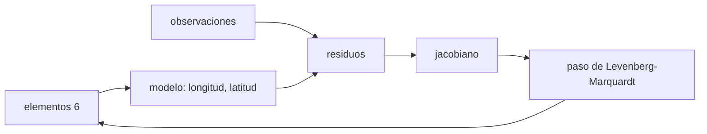

# B58-C07 — Determinación de órbitas

<!-- nav:top -->
[🏠 Programa](../../../../README.md) · [📚 Bloque B58](../../../tronco-comun/B58-asteroides-cometas-y-defensa-planetaria.md) · [← Anterior: B58-C06 — Astrometría de objetos menores](../B58-C06-astrometria-de-objetos-menores/CLASE.md) · [Siguiente: B58-C08 — Propagación de incertidumbre orbital →](../B58-C08-propagacion-de-incertidumbre-orbital/CLASE.md)
<!-- /nav -->

## 1. Ubicación, nivel y alcance

Clase 7 del bloque B58 (nivel N3). Con posiciones en el cielo se calcula una órbita. Aquí ajustas los seis elementos keplerianos de un asteroide **sintético** a 41 observaciones simuladas con el método de Levenberg–Marquardt, ves cómo el arco observado reduce la incertidumbre y contrastas con un caso sin ruido. Usas el propagador de C02 y las posiciones de C06.

## 2. Por qué esta clase existe

Una órbita ajustada es el producto central de la defensa planetaria: de ella salen las predicciones y las probabilidades. La decisión central: **¿cuántas observaciones y qué arco hacen falta para que la órbita sea fiable, y cómo se sabe que el ajuste es bueno?**

## 3. Lo que podrás hacer al terminar

1. Plantear el problema de mínimos cuadrados no lineal para los seis elementos.
2. Calcular el jacobiano por diferencias centrales.
3. Aplicar Levenberg–Marquardt y reconocer la convergencia.
4. Interpretar `χ²` por grado de libertad y la covarianza.
5. Medir el efecto del arco observado sobre `σ(a)`.
6. Verificar con un caso sin ruido.

La evidencia es la **ficha de la determinación orbital** del ejercicio 12 (sección 20).

## 4. Con qué llegas y cómo comprobarlo

1. ¿Qué son los elementos keplerianos?
2. ¿Qué es un jacobiano?
3. ¿Qué es `χ²`?
4. ¿Qué es un grado de libertad?
5. ¿Qué es una covarianza?

<details>
<summary>Ver respuestas</summary>

1. Seis números que fijan una órbita: `a, e, i, Ω, ω, M₀`. 2. La matriz de derivadas de los datos respecto de los parámetros. 3. La suma de los residuos al cuadrado ponderados por la incertidumbre. 4. Un dato independiente que sobra después de ajustar los parámetros. 5. Una matriz con las varianzas y correlaciones de los parámetros.
</details>

Con cuatro o cinco aciertos, sigue; si no, repasa los prerrequisitos.

## 5. Un caso de contexto y casos de referencia

El ejemplo conductor es un asteroide sintético con `a = 1,8 au` y `e = 0,35`. Sin ruido, el ajuste recupera los seis elementos con un error máximo de `7.3e-15` en 8 iteraciones. Con ruido de `0,5″` y 41 observaciones a lo largo de 240 días, `χ²/gl = 1.15` y `σ(a) = 1.9e-05 au`; con solo 10 observaciones (54 días) `σ(a) = 3.4e-03 au`, 180 veces mayor.

## 6. Vocabulario

La **determinación de órbitas** estima los elementos a partir de observaciones. **Levenberg–Marquardt** es un método de mínimos cuadrados que interpola entre Gauss–Newton y descenso de gradiente con un amortiguamiento `λ`. El **arco** es el intervalo de tiempo observado. Los **residuos** son observado menos calculado. La **covarianza formal** `(JᵀWJ)⁻¹` mide la incertidumbre bajo el modelo lineal.

## 7. Modelo mental: afinar un instrumento



*Descripción textual:* los elementos generan posiciones; los residuos frente a las observaciones y el jacobiano dan un paso de corrección; el ciclo se repite hasta que `χ²` deja de bajar.

Analogía: Como afinar una guitarra: se corrige cada cuerda según cuánto desafina y cómo cambia al girar la clavija. Límite: el método converge a un mínimo local; con arcos cortos hay varios mínimos casi iguales.

## 8. La explicación, paso a paso

### 8.1 El modelo

Para cada fecha se calcula la posición heliocéntrica del asteroide (Kepler), se resta la de la Tierra (circular, 1 au, simplificación didáctica) y se obtienen longitud y latitud eclípticas. El residuo es observado menos calculado, con la longitud multiplicada por `cos b`.

### 8.2 El jacobiano y el paso

Se calcula con diferencias centrales de paso `10⁻⁶`. El paso resuelve `(JᵀWJ + λ diag) δ = JᵀW r`; si `χ²` baja, se acepta y se reduce `λ`; si no, se aumenta.

### 8.3 Caso sin ruido

Con observaciones exactas el ajuste termina en `χ² = 6.8e-19` y recupera los elementos con error máximo `7.3e-15`: el código no introduce sesgo.

### 8.4 Arcos cortos y largos

Con el mismo ruido, `σ(a)` baja al crecer el arco: 10 obs. (54 d) → `3.4e-03 au`; 16 obs. (90 d) → `7.1e-04 au`; 24 obs. (138 d) → `2.1e-04 au`; 41 obs. (240 d) → `1.9e-05 au`. El factor entre el arco corto y el largo es 180.

### 8.5 Arco completo

`χ² = 87.5` con 76 grados de libertad (`χ²/gl = 1.15`). Los seis elementos quedan dentro de 4 `σ` de la verdad sintética: a +1.02 σ; e -0.96 σ; i +1.39 σ; Ω +1.21 σ; ω +0.45 σ; M₀ -0.73 σ.

## 9. Magnitudes, símbolos y unidades

| Símbolo | Qué es | Unidad | Valor / nota |
|---|---|---|---|
| `a` | semieje mayor | au | 1,8 (sintético) |
| `e` | excentricidad | — | 0,35 |
| `i, Ω, ω, M₀` | ángulos | rad | 7°, 40°, 120°, 60° |
| `σ` | ruido de cada medida | rad | 0,5″ |
| `χ²` | residuos ponderados | — | 87.5 |
| `λ` | amortiguamiento | — | adaptativo |
| `C` | covarianza | mixtas | 6 × 6 |

## 10. Convenciones y referencias

Marco eclíptico heliocéntrico; Tierra circular de 1 au; tiempo en días desde la época; observaciones sintéticas con semilla `20261109`. Sin aberración ni retardo de luz.

## 11. De dónde sale lo que afirmamos

| ID | Fuente | Localizador | Respalda | Estado |
|---|---|---|---|---|
| — | Sin fuente externa | — | relaciones estándar que verifica el laboratorio | No se consultó una fuente para esta clase |

No consultado: métodos operativos de determinación de órbitas (Gauss, Väisälä, Herget) ni software de seguimiento; el ajuste se valida con un caso sin ruido y con `χ²/gl`.

Límites: no hay fuente externa en esta clase.

## 12. Cómo ver la incertidumbre según el arco

| Magnitud | Valor |
|---|---|
| 10 obs. (54 d) | σ(a) = 3.4e-03 au |
| 16 obs. (90 d) | σ(a) = 7.1e-04 au |
| 24 obs. (138 d) | σ(a) = 2.1e-04 au |
| 41 obs. (240 d) | σ(a) = 1.9e-05 au |

Descripción larga: `σ(a)` cae de `3.4e-03` a `1.9e-05 au` al pasar de 54 a 240 días de arco.

## 13. Ejemplo trabajado: leer el ajuste de arco completo

**Paso 1 · Datos.** 41 observaciones, 82 medidas, 6 parámetros.

**Paso 2 · Ajuste.** `χ² = 87.5`, `gl = 76`.

**Paso 3 · Razón.** `χ²/gl = 1.15`, cercano a 1.

**Paso 4 · Incertidumbre.** `σ(a) = 1.9e-05 au`, `σ(e) = 3.1e-06`.

**Paso 5 · Lectura.** Un ajuste con `χ²/gl ≈ 1` es coherente con el ruido supuesto; no prueba que el modelo sea correcto.

## 14. Distintas formas de resolver lo mismo

**Mínimos cuadrados completos:** lo que se hace aquí. **Órbita preliminar con tres observaciones (Gauss):** da un punto de partida, no resuelto en el laboratorio. **Filtro secuencial:** actualiza con cada observación. Todas dan lo mismo en el caso lineal.

## 15. Práctica guiada

**Ejercicio 1 · con los pasos indicados.** Calcula los grados de libertad con 41 observaciones de 2 medidas y 6 parámetros. *Pasos:* `82 − 6`.

<details><summary>Solución comentada</summary>

`76`.
</details>

**Ejercicio 2 · con una pista.** Si `χ² = 87,5` y `gl = 76`, ¿cuánto vale `χ²/gl`?

<details><summary>Solución comentada</summary>

`1,15`.
</details>

**Ejercicio 3 · casi autónomo.** ¿Qué indica `χ²/gl` muy mayor que 1?

<details><summary>Solución comentada</summary>

Residuos mayores que el ruido supuesto: modelo incompleto o datos malos.
</details>

## 16. Práctica autónoma, transferencia e integrador

**Ejercicio 4 · autónomo.** ¿Cuánto mejora `σ(a)` entre 10 y 41 observaciones en el laboratorio?

<details><summary>Solución comentada</summary>

180 veces.
</details>

**Ejercicio 5 · autónomo.** ¿Qué pasa con `λ` si un paso baja `χ²`?

<details><summary>Solución comentada</summary>

Se reduce (se acerca a Gauss–Newton).
</details>

**Ejercicio 6 · autónomo.** ¿Por qué se multiplica la longitud por `cos b`?

<details><summary>Solución comentada</summary>

Para medir el residuo en arco de círculo máximo.
</details>

**Ejercicio 7 · autónomo.** Convierte `0,5″` a radianes.

<details><summary>Solución comentada</summary>

`2,42×10⁻⁶ rad`.
</details>

**Ejercicio 8 · autónomo.** ¿Qué es el residuo de una observación?

<details><summary>Solución comentada</summary>

Observado menos calculado.
</details>

**Ejercicio 9 · transferencia.** **Transferencia.** Un arco muy corto da varias órbitas compatibles. ¿Qué haría el observador?

<details><summary>Solución comentada</summary>

Alargar el arco con observaciones de seguimiento (C11).
</details>

**Ejercicio 10 · transferencia.** **Transferencia.** ¿Qué efecto tiene un error sistemático de 0,3″ en todas las posiciones?

<details><summary>Solución comentada</summary>

`χ²` no lo detecta bien; sesga los elementos.
</details>

**Ejercicio 11 · transferencia.** **Transferencia.** ¿Por qué el ajuste usa observaciones de una Tierra circular y no de una real?

<details><summary>Solución comentada</summary>

Es una simplificación declarada; con efemérides reales cambia la geometría y la precisión.
</details>

**Ejercicio 12 · integrador.** **Integrador.** Elabora tu *ficha de la determinación orbital*: elementos ajustados, `χ²/gl`, `σ` y efecto del arco.

<details><summary>Solución comentada</summary>

Secciones 8.3–8.5.
</details>

## 17. Laboratorio: ajuste de la órbita de un asteroide sintético

El script [orbita.py](orbita.py) ajusta seis elementos a observaciones sintéticas con Levenberg–Marquardt y mide el efecto del arco (**comprueba** error 10⁻⁸ sin ruido, `χ²/gl` entre 0,6 y 1,5 y cada elemento dentro de 4 `σ`).

**Datos:** asteroide y observaciones **sintéticos**; semilla `20261109`. **Predice antes de ejecutar:** ¿Cuántas veces mejorará σ(a) entre 10 y 41 observaciones? **Ejecución del 2026-11-09:**

```text
Python 3.12.9 (biblioteca estandar)
Sin ruido: iteraciones = 8 ; chi2 final = 6.78e-19 ; error maximo de elementos = 7.33e-15
   n arco[d]  iter      chi2    gl sigma(a)[au]     sigma(e) sigma(i)[rad]
  10      54    56     23.28    14     3.42e-03     2.34e-04     1.57e-05
  16      90    22     44.98    26     7.06e-04     8.71e-05     3.13e-06
  24     138    10     63.82    42     2.10e-04     3.90e-05     1.22e-06
  41     240     7     87.55    76     1.90e-05     3.13e-06     4.25e-07
Arco completo (41 observaciones): elementos ajustados frente a la verdad sintetica
  a [au]       ajuste = 1.8000193 ; verdad = 1.8000000 ; diferencia = +1.93e-05 = +1.02 sigma
  e            ajuste = 0.3499970 ; verdad = 0.3500000 ; diferencia = -3.00e-06 = -0.96 sigma
  i [rad]      ajuste = 0.1221736 ; verdad = 0.1221730 ; diferencia = +5.91e-07 = +1.39 sigma
  Omega [rad]  ajuste = 0.6981458 ; verdad = 0.6981317 ; diferencia = +1.41e-05 = +1.21 sigma
  omega [rad]  ajuste = 2.0944053 ; verdad = 2.0943951 ; diferencia = +1.01e-05 = +0.45 sigma
  M0 [rad]     ajuste = 1.0471821 ; verdad = 1.0471976 ; diferencia = -1.55e-05 = -0.73 sigma
Pruebas superadas.
```

```bash
python programa/clases/B58/B58-C07-determinacion-de-orbitas/orbita.py
```

**Límites:** dos cuerpos, Tierra circular, sin aberración ni retardo de luz; covarianza formal lineal.

## 18. Errores frecuentes y cómo corregirlos

**Creer que `χ²/gl ≈ 1` prueba el modelo.** Se corrige con 8.5.

**Ignorar el efecto del arco.** Se corrige con 8.4.

**Partir de una estimación inicial lejana.** Se corrige con 8.2.

**Presentar el resultado como una órbita real.** Se corrige con la sección 10.

## 19. Cómo sabrás que vas bien

Tras la sección 8: ¿qué mejora esperabas del arco largo y cuál obtuviste? Si dudas, repasa el ejemplo 13. Tras el laboratorio: ¿qué comprueba? (ver la sección 17).

## 20. Qué entregas y cómo se evalúa

El producto es tu **ficha de la determinación orbital** (ejercicio 12).

| Criterio | Inicial | En desarrollo | Logrado | Destacado |
|---|---|---|---|---|
| Conceptos | Los confunde | Parciales | Conceptos de la clase | Explica los límites |
| Cálculo | Sin unidades | Con errores | Tablas completas | Calcula casos nuevos |
| Numérico | Sin comprobar | Un caso | Contraste con el análisis | Interpreta las diferencias |
| Fuentes | Sin fuente | Sin fecha | Fuentes con fecha | Declara lo no consultado |
| Límites | No los nombra | Uno | Tres | Discute qué falta del modelo |

**Condiciones críticas (no se compensan con promedio):** rotular el asteroide y las observaciones como sintéticos; no presentar la órbita ajustada como la de un objeto real; declarar lo no consultado.

## 21. Ética, seguridad y límites

Clase educativa: los modelos son simplificados y los datos, sintéticos; nada de lo calculado evalúa un objeto real ni sustituye a los sistemas oficiales de monitoreo y alerta.  Accesibilidad: tablas equivalentes a las gráficas, fórmulas en texto, ejercicios sin conexión.

## 22. Para cerrar y seguir

El ajuste recupera los elementos sin ruido con `7.3e-15` y con ruido deja `χ²/gl = 1.15` y `σ(a) = 1.9e-05 au`. Queda una pregunta: ¿cómo viaja esa incertidumbre hacia el futuro?

**Glosario español–inglés.** determinación de órbitas · *orbit determination*; mínimos cuadrados · *least squares*; jacobiano · *Jacobian*; arco observado · *observed arc*; covarianza · *covariance*.

**Continuidad.** [B58-C08](../B58-C08-propagacion-de-incertidumbre-orbital/CLASE.md) estudia propagación de incertidumbre orbital.

**Referencias:** ver sección 11.

<!-- nav:bottom -->
---

[← Anterior: B58-C06 — Astrometría de objetos menores](../B58-C06-astrometria-de-objetos-menores/CLASE.md) · [📚 Bloque B58](../../../tronco-comun/B58-asteroides-cometas-y-defensa-planetaria.md) · [Siguiente: B58-C08 — Propagación de incertidumbre orbital →](../B58-C08-propagacion-de-incertidumbre-orbital/CLASE.md)
<!-- /nav -->
