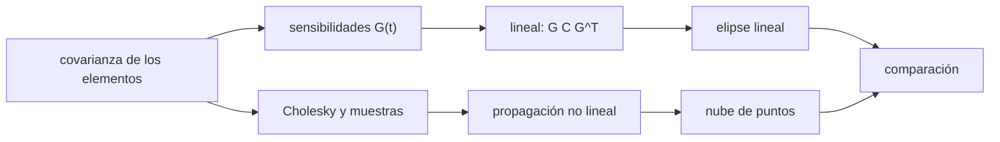

# B58-C08 — Propagación de incertidumbre orbital

<!-- nav:top -->
[🏠 Programa](../../../../README.md) · [📚 Bloque B58](../../../tronco-comun/B58-asteroides-cometas-y-defensa-planetaria.md) · [← Anterior: B58-C07 — Determinación de órbitas](../B58-C07-determinacion-de-orbitas/CLASE.md) · [Siguiente: B58-C09 — Probabilidades de impacto →](../B58-C09-probabilidades-de-impacto/CLASE.md)
<!-- /nav -->

## 1. Ubicación, nivel y alcance

Clase 8 del bloque B58 (nivel N3). Una órbita sin incertidumbre no es una predicción. Aquí tomas la covarianza del ajuste de C07, la propagas a la posición del cielo en fechas futuras por la vía lineal y por Monte Carlo y ves cuándo la aproximación lineal deja de valer. Todo con el asteroide **sintético** de C07.

## 2. Por qué esta clase existe

La incertidumbre tiende a crecer con el tiempo y se estira a lo largo de la órbita, aunque la geometría con la Tierra la modula. La decisión central: **¿cuánto se estira la región de búsqueda en cada fecha y hasta cuándo sirve la covarianza lineal?**

## 3. Lo que podrás hacer al terminar

1. Propagar una covarianza con la matriz de sensibilidades `G`.
2. Obtener el semieje mayor y menor de la elipse del cielo.
3. Muestrear con el factor de Cholesky y propagar sin linealizar.
4. Comparar ambas vías y reconocer la no linealidad.
5. Calcular qué fracción de muestras cae dentro de la elipse de 3 σ.
6. Distinguir covarianza formal de incertidumbre real.

La evidencia es la **ficha de la incertidumbre** del ejercicio 12 (sección 20).

## 4. Con qué llegas y cómo comprobarlo

1. ¿Qué es una covarianza?
2. ¿Qué es una propagación lineal?
3. ¿Qué es Monte Carlo?
4. ¿Qué es una elipse de confianza?
5. ¿Qué es el factor de Cholesky?

<details>
<summary>Ver respuestas</summary>

1. Matriz de varianzas y correlaciones. 2. Aproximar la salida por su derivada: `C_y = G C_x Gᵀ`. 3. Repetir el cálculo con muestras aleatorias de semilla fija. 4. La región con cierta probabilidad de contener el valor verdadero. 5. Una matriz triangular `L` con `L Lᵀ = C`, útil para muestrear.
</details>

Con cuatro o cinco aciertos, sigue; si no, repasa los prerrequisitos.

## 5. Un caso de contexto y casos de referencia

El ejemplo conductor es la covarianza de C07 (`σ(a) = 1.9e-05 au`). A 300 días de la época, el semieje mayor de la elipse del cielo mide `0.57″` por vía lineal y `0.58″` por Monte Carlo (cociente `1.023`). A 2400 días son `53″` y `53″` (cociente `1.016`): para este objeto la aproximación lineal sigue valiendo; se esperaba que se degradara y no ocurrió. La fracción de muestras dentro de la elipse lineal de 3 σ es `0.9860` frente a `0.9889` esperado.

## 6. Vocabulario

La **matriz de sensibilidades** `G` contiene las derivadas de la posición en el cielo respecto de los elementos. La **elipse de incertidumbre** es el contorno de probabilidad constante. La **propagación lineal** usa `G` en la fecha futura. **Monte Carlo** propaga muestras con el modelo no lineal. La **incertidumbre a lo largo de la traza** (*along-track*) crece más que la transversal porque un error en el periodo se acumula con el tiempo.

## 7. Modelo mental: una nube de globos



*Descripción textual:* la covarianza de los elementos se traslada al cielo de dos maneras, por derivadas y por muestras, y se comparan elipse y nube.

Analogía: Como soltar globos desde un punto con distinto viento: la nube se estira en la dirección del viento dominante. Límite: la elipse lineal supone que la nube sigue siendo una gaussiana; en casos extremos la nube se curva en forma de banana y la elipse deja de valer.

## 8. La explicación, paso a paso

### 8.1 La covarianza de los elementos

De C07: `C = (JᵀWJ)⁻¹` con `σ(a) = 1.90e-05 au`. Es la covarianza **formal**, válida si el modelo es lineal y el ruido gaussiano.

### 8.2 Propagación lineal

Para una fecha `t`, `G` es la matriz 2×6 de derivadas de (`Δλ cos β`, `Δβ`) en arcsec por unidad de cada elemento, por diferencias centrales de paso `10⁻⁶`. La covarianza en el cielo es `S = G C Gᵀ`; sus autovalores dan los semiejes al cuadrado.

### 8.3 Monte Carlo

Se generan 3000 conjuntos de elementos `el + L z`, con `z` normal estándar y `L` el factor de Cholesky de `C`, y se propaga cada uno con el modelo completo. Se mide la covarianza muestral en el cielo.

### 8.4 Resultados

A 300 días: lineal `0.57″`, Monte Carlo `0.58″`, cociente `1.023`, semieje menor `0.17″`, dentro de 3 σ lineal `0.9860`.
A 600 días: lineal `13.92″`, Monte Carlo `14.11″`, cociente `1.014`, semieje menor `0.19″`, dentro de 3 σ lineal `0.9887`.
A 1200 días: lineal `8.38″`, Monte Carlo `8.51″`, cociente `1.016`, semieje menor `0.11″`, dentro de 3 σ lineal `0.9860`.
A 2400 días: lineal `52.61″`, Monte Carlo `53.46″`, cociente `1.016`, semieje menor `0.12″`, dentro de 3 σ lineal `0.9890`.

### 8.5 Lectura

El semieje mayor pasa de `0.57″` a 300 días a `53″` a 2400 días, pero **no crece de forma monótona**: a 600 días es `13.9″` y a 1200 días `8.4″`, porque el cielo geocéntrico depende de la distancia a la Tierra y de la fase orbital. El semieje menor permanece entre `0.11″` y `0.19″`: la región es una elipse muy alargada. En las cuatro fechas el cociente Monte Carlo/lineal queda entre `1.014` y `1.023`; si se apartara de 1 habría que usar muestras. Los valores son de un objeto sintético con ruido sintético.

## 9. Magnitudes, símbolos y unidades

| Símbolo | Qué es | Unidad | Valor / nota |
|---|---|---|---|
| `C` | covarianza de los 6 elementos | mixtas | 6 × 6 |
| `G` | sensibilidades del cielo | ″ por unidad de elemento | 2 × 6 |
| `S` | covarianza en el cielo | ″² | 2 × 2 |
| `t` | días desde la época | d | 300 – 2400 |
| `N` | muestras | — | 3000 |
| `σ` | semieje de la elipse | ″ | 0.57 a 300 d |

## 10. Convenciones y referencias

Cielo geocéntrico en longitud y latitud eclípticas con Tierra circular; elementos del ajuste de C07 (semilla `20261109`); desplazamientos respecto de la posición nominal. Datos sintéticos.

## 11. De dónde sale lo que afirmamos

| ID | Fuente | Localizador | Respalda | Estado |
|---|---|---|---|---|
| — | Sin fuente externa | — | relaciones estándar que verifica el laboratorio | No se consultó una fuente para esta clase |

No consultado: tratamientos de la incertidumbre orbital en la literatura de defensa planetaria (elipsoides de confianza, líneas de variación); el contraste es interno (lineal frente a Monte Carlo).

Límites: ninguna fuente externa.

## 12. Cómo ver la elipse de incertidumbre

| Magnitud | Valor |
|---|---|
| 300 d: lineal / MC | 0.6″ / 0.6″ |
| 600 d: lineal / MC | 13.9″ / 14.1″ |
| 1200 d: lineal / MC | 8.4″ / 8.5″ |
| 2400 d: lineal / MC | 52.6″ / 53.5″ |

Descripción larga: el semieje mayor va de `0.6″` a `53″` sin crecer de forma monótona y el cociente MC/lineal se mantiene cerca de 1.

## 13. Ejemplo trabajado: leer la fila de 300 días

**Paso 1 · Lineal.** `0.57″` (semieje mayor).

**Paso 2 · Monte Carlo.** `0.58″`.

**Paso 3 · Cociente.** `1.023`: coinciden dentro de 10 %.

**Paso 4 · Dentro de 3 σ.** `0.9860` frente a `0.9889`.

**Paso 5 · Decisión.** A 300 días la elipse lineal es una descripción aceptable.

## 14. Distintas formas de resolver lo mismo

**Lineal:** rápida y exacta si la nube es gaussiana. **Monte Carlo:** no hace supuestos, cuesta más. **Líneas de variación:** muestrean solo el eje largo (no hechas aquí). Se compara la primera con la segunda para decidir cuándo basta la lineal.

## 15. Práctica guiada

**Ejercicio 1 · con los pasos indicados.** Calcula la fracción de una gaussiana 2D dentro de 3 σ. *Pasos:* `1 − exp(−9/2)`.

<details><summary>Solución comentada</summary>

`0.9889`.
</details>

**Ejercicio 2 · con una pista.** ¿Qué mide un cociente MC/lineal igual a 1,05?

<details><summary>Solución comentada</summary>

Que Monte Carlo da una elipse 5 % mayor.
</details>

**Ejercicio 3 · casi autónomo.** ¿Por qué el semieje mayor es mucho mayor que el menor?

<details><summary>Solución comentada</summary>

El error de periodo se acumula a lo largo de la traza con el tiempo.
</details>

## 16. Práctica autónoma, transferencia e integrador

**Ejercicio 4 · autónomo.** Con `S` de autovalores `λ₁ = 400` y `λ₂ = 1` (″²), ¿cuáles son los semiejes?

<details><summary>Solución comentada</summary>

`20″` y `1″`.
</details>

**Ejercicio 5 · autónomo.** ¿Cuántas muestras usa el laboratorio?

<details><summary>Solución comentada</summary>

3000.
</details>

**Ejercicio 6 · autónomo.** ¿Qué se necesita para muestrear con Cholesky?

<details><summary>Solución comentada</summary>

Una covarianza definida positiva.
</details>

**Ejercicio 7 · autónomo.** Si `G` se duplicara, ¿qué pasa con los semiejes?

<details><summary>Solución comentada</summary>

Se duplican.
</details>

**Ejercicio 8 · autónomo.** ¿Qué indica una fracción dentro de 3 σ de 0,90 en lugar de 0,989?

<details><summary>Solución comentada</summary>

La nube no es gaussiana: la elipse lineal subestima.
</details>

**Ejercicio 9 · transferencia.** **Transferencia.** ¿Por qué un objeto con arco corto puede perderse tras un año?

<details><summary>Solución comentada</summary>

Su región de búsqueda puede ser tan alargada que excede el campo de los telescopios (cf. `σ(a)` en C07).
</details>

**Ejercicio 10 · transferencia.** **Transferencia.** Un colega usa la elipse lineal a 8 años. ¿Qué verificas?

<details><summary>Solución comentada</summary>

Que el cociente MC/lineal siga cerca de 1; para este objeto vale `1.016` a 2400 días, pero en general debe comprobarse.
</details>

**Ejercicio 11 · transferencia.** **Transferencia.** ¿Qué observación reduciría más la elipse?

<details><summary>Solución comentada</summary>

Una a mayor distancia temporal (alargar el arco).
</details>

**Ejercicio 12 · integrador.** **Integrador.** Elabora tu *ficha de la incertidumbre*: semiejes lineales y Monte Carlo a cuatro fechas y la fracción dentro de 3 σ.

<details><summary>Solución comentada</summary>

Secciones 8.4–8.5.
</details>

## 17. Laboratorio: propagación lineal y Monte Carlo

El script [incertidumbre.py](incertidumbre.py) propaga la covarianza de un ajuste a cuatro fechas por vía lineal y con 3000 muestras (**comprueba** 5 % en las cuatro fechas y fracción en 3 σ entre 0,97 y 1,0 a 300 días).

**Datos:** objeto y observaciones **sintéticos**; semilla `20261109`. **Predice antes de ejecutar:** ¿A partir de qué fecha diferirán más de 10 % la vía lineal y Monte Carlo? (se esperaba que a plazos largos; no ocurrió en las cuatro fechas.) **Ejecución del 2026-11-09:**

```text
Python 3.12.9 (biblioteca estandar)
Elementos ajustados con 41 observaciones: sigma(a) = 1.90e-05 au ; chi2 = 87.5
  t[d]  sigma mayor lin   sigma mayor MC     MC/lin    sigma menor dentro 3 sigma lin
   300           0.57"           0.58"      1.023         0.17"             0.9860
   600          13.92"          14.11"      1.014         0.19"             0.9887
  1200           8.38"           8.51"      1.016         0.11"             0.9860
  2400          52.61"          53.46"      1.016         0.12"             0.9890
Fraccion esperada dentro de la elipse de 3 sigma (2D, gaussiana) = 0.9889
Pruebas superadas.
```

```bash
python programa/clases/B58/B58-C08-propagacion-de-incertidumbre-orbital/incertidumbre.py
```

**Límites:** covarianza formal; dos cuerpos; la no linealidad se muestra, no se corrige.

## 18. Errores frecuentes y cómo corregirlos

**Usar la elipse lineal a plazos largos.** Se corrige con 8.4.

**Confundir covarianza formal con incertidumbre real.** Se corrige con 8.1.

**Ignorar la correlación entre elementos.** Se corrige con 8.2.

**Presentar la nube como un objeto real.** Se corrige con la sección 10.

## 19. Cómo sabrás que vas bien

Tras la sección 8: ¿qué cociente esperabas a 2400 días y cuál obtuviste? Si dudas, repasa el ejemplo 13. Tras el laboratorio: ¿qué comprueba? (ver la sección 17).

## 20. Qué entregas y cómo se evalúa

El producto es tu **ficha de la incertidumbre** (ejercicio 12).

| Criterio | Inicial | En desarrollo | Logrado | Destacado |
|---|---|---|---|---|
| Conceptos | Los confunde | Parciales | Conceptos de la clase | Explica los límites |
| Cálculo | Sin unidades | Con errores | Tablas completas | Calcula casos nuevos |
| Numérico | Sin comprobar | Un caso | Contraste con el análisis | Interpreta las diferencias |
| Fuentes | Sin fuente | Sin fecha | Fuentes con fecha | Declara lo no consultado |
| Límites | No los nombra | Uno | Tres | Discute qué falta del modelo |

**Condiciones críticas (no se compensan con promedio):** rotular el objeto como sintético; no presentar la elipse como la de un objeto real; declarar lo no consultado.

## 21. Ética, seguridad y límites

Clase educativa: los modelos son simplificados y los datos, sintéticos; nada de lo calculado evalúa un objeto real ni sustituye a los sistemas oficiales de monitoreo y alerta.  Accesibilidad: tablas equivalentes a las gráficas, fórmulas en texto, ejercicios sin conexión.

## 22. Para cerrar y seguir

El semieje mayor va de `0.6″` a `53″` entre 300 y 2400 días sin crecer de forma monótona, y la vía lineal coincide con Monte Carlo a menos de 3 %. Queda una pregunta: ¿cómo se pasa de esa región a una probabilidad de impacto?

**Glosario español–inglés.** covarianza · *covariance*; propagación lineal · *linear propagation*; elipse de incertidumbre · *uncertainty ellipse*; factor de Cholesky · *Cholesky factor*; a lo largo de la traza · *along-track*.

**Continuidad.** [B58-C09](../B58-C09-probabilidades-de-impacto/CLASE.md) estudia probabilidades de impacto.

**Referencias:** ver sección 11.

<!-- nav:bottom -->
---

[← Anterior: B58-C07 — Determinación de órbitas](../B58-C07-determinacion-de-orbitas/CLASE.md) · [📚 Bloque B58](../../../tronco-comun/B58-asteroides-cometas-y-defensa-planetaria.md) · [Siguiente: B58-C09 — Probabilidades de impacto →](../B58-C09-probabilidades-de-impacto/CLASE.md)
<!-- /nav -->
