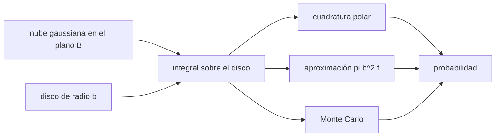

# B58-C09 — Probabilidades de impacto

<!-- nav:top -->
[🏠 Programa](../../../../README.md) · [📚 Bloque B58](../../../tronco-comun/B58-asteroides-cometas-y-defensa-planetaria.md) · [← Anterior: B58-C08 — Propagación de incertidumbre orbital](../B58-C08-propagacion-de-incertidumbre-orbital/CLASE.md) · [Siguiente: B58-C10 — Escalas de peligrosidad →](../B58-C10-escalas-de-peligrosidad/CLASE.md)
<!-- /nav -->

## 1. Ubicación, nivel y alcance

Clase 9 del bloque B58 (nivel N3). Una probabilidad de impacto es el área bajo una gaussiana sobre el disco que representa la Tierra en el plano B. Aquí calculas esa integral por tres vías (cuadratura polar, aproximación de disco pequeño y Monte Carlo), la contrastas con un caso exacto y ves cómo cae la probabilidad al alejarse el centro. Todo en un escenario **sintético**; usas la incertidumbre de C08.

## 2. Por qué esta clase existe

La probabilidad de impacto resume la incertidumbre en un número que alimenta las escalas (C10) y las decisiones (C17–C19). La decisión central: **¿qué área de la nube de posibles posiciones cae sobre la Tierra, y cuánto cambia si la nube se achica o se desplaza?**

## 3. Lo que podrás hacer al terminar

1. Definir el plano B y el radio efectivo con enfoque gravitatorio.
2. Escribir la densidad gaussiana bidimensional.
3. Integrar sobre el disco por cuadratura y por Monte Carlo.
4. Aplicar la aproximación de disco pequeño y reconocer cuándo falla.
5. Contrastar con el caso exacto de centro cero.
6. Explicar por qué la probabilidad cae al alejarse el centro.

La evidencia es la **ficha de probabilidad de impacto** del ejercicio 12 (sección 20).

## 4. Con qué llegas y cómo comprobarlo

1. ¿Qué es una densidad de probabilidad?
2. ¿Qué es una gaussiana 2D?
3. ¿Qué es la velocidad de escape?
4. ¿Qué es el enfoque gravitatorio?
5. ¿Qué es un error binomial?

<details>
<summary>Ver respuestas</summary>

1. Una función cuya integral sobre una región da su probabilidad. 2. Una campana en el plano con desviaciones `σ₁` y `σ₂`. 3. La velocidad mínima para alejarse sin retorno desde la superficie. 4. El aumento del área efectiva de captura por la atracción del cuerpo. 5. `√(P(1−P)/N)` para una frecuencia de `N` ensayos.
</details>

Con cuatro o cinco aciertos, sigue; si no, repasa los prerrequisitos.

## 5. Un caso de contexto y casos de referencia

El ejemplo conductor es un escenario sintético: nube de desviaciones `(12 000; 3000) km` y centro a `(15 000; 4000) km`. El radio efectivo del blanco es `b = 8719 km` (`R = 6378 km` más enfoque, factor `1.869` en área). La cuadratura da `P = 2.164e-01`, Monte Carlo (1,5 millones) `2.171e-01 ± 3e-04` y la aproximación de disco pequeño `1.988e-01` (cociente `0.92`). Con el centro a 0 y `σ` igual el caso exacto es `1 − exp(−b²/2σ²) = 0.90707`.

## 6. Vocabulario

El **plano B** es el plano perpendicular a la velocidad relativa del objeto en el infinito y que pasa por el centro de la Tierra. El **radio efectivo** `b = R√(1 + v_esc²/v_∞²)` incluye el enfoque gravitatorio. La **probabilidad de impacto** es la integral de la densidad sobre el disco. La **cuadratura** es una integral numérica. Un **encuentro rápido** es aquel en que la geometría se resume en el plano B.

## 7. Modelo mental: tirar dardos a un blanco



*Descripción textual:* la nube gaussiana y el disco terrestre se integran por tres vías que deben coincidir.

Analogía: Como tirar dardos con puntería dispersa: la probabilidad de acertar depende del tamaño del blanco y de cuánto apunta hacia él. Límite: la nube real se curva y puede tener varios máximos; la gaussiana es una aproximación.

## 8. La explicación, paso a paso

### 8.1 El plano B y el radio efectivo

Con `R = 6378,137 km`, `v_esc = 11,186 km/s` y `v_∞ = 12 km/s` (valores recordados y supuestos, no consultados), `b = R√(1 + (v_esc/v_∞)²) = 8719.5 km`.

### 8.2 La integral

La densidad es `f(x, y) = exp(−½[((x−c₁)/σ₁)² + ((y−c₂)/σ₂)²])/(2πσ₁σ₂)`; `P = ∬_{x²+y²≤b²} f dx dy`. La cuadratura polar usa 400 radios × 720 ángulos.

### 8.3 Caso de control

Si el centro es `0` y `σ₁ = σ₂ = σ`, la integral es exacta: `P = 1 − exp(−b²/2σ²)`. Con `σ = 4000 km`: exacto `0.90707106`, cuadratura `0.90707272`.

### 8.4 Las tres vías

Cuadratura `2.1637e-01`; Monte Carlo `2.1706e-01` (diferencia de `+2.05` errores binomiales); aproximación `πb² f(0)` `1.9875e-01`, que sobreestima o subestima porque `f` varía mucho en un disco de 0.73 `σ₁`. Para un disco de 500 km: `6.5538e-04` frente a `6.5354e-04`, coincidiendo a 1 %.

### 8.5 Caída con el desplazamiento

Al mover el centro sobre el eje 1: `d = 0 mil km → 5.01e-01`; `d = 6 mil km → 4.50e-01`; `d = 12 mil km → 3.27e-01`; `d = 24 mil km → 8.99e-02`; `d = 36 mil km → 1.02e-02`. La probabilidad cae porque el disco se aleja del máximo de la nube. Si observaciones nuevas achican la nube (C08, C11) y el disco queda dentro, la probabilidad sube; si queda fuera, baja hacia cero (C19).

## 9. Magnitudes, símbolos y unidades

| Símbolo | Qué es | Unidad | Valor / nota |
|---|---|---|---|
| `b` | radio efectivo del blanco | km | 8719 |
| `R` | radio terrestre ecuatorial | km | 6378,137 |
| `v_esc`, `v_∞` | escape y aproximación | km/s | 11,186; 12 |
| `σ₁, σ₂` | desviaciones de la nube | km | 12 000; 3000 |
| `c` | centro de la nube | km | (15 000; 4000) |
| `P` | probabilidad de impacto | — | 2.16e-01 |
| `N` | muestras Monte Carlo | — | 1 500 000 |

## 10. Convenciones y referencias

Plano B con ejes alineados con la nube; unidades en km; semilla `20261109`; encuentro rápido. El escenario es sintético y no representa ningún objeto.

## 11. De dónde sale lo que afirmamos

| ID | Fuente | Localizador | Respalda | Estado |
|---|---|---|---|---|
| — | Sin fuente externa | — | relaciones estándar que verifica el laboratorio | No se consultó una fuente para esta clase |

No consultado: el tratamiento del plano B y de los "ojos de cerradura" en la literatura; el radio terrestre y la velocidad de escape provienen de la memoria del autor; el laboratorio verifica la integral con el caso exacto y con Monte Carlo.

Límites: sin fuente externa; el escenario es ilustrativo.

## 12. Cómo ver las tres estimaciones

| Magnitud | Valor |
|---|---|
| cuadratura | 2.1637e-01 |
| Monte Carlo | 2.1706e-01 ± 3e-04 |
| aproximación | 1.9875e-01 |
| control exacto / cuadratura | 0.907071 / 0.907073 |

Descripción larga: la cuadratura y Monte Carlo coinciden dentro del error binomial; la aproximación solo vale para discos pequeños.

## 13. Ejemplo trabajado: el caso de control

**Paso 1 · Datos.** `b = 8719 km`, `σ = 4000 km`, centro 0.

**Paso 2 · Exponente.** `b²/(2σ²) = 2.3759`.

**Paso 3 · Probabilidad.** `P = 1 − e^(−x) = 0.90707`.

**Paso 4 · Cuadratura.** `0.90707`: coincide a 10⁻⁵.

## 14. Distintas formas de resolver lo mismo

**Cuadratura:** precisa y determinista. **Monte Carlo:** no requiere forma del blanco, pero con `P` pequeña necesita muchas muestras. **Aproximación de disco pequeño:** una línea de cálculo, válida solo si la densidad es casi constante en el disco. Se compara la tercera con la primera.

## 15. Práctica guiada

**Ejercicio 1 · con los pasos indicados.** Calcula `b` con `v_esc = 11,186` y `v_∞ = 12`. *Pasos:* factor `√(1 + 0,869)`.

<details><summary>Solución comentada</summary>

`8719 km`.
</details>

**Ejercicio 2 · con una pista.** ¿Qué probabilidad da el caso exacto con `b = σ`? *Pista:* `1 − exp(−½)`.

<details><summary>Solución comentada</summary>

`0,3935`.
</details>

**Ejercicio 3 · casi autónomo.** ¿Cuál es el factor de enfoque en área?

<details><summary>Solución comentada</summary>

`1.869`.
</details>

## 16. Práctica autónoma, transferencia e integrador

**Ejercicio 4 · autónomo.** Con `P = 10⁻⁴`, ¿cuántos impactos esperas en 10⁶ nubes iguales?

<details><summary>Solución comentada</summary>

100.
</details>

**Ejercicio 5 · autónomo.** ¿Cuántas muestras hacen falta para estimar `P = 10⁻⁴` con error del 10 %?

<details><summary>Solución comentada</summary>

`N = (1−P)/(P·0,01) ≈ 10⁶`.
</details>

**Ejercicio 6 · autónomo.** ¿Qué pasa con `P` si `σ₁` se reduce a la mitad y el disco queda centrado?

<details><summary>Solución comentada</summary>

Sube hasta acercarse a 1.
</details>

**Ejercicio 7 · autónomo.** ¿Qué pasa con `P` si el disco queda fuera de la nube reducida?

<details><summary>Solución comentada</summary>

Cae casi a cero.
</details>

**Ejercicio 8 · autónomo.** ¿Por qué la aproximación falla para el disco de la Tierra?

<details><summary>Solución comentada</summary>

Porque `b` (≈ 0,7 `σ₁`) no es pequeño frente a la escala de variación de `f`.
</details>

**Ejercicio 9 · transferencia.** **Transferencia.** Un colega dice que `P = 1/10 000` significa que ocurrirá en 10 000 ocasiones. Respóndele.

<details><summary>Solución comentada</summary>

Es una frecuencia sobre muchos casos iguales, no un plazo; en este caso solo hay un objeto (C19).
</details>

**Ejercicio 10 · transferencia.** **Transferencia.** ¿Qué cambia si la nube tiene una cola más pesada que una gaussiana?

<details><summary>Solución comentada</summary>

Las probabilidades pequeñas aumentan; la gaussiana las subestima.
</details>

**Ejercicio 11 · transferencia.** **Transferencia.** ¿Por qué incluir el enfoque gravitatorio?

<details><summary>Solución comentada</summary>

Porque la trayectoria se curva y el área efectiva de captura es mayor que el disco geométrico.
</details>

**Ejercicio 12 · integrador.** **Integrador.** Elabora tu *ficha de probabilidad de impacto*: `b`, las tres estimaciones, el control exacto y la curva `P(d)`.

<details><summary>Solución comentada</summary>

Secciones 8.1–8.5.
</details>

## 17. Laboratorio: probabilidad de impacto en el plano B

El script [probabilidad.py](probabilidad.py) integra una gaussiana sobre el disco efectivo por cuadratura, aproximación y Monte Carlo (**comprueba** el control exacto con 10⁻⁵, Monte Carlo dentro de 3 errores y la aproximación a 1 % para b = 500 km).

**Datos:** escenario **sintético**; `R` y `v_esc` recordados, no consultados. **Predice antes de ejecutar:** ¿Sobreestimará o subestimará la aproximación del disco a la cuadratura? **Ejecución del 2026-11-09:**

```text
Python 3.12.9 (biblioteca estandar)
Radio efectivo del blanco b = 8719.5 km (R = 6378.137 km ; factor de enfoque b^2/R^2 = 1.8689)
Control (centro 0, sigma 4000 km): exacto = 0.90707106 ; cuadratura = 0.90707272
Escenario: cuadratura = 2.163703e-01 ; aproximacion pi b^2 f(centro) = 1.987546e-01 ; Monte Carlo (1500000) = 2.170580e-01 +- 3.4e-04
Diferencia Monte Carlo - cuadratura = +2.05 errores binomiales ; aproximacion / cuadratura = 0.9186
Disco pequeno b = 500 km: cuadratura = 6.553779e-04 ; aproximacion = 6.535449e-04 ; cociente = 0.99720
P frente al desplazamiento del centro en el eje 1 (sigma1 = 12000 km):
  d1 =      0 km  ->  P = 5.0083e-01
  d1 =   6000 km  ->  P = 4.5022e-01
  d1 =  12000 km  ->  P = 3.2684e-01
  d1 =  24000 km  ->  P = 8.9876e-02
  d1 =  36000 km  ->  P = 1.0153e-02
Pruebas superadas.
```

```bash
python programa/clases/B58/B58-C09-probabilidades-de-impacto/probabilidad.py
```

**Límites:** encuentro rápido, gaussiana exacta, sin correlaciones, sin ojos de cerradura.

## 18. Errores frecuentes y cómo corregirlos

**Usar el radio geométrico en vez del efectivo.** Se corrige con 8.1.

**Aplicar la aproximación a discos grandes.** Se corrige con 8.4.

**Leer `P` como un plazo.** Se corrige con 8.5.

**Presentar el escenario como real.** Se corrige con la sección 10.

## 19. Cómo sabrás que vas bien

Tras la sección 8: ¿qué esperabas del cociente aproximación/cuadratura y cuál obtuviste? Si dudas, repasa el ejemplo 13. Tras el laboratorio: ¿qué comprueba? (ver la sección 17).

## 20. Qué entregas y cómo se evalúa

El producto es tu **ficha de probabilidad de impacto** (ejercicio 12).

| Criterio | Inicial | En desarrollo | Logrado | Destacado |
|---|---|---|---|---|
| Conceptos | Los confunde | Parciales | Conceptos de la clase | Explica los límites |
| Cálculo | Sin unidades | Con errores | Tablas completas | Calcula casos nuevos |
| Numérico | Sin comprobar | Un caso | Contraste con el análisis | Interpreta las diferencias |
| Fuentes | Sin fuente | Sin fecha | Fuentes con fecha | Declara lo no consultado |
| Límites | No los nombra | Uno | Tres | Discute qué falta del modelo |

**Condiciones críticas (no se compensan con promedio):** rotular el escenario como sintético; no presentar una probabilidad de laboratorio como la de un objeto real; declarar lo no consultado.

## 21. Ética, seguridad y límites

Clase educativa: los modelos son simplificados y los datos, sintéticos; nada de lo calculado evalúa un objeto real ni sustituye a los sistemas oficiales de monitoreo y alerta.  Accesibilidad: tablas equivalentes a las gráficas, fórmulas en texto, ejercicios sin conexión.

## 22. Para cerrar y seguir

La integral da `P = 2.16e-01` por cuadratura y `2.17e-01` por Monte Carlo en un escenario sintético. Queda una pregunta: ¿cómo se comunica un número así con una escala?

**Glosario español–inglés.** plano B · *B-plane*; radio efectivo · *effective radius*; enfoque gravitatorio · *gravitational focusing*; probabilidad de impacto · *impact probability*; cuadratura · *quadrature*.

**Continuidad.** [B58-C10](../B58-C10-escalas-de-peligrosidad/CLASE.md) estudia escalas de peligrosidad.

**Referencias:** ver sección 11.

<!-- nav:bottom -->
---

[← Anterior: B58-C08 — Propagación de incertidumbre orbital](../B58-C08-propagacion-de-incertidumbre-orbital/CLASE.md) · [📚 Bloque B58](../../../tronco-comun/B58-asteroides-cometas-y-defensa-planetaria.md) · [Siguiente: B58-C10 — Escalas de peligrosidad →](../B58-C10-escalas-de-peligrosidad/CLASE.md)
<!-- /nav -->
