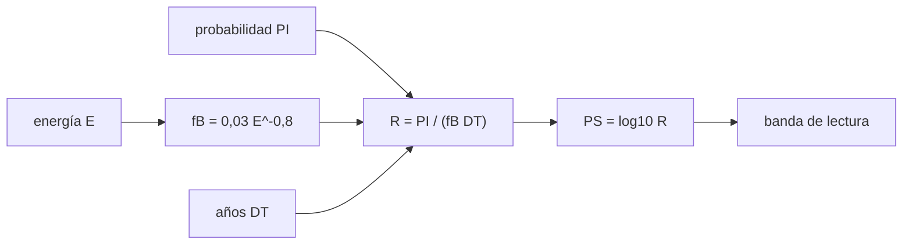

# B58-C10 — Escalas de peligrosidad

<!-- nav:top -->
[🏠 Programa](../../../../README.md) · [📚 Bloque B58](../../../tronco-comun/B58-asteroides-cometas-y-defensa-planetaria.md) · [← Anterior: B58-C09 — Probabilidades de impacto](../B58-C09-probabilidades-de-impacto/CLASE.md) · [Siguiente: B58-C11 — Observaciones de seguimiento →](../B58-C11-observaciones-de-seguimiento/CLASE.md)
<!-- /nav -->

## 1. Ubicación, nivel y alcance

Clase 10 del bloque B58 (nivel N3). Una probabilidad de impacto sola no dice cuánto preocuparse: hay que compararla con el riesgo de fondo y con las consecuencias. Aquí calculas la escala de Palermo, la energía cinética y las categorías de la escala de Torino sobre cinco casos **sintéticos**, usando la probabilidad de C09.

## 2. Por qué esta clase existe

Dos objetos con la misma probabilidad pueden merecer atención muy distinta si uno es de 20 m y otro de 1 km. Las escalas ordenan casos y sirven para decidir qué vigilar. La decisión central: **¿cómo se compara un riesgo concreto con el de fondo y cómo se lo comunica?**

## 3. Lo que podrás hacer al terminar

1. Calcular la energía cinética de un impacto en megatones.
2. Obtener la frecuencia de fondo `f_B` y la puntuación de Palermo.
3. Interpretar los tramos de la escala de Palermo.
4. Describir los niveles y colores de la escala de Torino.
5. Distinguir una escala técnica de una de comunicación pública.
6. Rotular los casos como sintéticos.

La evidencia es la **ficha de escalas de peligro** del ejercicio 12 (sección 20).

## 4. Con qué llegas y cómo comprobarlo

1. ¿Qué es la energía cinética?
2. ¿Qué es un logaritmo decimal?
3. ¿Qué es un megatón?
4. ¿Qué es un riesgo de fondo?
5. ¿Por qué se rotulan los datos sintéticos?

<details>
<summary>Ver respuestas</summary>

1. `½ m v²`. 2. El exponente al que se eleva 10. 3. Unidad de energía de 10⁶ toneladas de TNT, `4,184×10¹⁵ J` por convención. 4. La frecuencia media de impactos de objetos naturales. 5. Para no presentarlos como medidas.
</details>

Con cuatro o cinco aciertos, sigue; si no, repasa los prerrequisitos.

## 5. Un caso de contexto y casos de referencia

El ejemplo conductor son cinco casos sintéticos. El de 470 m (tamaño mediano del escenario ficticio del ejercicio de 2023, usado aquí con velocidad ilustrativa) libera `6756 Mt` y con `PI = 1 %` a 13 años tiene `PS = 1.47`. Según la fuente, Palermo mayor que 0 merece atención; el de 20 m queda en `PS = -4.43`.

## 6. Vocabulario

La **escala de Palermo** es logarítmica y continua: compara la probabilidad del evento con la del fondo hasta esa fecha [S2]. La **escala de Torino** es entera, de 0 a 10, y comunica al público [S1]. `f_B = 0,03 E^(−4/5)` es la frecuencia anual de impactos de energía al menos `E` (Mt) [S2]. `DT` son los años hasta el evento.

## 7. Modelo mental: comparar con el clima habitual



*Descripción textual:* la probabilidad se divide por el riesgo de fondo acumulado y el logaritmo da la puntuación.

Analogía: Como comparar la lluvia de hoy con la media del mes. Límite: el fondo es un promedio de largo plazo; no predice cuándo cae el próximo objeto.

## 8. La explicación, paso a paso

### 8.1 Energía

`E = ½ ρ (πD³/6) v²`. Para una esfera de 100 m, 3000 kg/m³ y 20 km/s: `75.0859 Mt`, igual a la cuenta manual.

### 8.2 Frecuencia de fondo y Palermo

Según [S2], `PS = log10[PI/(f_B DT)]`, con `f_B = 0,03 E^(−4/5)` por año (E en Mt) y DT redondeado hacia arriba. Con `PI = f_B DT` el resultado es `0.0`; con `PI = 0,01 f_B DT`, `-2.0`, como dice la fuente.

### 8.3 Los cinco casos

SINT-1: `D = 140 m`, `E = 179 Mt`, `PI = 1e-04`, `DT = 30` → `PS = -2.15` (sin consecuencias probables).
SINT-2: `D = 50 m`, `E = 4.58 Mt`, `PI = 1e-03`, `DT = 10` → `PS = -1.95` (merece vigilancia).
SINT-3: `D = 470 m`, `E = 6.76e+03 Mt`, `PI = 1e-02`, `DT = 13` → `PS = 1.47` (merece atencion).
SINT-4: `D = 20 m`, `E = 0.487 Mt`, `PI = 1e-05`, `DT = 5` → `PS = -4.43` (sin consecuencias probables).
SINT-5: `D = 1000 m`, `E = 6.51e+04 Mt`, `PI = 1e-06`, `DT = 50` → `PS = -2.33` (sin consecuencias probables).

### 8.4 Lectura de Palermo

Por [S2], valores menores que −2 no tienen consecuencias probables, entre −2 y 0 merecen vigilancia y los positivos, atención. Que un caso de 1 km con `PI = 10⁻⁶` dé un Palermo bajo no significa que sus consecuencias sean pequeñas: la escala compara probabilidades con el fondo.

### 8.5 La escala de Torino

Según [S1] va de 0 a 10: blanco (0, sin peligro), verde (1, normal), amarillo (2–4, merece atención de astrónomos), naranja (5–7, amenazante) y rojo (8–10, colisiones ciertas). Los niveles dependen de la probabilidad **y** de la energía; el laboratorio solo codifica la correspondencia nivel–color, no la tabla de decisión.

## 9. Magnitudes, símbolos y unidades

| Símbolo | Qué es | Unidad | Valor / nota |
|---|---|---|---|
| `D` | diámetro | m | 20–1000 (sintético) |
| `ρ` | densidad | kg/m³ | 2600–3000 (ilustrativa) |
| `v` | velocidad | km/s | 15–20 (ilustrativa) |
| `E` | energía | Mt | 179 a 6.51e+04 |
| `f_B` | frecuencia de fondo | 1/año | `0,03 E^(−0,8)` |
| `PI` | probabilidad de impacto | — | 10⁻⁶ – 10⁻² |
| `PS` | puntuación de Palermo | — | -4.4 a 1.5 |

## 10. Convenciones y referencias

Esfera homogénea; megatón convencional; DT en años; casos sintéticos. La escala de Torino se describe, no se calcula.

## 11. De dónde sale lo que afirmamos

| ID | Fuente | Localizador | Respalda | Estado |
|---|---|---|---|---|
| S1 | CNEOS/JPL, *Torino Impact Hazard Scale* | [https://cneos.jpl.nasa.gov/sentry/torino_scale.html](https://cneos.jpl.nasa.gov/sentry/torino_scale.html) | niveles 0–10 y colores de Torino, adoptada por la IAU en 1999, uso como herramienta de comunicación | Página leída el 2026-11-09 (resumen extraído de la página) |
| S2 | CNEOS/JPL, *Palermo Technical Impact Hazard Scale* | [https://cneos.jpl.nasa.gov/sentry/palermo_scale.html](https://cneos.jpl.nasa.gov/sentry/palermo_scale.html) | fórmula de Palermo, `f_B = 0,03 E^(−4/5)`, lectura de valores | Página leída el 2026-11-09 (resumen extraído de la página) |

No consultado: la tabla completa de decisión de Torino (probabilidad frente a energía) y el valor de conversión del megatón.

Límites: ninguna fuente respalda los casos sintéticos ni sus energías.

## 12. Cómo ver los cinco casos

| Magnitud | Valor |
|---|---|
| SINT-1 | E = 179 Mt ; PS = -2.15 |
| SINT-2 | E = 4.58 Mt ; PS = -1.95 |
| SINT-3 | E = 6.76e+03 Mt ; PS = 1.47 |
| SINT-4 | E = 0.487 Mt ; PS = -4.43 |
| SINT-5 | E = 6.51e+04 Mt ; PS = -2.33 |

Descripción larga: solo el caso de 470 m con 1 % queda en `PS = 1.47`; los demás son negativos.

## 13. Ejemplo trabajado: Palermo del caso de 470 m

**Paso 1 · Energía.** `6756 Mt`.

**Paso 2 · Fondo.** `f_B = 2.59e-05` por año.

**Paso 3 · Razón.** `R = 0,01/(2.59e-05·13) = 29.70`.

**Paso 4 · Puntuación.** `PS = log10 R = 1.47`.

**Paso 5 · Lectura.** Positivo: merece atención, por [S2].

## 14. Distintas formas de resolver lo mismo

**Palermo:** técnica, continua, para especialistas. **Torino:** entera, de colores, para comunicar. Se usan juntas: una para ordenar casos y otra para decir qué significa un caso al público.

## 15. Práctica guiada

**Ejercicio 1 · con los pasos indicados.** Calcula `f_B` para `E = 1 Mt`. *Pasos:* `0,03·1^(−0,8)`.

<details><summary>Solución comentada</summary>

`0,03` por año.
</details>

**Ejercicio 2 · con una pista.** ¿Qué `PS` da `PI = f_B DT`? *Pista:* sección 8.2.

<details><summary>Solución comentada</summary>

`0`.
</details>

**Ejercicio 3 · casi autónomo.** ¿Qué `PS` da un evento 100 veces más probable que el fondo?

<details><summary>Solución comentada</summary>

`+2` [S2].
</details>

## 16. Práctica autónoma, transferencia e integrador

**Ejercicio 4 · autónomo.** Calcula la energía de una esfera de 140 m, 2600 kg/m³ y 20 km/s.

<details><summary>Solución comentada</summary>

`178.6 Mt`.
</details>

**Ejercicio 5 · autónomo.** Calcula `PS` de SINT-1.

<details><summary>Solución comentada</summary>

`-2.15`.
</details>

**Ejercicio 6 · autónomo.** ¿En qué color de Torino cae el nivel 3?

<details><summary>Solución comentada</summary>

Amarillo [S1].
</details>

**Ejercicio 7 · autónomo.** ¿Y el nivel 6?

<details><summary>Solución comentada</summary>

Naranja [S1].
</details>

**Ejercicio 8 · autónomo.** Si `E` se multiplica por 8 con `PI` y `DT` fijos, ¿cómo cambia `PS`?

<details><summary>Solución comentada</summary>

`f_B` cae `8^(−0,8) = 0,19`, luego `PS` sube `0,72`.
</details>

**Ejercicio 9 · transferencia.** **Transferencia.** Un titular dice «Palermo −3: el asteroide es inofensivo». ¿Qué corrección haces?

<details><summary>Solución comentada</summary>

Significa que la probabilidad es mucho menor que el fondo, no que no haga daño si ocurriera.
</details>

**Ejercicio 10 · transferencia.** **Transferencia.** ¿Por qué Torino no se calcula con una sola fórmula?

<details><summary>Solución comentada</summary>

Combina probabilidad y consecuencias en una tabla de decisión pública.
</details>

**Ejercicio 11 · transferencia.** **Transferencia.** ¿Qué pasa con `PS` al acercarse la fecha (DT menor) con `PI` fija?

<details><summary>Solución comentada</summary>

Sube: `f_B DT` se reduce.
</details>

**Ejercicio 12 · integrador.** **Integrador.** Elabora tu *ficha de escalas de peligro*: energía, Palermo y banda de cinco casos, y la correspondencia de Torino.

<details><summary>Solución comentada</summary>

Secciones 8.1–8.5.
</details>

## 17. Laboratorio: Palermo, energía y Torino

El script [escalas.py](escalas.py) calcula energía y Palermo de cinco casos sintéticos y verifica los valores de referencia (**comprueba** `PS = 0` y `−2` con 10⁻¹², energía con 10⁻⁹ y la partición de colores de Torino).

**Datos:** cinco casos **sintéticos**; fórmulas de [S2] y [S1]; megatón convencional, no consultado. **Predice antes de ejecutar:** ¿Cuántos de los cinco casos tendrán Palermo positivo? **Ejecución del 2026-11-09:**

```text
Python 3.12.9 (biblioteca estandar)
caso       D[m]      v        PI    DT       E[Mt]   fB[1/anio]  Palermo  banda
SINT-1      140   20.0     1e-04    30       178.6    0.0004739    -2.15  sin consecuencias probables
SINT-2       50   15.0     1e-03    10       4.576     0.008887    -1.95  merece vigilancia
SINT-3      470   20.0     1e-02    13        6756     2.59e-05     1.47  merece atencion
SINT-4       20   18.0     1e-05     5      0.4866      0.05338    -4.43  sin consecuencias probables
SINT-5     1000   20.0     1e-06    50   6.507e+04    4.231e-06    -2.33  sin consecuencias probables
Esfera de 100 m, 3000 kg/m3, 20 km/s: E = 75.085866 Mt (cuenta manual 75.085866)
PS cuando PI = fB DT: 0.000000000000 ; cuando PI = 0.01 fB DT: -2.000000000000
Torino (niveles -> color): 0=blanco, 1=verde, 2=amarillo, 3=amarillo, 4=amarillo, 5=naranja, 6=naranja, 7=naranja, 8=rojo, 9=rojo, 10=rojo
Pruebas superadas.
```

```bash
python programa/clases/B58/B58-C10-escalas-de-peligrosidad/escalas.py
```

**Límites:** esfera sin entrada atmosférica; Torino no se calcula; el fondo es un promedio.

## 18. Errores frecuentes y cómo corregirlos

**Leer Palermo negativo como «inofensivo».** Se corrige con 8.4.

**Confundir Palermo y Torino.** Se corrige con la sección 14.

**Olvidar `DT` en el fondo.** Se corrige con 8.2.

**Presentar los casos sintéticos como reales.** Se corrige con la sección 10.

## 19. Cómo sabrás que vas bien

Tras la sección 8: ¿qué casos esperabas positivos y cuáles obtuviste? Si dudas, repasa el ejemplo 13. Tras el laboratorio: ¿qué comprueba? (ver la sección 17).

## 20. Qué entregas y cómo se evalúa

El producto es tu **ficha de escalas de peligro** (ejercicio 12).

| Criterio | Inicial | En desarrollo | Logrado | Destacado |
|---|---|---|---|---|
| Conceptos | Los confunde | Parciales | Conceptos de la clase | Explica los límites |
| Cálculo | Sin unidades | Con errores | Tablas completas | Calcula casos nuevos |
| Numérico | Sin comprobar | Un caso | Contraste con el análisis | Interpreta las diferencias |
| Fuentes | Sin fuente | Sin fecha | Fuentes con fecha | Declara lo no consultado |
| Límites | No los nombra | Uno | Tres | Discute qué falta del modelo |

**Condiciones críticas (no se compensan con promedio):** rotular los casos como sintéticos; no presentar una puntuación de laboratorio como evaluación de un objeto real; citar solo lo consultado.

## 21. Ética, seguridad y límites

Clase educativa: los modelos son simplificados y los datos, sintéticos; nada de lo calculado evalúa un objeto real ni sustituye a los sistemas oficiales de monitoreo y alerta.  Accesibilidad: tablas equivalentes a las gráficas, fórmulas en texto, ejercicios sin conexión.

## 22. Para cerrar y seguir

El caso de 470 m con 1 % da `PS = 1.47` y los demás quedan en negativo; Torino describe niveles y colores. Queda una pregunta: ¿cómo se reduce la probabilidad con nuevas observaciones?

**Glosario español–inglés.** escala de Palermo · *Palermo scale*; escala de Torino · *Torino scale*; frecuencia de fondo · *background frequency*; megatón · *megaton*; energía cinética · *kinetic energy*.

**Continuidad.** [B58-C11](../B58-C11-observaciones-de-seguimiento/CLASE.md) estudia observaciones de seguimiento.

**Referencias:** ver sección 11.

<!-- nav:bottom -->
---

[← Anterior: B58-C09 — Probabilidades de impacto](../B58-C09-probabilidades-de-impacto/CLASE.md) · [📚 Bloque B58](../../../tronco-comun/B58-asteroides-cometas-y-defensa-planetaria.md) · [Siguiente: B58-C11 — Observaciones de seguimiento →](../B58-C11-observaciones-de-seguimiento/CLASE.md)
<!-- /nav -->
