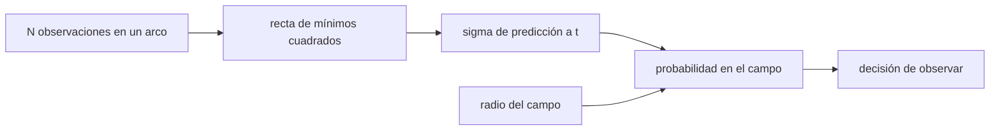

# B58-C11 — Observaciones de seguimiento

<!-- nav:top -->
[🏠 Programa](../../../../README.md) · [📚 Bloque B58](../../../tronco-comun/B58-asteroides-cometas-y-defensa-planetaria.md) · [← Anterior: B58-C10 — Escalas de peligrosidad](../B58-C10-escalas-de-peligrosidad/CLASE.md) · [Siguiente: B58-C12 — Radar planetario →](../B58-C12-radar-planetario/CLASE.md)
<!-- /nav -->

## 1. Ubicación, nivel y alcance

Clase 11 del bloque B58 (nivel N3). Tras un descubrimiento, la probabilidad de impacto depende de cuánto se alargue el arco. Aquí calculas cómo crece la incertidumbre de predicción de un movimiento lineal con arcos de 3 y 10 días y cuál es la probabilidad de recuperar el objeto en un campo de cierto radio. Todo **sintético**; conecta C07–C08 con C09.

## 2. Por qué esta clase existe

Una observación de seguimiento solo sirve si el objeto cae en el campo de la cámara. La decisión central: **¿cuándo y con qué arco conviene volver a observar para no perder el objeto?**

## 3. Lo que podrás hacer al terminar

1. Calcular la incertidumbre de una predicción lineal.
2. Comparar arcos de distinta duración.
3. Calcular la probabilidad de recuperación en un campo circular.
4. Contrastar fórmulas con Monte Carlo.
5. Decidir el tamaño de campo necesario.
6. Reconocer el límite del modelo lineal.

La evidencia es la **ficha de seguimiento** del ejercicio 12 (sección 20).

## 4. Con qué llegas y cómo comprobarlo

1. ¿Qué es una recta de mínimos cuadrados?
2. ¿Qué es una distribución de Rayleigh?
3. ¿Qué es un campo de visión?
4. ¿Qué es un arco corto?
5. ¿Qué es un error binomial?

<details>
<summary>Ver respuestas</summary>

1. La recta que minimiza la suma de los residuos al cuadrado. 2. La del módulo de un vector gaussiano 2D de media cero. 3. La región del cielo que cubre la cámara. 4. Un conjunto de observaciones que cubre pocos días. 5. `√(P(1−P)/N)`.
</details>

Con cuatro o cinco aciertos, sigue; si no, repasa los prerrequisitos.

## 5. Un caso de contexto y casos de referencia

El ejemplo conductor es un objeto sintético observado 8 veces con error de `0,3″`. Predicho a 30 días, el error es `3.1″` con un arco de 3 días y `0.8″` con uno de 10 días (analítico), 3.8 veces menor. Con `σ = 10′` por eje, un campo de radio 10′ recupera el objeto con probabilidad `0.393`.

## 6. Vocabulario

La **predicción** extrapola el ajuste a una fecha futura. El **arco** es el tiempo cubierto. Un **campo de visión** circular de radio `r` recupera el objeto si el error de posición es menor que `r`. La **distribución de Rayleigh** describe el módulo del error en 2D. El **seguimiento** (*follow-up*) son las observaciones posteriores al descubrimiento.

## 7. Modelo mental: lanzar una pelota a una canasta



*Descripción textual:* el arco fija la recta y su incertidumbre en la fecha futura; con el radio del campo se obtiene la probabilidad de recuperar el objeto.

Analogía: Como apuntar con un lanzamiento corto: un error pequeño de ángulo se vuelve grande a distancia. Límite: la extrapolación real se curva por la órbita (C08) y el modelo lineal solo vale para arcos y plazos cortos.

## 8. La explicación, paso a paso

### 8.1 Predicción lineal

Con `N` observaciones en las fechas `tᵢ` y error `σ`, `σ_pred(t)² = σ²(1/N + (t − t̄)²/Sxx)` con `Sxx = Σ(tᵢ − t̄)²`. El segundo término crece con el cuadrado de la distancia al centro del arco.

### 8.2 Cuatro fechas

A 5 d: arco de 3 d `0.39″` (Monte Carlo `0.39″`); arco de 10 d `0.11″` (`0.11″`).
A 10 d: arco de 3 d `0.92″` (Monte Carlo `0.92″`); arco de 10 d `0.19″` (`0.19″`).
A 30 d: arco de 3 d `3.08″` (Monte Carlo `3.12″`); arco de 10 d `0.82″` (`0.80″`).
A 100 d: arco de 3 d `10.64″` (Monte Carlo `10.61″`); arco de 10 d `3.08″` (`3.07″`).

### 8.3 Efecto del arco

Alargar el arco de 3 a 10 días reduce el error a 30 días en un factor 3.8 y a 100 días en 3.5. Es la razón de pedir observaciones de seguimiento en cuanto aparece un objeto nuevo.

### 8.4 Recuperar el objeto

Con error gaussiano `σ` por eje, el módulo sigue Rayleigh y `P(≤ r) = 1 − exp(−r²/2σ²)`. Con `σ = 10′`: `r = 5′ → 0.118` (MC `0.117`); `r = 10′ → 0.393` (MC `0.394`); `r = 20′ → 0.865` (MC `0.865`).

### 8.5 Lectura

Para tener 95 % de probabilidad hace falta un campo de unos `2,45 σ`. Un campo estrecho obliga a mosaicos o a esperar a que mejore la órbita. El modelo lineal es solo ilustrativo: la órbita real se curva y las incertidumbres alargadas de C08 cambian el tamaño y la forma de la región.

## 9. Magnitudes, símbolos y unidades

| Símbolo | Qué es | Unidad | Valor / nota |
|---|---|---|---|
| `σ` | error de una observación | ″ | 0,3 |
| `N` | observaciones | — | 8 |
| `t` | fecha de la predicción | d | 5–100 |
| `S_xx` | dispersión de las fechas | d² | — |
| `r` | radio del campo | ′ | 5, 10, 20 |
| `σ_c` | error de posición por eje | ′ | 10 |

## 10. Convenciones y referencias

Movimiento lineal uniforme en una coordenada; error gaussiano independiente; semilla `20261109`. Datos sintéticos.

## 11. De dónde sale lo que afirmamos

| ID | Fuente | Localizador | Respalda | Estado |
|---|---|---|---|---|
| — | Sin fuente externa | — | relaciones estándar que verifica el laboratorio | No se consultó una fuente para esta clase |

No consultado: prácticas reales de seguimiento (NEOCP, MPC) ni el formato de observaciones; el laboratorio solo contrasta las fórmulas con Monte Carlo.

Límites: ninguna fuente externa.

## 12. Cómo ver la predicción según el arco

| Magnitud | Valor |
|---|---|
| t = 5 d | 3 d: 0.39″ ; 10 d: 0.11″ |
| t = 10 d | 3 d: 0.92″ ; 10 d: 0.19″ |
| t = 30 d | 3 d: 3.08″ ; 10 d: 0.82″ |
| t = 100 d | 3 d: 10.64″ ; 10 d: 3.08″ |

Descripción larga: el arco de 10 días reduce el error a 30 días en un factor 3.8.

## 13. Ejemplo trabajado: predicción a 30 días con arco de 3 días

**Paso 1 · Datos.** `N = 8`, `σ = 0,3″`, `Sxx` de 8 fechas en 3 días.

**Paso 2 · Fórmula.** `σ_pred² = σ²(1/N + (t−t̄)²/Sxx)`.

**Paso 3 · Resultado.** `3.08″` (Monte Carlo `3.12″`).

**Paso 4 · Con 10 días.** `0.82″`.

**Paso 5 · Decisión.** Alargar el arco reduce el campo necesario.

## 14. Distintas formas de resolver lo mismo

**Analítica:** fórmula de regresión. **Monte Carlo:** 4000 ajustes. **Órbita completa:** C08. Las dos primeras coinciden a 5 %; la tercera es la que se usa en la práctica.

## 15. Práctica guiada

**Ejercicio 1 · con los pasos indicados.** Calcula `P` de un campo `r = σ`. *Pasos:* `1 − e^(−1/2)`.

<details><summary>Solución comentada</summary>

`0,393`.
</details>

**Ejercicio 2 · con una pista.** ¿Y para `r = 2σ`?

<details><summary>Solución comentada</summary>

`1 − e^(−2) = 0,865`.
</details>

**Ejercicio 3 · casi autónomo.** ¿Qué radio da 95 % con `σ = 10′`? *Pista:* `r = σ√(2 ln 20)`.

<details><summary>Solución comentada</summary>

`24,5′`.
</details>

## 16. Práctica autónoma, transferencia e integrador

**Ejercicio 4 · autónomo.** ¿Cómo cambia `σ_pred` si `σ` se duplica?

<details><summary>Solución comentada</summary>

Se duplica.
</details>

**Ejercicio 5 · autónomo.** ¿Qué pasa con `σ_pred` en `t = t̄`?

<details><summary>Solución comentada</summary>

Es `σ/√N`, el mínimo.
</details>

**Ejercicio 6 · autónomo.** ¿Por qué el arco largo ayuda?

<details><summary>Solución comentada</summary>

Aumenta `Sxx`, que reduce el término que crece con `t`.
</details>

**Ejercicio 7 · autónomo.** Con `N = 16` en lugar de 8, ¿qué ocurre con `σ/√N`?

<details><summary>Solución comentada</summary>

Baja un factor `√2`.
</details>

**Ejercicio 8 · autónomo.** ¿Qué probabilidad hay con `r = 20′`?

<details><summary>Solución comentada</summary>

`0.865`.
</details>

**Ejercicio 9 · transferencia.** **Transferencia.** Un observador dispone de un campo de 5′ y `σ = 10′`. ¿Qué haría?

<details><summary>Solución comentada</summary>

Probabilidad `0.118`: usar mosaico o esperar a reducir `σ`.
</details>

**Ejercicio 10 · transferencia.** **Transferencia.** ¿Por qué el modelo lineal subestima la incertidumbre para plazos largos?

<details><summary>Solución comentada</summary>

Ignora la curvatura de la órbita y las correlaciones de C08.
</details>

**Ejercicio 11 · transferencia.** **Transferencia.** ¿Qué ventaja tiene un segundo observatorio lejano?

<details><summary>Solución comentada</summary>

Una paralaje mayor y una cobertura de fechas distinta.
</details>

**Ejercicio 12 · integrador.** **Integrador.** Elabora tu *ficha de seguimiento*: tabla de predicción con dos arcos y probabilidad de recuperación para tres campos.

<details><summary>Solución comentada</summary>

Secciones 8.2–8.4.
</details>

## 17. Laboratorio: predicción lineal y recuperación en el campo

El script [seguimiento.py](seguimiento.py) calcula la incertidumbre de predicción para dos arcos y la probabilidad de recuperación en tres campos, contra Monte Carlo (**comprueba** 5 % en `σ_pred` y 3 errores binomiales en `P`).

**Datos:** objeto y observaciones **sintéticos**; semilla `20261109`. **Predice antes de ejecutar:** ¿Cuántas veces mejora el error a 30 días al pasar de arco de 3 a 10 días? **Ejecución del 2026-11-09:**

```text
Python 3.12.9 (biblioteca estandar)
Prediccion a t dias del inicio (error de observacion 0.3 arcsec, 8 observaciones):
   t[d]   arco 3 d ana           MC  arco 10 d ana           MC
      5          0.39"        0.39"          0.11"        0.11"
     10          0.92"        0.92"          0.19"        0.19"
     30          3.08"        3.12"          0.82"        0.80"
    100         10.64"       10.61"          3.08"        3.07"
Probabilidad de recuperar el objeto en un campo de radio r (sigma = 10 arcmin por eje):
  r =    5 arcmin : analitica = 0.1175 ; Monte Carlo = 0.1170 ; diferencia = -1.03 errores
  r =   10 arcmin : analitica = 0.3935 ; Monte Carlo = 0.3940 ; diferencia = +0.68 errores
  r =   20 arcmin : analitica = 0.8647 ; Monte Carlo = 0.8655 ; diferencia = +1.51 errores
Pruebas superadas.
```

```bash
python programa/clases/B58/B58-C11-observaciones-de-seguimiento/seguimiento.py
```

**Límites:** movimiento rectilíneo; ruido gaussiano; sin curvatura orbital.

## 18. Errores frecuentes y cómo corregirlos

**Ignorar que el error crece con la distancia al arco.** Se corrige con 8.1.

**Confundir `σ` con el radio del campo.** Se corrige con 8.4.

**Extrapolar linealmente por mucho tiempo.** Se corrige con 8.5.

**Presentar el seguimiento simulado como observado.** Se corrige con la sección 10.

## 19. Cómo sabrás que vas bien

Tras la sección 8: ¿qué mejora esperabas y cuál obtuviste? Si dudas, repasa el ejemplo 13. Tras el laboratorio: ¿qué comprueba? (ver la sección 17).

## 20. Qué entregas y cómo se evalúa

El producto es tu **ficha de seguimiento** (ejercicio 12).

| Criterio | Inicial | En desarrollo | Logrado | Destacado |
|---|---|---|---|---|
| Conceptos | Los confunde | Parciales | Conceptos de la clase | Explica los límites |
| Cálculo | Sin unidades | Con errores | Tablas completas | Calcula casos nuevos |
| Numérico | Sin comprobar | Un caso | Contraste con el análisis | Interpreta las diferencias |
| Fuentes | Sin fuente | Sin fecha | Fuentes con fecha | Declara lo no consultado |
| Límites | No los nombra | Uno | Tres | Discute qué falta del modelo |

**Condiciones críticas (no se compensan con promedio):** rotular el objeto como sintético; no presentar el seguimiento simulado como observado; declarar lo no consultado.

## 21. Ética, seguridad y límites

Clase educativa: los modelos son simplificados y los datos, sintéticos; nada de lo calculado evalúa un objeto real ni sustituye a los sistemas oficiales de monitoreo y alerta.  Accesibilidad: tablas equivalentes a las gráficas, fórmulas en texto, ejercicios sin conexión.

## 22. Para cerrar y seguir

Alargar el arco de 3 a 10 días reduce el error a 30 días en un factor 3.8, y un campo de 10′ recupera un objeto con `σ = 10′` el `39 %` de las veces. Queda una pregunta: ¿qué más se puede medir sin esperar?

**Glosario español–inglés.** seguimiento · *follow-up*; arco · *arc*; campo de visión · *field of view*; predicción · *prediction*; distribución de Rayleigh · *Rayleigh distribution*.

**Continuidad.** [B58-C12](../B58-C12-radar-planetario/CLASE.md) estudia radar planetario.

**Referencias:** ver sección 11.

<!-- nav:bottom -->
---

[← Anterior: B58-C10 — Escalas de peligrosidad](../B58-C10-escalas-de-peligrosidad/CLASE.md) · [📚 Bloque B58](../../../tronco-comun/B58-asteroides-cometas-y-defensa-planetaria.md) · [Siguiente: B58-C12 — Radar planetario →](../B58-C12-radar-planetario/CLASE.md)
<!-- /nav -->
