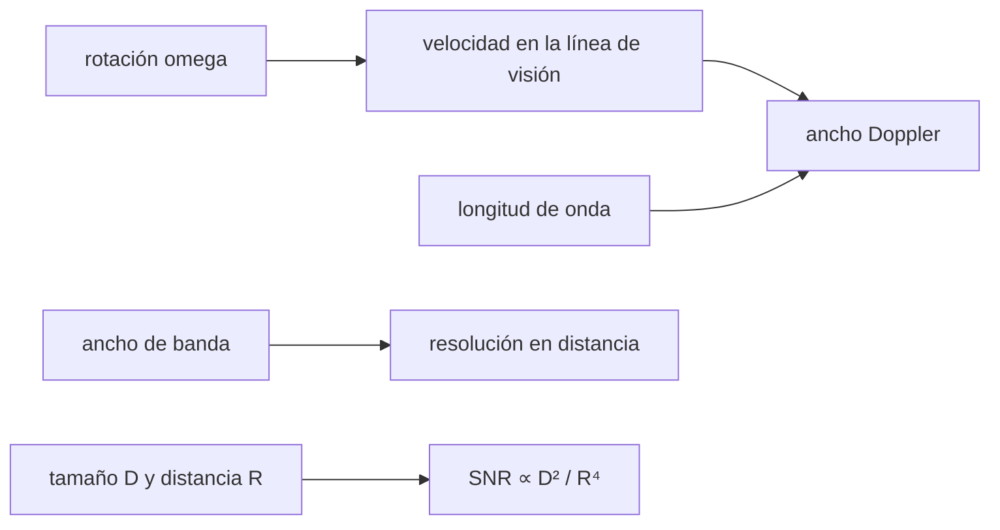

# B58-C12 — Radar planetario

<!-- nav:top -->
[🏠 Programa](../../../../README.md) · [📚 Bloque B58](../../../tronco-comun/B58-asteroides-cometas-y-defensa-planetaria.md) · [← Anterior: B58-C11 — Observaciones de seguimiento](../B58-C11-observaciones-de-seguimiento/CLASE.md) · [Siguiente: B58-C13 — Caracterización de rotación →](../B58-C13-caracterizacion-de-rotacion/CLASE.md)
<!-- /nav -->

## 1. Ubicación, nivel y alcance

Clase 12 del bloque B58 (nivel N3). El radar planetario mide distancia y velocidad con precisión y, con ellas, forma, rotación y tamaño. Aquí calculas el ancho Doppler de un asteroide **sintético** que rota, comprobándolo con un cálculo numérico independiente, la resolución en distancia y cómo cae la señal con la distancia y el tamaño.

## 2. Por qué esta clase existe

El radar aporta lo que la fotometría no da: tamaño directo (sin albedo) y distancias de precisión que reducen la incertidumbre orbital. La decisión central: **¿qué resolución y qué señal se obtienen de un objeto de cierto tamaño a cierta distancia?**

## 3. Lo que podrás hacer al terminar

1. Obtener el ancho Doppler de un cuerpo en rotación.
2. Contrastar la fórmula con un barrido numérico de la superficie.
3. Calcular la resolución en distancia de un ancho de banda dado.
4. Aplicar la ley `1/R⁴` y la dependencia con `D²`.
5. Explicar qué mide el radar que no mide la óptica.
6. Declarar los parámetros ilustrativos.

La evidencia es la **ficha del radar** del ejercicio 12 (sección 20).

## 4. Con qué llegas y cómo comprobarlo

1. ¿Qué es el efecto Doppler?
2. ¿Qué es un periodo de rotación?
3. ¿Qué es una longitud de onda?
4. ¿Qué es el ancho de banda?
5. ¿Por qué el radar usa ida y vuelta?

<details>
<summary>Ver respuestas</summary>

1. El cambio de frecuencia por movimiento relativo. 2. El tiempo de una vuelta. 3. La distancia de un ciclo de onda; `λ = c/f`. 4. El intervalo de frecuencias ocupado. 5. La señal recorre dos veces la distancia, y la ecuación incluye `R⁴`.
</details>

Con cuatro o cinco aciertos, sigue; si no, repasa los prerrequisitos.

## 5. Un caso de contexto y casos de referencia

El ejemplo conductor es una esfera sintética de 500 m con periodo de 4 h, vista a latitud subradar 30° con `λ = 3,5 cm`. El ancho Doppler analítico es `10.80 Hz` y el numérico `10.80 Hz`. Con 2 MHz de ancho de banda la resolución en distancia es `75 m`, es decir `6.7` elementos a lo largo del diámetro. Parámetros ilustrativos, sin radar real.

## 6. Vocabulario

El **eco radar** es la señal que vuelve del objeto. El **ancho Doppler** `B` es la dispersión en frecuencia por la rotación. La **resolución en distancia** `c/(2B_tx)` depende del ancho de banda transmitido. La **latitud subradar** es la latitud del punto más cercano al radar. La **sección eficaz** mide cuánta señal devuelve el objeto.

## 7. Modelo mental: el silbato de una ambulancia que gira



*Descripción textual:* la rotación y la longitud de onda fijan el ancho Doppler; el ancho de banda fija la resolución en distancia; el tamaño y la distancia fijan la señal.

Analogía: Como un silbato en un carrusel: un lado se acerca y suena más agudo, el otro se aleja. Límite: la forma real no es una esfera ni su superficie es lisa; el eco depende de la rugosidad.

## 8. La explicación, paso a paso

### 8.1 Ancho Doppler

Para una esfera, `B = 4πD cos δ/(λ P)`, donde `δ` es la latitud subradar. Con los valores del ejemplo: `10.796 Hz`. La deducción: los puntos del limbo ecuatorial se mueven con `v = ωD/2` y el desplazamiento Doppler es `2v/λ` a cada lado.

### 8.2 Verificación numérica

El laboratorio recorre una malla de 720 × 360 puntos de la mitad visible, calcula `v = (ω ẑ × r)·k̂` en cada uno y toma los extremos de `2v/λ`. Resultado `10.796 Hz`, a `0.000 %` del analítico. Con `δ = 0` el ancho sube a `12.467 Hz`; el cociente `0.8660` es `cos 30°`.

### 8.3 Resolución en distancia

Con `B_tx = 2 MHz`, `Δr = c/(2B_tx) = 74.9 m`; el diámetro cubre `6.7` elementos. Más ancho de banda da más detalle.

### 8.4 La ecuación del radar

La señal recibida escala como `D²/R⁴`. Pasar de 0,04 a 0,02 au multiplica la señal por 16 (`16`) y pasar de 250 a 500 m, por 4. Por eso el radar solo trabaja con objetos relativamente cercanos.

### 8.5 Qué aporta

El tamaño medido directamente no necesita el albedo (C01), y la distancia y la velocidad radial acotan la órbita (C07). Las especificaciones de instrumentos reales no se consultaron.

## 9. Magnitudes, símbolos y unidades

| Símbolo | Qué es | Unidad | Valor / nota |
|---|---|---|---|
| `D` | diámetro | m | 500 (sintético) |
| `P` | periodo de rotación | s | 14 400 |
| `λ` | longitud de onda | m | 0,035 (ilustrativa) |
| `δ` | latitud subradar | grado | 30 |
| `B` | ancho Doppler | Hz | 10.80 |
| `B_tx` | ancho de banda transmitido | Hz | 2×10⁶ |
| `Δr` | resolución en distancia | m | 75 |

## 10. Convenciones y referencias

Esfera lisa; rotación alrededor del eje polar; sin retardo de luz ni ruido; parámetros ilustrativos.

## 11. De dónde sale lo que afirmamos

| ID | Fuente | Localizador | Respalda | Estado |
|---|---|---|---|---|
| — | Sin fuente externa | — | relaciones estándar que verifica el laboratorio | No se consultó una fuente para esta clase |

No consultado: especificaciones de radares reales (la página de radar de CNEOS no estuvo disponible, 404) ni la teoría de imágenes radar. Las relaciones se verifican con un cálculo numérico propio.

Límites: sin fuente externa.

## 12. Cómo ver el ancho Doppler

| Magnitud | Valor |
|---|---|
| analítico | 10.796 Hz |
| numérico | 10.796 Hz |
| δ = 0° | 12.467 Hz |
| resolución | 74.9 m |

Descripción larga: el cálculo numérico y la fórmula coinciden a 0.000 %.

## 13. Ejemplo trabajado: el ancho Doppler del ejemplo

**Paso 1 · Datos.** `D = 500 m`, `P = 14 400 s`, `λ = 0,035 m`, `δ = 30°`.

**Paso 2 · Fórmula.** `B = 4π·500·cos30°/(0,035·14 400)`.

**Paso 3 · Resultado.** `10.796 Hz`.

**Paso 4 · Resolución.** `Δr = c/(2·2×10⁶) = 74.9 m`.

## 14. Distintas formas de resolver lo mismo

**Fórmula:** una línea. **Barrido numérico:** independiente y válido para otras formas. La primera da el orden de magnitud; la segunda comprueba y se generaliza a elipsoides.

## 15. Práctica guiada

**Ejercicio 1 · con los pasos indicados.** Calcula `Δr` con `B_tx = 1 MHz`. *Pasos:* `c/(2B)`.

<details><summary>Solución comentada</summary>

`150 m`.
</details>

**Ejercicio 2 · con una pista.** ¿Cuál es `B` si `P` se duplica? *Pista:* sección 8.1.

<details><summary>Solución comentada</summary>

Se reduce a la mitad.
</details>

**Ejercicio 3 · casi autónomo.** ¿Y si `λ` se reduce a la mitad?

<details><summary>Solución comentada</summary>

Se duplica.
</details>

## 16. Práctica autónoma, transferencia e integrador

**Ejercicio 4 · autónomo.** ¿Qué factor de SNR hay entre 0,01 y 0,02 au?

<details><summary>Solución comentada</summary>

16.
</details>

**Ejercicio 5 · autónomo.** ¿Y entre 100 y 200 m a igual distancia?

<details><summary>Solución comentada</summary>

4.
</details>

**Ejercicio 6 · autónomo.** ¿Por qué `B` baja con `cos δ`?

<details><summary>Solución comentada</summary>

Al mirar desde el polo, la rotación es transversal a la línea de visión.
</details>

**Ejercicio 7 · autónomo.** ¿Cuántos elementos de distancia cubre un cuerpo de 500 m con 75 m?

<details><summary>Solución comentada</summary>

`6,7`.
</details>

**Ejercicio 8 · autónomo.** Convierte `B` de Hz a velocidad extrema para `λ = 0,035`.

<details><summary>Solución comentada</summary>

`v = Bλ/4`: con `B ≈ 10,8 Hz`, `v ≈ 0,094 m/s`.
</details>

**Ejercicio 9 · transferencia.** **Transferencia.** ¿Por qué la medida del tamaño por radar no necesita albedo?

<details><summary>Solución comentada</summary>

Porque mide el retardo y la dispersión Doppler, no el brillo.
</details>

**Ejercicio 10 · transferencia.** **Transferencia.** ¿Qué limita el alcance del radar?

<details><summary>Solución comentada</summary>

La caída `R⁻⁴` de la señal.
</details>

**Ejercicio 11 · transferencia.** **Transferencia.** ¿Qué haría un cuerpo muy alargado al ancho Doppler?

<details><summary>Solución comentada</summary>

Depende del eje de visión; un cuerpo alargado visto de punta tiene más ancho.
</details>

**Ejercicio 12 · integrador.** **Integrador.** Elabora tu *ficha del radar*: ancho Doppler analítico y numérico, resolución y leyes de escala.

<details><summary>Solución comentada</summary>

Secciones 8.1–8.4.
</details>

## 17. Laboratorio: ancho Doppler, resolución y escala de la señal

El script [radar.py](radar.py) compara el ancho Doppler analítico con un barrido numérico de la superficie y verifica los cocientes de la señal (**comprueba** 0,3 % y factores 16 y 4).

**Datos:** asteroide **sintético**; parámetros del radar **ilustrativos**. **Predice antes de ejecutar:** ¿Cuál es el ancho Doppler para latitud subradar 0° respecto del de 30°? **Ejecución del 2026-11-09:**

```text
Python 3.12.9 (biblioteca estandar)
Ancho Doppler (D = 500 m, P = 4 h, lambda = 3.5 cm, latitud subradar 30 deg): analitico = 10.796 Hz ; numerico = 10.796 Hz ; diferencia = 0.000 %
Ancho Doppler con latitud subradar 0 deg = 12.467 Hz (cociente 30 deg / 0 deg = 0.8660 ; cos 30 = 0.8660)
Resolucion en distancia con 2 MHz = 74.9 m ; elementos de distancia a lo largo de D = 6.7
SNR relativa: R de 0.02 a 0.04 au -> factor 16.0 ; D de 250 a 500 m -> factor 4.0
Pruebas superadas.
```

```bash
python programa/clases/B58/B58-C12-radar-planetario/radar.py
```

**Límites:** esfera lisa; sin forma real, ruido ni retardo de luz.

## 18. Errores frecuentes y cómo corregirlos

**Confundir resolución en distancia y Doppler.** Se corrige con 8.3.

**Olvidar el factor 2 de ida y vuelta.** Se corrige con 8.1.

**Creer que el radar llega lejos.** Se corrige con 8.4.

**Tomar los parámetros por los de un radar real.** Se corrige con la sección 10.

## 19. Cómo sabrás que vas bien

Tras la sección 8: ¿qué cociente esperabas entre latitudes y cuál obtuviste? Si dudas, repasa el ejemplo 13. Tras el laboratorio: ¿qué comprueba? (ver la sección 17).

## 20. Qué entregas y cómo se evalúa

El producto es tu **ficha del radar** (ejercicio 12).

| Criterio | Inicial | En desarrollo | Logrado | Destacado |
|---|---|---|---|---|
| Conceptos | Los confunde | Parciales | Conceptos de la clase | Explica los límites |
| Cálculo | Sin unidades | Con errores | Tablas completas | Calcula casos nuevos |
| Numérico | Sin comprobar | Un caso | Contraste con el análisis | Interpreta las diferencias |
| Fuentes | Sin fuente | Sin fecha | Fuentes con fecha | Declara lo no consultado |
| Límites | No los nombra | Uno | Tres | Discute qué falta del modelo |

**Condiciones críticas (no se compensan con promedio):** rotular el asteroide y los parámetros como sintéticos e ilustrativos; no atribuir las cifras a un radar real; declarar lo no consultado.

## 21. Ética, seguridad y límites

Clase educativa: los modelos son simplificados y los datos, sintéticos; nada de lo calculado evalúa un objeto real ni sustituye a los sistemas oficiales de monitoreo y alerta.  Accesibilidad: tablas equivalentes a las gráficas, fórmulas en texto, ejercicios sin conexión.

## 22. Para cerrar y seguir

El barrido numérico reproduce el ancho Doppler analítico (`10.80` frente a `10.80 Hz`) y la señal cae como `R⁻⁴`. Queda una pregunta: ¿cómo se mide la rotación sin radar?

**Glosario español–inglés.** radar planetario · *planetary radar*; ancho Doppler · *Doppler bandwidth*; resolución en distancia · *range resolution*; sección eficaz · *radar cross-section*; latitud subradar · *sub-radar latitude*.

**Continuidad.** [B58-C13](../B58-C13-caracterizacion-de-rotacion/CLASE.md) estudia caracterización de rotación.

**Referencias:** ver sección 11.

<!-- nav:bottom -->
---

[← Anterior: B58-C11 — Observaciones de seguimiento](../B58-C11-observaciones-de-seguimiento/CLASE.md) · [📚 Bloque B58](../../../tronco-comun/B58-asteroides-cometas-y-defensa-planetaria.md) · [Siguiente: B58-C13 — Caracterización de rotación →](../B58-C13-caracterizacion-de-rotacion/CLASE.md)
<!-- /nav -->
