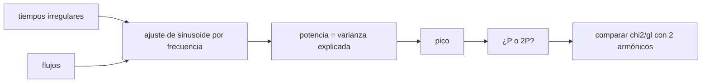

# B58-C13 — Caracterización de rotación

<!-- nav:top -->
[🏠 Programa](../../../../README.md) · [📚 Bloque B58](../../../tronco-comun/B58-asteroides-cometas-y-defensa-planetaria.md) · [← Anterior: B58-C12 — Radar planetario](../B58-C12-radar-planetario/CLASE.md) · [Siguiente: B58-C14 — Efectos Yarkovsky y YORP →](../B58-C14-efectos-yarkovsky-y-yorp/CLASE.md)
<!-- /nav -->

## 1. Ubicación, nivel y alcance

Clase 13 del bloque B58 (nivel N3). La curva de luz de un asteroide se repite al rotar. Aquí buscas el periodo en una curva **sintética** irregularmente muestreada con un periodograma de mínimos cuadrados, ves por qué el pico suele indicar la mitad del periodo y lo resuelves comparando modelos. Conecta con la forma y la rotación que el radar (C12) también mide.

## 2. Por qué esta clase existe

La rotación fija el tamaño máximo de un cuerpo sin cohesión y la acción de los efectos térmicos (C14); además, un cuerpo que rota muy rápido o muy lento ya dice algo de su estructura. La decisión central: **¿cuál es el periodo, el del pico del periodograma o el doble?**

## 3. Lo que podrás hacer al terminar

1. Ajustar una sinusoide a datos irregulares por mínimos cuadrados.
2. Calcular la potencia como fracción de varianza explicada.
3. Localizar el pico en una malla de frecuencias.
4. Explicar la ambigüedad del doble pico en curvas de dos máximos.
5. Decidir entre dos periodos con `χ²/gl`.
6. Rotular la curva como sintética.

La evidencia es la **ficha de la curva de luz** del ejercicio 12 (sección 20).

## 4. Con qué llegas y cómo comprobarlo

1. ¿Qué es una frecuencia?
2. ¿Qué es una serie de Fourier?
3. ¿Qué es `χ²/gl`?
4. ¿Qué es muestreo irregular?
5. ¿Qué es una curva de luz?

<details>
<summary>Ver respuestas</summary>

1. El inverso del periodo. 2. Una suma de senos y cosenos de frecuencias múltiplos de una fundamental. 3. El residuo ponderado por grado de libertad; cercano a 1 si el ajuste es bueno. 4. Observaciones a intervalos desiguales. 5. El brillo en función del tiempo.
</details>

Con cuatro o cinco aciertos, sigue; si no, repasa los prerrequisitos.

## 5. Un caso de contexto y casos de referencia

El ejemplo conductor es una curva sintética de 60 puntos en tres noches, con periodo verdadero `3,2 h` y dos máximos por vuelta. El periodograma tiene su pico en `14.999 ciclos/día`, es decir `1.600 h`, la mitad del verdadero. El doble, `3.200 h`, da `χ²/gl = 1.24` y el periodo del pico, `6`.

## 6. Vocabulario

El **periodograma** mide la potencia de una sinusoide en cada frecuencia. La **curva de luz** es el brillo frente al tiempo. Una curva **bimodal** tiene dos máximos y dos mínimos por vuelta (cuerpo alargado). El **alias** es un pico falso por el muestreo. Un **armónico** es una frecuencia múltiplo de la fundamental.

## 7. Modelo mental: un ventilador con dos aspas iguales



*Descripción textual:* se ajusta una sinusoide en cada frecuencia, se toma el pico y se decide entre el periodo del pico y su doble comparando modelos de dos armónicos.

Analogía: Como un ventilador con dos aspas iguales: parece repetirse en media vuelta. Límite: si las dos mitades de la curva son distintas (primer armónico), el periodo verdadero es el doble.

## 8. La explicación, paso a paso

### 8.1 Ajuste por frecuencia

Para cada `f` se resuelve `y = c + a cos 2πft + b sin 2πft` por mínimos cuadrados y la potencia es `1 − SSE/SS₀`, la fracción de varianza explicada. Para una sinusoide exacta es `1.000000000000`.

### 8.2 El pico

El barrido de 2 a 20 ciclos/día con paso 0,01 y un refinamiento fino da el pico en `14.9995 ciclos/día`, a `0.00 %` del segundo armónico `2/P = 15.000`. La amplitud del segundo armónico (0,12) domina a la del primero (0,03).

### 8.3 Periodo o doble

Se ajusta una serie de dos armónicos con frecuencia fundamental `f_pico` y con `f_pico/2`. Resultado: `χ²/gl = 6.1` para el pico y `1.24` para el doble. El doble describe los datos al nivel del ruido (`σ = 0,01`) y el del pico no.

### 8.4 Consecuencia

El periodo es `3.200 h`, no `1.600 h`. La regla práctica: una curva de dos máximos por vuelta tiene un pico en la mitad del periodo, y hay que comprobar si el primer armónico distingue las dos mitades.

### 8.5 Límites

Con tres noches se resuelve el periodo, pero un muestreo con huecos de un día crea alias; la fase solar y los cambios de geometría deforman la curva en observaciones reales.

## 9. Magnitudes, símbolos y unidades

| Símbolo | Qué es | Unidad | Valor / nota |
|---|---|---|---|
| `P` | periodo de rotación | h | 3,2 (sintético) |
| `f` | frecuencia | ciclos/día | 14.999 (pico) |
| `t` | tiempo | d | 0–2,25 |
| `σ` | ruido | — | 0,01 |
| potencia | varianza explicada | — | 0.902 |
| `χ²/gl` | ajuste | — | 1.24 (doble) |

## 10. Convenciones y referencias

Brillo relativo adimensional; tiempos en días de las tres noches; semilla `20261109`; curva sintética.

## 11. De dónde sale lo que afirmamos

| ID | Fuente | Localizador | Respalda | Estado |
|---|---|---|---|---|
| — | Sin fuente externa | — | relaciones estándar que verifica el laboratorio | No se consultó una fuente para esta clase |

No consultado: bases de periodos de rotación ni la literatura de inversión de curvas de luz; el contraste es una sinusoide exacta y el modelo de Fourier usado para generar los datos.

Límites: sin fuente externa.

## 12. Cómo ver el periodograma

| Magnitud | Valor |
|---|---|
| pico | 14.9995 ciclos/día (1.600 h) |
| periodo doble | 3.200 h |
| χ²/gl en el pico | 6.1 |
| χ²/gl en el doble | 1.24 |

Descripción larga: el pico indica `1.60 h` pero el modelo correcto es el del doble, `3.20 h`.

## 13. Ejemplo trabajado: leer el pico

**Paso 1 · Pico.** `f = 14.999` ciclos/día, `P = 24/f = 1.600 h`.

**Paso 2 · Hipótesis.** Curva bimodal: el verdadero periodo es el doble.

**Paso 3 · Prueba.** `χ²/gl` en el doble `1.24`; en el pico `6`.

**Paso 4 · Conclusión.** `P = 3.200 h`.

## 14. Distintas formas de resolver lo mismo

**Pico simple:** rápido pero ambiguo. **Dos armónicos:** distingue P de P/2. **Inversión de forma:** usa muchas curvas para obtener la forma (no hecha aquí).

## 15. Práctica guiada

**Ejercicio 1 · con los pasos indicados.** Convierte `f = 15 ciclos/día` en periodo en horas. *Pasos:* `24/f`.

<details><summary>Solución comentada</summary>

`1,6 h`.
</details>

**Ejercicio 2 · con una pista.** ¿Cuál es el doble de ese periodo?

<details><summary>Solución comentada</summary>

`3,2 h`.
</details>

**Ejercicio 3 · casi autónomo.** Calcula `χ²/gl` si `SSE = 0,0072`, `σ = 0,01` y `gl = 55`.

<details><summary>Solución comentada</summary>

`1,31`.
</details>

## 16. Práctica autónoma, transferencia e integrador

**Ejercicio 4 · autónomo.** ¿Qué potencia tiene una sinusoide exacta?

<details><summary>Solución comentada</summary>

1.
</details>

**Ejercicio 5 · autónomo.** ¿Por qué un cuerpo alargado da dos máximos por vuelta?

<details><summary>Solución comentada</summary>

Presenta dos veces la cara mayor en cada vuelta.
</details>

**Ejercicio 6 · autónomo.** ¿Qué pasaría con noches separadas por 10 días?

<details><summary>Solución comentada</summary>

Alias: picos falsos con separación `1/10 d`.
</details>

**Ejercicio 7 · autónomo.** ¿Qué indica una potencia de 0,5?

<details><summary>Solución comentada</summary>

Que la sinusoide explica la mitad de la varianza.
</details>

**Ejercicio 8 · autónomo.** ¿Cuántas noches mínimas hacen falta para periodo de 3,2 h?

<details><summary>Solución comentada</summary>

Una noche de 6 h cubre casi dos vueltas, pero varias dan más seguridad.
</details>

**Ejercicio 9 · transferencia.** **Transferencia.** Un colega publica 1,6 h. ¿Qué verificas?

<details><summary>Solución comentada</summary>

Si la curva es bimodal y si el doble ajusta mejor.
</details>

**Ejercicio 10 · transferencia.** **Transferencia.** ¿Qué relación hay con la barrera de rotación de C14?

<details><summary>Solución comentada</summary>

Un periodo menor que unas 2 h exige cohesión en un cúmulo de escombros.
</details>

**Ejercicio 11 · transferencia.** **Transferencia.** ¿Qué efecto tiene un cambio de fase solar durante las noches?

<details><summary>Solución comentada</summary>

Cambia la amplitud y la forma y sesga el ajuste.
</details>

**Ejercicio 12 · integrador.** **Integrador.** Elabora tu *ficha de la curva de luz*: pico, doble periodo, `χ²/gl` y la decisión.

<details><summary>Solución comentada</summary>

Secciones 8.2–8.4.
</details>

## 17. Laboratorio: periodograma de una curva de luz sintética

El script [rotacion.py](rotacion.py) busca el periodo con mínimos cuadrados por frecuencia y decide entre P y 2P (**comprueba** potencia 1 para una sinusoide exacta, pico a 1 % de `2/P`, `χ²/gl` del doble entre 0,6 y 1,5 y del pico mayor que 5).

**Datos:** curva **sintética**; semilla `20261109`. **Predice antes de ejecutar:** ¿El pico estará en `1/P` o en `2/P`? **Ejecución del 2026-11-09:**

```text
Python 3.12.9 (biblioteca estandar)
60 puntos; periodo verdadero sintetico = 3.200 h (frecuencia 7.500 ciclos/dia ; segundo armonico 15.000)
Potencia de una sinusoide exacta = 1.000000000000
Pico del periodograma: f = 14.9995 ciclos/dia (periodo 1.6001 h) con potencia 0.9021
Doble del periodo del pico = 3.2001 h
chi2/gl con 2 armonicos: en el pico = 6.09 ; en la mitad de la frecuencia (periodo doble) = 1.24
Pruebas superadas.
```

```bash
python programa/clases/B58/B58-C13-caracterizacion-de-rotacion/rotacion.py
```

**Límites:** rotación principal, sin geometría variable, tres noches regulares.

## 18. Errores frecuentes y cómo corregirlos

**Tomar el pico como el periodo.** Se corrige con 8.3.

**Ignorar los alias.** Se corrige con 8.5.

**Confundir potencia y significancia.** Se corrige con 8.1.

**Presentar la curva como observada.** Se corrige con la sección 10.

## 19. Cómo sabrás que vas bien

Tras la sección 8: ¿qué esperabas del pico y qué obtuviste? Si dudas, repasa el ejemplo 13. Tras el laboratorio: ¿qué comprueba? (ver la sección 17).

## 20. Qué entregas y cómo se evalúa

El producto es tu **ficha de la curva de luz** (ejercicio 12).

| Criterio | Inicial | En desarrollo | Logrado | Destacado |
|---|---|---|---|---|
| Conceptos | Los confunde | Parciales | Conceptos de la clase | Explica los límites |
| Cálculo | Sin unidades | Con errores | Tablas completas | Calcula casos nuevos |
| Numérico | Sin comprobar | Un caso | Contraste con el análisis | Interpreta las diferencias |
| Fuentes | Sin fuente | Sin fecha | Fuentes con fecha | Declara lo no consultado |
| Límites | No los nombra | Uno | Tres | Discute qué falta del modelo |

**Condiciones críticas (no se compensan con promedio):** rotular la curva como sintética; no presentar el periodo como el de un asteroide real; declarar lo no consultado.

## 21. Ética, seguridad y límites

Clase educativa: los modelos son simplificados y los datos, sintéticos; nada de lo calculado evalúa un objeto real ni sustituye a los sistemas oficiales de monitoreo y alerta.  Accesibilidad: tablas equivalentes a las gráficas, fórmulas en texto, ejercicios sin conexión.

## 22. Para cerrar y seguir

El pico está en la mitad del periodo (1.60 h) y la comparación de modelos da 3.20 h. Queda una pregunta: ¿qué fuerzas cambian la órbita y la rotación sin choques?

**Glosario español–inglés.** periodograma · *periodogram*; curva de luz · *light curve*; armónico · *harmonic*; alias · *alias*; periodo de rotación · *rotation period*.

**Continuidad.** [B58-C14](../B58-C14-efectos-yarkovsky-y-yorp/CLASE.md) estudia efectos Yarkovsky y YORP.

**Referencias:** ver sección 11.

<!-- nav:bottom -->
---

[← Anterior: B58-C12 — Radar planetario](../B58-C12-radar-planetario/CLASE.md) · [📚 Bloque B58](../../../tronco-comun/B58-asteroides-cometas-y-defensa-planetaria.md) · [Siguiente: B58-C14 — Efectos Yarkovsky y YORP →](../B58-C14-efectos-yarkovsky-y-yorp/CLASE.md)
<!-- /nav -->
