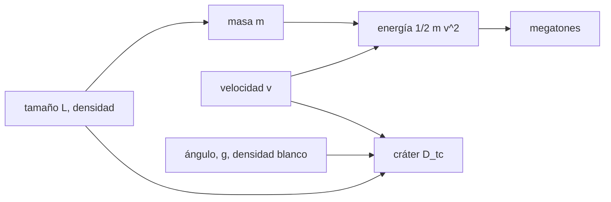

# B58-C15 — Modelos de impacto planetario

<!-- nav:top -->
[🏠 Programa](../../../../README.md) · [📚 Bloque B58](../../../tronco-comun/B58-asteroides-cometas-y-defensa-planetaria.md) · [← Anterior: B58-C14 — Efectos Yarkovsky y YORP](../B58-C14-efectos-yarkovsky-y-yorp/CLASE.md) · [Siguiente: B58-C16 — Consecuencias geofísicas de impactos →](../B58-C16-consecuencias-geofisicas-de-impactos/CLASE.md)
<!-- /nav -->

## 1. Ubicación, nivel y alcance

Clase 15 del bloque B58 (nivel N3). Si un objeto impacta, ¿cuánta energía libera y qué cráter deja? Aquí calculas la energía cinética de un impactor **sintético** de 470 m, aplicas una ley de escalamiento recordada para el cráter transitorio, verificas sus exponentes numéricamente y ves cómo cambian el cráter con la velocidad y el ángulo. Usas la energía de C10 y prepara C16–C17.

## 2. Por qué esta clase existe

Para decidir si una desviación es necesaria hay que saber qué haría el impacto. La decisión central: **¿cómo escalan la energía y el cráter con el tamaño, la velocidad y el ángulo?** Aquí se verifica el escalamiento, no los coeficientes.

## 3. Lo que podrás hacer al terminar

1. Calcular la masa y la energía de un impactor esférico.
2. Convertir energía a megatones.
3. Aplicar una ley de potencias para el cráter transitorio.
4. Verificar los exponentes con diferencias centrales.
5. Leer la sensibilidad a velocidad y ángulo.
6. Declarar que los coeficientes no se consultaron.

La evidencia es la **ficha del modelo de impacto** del ejercicio 12 (sección 20).

## 4. Con qué llegas y cómo comprobarlo

1. ¿Qué es la energía cinética?
2. ¿Qué es una ley de potencias?
3. ¿Qué es un exponente local?
4. ¿Qué es un megatón?
5. ¿Qué es el ángulo de impacto?

<details>
<summary>Ver respuestas</summary>

1. `½ m v²`. 2. Una relación `y = C x^p`. 3. `d ln y / d ln x`. 4. `4,184×10¹⁵ J` por convención. 5. El ángulo entre la trayectoria y la superficie.
</details>

Con cuatro o cinco aciertos, sigue; si no, repasa los prerrequisitos.

## 5. Un caso de contexto y casos de referencia

El ejemplo conductor es un impactor sintético de 470 m (el tamaño mediano del escenario ficticio de [S6]), con densidad `2600 kg/m³`, `20 km/s` y 45° (los tres últimos, ilustrativos). Su masa es `1.41e+11 kg` y su energía `6756 Mt`. El escalamiento recordado da un cráter transitorio de `6.01 km` y uno final simple de `7.51 km`.

## 6. Vocabulario

El **cráter transitorio** es la cavidad máxima antes del colapso. El **cráter simple** conserva forma de cuenco. La **ley de escalamiento** relaciona el cráter con las variables del impacto. La **velocidad de impacto** incluye la de aproximación y la atracción terrestre. El **ángulo** modifica el cráter con `sin^(1/3)θ` en este modelo.

## 7. Modelo mental: lanzar una piedra a la arena



*Descripción textual:* el tamaño y la densidad fijan la masa; con la velocidad dan la energía; el escalamiento combina tamaño, velocidad, ángulo y gravedad en el cráter.

Analogía: Como lanzar piedras cada vez más rápidas a la arena: el hoyo crece, pero menos que proporcionalmente. Límite: el escalamiento vale en un rango; para impactos muy grandes o blandos hay otros regímenes.

## 8. La explicación, paso a paso

### 8.1 Masa y energía

`m = ρπL³/6 = 1.413e+11 kg`; `E = ½ m v² = 2.827e+19 J = 6756.2 Mt`. Por la vía del impulso `p²/2m` coincide con 12 cifras.

### 8.2 Ley de escalamiento

`D_tc = 1,161 (ρ_i/ρ_t)^(1/3) L^0,78 v^0,44 g^(−0,22) sin^(1/3)θ` (SI). El coeficiente y los exponentes son los que el autor recuerda de la literatura (no consultados): el modelo es un **escalamiento por verificar**. El crater simple final se toma como `1,25 D_tc`.

### 8.3 Verificación de exponentes

El exponente local de `L` es `0.780000`, el de `v` `0.440000`, el de `g` `-0.220000` y el del seno `0.333333`: el código implementa lo que dice la fórmula. Duplicar `L` multiplica el cráter por `1.7171 = 2^0,78`, menos que el factor 2 de la longitud.

### 8.4 Sensibilidad

`v = 12 km/s`, `θ = 30°` → `D_tc = 4.28 km`, final `5.35 km`.
`v = 12 km/s`, `θ = 45°` → `D_tc = 4.80 km`, final `6.00 km`.
`v = 12 km/s`, `θ = 90°` → `D_tc = 5.39 km`, final `6.73 km`.
`v = 20 km/s`, `θ = 30°` → `D_tc = 5.35 km`, final `6.69 km`.
`v = 20 km/s`, `θ = 45°` → `D_tc = 6.01 km`, final `7.51 km`.
`v = 20 km/s`, `θ = 90°` → `D_tc = 6.75 km`, final `8.43 km`.
`v = 30 km/s`, `θ = 30°` → `D_tc = 6.40 km`, final `8.00 km`.
`v = 30 km/s`, `θ = 45°` → `D_tc = 7.18 km`, final `8.98 km`.
`v = 30 km/s`, `θ = 90°` → `D_tc = 8.06 km`, final `10.08 km`.

### 8.5 A igual energía

Con `v = 30 km/s` y la misma energía (`6756 Mt`), el cuerpo mediría `359 m` y el cráter transitorio sería `5.82 km`: la energía no basta, importan el tamaño y la velocidad por separado.

## 9. Magnitudes, símbolos y unidades

| Símbolo | Qué es | Unidad | Valor / nota |
|---|---|---|---|
| `L` | diámetro del impactor | m | 470 (sintético) |
| `ρ_i, ρ_t` | densidades | kg/m³ | 2600; 2500 |
| `v` | velocidad | m/s | 20 000 |
| `θ` | ángulo | grado | 45 |
| `g` | gravedad | m/s² | 9,81 |
| `E` | energía | J; Mt | 2.83e+19; 6756 |
| `D_tc` | cráter transitorio | km | 6.01 |

## 10. Convenciones y referencias

SI; impactor esférico homogéneo; blanco de roca; sin atmósfera. Escenario sintético; el tamaño procede de un ejercicio ficticio.

## 11. De dónde sale lo que afirmamos

| ID | Fuente | Localizador | Respalda | Estado |
|---|---|---|---|---|
| S6 | CNEOS/JPL, ejercicio de la Conferencia de Defensa Planetaria 2023 (asteroide ficticio 2023 PDC) | [https://cneos.jpl.nasa.gov/pd/cs/pdc23/](https://cneos.jpl.nasa.gov/pd/cs/pdc23/) | escenario ficticio con asteroide de unos 470 m de tamaño mediano (2023 PDC), usado solo como orden de magnitud | Página leída el 2026-11-09 (resumen extraído de la página) |

No consultado: el artículo de escalamiento de cráteres de impacto (ADS no abrió) ni ninguna tabla de coeficientes; la ley de potencias y el factor 1,25 son recordados y se rotulan por verificar.

Límites: la fuente solo respalda el tamaño del escenario ficticio; no hay cráter observado alguno.

## 12. Cómo ver el cráter según velocidad y ángulo

| Magnitud | Valor |
|---|---|
| 12 km/s, 30° | 4.28 km |
| 12 km/s, 45° | 4.80 km |
| 12 km/s, 90° | 5.39 km |
| 20 km/s, 30° | 5.35 km |
| 20 km/s, 45° | 6.01 km |
| 20 km/s, 90° | 6.75 km |
| 30 km/s, 30° | 6.40 km |
| 30 km/s, 45° | 7.18 km |
| 30 km/s, 90° | 8.06 km |

Descripción larga: el cráter pasa de `4.3` a `8.1 km` entre los casos extremos.

## 13. Ejemplo trabajado: energía del caso conductor

**Paso 1 · Masa.** `m = 1.413e+11 kg`.

**Paso 2 · Energía.** `E = 2.827e+19 J`.

**Paso 3 · En Mt.** `6756.2 Mt`.

**Paso 4 · Cráter.** `D_tc = 6.01 km`.

## 14. Distintas formas de resolver lo mismo

**Energía:** exacta. **Escalamiento:** aproximada y recordada. **Simulación hidrodinámica** (no hecha aquí) sería la referencia. Se verifica primero el código con exponentes y luego se compara con la literatura.

## 15. Práctica guiada

**Ejercicio 1 · con los pasos indicados.** Calcula la masa de una esfera de 100 m y 3000 kg/m³. *Pasos:* `ρπL³/6`.

<details><summary>Solución comentada</summary>

`1,571×10⁹ kg`.
</details>

**Ejercicio 2 · con una pista.** ¿Cuál es su energía a 20 km/s?

<details><summary>Solución comentada</summary>

`3,14×10¹⁷ J ≈ 75 Mt`.
</details>

**Ejercicio 3 · casi autónomo.** Si `v` se duplica, ¿cuánto cambia `E`?

<details><summary>Solución comentada</summary>

Se cuadruplica.
</details>

## 16. Práctica autónoma, transferencia e integrador

**Ejercicio 4 · autónomo.** Si `v` se duplica, ¿cuánto cambia `D_tc`?

<details><summary>Solución comentada</summary>

`2^0,44 = 1,36`.
</details>

**Ejercicio 5 · autónomo.** Si `L` se multiplica por 10, ¿cuánto cambia `D_tc`?

<details><summary>Solución comentada</summary>

`10^0,78 = 6,0`.
</details>

**Ejercicio 6 · autónomo.** ¿Y `E`?

<details><summary>Solución comentada</summary>

`10³`.
</details>

**Ejercicio 7 · autónomo.** ¿Qué cambia `D_tc` al pasar de 45° a 90°?

<details><summary>Solución comentada</summary>

`(1/sin45°)^(1/3) = 1,12` veces mayor: `6.01` frente a `6.75 km` a 20 km/s.
</details>

**Ejercicio 8 · autónomo.** Calcula `1,25·D_tc` de un transitorio de 8 km.

<details><summary>Solución comentada</summary>

`10 km`.
</details>

**Ejercicio 9 · transferencia.** **Transferencia.** Un colega usa la energía para predecir el cráter. ¿Qué le falta?

<details><summary>Solución comentada</summary>

Tamaño y velocidad por separado, ángulo, gravedad y blanco.
</details>

**Ejercicio 10 · transferencia.** **Transferencia.** ¿Por qué un impacto sobre el océano no se describe con este cráter?

<details><summary>Solución comentada</summary>

El blanco es agua: otro régimen y otra consecuencia (tsunami).
</details>

**Ejercicio 11 · transferencia.** **Transferencia.** ¿Qué comprobarías antes de usar el coeficiente 1,161?

<details><summary>Solución comentada</summary>

Su valor en la fuente primaria y el rango de validez.
</details>

**Ejercicio 12 · integrador.** **Integrador.** Elabora tu *ficha del modelo de impacto*: energía, cráter, exponentes verificados y sensibilidad.

<details><summary>Solución comentada</summary>

Secciones 8.1–8.5.
</details>

## 17. Laboratorio: energía y escalamiento del cráter

El script [impacto.py](impacto.py) calcula la energía por dos vías y el cráter por ley de potencias, y verifica los exponentes (**comprueba** energía con 10⁻¹², exponentes con 10⁻⁶ y el cociente `2^0,78`).

**Datos:** escenario **sintético** (tamaño de [S6]); coeficientes recordados, no consultados. **Predice antes de ejecutar:** ¿Cuántas veces mayor será el cráter si el cuerpo es el doble de grande? **Ejecución del 2026-11-09:**

```text
Python 3.12.9 (biblioteca estandar)
Masa = 1.4134e+11 kg ; E = 2.8268e+19 J = 6756.2 Mt (via p^2/2m: 2.8268e+19 J)
Crater transitorio D_tc = 6.010 km ; crater simple final = 7.512 km
Exponentes numericos: L = 0.780000 (0.78) ; v = 0.440000 (0.44) ; g = -0.220000 (-0.22) ; sin(theta) = 0.333333 (1/3)
Duplicar L multiplica D_tc por 1.717131 (2^0.78 = 1.717131)
 v[km/s]    theta   D_tc[km] D_final[km]
      12       30      4.276      5.345
      12       45      4.800      6.000
      12       90      5.388      6.735
      20       30      5.354      6.693
      20       45      6.010      7.512
      20       90      6.746      8.432
      30       30      6.400      8.000
      30       45      7.184      8.979
      30       90      8.063     10.079
Misma energia con v = 30 km/s: L = 358.7 m (E = 6756.2 Mt) -> D_tc = 5.818 km
Pruebas superadas.
```

```bash
python programa/clases/B58/B58-C15-modelos-de-impacto-planetario/impacto.py
```

**Límites:** roca competente, sin atmósfera; solo el escalamiento se verifica, no los coeficientes.

## 18. Errores frecuentes y cómo corregirlos

**Tomar el cráter por un valor medido.** Se corrige con la sección 11.

**Confundir energía y tamaño.** Se corrige con 8.5.

**Olvidar el ángulo.** Se corrige con 8.4.

**Aplicar el modelo al océano.** Se corrige con la sección 21.

## 19. Cómo sabrás que vas bien

Tras la sección 8: ¿qué factor esperabas al duplicar L y cuál obtuviste? Si dudas, repasa el ejemplo 13. Tras el laboratorio: ¿qué comprueba? (ver la sección 17).

## 20. Qué entregas y cómo se evalúa

El producto es tu **ficha del modelo de impacto** (ejercicio 12).

| Criterio | Inicial | En desarrollo | Logrado | Destacado |
|---|---|---|---|---|
| Conceptos | Los confunde | Parciales | Conceptos de la clase | Explica los límites |
| Cálculo | Sin unidades | Con errores | Tablas completas | Calcula casos nuevos |
| Numérico | Sin comprobar | Un caso | Contraste con el análisis | Interpreta las diferencias |
| Fuentes | Sin fuente | Sin fecha | Fuentes con fecha | Declara lo no consultado |
| Límites | No los nombra | Uno | Tres | Discute qué falta del modelo |

**Condiciones críticas (no se compensan con promedio):** rotular el escenario como sintético; no presentar el cráter como predicción de un objeto real; declarar que los coeficientes no se consultaron.

## 21. Ética, seguridad y límites

Clase educativa: los modelos son simplificados y los datos, sintéticos; nada de lo calculado evalúa un objeto real ni sustituye a los sistemas oficiales de monitoreo y alerta.  Accesibilidad: tablas equivalentes a las gráficas, fórmulas en texto, ejercicios sin conexión.

## 22. Para cerrar y seguir

El impactor sintético libera `6756 Mt` y el escalamiento recordado da un cráter transitorio de `6.0 km`. Queda una pregunta: ¿qué otros efectos geofísicos produce?

**Glosario español–inglés.** cráter transitorio · *transient crater*; escalamiento · *scaling*; energía cinética · *kinetic energy*; ángulo de impacto · *impact angle*; cráter simple · *simple crater*.

**Continuidad.** [B58-C16](../B58-C16-consecuencias-geofisicas-de-impactos/CLASE.md) estudia consecuencias geofísicas de impactos.

**Referencias:** ver sección 11.

<!-- nav:bottom -->
---

[← Anterior: B58-C14 — Efectos Yarkovsky y YORP](../B58-C14-efectos-yarkovsky-y-yorp/CLASE.md) · [📚 Bloque B58](../../../tronco-comun/B58-asteroides-cometas-y-defensa-planetaria.md) · [Siguiente: B58-C16 — Consecuencias geofísicas de impactos →](../B58-C16-consecuencias-geofisicas-de-impactos/CLASE.md)
<!-- /nav -->
