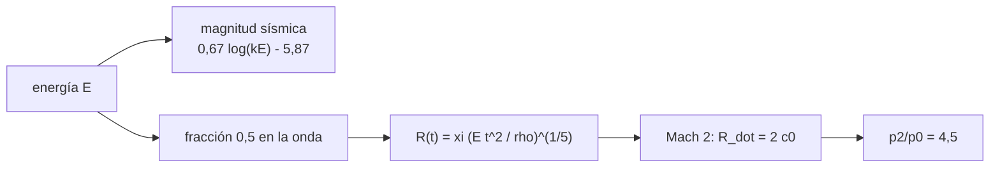

# B58-C16 — Consecuencias geofísicas de impactos

<!-- nav:top -->
[🏠 Programa](../../../../README.md) · [📚 Bloque B58](../../../tronco-comun/B58-asteroides-cometas-y-defensa-planetaria.md) · [← Anterior: B58-C15 — Modelos de impacto planetario](../B58-C15-modelos-de-impacto-planetario/CLASE.md) · [Siguiente: B58-C17 — Principios de mitigación y desviación →](../../../tronco-comun/B58-asteroides-cometas-y-defensa-planetaria.md#b58-c17)
<!-- /nav -->

## 1. Ubicación, nivel y alcance

Clase 16 del bloque B58 (nivel N3). Un impacto libera energía en la atmósfera y en el suelo. Aquí calculas, para cuatro impactores **sintéticos** de C10, la magnitud sísmica equivalente y el radio donde la onda de choque llega a Mach 2, con la solución de Sedov–Taylor, y verificas sus relaciones de escala. Todo con coeficientes recordados y rotulados.

## 2. Por qué esta clase existe

Las consecuencias se miden por zonas: sismo, onda de choque, calor. Las escalas con la energía son lo que permite comparar casos. La decisión central: **¿cómo crece el área afectada con la energía y qué parte del cálculo es robusta?**

## 3. Lo que podrás hacer al terminar

1. Calcular la magnitud sísmica equivalente de una energía.
2. Aplicar la solución de Sedov–Taylor.
3. Hallar el radio donde el frente tiene Mach 2.
4. Verificar escalas con la energía.
5. Usar la relación de Rankine–Hugoniot.
6. Declarar los coeficientes como recordados y las eficiencias como ilustrativas.

La evidencia es la **ficha de consecuencias** del ejercicio 12 (sección 20).

## 4. Con qué llegas y cómo comprobarlo

1. ¿Qué es una onda de choque?
2. ¿Qué es el número de Mach?
3. ¿Qué es una escala logarítmica?
4. ¿Qué es una eficiencia?
5. ¿Qué es un punto de explosión?

<details>
<summary>Ver respuestas</summary>

1. Un frente de presión que avanza más rápido que el sonido. 2. La velocidad dividida por la del sonido. 3. Una en que cada unidad multiplica por un factor. 4. La fracción de energía que va a un proceso. 5. Una liberación de energía concentrada en un punto.
</details>

Con cuatro o cinco aciertos, sigue; si no, repasa los prerrequisitos.

## 5. Un caso de contexto y casos de referencia

El ejemplo conductor son cuatro impactores sintéticos. El de 140 m libera `179 Mt`; con eficiencia sísmica ilustrativa de `10⁻⁴` su magnitud equivalente es `3.43`, y con la mitad de la energía en la onda, el frente llega a Mach 2 a `5.0 km` a los `3 s`. Para 470 m: `4.48` y `16.9 km`.

## 6. Vocabulario

La **magnitud sísmica equivalente** traduce una energía sísmica en una magnitud. La **solución de Sedov–Taylor** describe la expansión autosemejante de una explosión intensa. El **Mach** del frente es `Ṙ/c₀`. Las **relaciones de Rankine–Hugoniot** unen los estados antes y después del choque. El **radio de Mach 2** es un criterio práctico, no un daño.

## 7. Modelo mental: la onda de una piedra en un estanque



*Descripción textual:* la energía se reparte en una parte sísmica y otra en la onda; la solución autosemejante da el radio del frente y se busca donde su velocidad cae a Mach 2.

Analogía: Como el anillo de una piedra: crece y se debilita con la distancia. Límite: la explosión real tiene altura, fragmentación y atmósfera estratificada; Sedov supone aire uniforme y punto.

## 8. La explicación, paso a paso

### 8.1 Magnitud sísmica equivalente

`M = 0,67 log₁₀(kE) − 5,87`, con `E` en J y `k = 10⁻⁴` (ilustrativa; relación recordada, no consultada). Resultados: `SINT-4 (20 m) → 1.71`; `SINT-2 (50 m) → 2.36`; `SINT-1 (140 m) → 3.43`; `SINT-3 (470 m) → 4.48`. Es una equivalencia energética, no un terremoto idéntico.

### 8.2 Sedov–Taylor

`R(t) = ξ (E t²/ρ₀)^(1/5)` con `ξ = 1,033`, `ρ₀ = 1,2 kg/m³` (valores recordados). La velocidad del frente es `Ṙ = 0,4 R/t`; el laboratorio la comprueba por diferencias centrales: `680.000000` frente a `680.000000 m/s`.

### 8.3 Radio de Mach 2

Se resuelve `Ṙ = 2 c₀` con `c₀ = 340 m/s`. Con el 50 % de la energía en la onda: `SINT-4: 0.70 km a 0.4 s`; `SINT-2: 1.48 km a 0.9 s`; `SINT-1: 5.02 km a 3.0 s`; `SINT-3: 16.86 km a 9.9 s`. El radio crece como `E^(1/3)`; al multiplicar `E` por 8 el factor es `2.000000`.

### 8.4 Rankine–Hugoniot

Para un choque fuerte `p₂/p₀ = (2γM² − (γ−1))/(γ+1)`: vale `1.0` en `M = 1` (sin salto) y `4.5` en `M = 2`, es decir una sobrepresión de 3,5 veces la atmosférica. Es la base de los criterios de daño.

### 8.5 Qué no hace

No calcula daños ni víctimas, no considera altura de la explosión ni terreno, y la eficiencia sísmica y la fracción de la onda son valores ilustrativos. Sirve para comparar casos, no para evaluar uno real.

## 9. Magnitudes, símbolos y unidades

| Símbolo | Qué es | Unidad | Valor / nota |
|---|---|---|---|
| `E` | energía del impacto | J; Mt | 0.487 – 6.76e+03 Mt |
| `k` | eficiencia sísmica | — | 10⁻⁴ (ilustrativa) |
| `M` | magnitud equivalente | — | 1.7 – 4.5 |
| `ξ` | constante de Sedov | — | 1,033 |
| `ρ₀, c₀` | aire | kg/m³, m/s | 1,2; 340 |
| `R` | radio del frente | km | 0.70 – 16.9 |
| `p₂/p₀` | salto de presión | — | 4,5 en Mach 2 |

## 10. Convenciones y referencias

SI; aire uniforme; fracción de la energía en la onda 0,5; datos sintéticos; coeficientes recordados.

## 11. De dónde sale lo que afirmamos

| ID | Fuente | Localizador | Respalda | Estado |
|---|---|---|---|---|
| — | Sin fuente externa | — | relaciones estándar que verifica el laboratorio | No se consultó una fuente para esta clase |

No consultado: las relaciones de efectos de impacto (sísmica y ondas) ni los criterios de daño; Rankine–Hugoniot y Sedov–Taylor son resultados estándar de la gasdinámica verificados con comprobaciones internas, y los coeficientes se rotulan recordados.

Límites: sin fuente externa; no hay daños calculados.

## 12. Cómo ver las consecuencias de cuatro casos

| Magnitud | Valor |
|---|---|
| SINT-4 (20 m) | M ≈ 1.71; R(Mach 2) = 0.70 km |
| SINT-2 (50 m) | M ≈ 2.36; R(Mach 2) = 1.48 km |
| SINT-1 (140 m) | M ≈ 3.43; R(Mach 2) = 5.02 km |
| SINT-3 (470 m) | M ≈ 4.48; R(Mach 2) = 16.86 km |

Descripción larga: el radio de Mach 2 crece de `0.70` a `16.9 km`.

## 13. Ejemplo trabajado: el radio de Mach 2 del caso de 140 m

**Paso 1 · Energía en la onda.** `E_b = 0,5·179 Mt`.

**Paso 2 · Tiempo.** `t = 3.0 s` donde `Ṙ = 2c₀ = 680 m/s`.

**Paso 3 · Radio.** `R = 5.02 km`.

**Paso 4 · Presión.** `p₂/p₀ = 4,5`.

## 14. Distintas formas de resolver lo mismo

**Sedov:** analítico y autosemejante. **Escala cúbica:** `R ∝ E^(1/3)` a Mach fijo. **Simulación hidrodinámica:** referencia (no hecha). La primera da la ley; las otras darían el coeficiente.

## 15. Práctica guiada

**Ejercicio 1 · con los pasos indicados.** Calcula `p₂/p₀` en `M = 3`. *Pasos:* fórmula con `γ = 1,4`.

<details><summary>Solución comentada</summary>

`(2·1,4·9 − 0,4)/2,4 = 10,33`.
</details>

**Ejercicio 2 · con una pista.** ¿Cómo cambia `R(Mach 2)` si `E` se multiplica por 1000?

<details><summary>Solución comentada</summary>

Por 10 (`1000^(1/3)`).
</details>

**Ejercicio 3 · casi autónomo.** ¿Cómo cambia `M` sísmica si `E` se multiplica por 10?

<details><summary>Solución comentada</summary>

Sube `0,67`.
</details>

## 16. Práctica autónoma, transferencia e integrador

**Ejercicio 4 · autónomo.** Calcula `M` para `E = 10¹⁷ J` con `k = 10⁻⁴`.

<details><summary>Solución comentada</summary>

`0,67·13 − 5,87 = 2,84`.
</details>

**Ejercicio 5 · autónomo.** ¿Qué velocidad tiene el frente en Mach 2?

<details><summary>Solución comentada</summary>

`680 m/s`.
</details>

**Ejercicio 6 · autónomo.** ¿Qué relación hay entre `Ṙ`, `R` y `t` en Sedov?

<details><summary>Solución comentada</summary>

`Ṙ = 0,4 R/t`.
</details>

**Ejercicio 7 · autónomo.** Si la onda recibe 25 % de la energía en lugar de 50 %, ¿cómo cambia el radio?

<details><summary>Solución comentada</summary>

Se multiplica por `0,5^(1/3) = 0,79`.
</details>

**Ejercicio 8 · autónomo.** ¿Para qué sirve el criterio de Mach 2?

<details><summary>Solución comentada</summary>

Para comparar casos con un radio común, no para fijar daño.
</details>

**Ejercicio 9 · transferencia.** **Transferencia.** Un titular compara cráteres con terremotos de igual magnitud. ¿Qué precisas?

<details><summary>Solución comentada</summary>

La magnitud equivalente es energética y depende de una eficiencia asumida; los efectos difieren.
</details>

**Ejercicio 10 · transferencia.** **Transferencia.** ¿Qué cambia si el objeto explota a gran altura?

<details><summary>Solución comentada</summary>

La energía se libera lejos del suelo y el radio sobre el terreno es distinto.
</details>

**Ejercicio 11 · transferencia.** **Transferencia.** ¿Qué dato necesitas para pasar del radio a un daño?

<details><summary>Solución comentada</summary>

Una relación entre sobrepresión y daño a las construcciones.
</details>

**Ejercicio 12 · integrador.** **Integrador.** Elabora tu *ficha de consecuencias*: magnitud, radio de Mach 2 y escalas de cuatro casos.

<details><summary>Solución comentada</summary>

Secciones 8.1–8.4.
</details>

## 17. Laboratorio: magnitud sísmica y onda de choque

El script [consecuencias.py](consecuencias.py) calcula magnitud y radio de Mach 2 de cuatro casos y verifica las leyes de escala (**comprueba** la derivada de `R(t)` con 10⁻⁶, la escala `E^(1/3)` con 10⁻⁹ y Rankine–Hugoniot con 10⁻¹²).

**Datos:** impactores **sintéticos**; coeficientes recordados y eficiencias **ilustrativas**. **Predice antes de ejecutar:** ¿Cuánto crece el radio de Mach 2 si la energía se multiplica por 8? **Ejecución del 2026-11-09:**

```text
Python 3.12.9 (biblioteca estandar)
caso       D[m]        E[Mt]   M sismica    R(Mach 2) [km]     t [s]
SINT-4       20       0.4866        1.71             0.702      0.41
SINT-2       50        4.576        2.36             1.481      0.87
SINT-1      140        178.6        3.43             5.023      2.95
SINT-3      470         6756        4.48            16.861      9.92
Velocidad del frente en el punto Mach 2 (caso 140 m): numerica = 680.000000 m/s ; 0.4 R/t = 680.000000 m/s ; 2 c0 = 680.0 m/s
R(Mach 2) al multiplicar E por 8: factor 2.000000000 (8^(1/3) = 2)
Rankine-Hugoniot p2/p0: M = 1 -> 1.000000000000 ; M = 2 -> 4.500000000000
Pruebas superadas.
```

```bash
python programa/clases/B58/B58-C16-consecuencias-geofisicas-de-impactos/consecuencias.py
```

**Límites:** aire uniforme, explosión puntual, sin altura ni daños.

## 18. Errores frecuentes y cómo corregirlos

**Tomar la magnitud equivalente por un sismo real.** Se corrige con 8.1.

**Aplicar Sedov a Mach bajo.** Se corrige con 8.3.

**Olvidar la fracción de energía.** Se corrige con 8.3.

**Presentar radios como zonas de daño.** Se corrige con 8.5.

## 19. Cómo sabrás que vas bien

Tras la sección 8: ¿qué factor esperabas al multiplicar E por 8 y cuál obtuviste? Si dudas, repasa el ejemplo 13. Tras el laboratorio: ¿qué comprueba? (ver la sección 17).

## 20. Qué entregas y cómo se evalúa

El producto es tu **ficha de consecuencias** (ejercicio 12).

| Criterio | Inicial | En desarrollo | Logrado | Destacado |
|---|---|---|---|---|
| Conceptos | Los confunde | Parciales | Conceptos de la clase | Explica los límites |
| Cálculo | Sin unidades | Con errores | Tablas completas | Calcula casos nuevos |
| Numérico | Sin comprobar | Un caso | Contraste con el análisis | Interpreta las diferencias |
| Fuentes | Sin fuente | Sin fecha | Fuentes con fecha | Declara lo no consultado |
| Límites | No los nombra | Uno | Tres | Discute qué falta del modelo |

**Condiciones críticas (no se compensan con promedio):** rotular los impactores como sintéticos; no presentar radios ni magnitudes como daños de un objeto real; declarar lo no consultado.

## 21. Ética, seguridad y límites

Clase educativa: los modelos son simplificados y los datos, sintéticos; nada de lo calculado evalúa un objeto real ni sustituye a los sistemas oficiales de monitoreo y alerta.  Accesibilidad: tablas equivalentes a las gráficas, fórmulas en texto, ejercicios sin conexión.

## 22. Para cerrar y seguir

La energía de `179 Mt` da `M ≈ 3.4` y un frente de Mach 2 a `5.0 km`; el radio escala como `E^(1/3)`. Queda una pregunta: ¿cómo se evita el impacto?

**Glosario español–inglés.** onda de choque · *shock wave*; solución de Sedov–Taylor · *Sedov–Taylor solution*; número de Mach · *Mach number*; magnitud sísmica · *seismic magnitude*; Rankine–Hugoniot · *Rankine–Hugoniot*.

**Continuidad.** [B58-C17](../B58-C17-principios-de-mitigacion-y-desviacion/CLASE.md) estudia principios de mitigación y desviación.

**Referencias:** ver sección 11.

<!-- nav:bottom -->
---

[← Anterior: B58-C15 — Modelos de impacto planetario](../B58-C15-modelos-de-impacto-planetario/CLASE.md) · [📚 Bloque B58](../../../tronco-comun/B58-asteroides-cometas-y-defensa-planetaria.md) · [Siguiente: B58-C17 — Principios de mitigación y desviación →](../../../tronco-comun/B58-asteroides-cometas-y-defensa-planetaria.md#b58-c17)
<!-- /nav -->
