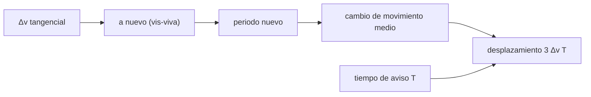

# B58-C17 — Principios de mitigación y desviación

<!-- nav:top -->
[🏠 Programa](../../../../README.md) · [📚 Bloque B58](../../../tronco-comun/B58-asteroides-cometas-y-defensa-planetaria.md) · [← Anterior: B58-C16 — Consecuencias geofísicas de impactos](../B58-C16-consecuencias-geofisicas-de-impactos/CLASE.md) · [Siguiente: B58-C18 — Marco internacional de defensa planetaria →](../B58-C18-marco-internacional-de-defensa-planetaria/CLASE.md)
<!-- /nav -->

## 1. Ubicación, nivel y alcance

Clase 17 del bloque B58 (nivel N3). La desviación por impactador cinético cambia la velocidad del objeto en una fracción pequeña y deja que el tiempo haga el resto. Aquí calculas, con un binario **sintético** inspirado en la misión DART, qué cambio de velocidad produce un cambio de periodo de 32 minutos, y qué desplazamiento acumula un asteroide heliocéntrico con un impulso de 1 cm/s. Usas el integrador de C02.

## 2. Por qué esta clase existe

Lo que importa no es el tamaño del empuje sino cuándo se da: el desplazamiento crece con el tiempo de aviso. La decisión central: **¿qué `Δv` y cuántos años de aviso se necesitan para mover un objeto lo suficiente?**

## 3. Lo que podrás hacer al terminar

1. Relacionar `Δv` con el cambio de periodo de una órbita circular.
2. Comprobar el primer orden `ΔP/P = −3Δv/v`.
3. Calcular el desplazamiento a lo largo de la órbita `≈ 3 Δv T`.
4. Verificarlo con integración numérica.
5. Calcular el `Δv` necesario según el tiempo de aviso.
6. Distinguir lo que dice la fuente de lo ilustrativo.

La evidencia es la **ficha de la desviación** del ejercicio 12 (sección 20).

## 4. Con qué llegas y cómo comprobarlo

1. ¿Qué es un impulso?
2. ¿Qué es la ecuación vis-viva?
3. ¿Cómo escala el periodo con el semieje?
4. ¿Qué es un impactor cinético?
5. ¿Qué es el tiempo de aviso?

<details>
<summary>Ver respuestas</summary>

1. Un cambio instantáneo de velocidad `Δv`. 2. `v² = GM(2/r − 1/a)`. 3. `P ∝ a^1,5`. 4. Una nave que cambia el momento de un cuerpo al chocar con él. 5. Los años entre la desviación y el posible impacto.
</details>

Con cuatro o cinco aciertos, sigue; si no, repasa los prerrequisitos.

## 5. Un caso de contexto y casos de referencia

El ejemplo conductor combina dos escalas. En el binario sintético, según [S4] el periodo bajó de 11 h 55 min a 11 h 23 min (−32 min, `4.5 %`). Con `a = 1190 m` ilustrativo, `v = 0.174 m/s` y el impulso exacto es `Δv = 2.722 mm/s` (primer orden `2.600`). En el asteroide heliocéntrico, `1 cm/s` a 10 años desplaza `9668 km`, igual a `3ΔvT = 9467 km`.

## 6. Vocabulario

Un **impactor cinético** transfiere momento por colisión. El **factor beta** mide cuánto aumenta el momento transferido por la eyección de material; la fuente [S4] no da un valor numérico. El **tiempo de aviso** es el intervalo hasta el posible impacto. El **desplazamiento a lo largo de la órbita** es la diferencia de posición por el cambio de periodo.

## 7. Modelo mental: adelantar un reloj un segundo



*Descripción textual:* un cambio de velocidad tangencial cambia el semieje, el periodo y el movimiento medio; el desplazamiento acumulado crece con el tiempo de aviso.

Analogía: Como adelantar un reloj un segundo por día: al cabo de un año la diferencia es grande. Límite: el empuje real es una colisión con eyección y rotación, no un impulso ideal; y con cuerpos porosos la respuesta cambia (C03).

## 8. La explicación, paso a paso

### 8.1 Periodo y velocidad

Con `P = 11 h 55 min` y `a = 1190 m` (ilustrativo) la tercera ley da `GM = 4π²a³/P²` y `v = 0.1743 m/s`.

### 8.2 El impulso

Para `ΔP = −32 min` se resuelve por bisección con vis-viva exacta: `Δv = 2.7224 mm/s`. A primer orden `ΔP/P = −3Δv/v` da `2.6001 mm/s`, `-4.5 %` respecto del exacto, porque el cambio es del 4,5 %.

### 8.3 Verificación por integración

Integrando la órbita después del impulso, el periodo medido es `40980.001 s` frente a `40980.000 s` de vis-viva (diferencia `3.6e-08`).

### 8.4 Desplazamiento heliocéntrico

Un `Δv` tangencial cambia el movimiento medio en `Δn = −3nΔv/v_c` y el ángulo acumula `Δθ = Δn T`, luego `Δs ≈ 3 Δv T`. Integrando 10 y 20 años: `10 años → 9668 km` (fórmula `9467`, `2.12 %`); `20 años → 18734 km` (fórmula `18935`, `1.06 %`).

### 8.5 Cuánto aviso hace falta

Para mover 1,5 radios terrestres (`9567 km`): `T = 1 años → Δv = 101.06 mm/s`; `T = 2 años → Δv = 50.53 mm/s`; `T = 5 años → Δv = 20.21 mm/s`; `T = 10 años → Δv = 10.11 mm/s`; `T = 20 años → Δv = 5.05 mm/s`. El empuje necesario es inversamente proporcional al aviso; con un año hace falta 20 veces más que con 20. No se calcula aquí la nave ni el factor beta.

## 9. Magnitudes, símbolos y unidades

| Símbolo | Qué es | Unidad | Valor / nota |
|---|---|---|---|
| `P` | periodo | s | 42 900 (11 h 55 min) |
| `a` | semieje del binario | m | 1190 (ilustrativo) |
| `v` | velocidad circular | m/s | 0.1743 |
| `Δv` | cambio de velocidad | mm/s | 2.722 |
| `T` | tiempo de aviso | años | 1–20 |
| `Δs` | desplazamiento a lo largo de la órbita | km | 9668 (10 años, 1 cm/s) |

## 10. Convenciones y referencias

Orbitas circulares iniciales; impulso tangencial instantáneo; dos cuerpos; binario sintético inspirado en DART, no reconstrucción de la misión.

## 11. De dónde sale lo que afirmamos

| ID | Fuente | Localizador | Respalda | Estado |
|---|---|---|---|---|
| S4 | NASA, *Planetary Defense: DART* (página de la misión) | [https://science.nasa.gov/planetary-defense-dart](https://science.nasa.gov/planetary-defense-dart) | fecha del impacto, periodo orbital de 11 h 55 min a 11 h 23 min (−32 min) y ausencia de un valor numérico de beta en esa página | Página leída el 2026-11-09 (resumen extraído de la página) |

No consultado: resultados científicos de DART (artículos), el factor beta medido, la masa de los cuerpos ni la geometría del impacto; el semieje de 1190 m es ilustrativo.

Límites: la fuente respalda el cambio de periodo, no el cálculo del impulso.

## 12. Cómo ver el impulso y el desplazamiento

| Magnitud | Valor |
|---|---|
| Δv exacto (binario) | 2.7224 mm/s |
| Δv primer orden | 2.6001 mm/s |
| Δs a 10 años (1 cm/s) | 9668 km |
| Δs a 20 años | 18734 km |

Descripción larga: el desplazamiento se duplica al duplicar el aviso, de `9668` a `18734 km`.

## 13. Ejemplo trabajado: un cm/s con diez años de aviso

**Paso 1 · Impulso.** `Δv = 0,01 m/s`.

**Paso 2 · Tiempo.** `T = 10 años = 3,156×10⁸ s`.

**Paso 3 · Desplazamiento.** `3ΔvT = 9467 km`.

**Paso 4 · Integración.** `9668 km`.

**Paso 5 · Lectura.** Equivale a 1,5 radios terrestres, el orden del radio efectivo de C09.

## 14. Distintas formas de resolver lo mismo

**Primer orden:** `−3Δv/v`. **Exacto:** vis-viva. **Integración:** comprueba ambos. Para el desplazamiento: fórmula `3ΔvT` e integración. Todas coinciden en los límites de pequeño `Δv`.

## 15. Práctica guiada

**Ejercicio 1 · con los pasos indicados.** Calcula `ΔP/P` para `Δv/v = 1 %`. *Pasos:* `−3·0,01`.

<details><summary>Solución comentada</summary>

`−3 %`.
</details>

**Ejercicio 2 · con una pista.** ¿Qué `ΔP` en minutos da `−4,5 %` de 715 min?

<details><summary>Solución comentada</summary>

`−32 min`.
</details>

**Ejercicio 3 · casi autónomo.** Calcula `3ΔvT` con `Δv = 1 mm/s` y `T = 10 años`.

<details><summary>Solución comentada</summary>

`948 km`.
</details>

## 16. Práctica autónoma, transferencia e integrador

**Ejercicio 4 · autónomo.** ¿Qué `Δv` mueve 6000 km en 5 años?

<details><summary>Solución comentada</summary>

`6×10⁶/(3·1,578×10⁸) = 12,7 mm/s`.
</details>

**Ejercicio 5 · autónomo.** ¿Cómo cambia `Δs` si `T` se duplica?

<details><summary>Solución comentada</summary>

Se duplica.
</details>

**Ejercicio 6 · autónomo.** ¿Y si se reduce `Δv` a la mitad?

<details><summary>Solución comentada</summary>

Se reduce a la mitad.
</details>

**Ejercicio 7 · autónomo.** ¿Por qué el primer orden subestima `Δv` en el binario?

<details><summary>Solución comentada</summary>

Porque el cambio de periodo no es infinitesimal.
</details>

**Ejercicio 8 · autónomo.** ¿Qué mide el factor beta?

<details><summary>Solución comentada</summary>

El aumento del momento transferido respecto del del impactor por la eyección.
</details>

**Ejercicio 9 · transferencia.** **Transferencia.** Un colega propone esperar a tener más datos antes de desviar. ¿Qué le muestras?

<details><summary>Solución comentada</summary>

Que `Δv ∝ 1/T`: perder años multiplica el impulso necesario (tabla 8.5).
</details>

**Ejercicio 10 · transferencia.** **Transferencia.** ¿Por qué la porosidad (C03) afecta a la desviación?

<details><summary>Solución comentada</summary>

Cambia cuánto material se eyecta y por tanto beta.
</details>

**Ejercicio 11 · transferencia.** **Transferencia.** ¿Qué riesgo introduce una desviación mal calculada?

<details><summary>Solución comentada</summary>

Mover un objeto a un acercamiento peor; por eso se exige incertidumbre y seguimiento (C09, C11).
</details>

**Ejercicio 12 · integrador.** **Integrador.** Elabora tu *ficha de la desviación*: `Δv` del binario, desplazamiento a dos plazos y tabla de aviso.

<details><summary>Solución comentada</summary>

Secciones 8.2–8.5.
</details>

## 17. Laboratorio: impulso, periodo y desplazamiento

El script [desviacion.py](desviacion.py) calcula el impulso de un cambio de periodo de 32 min y el desplazamiento heliocéntrico a 10 y 20 años, con integración (**comprueba** periodo con 10⁻⁶, primer orden con 5 % y desplazamiento con 3 %).

**Datos:** sistemas **sintéticos**; cambio de periodo de [S4]; semieje ilustrativo. **Predice antes de ejecutar:** ¿Cuánto se desplaza el asteroide si el aviso se duplica a 20 años? **Ejecución del 2026-11-09:**

```text
Python 3.12.9 (biblioteca estandar)
(A) Binario sintetico: P0 = 42900 s (11 h 55 min) ; a = 1190 m (ilustrativo) ; v circular = 0.1743 m/s
    dv exacto (vis-viva) para -32 min = 0.00272 m/s ; primer orden -3 dv/v: 0.00260 m/s ; cociente = 0.955
    Periodo tras el impulso: integrado = 40980.001 s ; vis-viva = 40980.000 s ; diferencia relativa = 3.56e-08
(B) Impulso de 0.01 m/s a 1.1 au; desplazamiento a lo largo de la orbita:
    10 anios : integrado = 9668 km ; 3 dv T = 9467 km ; diferencia = 2.12 %
    20 anios : integrado = 18734 km ; 3 dv T = 18935 km ; diferencia = 1.06 %
(C) dv necesario para desplazar 1.5 radios terrestres (9567 km) segun el aviso T:
    T =  1 anios : dv = 101.055 mm/s
    T =  2 anios : dv = 50.528 mm/s
    T =  5 anios : dv = 20.211 mm/s
    T = 10 anios : dv = 10.106 mm/s
    T = 20 anios : dv = 5.053 mm/s
Pruebas superadas.
```

```bash
python programa/clases/B58/B58-C17-principios-de-mitigacion-y-desviacion/desviacion.py
```

**Límites:** impulso instantáneo y tangencial; sin colisión real, rotación ni porosidad.

## 18. Errores frecuentes y cómo corregirlos

**Creer que importa solo la magnitud del impulso.** Se corrige con 8.5.

**Usar el primer orden con cambios grandes.** Se corrige con 8.2.

**Atribuir a DART cifras no consultadas.** Se corrige con la sección 11.

**Presentar el cálculo como diseño de misión.** Se corrige con la sección 21.

## 19. Cómo sabrás que vas bien

Tras la sección 8: ¿qué desplazamiento esperabas a 20 años y cuál obtuviste? Si dudas, repasa el ejemplo 13. Tras el laboratorio: ¿qué comprueba? (ver la sección 17).

## 20. Qué entregas y cómo se evalúa

El producto es tu **ficha de la desviación** (ejercicio 12).

| Criterio | Inicial | En desarrollo | Logrado | Destacado |
|---|---|---|---|---|
| Conceptos | Los confunde | Parciales | Conceptos de la clase | Explica los límites |
| Cálculo | Sin unidades | Con errores | Tablas completas | Calcula casos nuevos |
| Numérico | Sin comprobar | Un caso | Contraste con el análisis | Interpreta las diferencias |
| Fuentes | Sin fuente | Sin fecha | Fuentes con fecha | Declara lo no consultado |
| Límites | No los nombra | Uno | Tres | Discute qué falta del modelo |

**Condiciones críticas (no se compensan con promedio):** rotular los sistemas como sintéticos; no atribuir a DART valores no consultados; no presentar el cálculo como diseño de misión.

## 21. Ética, seguridad y límites

Clase educativa: los modelos son simplificados y los datos, sintéticos; nada de lo calculado evalúa un objeto real ni sustituye a los sistemas oficiales de monitoreo y alerta.  Accesibilidad: tablas equivalentes a las gráficas, fórmulas en texto, ejercicios sin conexión.

## 22. Para cerrar y seguir

Un cambio de periodo de 32 min exige `2.72 mm/s` en el binario sintético y 1 cm/s mueve `9668 km` en 10 años. Queda una pregunta: ¿quién decide y cómo se coordina una respuesta?

**Glosario español–inglés.** impactor cinético · *kinetic impactor*; factor beta · *momentum enhancement factor*; tiempo de aviso · *warning time*; vis-viva · *vis-viva*; desviación · *deflection*.

**Continuidad.** [B58-C18](../B58-C18-marco-internacional-de-defensa-planetaria/CLASE.md) estudia marco internacional de defensa planetaria.

**Referencias:** ver sección 11.

<!-- nav:bottom -->
---

[← Anterior: B58-C16 — Consecuencias geofísicas de impactos](../B58-C16-consecuencias-geofisicas-de-impactos/CLASE.md) · [📚 Bloque B58](../../../tronco-comun/B58-asteroides-cometas-y-defensa-planetaria.md) · [Siguiente: B58-C18 — Marco internacional de defensa planetaria →](../B58-C18-marco-internacional-de-defensa-planetaria/CLASE.md)
<!-- /nav -->
