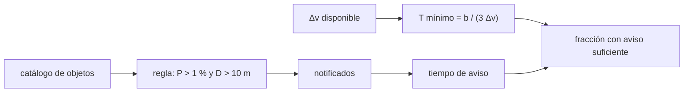

# B58-C18 — Marco internacional de defensa planetaria

<!-- nav:top -->
[🏠 Programa](../../../../README.md) · [📚 Bloque B58](../../../tronco-comun/B58-asteroides-cometas-y-defensa-planetaria.md) · [← Anterior: B58-C17 — Principios de mitigación y desviación](../B58-C17-principios-de-mitigacion-y-desviacion/CLASE.md) · [Siguiente: B58-C19 — Comunicación pública del riesgo →](../B58-C19-comunicacion-publica-del-riesgo/CLASE.md)
<!-- /nav -->

## 1. Ubicación, nivel y alcance

Clase 18 del bloque B58 (nivel N3). La defensa planetaria es también un asunto de coordinación: quién avisa, a quién y cuándo. Aquí aplicas el umbral de notificación de la red internacional de alerta a un catálogo **sintético** de 20 000 objetos y calculas, con el resultado de C17, qué fracción de los notificados tiene tiempo para una desviación. Usas la fuente de IAWN como único respaldo.

## 2. Por qué esta clase existe

Un umbral de notificación decide cuántos casos entran en el circuito internacional y cuántos tienen tiempo suficiente. La decisión central: **¿qué umbral activa la alerta y qué margen de tiempo deja para actuar?**

## 3. Lo que podrás hacer al terminar

1. Describir qué son IAWN y SMPAG según la fuente consultada.
2. Aplicar el umbral de notificación a un catálogo.
3. Calcular la fracción esperada y compararla con la observada.
4. Calcular el tiempo mínimo de aviso para un `Δv` disponible.
5. Cruzar notificación y tiempo disponible.
6. Distinguir lo consultado de lo sintético.

La evidencia es la **ficha del marco internacional** del ejercicio 12 (sección 20).

## 4. Con qué llegas y cómo comprobarlo

1. ¿Qué es un umbral?
2. ¿Qué es una ley de potencias de tamaños?
3. ¿Qué es un error binomial?
4. ¿Qué es un `Δv`?
5. ¿Por qué se rotula un catálogo sintético?

<details>
<summary>Ver respuestas</summary>

1. Un valor que activa una acción al superarse. 2. Pocos objetos grandes y muchos pequeños, `N(>D) ∝ D^−p`. 3. `√(P(1−P)/N)`. 4. Un cambio de velocidad. 5. Para no presentarlo como observado.
</details>

Con cuatro o cinco aciertos, sigue; si no, repasa los prerrequisitos.

## 5. Un caso de contexto y casos de referencia

El ejemplo conductor es un catálogo sintético de 20000 objetos. La regla de [S7] (probabilidad mayor que 1 % para más de 10 m) notifica 577 (`2.89 %`), frente a `3.08 %` esperado. Con un `Δv` de 5 mm/s hacen falta `20.2` años de aviso para desplazar 1,5 radios terrestres, y `30 %` de los notificados lo tiene.

## 6. Vocabulario

**IAWN** es la red internacional de alerta de asteroides, coordinada por NASA, creada por recomendación de un grupo de trabajo de la ONU [S7]. **SMPAG** es el grupo asesor de planificación de misiones espaciales que implementa una respuesta internacional [S7]. La **notificación** se emite cuando se superan los umbrales de probabilidad y tamaño. El **tiempo de aviso** es el margen hasta el posible impacto.

## 7. Modelo mental: una alarma de incendio con sensibilidad ajustable



*Descripción textual:* la regla de notificación filtra el catálogo; el tiempo mínimo que exige un `Δv` se compara con el aviso de cada objeto notificado.

Analogía: Como la sensibilidad de una alarma: muy baja y no avisa, muy alta y satura. Límite: el umbral real se revisa y no es la única regla; aquí se aplica de forma literal.

## 8. La explicación, paso a paso

### 8.1 Qué dice la fuente

Según [S7], IAWN es una colaboración mundial de astrónomos y modeladores coordinada por NASA, establecida por recomendación del grupo de trabajo sobre objetos cercanos a la Tierra de la subcomisión científica de la COPUOS, endosada en febrero de 2013 y reconocida por la Asamblea General de la ONU. Emite una advertencia de impacto cuando la probabilidad supera 1 % para un objeto de más de 10 m, y UNOOSA transmite la información a los Estados miembros. SMPAG implementa la respuesta internacional, con UNOOSA como secretaría permanente. La página tiene una inconsistencia en la fecha de una resolución de la Asamblea General, por lo que no se cita.

### 8.2 La regla sobre el catálogo

Con diámetros de ley de potencias desde 5 m (exponente ilustrativo 2,7) y `log P` uniforme entre `−8` y `−0,5`, la fracción esperada es `(10/5)^(−2,7)·(1,5/7,5) = 0.03078`. Se notificaron 577 de 20000 (`0.02885`, `-1.58` errores binomiales).

### 8.3 El tiempo mínimo

Con el resultado de C17, desplazar `b = 1,5 R_T = 9567 km` exige `T = b/(3Δv)`: `Δv = 1 mm/s → 101.1 años`; `Δv = 5 mm/s → 20.2 años`; `Δv = 20 mm/s → 5.1 años`. Las capacidades de 1, 5 y 20 mm/s son ilustrativas.

### 8.4 Cruce

Con aviso uniforme entre 0,1 y 30 años, la fracción con aviso suficiente es `(30 − T)/29,9`: `1 mm/s → 0.000` (analítica `0.000`); `5 mm/s → 0.302` (analítica `0.327`); `20 mm/s → 0.835` (analítica `0.834`). Con poca capacidad, la mayoría de los notificados no tiene tiempo.

### 8.5 Lectura

El resultado no estima cuántos objetos reales se notificarán: el catálogo es sintético, los exponentes ilustrativos y el aviso uniforme es una suposición. Muestra cómo dos reglas simples (umbral y tiempo) estructuran la decisión.

## 9. Magnitudes, símbolos y unidades

| Símbolo | Qué es | Unidad | Valor / nota |
|---|---|---|---|
| `D` | diámetro | m | ≥ 5 (sintético) |
| `P` | probabilidad de impacto | — | 10⁻⁸ – 10⁻⁰·⁵ |
| `T` | tiempo de aviso | años | 0,1 – 30 |
| `Δv` | capacidad de desviación | mm/s | 1; 5; 20 (ilustrativas) |
| `b` | desplazamiento buscado | km | 9567 |
| `N` | tamaño del catálogo | — | 20 000 |

## 10. Convenciones y referencias

Catálogo sintético; umbrales de [S7]; semilla `20261109`; variables independientes.

## 11. De dónde sale lo que afirmamos

| ID | Fuente | Localizador | Respalda | Estado |
|---|---|---|---|---|
| S7 | IAWN, *About* (Red Internacional de Alerta de Asteroides) | [https://iawn.net/about.shtml](https://iawn.net/about.shtml) | descripción de IAWN, relación con la ONU, UNOOSA y SMPAG, y umbral de notificación (1 % y 10 m) | Página leída el 2026-11-09 (resumen extraído de la página) |

No consultado: la página de SMPAG de UNOOSA (404), documentos de política de COPUOS ni protocolos de comunicación de IAWN; el exponente 2,7, la distribución de probabilidades y el aviso uniforme son sintéticos.

Límites: la fuente describe organismos y un umbral; no respalda ninguna fracción del catálogo.

## 12. Cómo ver notificación y aviso

| Magnitud | Valor |
|---|---|
| notificados | 577 de 20000 (2.89 %) |
| T mínimo con 1 mm/s | 101.1 años |
| T mínimo con 5 mm/s | 20.2 años |
| con aviso suficiente (5 mm/s) | 30 % |

Descripción larga: los umbrales dejan pasar `2.9 %` del catálogo y el aviso suficiente depende de la capacidad.

## 13. Ejemplo trabajado: la fracción esperada

**Paso 1 · Tamaño.** `P(D > 10) = (10/5)^(−2,7) = 0,154`.

**Paso 2 · Probabilidad.** `P(P > 0,01) = (−0,5 − (−2))/7,5 = 0,2`.

**Paso 3 · Producto.** `0.03078`.

**Paso 4 · Observada.** `0.02885`.

## 14. Distintas formas de resolver lo mismo

**Analítica:** producto de probabilidades. **Simulación:** 20 000 objetos. Coinciden dentro del error binomial. El marco real añade criterios cualitativos que ninguna de las dos recoge.

## 15. Práctica guiada

**Ejercicio 1 · con los pasos indicados.** Calcula `P(D > 20 m)` con `D_min = 5 m` y exponente 2,7. *Pasos:* `(20/5)^(−2,7)`.

<details><summary>Solución comentada</summary>

`0,0236`.
</details>

**Ejercicio 2 · con una pista.** ¿Qué `T` mínimo da `Δv = 10 mm/s` para 9567 km?

<details><summary>Solución comentada</summary>

`≈ 10,1 años`.
</details>

**Ejercicio 3 · casi autónomo.** ¿Quién transmite la información de IAWN a los Estados, según la fuente?

<details><summary>Solución comentada</summary>

UNOOSA [S7].
</details>

## 16. Práctica autónoma, transferencia e integrador

**Ejercicio 4 · autónomo.** ¿Cuál es el umbral de notificación según la fuente?

<details><summary>Solución comentada</summary>

Probabilidad mayor que 1 % y más de 10 m [S7].
</details>

**Ejercicio 5 · autónomo.** ¿Qué pasa con la fracción notificada si el umbral de probabilidad baja a 0,1 %?

<details><summary>Solución comentada</summary>

Sube a `(10/5)^(−2,7)·(2,5/7,5) = 0,051`.
</details>

**Ejercicio 6 · autónomo.** ¿Y si el umbral de tamaño sube a 20 m?

<details><summary>Solución comentada</summary>

Baja a `0,0236·0,2 = 0,0047`.
</details>

**Ejercicio 7 · autónomo.** ¿Por qué una capacidad baja deja menos objetos con aviso suficiente?

<details><summary>Solución comentada</summary>

Porque `T_min = b/(3Δv)` crece.
</details>

**Ejercicio 8 · autónomo.** ¿Quién es el secretariado permanente de SMPAG según la fuente?

<details><summary>Solución comentada</summary>

UNOOSA.
</details>

**Ejercicio 9 · transferencia.** **Transferencia.** Un periodista dice que «IAWN decide desviar asteroides». Corrígelo con la fuente.

<details><summary>Solución comentada</summary>

IAWN alerta y valida información; SMPAG planifica la respuesta; no consta aquí que ninguno decida una misión.
</details>

**Ejercicio 10 · transferencia.** **Transferencia.** ¿Por qué no se cita la resolución de la Asamblea General con fecha?

<details><summary>Solución comentada</summary>

La página es inconsistente entre dos fechas; sin otra fuente, se omite.
</details>

**Ejercicio 11 · transferencia.** **Transferencia.** ¿Qué haría falta para estimar la fracción real de notificaciones?

<details><summary>Solución comentada</summary>

Un catálogo observado y una distribución real de probabilidades.
</details>

**Ejercicio 12 · integrador.** **Integrador.** Elabora tu *ficha del marco internacional*: roles de IAWN y SMPAG según la fuente, la fracción notificada y la tabla de aviso.

<details><summary>Solución comentada</summary>

Secciones 8.1–8.4.
</details>

## 17. Laboratorio: umbral de notificación y tiempo de aviso

El script [marco.py](marco.py) aplica el umbral de IAWN a 20 000 objetos sintéticos y cruza con el tiempo mínimo de aviso (**comprueba** 3 errores binomiales en la fracción notificada y en la fracción con aviso suficiente).

**Datos:** catálogo **sintético**; umbral de [S7]; exponente y capacidades ilustrativos. **Predice antes de ejecutar:** ¿Qué fracción de los objetos del catálogo será notificada? **Ejecución del 2026-11-09:**

```text
Python 3.12.9 (biblioteca estandar)
Catalogo sintetico de 20000 objetos ; regla de notificacion: P > 1 % y D > 10 m
Notificados: 577 (fraccion 0.02885) ; esperado 0.03078 +- 0.00122 ; diferencia = -1.58 errores
Objetos notificados con aviso suficiente para desplazar 1.5 radios terrestres:
  dv =  1.0 mm/s -> T minimo = 101.06 anios ; fraccion con aviso suficiente = 0.0000 (analitica 0.0000)
  dv =  5.0 mm/s -> T minimo =  20.21 anios ; fraccion con aviso suficiente = 0.3016 (analitica 0.3274)
  dv = 20.0 mm/s -> T minimo =   5.05 anios ; fraccion con aviso suficiente = 0.8354 (analitica 0.8344)
Pruebas superadas.
```

```bash
python programa/clases/B58/B58-C18-marco-internacional-de-defensa-planetaria/marco.py
```

**Límites:** variables independientes; aviso uniforme; sin criterios cualitativos de la política real.

## 18. Errores frecuentes y cómo corregirlos

**Atribuir a IAWN la decisión de desviar.** Se corrige con 8.1.

**Citar la fecha inconsistente de una resolución.** Se corrige con 8.1.

**Tomar el catálogo por real.** Se corrige con la sección 10.

**Confundir notificar con actuar.** Se corrige con 8.4.

## 19. Cómo sabrás que vas bien

Tras la sección 8: ¿qué fracción esperabas y cuál obtuviste? Si dudas, repasa el ejemplo 13. Tras el laboratorio: ¿qué comprueba? (ver la sección 17).

## 20. Qué entregas y cómo se evalúa

El producto es tu **ficha del marco internacional** (ejercicio 12).

| Criterio | Inicial | En desarrollo | Logrado | Destacado |
|---|---|---|---|---|
| Conceptos | Los confunde | Parciales | Conceptos de la clase | Explica los límites |
| Cálculo | Sin unidades | Con errores | Tablas completas | Calcula casos nuevos |
| Numérico | Sin comprobar | Un caso | Contraste con el análisis | Interpreta las diferencias |
| Fuentes | Sin fuente | Sin fecha | Fuentes con fecha | Declara lo no consultado |
| Límites | No los nombra | Uno | Tres | Discute qué falta del modelo |

**Condiciones críticas (no se compensan con promedio):** rotular el catálogo como sintético; atribuir a IAWN y SMPAG solo lo que dice la fuente; citar solo lo consultado.

## 21. Ética, seguridad y límites

Clase educativa: los modelos son simplificados y los datos, sintéticos; nada de lo calculado evalúa un objeto real ni sustituye a los sistemas oficiales de monitoreo y alerta.  Accesibilidad: tablas equivalentes a las gráficas, fórmulas en texto, ejercicios sin conexión.

## 22. Para cerrar y seguir

El umbral notifica `2.9 %` del catálogo sintético y, con 5 mm/s, `30 %` de los notificados tiene tiempo suficiente. Queda una pregunta: ¿cómo se comunica un riesgo así sin alarmar ni minimizar?

**Glosario español–inglés.** IAWN · *International Asteroid Warning Network*; SMPAG · *Space Mission Planning Advisory Group*; umbral de notificación · *notification threshold*; tiempo de aviso · *warning time*; secretaría · *secretariat*.

**Continuidad.** [B58-C19](../B58-C19-comunicacion-publica-del-riesgo/CLASE.md) estudia comunicación pública del riesgo.

**Referencias:** ver sección 11.

<!-- nav:bottom -->
---

[← Anterior: B58-C17 — Principios de mitigación y desviación](../B58-C17-principios-de-mitigacion-y-desviacion/CLASE.md) · [📚 Bloque B58](../../../tronco-comun/B58-asteroides-cometas-y-defensa-planetaria.md) · [Siguiente: B58-C19 — Comunicación pública del riesgo →](../B58-C19-comunicacion-publica-del-riesgo/CLASE.md)
<!-- /nav -->
