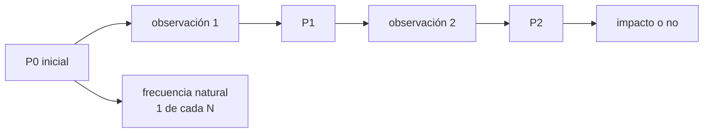

# B58-C19 — Comunicación pública del riesgo

<!-- nav:top -->
[🏠 Programa](../../../../README.md) · [📚 Bloque B58](../../../tronco-comun/B58-asteroides-cometas-y-defensa-planetaria.md) · [← Anterior: B58-C18 — Marco internacional de defensa planetaria](../B58-C18-marco-internacional-de-defensa-planetaria/CLASE.md) · [Siguiente: B58-C20 — Simulador de riesgo de impacto basado en datos →](../B58-C20-simulador-de-riesgo-de-impacto-basado-en-datos/CLASE.md)
<!-- /nav -->

## 1. Ubicación, nivel y alcance

Clase 19 del bloque B58 (nivel N3). Comunicar un riesgo es decir qué se sabe, cuánto y qué puede cambiar. Aquí traduces una probabilidad a frecuencias naturales y simulas, con objetos **sintéticos**, cómo cambia la probabilidad al llegar observaciones nuevas: la mayoría de los casos baja a casi cero, y los pocos impactos reales suben a uno. Usas la integral de C09 y el seguimiento de C11.

## 2. Por qué esta clase existe

El público oye «1 %» y a veces «ahora 0 %». Si no se explica que las probabilidades cambian con los datos y que la media se conserva, bajar a cero parece un error. La decisión central: **¿cómo expresar una probabilidad para que se entienda y qué se debe decir sobre su evolución?**

## 3. Lo que podrás hacer al terminar

1. Expresar una probabilidad en frecuencias naturales.
2. Actualizar una posición gaussiana con una observación.
3. Verificar que la probabilidad es una martingala.
4. Medir qué fracción de los casos baja y qué fracción sube.
5. Explicar por qué una probabilidad que baja no es un error.
6. Rotular la simulación como sintética.

La evidencia es la **ficha de comunicación del riesgo** del ejercicio 12 (sección 20).

## 4. Con qué llegas y cómo comprobarlo

1. ¿Qué es una frecuencia natural?
2. ¿Qué es una actualización bayesiana?
3. ¿Qué es una martingala?
4. ¿Qué es una probabilidad condicional?
5. ¿Qué es la escala de Torino?

<details>
<summary>Ver respuestas</summary>

1. Una probabilidad expresada como «1 de cada N casos». 2. Combinar un conocimiento previo con un dato nuevo. 3. Una cantidad cuyo valor esperado futuro es el actual. 4. La probabilidad dada cierta información. 5. Una escala 0–10 de comunicación (C10).
</details>

Con cuatro o cinco aciertos, sigue; si no, repasa los prerrequisitos.

## 5. Un caso de contexto y casos de referencia

El ejemplo conductor es un objeto sintético con probabilidad inicial `P₀ = 0.1109`, o 1 de cada 9. Tras simular 200000 objetos: la media de la probabilidad tras cada observación se conserva (`0.1114` y `0.1110`), el `11.1 %` impacta de verdad y en `78 %` de los casos la probabilidad final cae por debajo de `1 %` de la inicial. El escenario ficticio de [S6] ilustra la trayectoria cualitativa: de 1 en 10 000 a 1 %, con Torino 1.

## 6. Vocabulario

Una **frecuencia natural** expresa «de 100 casos iguales, `k` ocurren». Una **actualización** combina la posición previa con una observación. Una **martingala** conserva el valor esperado. La **escala de Torino** comunica el riesgo con un entero [S1]. La **comunicación del riesgo** incluye probabilidad, consecuencia, incertidumbre y qué pasará después.

## 7. Modelo mental: tirar una moneda con información parcial



*Descripción textual:* la probabilidad inicial se actualiza con cada observación; en promedio se conserva, pero en cada caso concreto sube o baja.

Analogía: Como estimar el resultado de una moneda tapada mientras se asoma poco a poco. Límite: las probabilidades reales de impacto tienen estructura más compleja que una gaussiana 1D.

## 8. La explicación, paso a paso

### 8.1 Frecuencias naturales

Una probabilidad `0.1109` se dice «1 de cada 9». Las frecuencias naturales se entienden mejor que los porcentajes, pero hay que decir también el tamaño del objeto y la incertidumbre.

### 8.2 Actualización gaussiana

Con prior `N(μ, σ²)` y observación `y = x + ε`, `ε ~ N(0, s²)`: `1/v' = 1/v + 1/s²` y `m' = v'(m/v + y/s²)`. La probabilidad es `Φ((1−m')/√v') − Φ((−1−m')/√v')`.

### 8.3 Martingala

La media de las probabilidades posteriores coincide con `P₀`: `0.11140 ± 0.00032` y `0.11099 ± 0.00063` frente a `0.11086`; y la fracción de objetos que de verdad impactan es `0.11097 ± 0.00070`.

### 8.4 Lo que ocurre caso a caso

Tras la primera observación la probabilidad baja en `66.3 %` de los casos (y sube en el resto); tras la segunda, `78.2 %` queda por debajo de `1 %` de la inicial y `11.1 %` supera `0,5`. En `15.9 %` la probabilidad **sube y luego cae** casi a cero.

### 8.5 Qué decir al público

Que la probabilidad inicial es una descripción de lo que se sabe; que con nuevas observaciones suele caer a cero, aunque a veces sube primero; y que la media se conserva. Esto es coherente con el escenario ficticio de [S6], donde la probabilidad crece antes de que nuevas observaciones decidan. Una probabilidad que baja a cero no es una falsa alarma sino el efecto esperado de reducir la incertidumbre.

## 9. Magnitudes, símbolos y unidades

| Símbolo | Qué es | Unidad | Valor / nota |
|---|---|---|---|
| `x` | posición transversal | radios efectivos | N(4, 3²) a priori |
| `P` | probabilidad de impacto | — | 0.1109 inicial |
| `s` | error de observación | radios efectivos | 2 y 0,3 |
| `m, v` | media y varianza posteriores | —, —² | — |
| `N` | objetos simulados | — | 200 000 |

## 10. Convenciones y referencias

Posiciones en unidades del radio efectivo; impacto si `|x| < 1`; gaussiana 1D; semilla `20261109`; objetos sintéticos.

## 11. De dónde sale lo que afirmamos

| ID | Fuente | Localizador | Respalda | Estado |
|---|---|---|---|---|
| S6 | CNEOS/JPL, ejercicio de la Conferencia de Defensa Planetaria 2023 (asteroide ficticio 2023 PDC) | [https://cneos.jpl.nasa.gov/pd/cs/pdc23/](https://cneos.jpl.nasa.gov/pd/cs/pdc23/) | trayectoria cualitativa de un escenario ficticio: de 1 en 10 000 a 1 %, Torino 1 | Página leída el 2026-11-09 (resumen extraído de la página) |
| S1 | CNEOS/JPL, *Torino Impact Hazard Scale* | [https://cneos.jpl.nasa.gov/sentry/torino_scale.html](https://cneos.jpl.nasa.gov/sentry/torino_scale.html) | la escala de Torino es una herramienta de comunicación | Página leída el 2026-11-09 (resumen extraído de la página) |

No consultado: guías de comunicación del riesgo de las agencias ni estudios de percepción; las cifras de la simulación son propias.

Límites: las fuentes respaldan la descripción cualitativa del escenario y de la escala; no la simulación.

## 12. Cómo ver la evolución de la probabilidad

| Magnitud | Valor |
|---|---|
| P inicial | 0.1109 |
| media tras obs. 1 | 0.1114 |
| media tras obs. 2 | 0.1110 |
| impactos reales | 0.1110 |
| sube y luego casi cero | 15.9 % |

Descripción larga: la media se conserva en `0.111` mientras los casos individuales se reparten entre casi cero y casi uno.

## 13. Ejemplo trabajado: decir el riesgo en frecuencias

**Paso 1 · Probabilidad.** `P₀ = 0.1109`.

**Paso 2 · Frecuencia.** 1 de cada 9.

**Paso 3 · Evolución.** En `78 %` de los casos cae por debajo del `1 %` de la inicial.

**Paso 4 · Mensaje.** «Hoy es una probabilidad; con más datos probablemente baje, y si no, lo diremos».

## 14. Distintas formas de resolver lo mismo

**Porcentaje:** compacto, pero se malinterpreta. **Frecuencia natural:** más intuitiva. **Escala de color:** rápida, sin matices. Se usan juntas, cada una con su límite.

## 15. Práctica guiada

**Ejercicio 1 · con los pasos indicados.** Expresa `P = 0,02` en frecuencia natural. *Pasos:* `1/P`.

<details><summary>Solución comentada</summary>

1 de cada 50.
</details>

**Ejercicio 2 · con una pista.** ¿Y `P = 10⁻⁴`?

<details><summary>Solución comentada</summary>

1 de cada 10 000.
</details>

**Ejercicio 3 · casi autónomo.** Si 1000 objetos tienen `P = 0,1`, ¿cuántos esperas que impacten?

<details><summary>Solución comentada</summary>

100.
</details>

## 16. Práctica autónoma, transferencia e integrador

**Ejercicio 4 · autónomo.** ¿Por qué la media de `P` posterior es `P₀`?

<details><summary>Solución comentada</summary>

Es una martingala: la información promedio no cambia la media.
</details>

**Ejercicio 5 · autónomo.** ¿Qué fracción de objetos impacta de verdad en la simulación?

<details><summary>Solución comentada</summary>

`0.1110`.
</details>

**Ejercicio 6 · autónomo.** ¿Qué indica `P2 > 0,5`?

<details><summary>Solución comentada</summary>

Que la observación apunta con fuerza al impacto.
</details>

**Ejercicio 7 · autónomo.** ¿Por qué el error de observación se reduce de 2 a 0,3?

<details><summary>Solución comentada</summary>

Se supone una segunda observación más precisa.
</details>

**Ejercicio 8 · autónomo.** ¿Qué color de Torino corresponde al nivel 1?

<details><summary>Solución comentada</summary>

Verde [S1].
</details>

**Ejercicio 9 · transferencia.** **Transferencia.** Un titular dice «ahora es 0 %: se equivocaron». ¿Qué respondes?

<details><summary>Solución comentada</summary>

Una probabilidad que cae a cero es el resultado más probable de reducir la incertidumbre; no es un error.
</details>

**Ejercicio 10 · transferencia.** **Transferencia.** ¿Qué diferencia comunica «1 %» de «1 de cada 100 casos iguales»?

<details><summary>Solución comentada</summary>

La segunda aclara que es una frecuencia sobre casos iguales, no un plazo.
</details>

**Ejercicio 11 · transferencia.** **Transferencia.** ¿Qué debe acompañar a la probabilidad?

<details><summary>Solución comentada</summary>

Tamaño, consecuencia, incertidumbre y qué observación sigue.
</details>

**Ejercicio 12 · integrador.** **Integrador.** Elabora tu *ficha de comunicación del riesgo*: P inicial en frecuencias, evolución simulada y mensaje.

<details><summary>Solución comentada</summary>

Secciones 8.1–8.5.
</details>

## 17. Laboratorio: actualización de la probabilidad con observaciones

El script [comunicacion.py](comunicacion.py) simula 200 000 objetos con dos observaciones y verifica la martingala (**comprueba** media de `P` y fracción de impactos iguales a `P₀` dentro de 3 errores típicos).

**Datos:** objetos **sintéticos**; semilla `20261109`; trayectoria cualitativa de [S6]. **Predice antes de ejecutar:** ¿Qué fracción de los casos verá subir primero la probabilidad? **Ejecución del 2026-11-09:**

```text
Python 3.12.9 (biblioteca estandar)
Probabilidad inicial P0 = 0.11086 ; en frecuencias naturales: 1 de cada 9
Con 200000 objetos simulados:
  media de P tras la 1a observacion = 0.11140 +- 0.00032 (P0 = 0.11086)
  media de P tras la 2a observacion = 0.11099 +- 0.00063
  fraccion de impactos reales = 0.11097 +- 0.00070
  P1 < P0 en 66.3 % de los casos ; P2 < 0.01 P0 en 78.2 % ; P2 > 0.5 en 11.1 %
  casos en que P sube tras la 1a observacion y termina por debajo de 0.01 P0: 15.9 %
Pruebas superadas.
```

```bash
python programa/clases/B58/B58-C19-comunicacion-publica-del-riesgo/comunicacion.py
```

**Límites:** gaussiana 1D, sin ojos de cerradura, errores independientes.

## 18. Errores frecuentes y cómo corregirlos

**Ver una probabilidad que baja como un error.** Se corrige con 8.5.

**Comunicar solo el porcentaje.** Se corrige con 8.1.

**Olvidar el tamaño del objeto.** Se corrige con 8.5.

**Tomar la simulación por observación.** Se corrige con la sección 10.

## 19. Cómo sabrás que vas bien

Tras la sección 8: ¿qué esperabas de la media de P y qué obtuviste? Si dudas, repasa el ejemplo 13. Tras el laboratorio: ¿qué comprueba? (ver la sección 17).

## 20. Qué entregas y cómo se evalúa

El producto es tu **ficha de comunicación del riesgo** (ejercicio 12).

| Criterio | Inicial | En desarrollo | Logrado | Destacado |
|---|---|---|---|---|
| Conceptos | Los confunde | Parciales | Conceptos de la clase | Explica los límites |
| Cálculo | Sin unidades | Con errores | Tablas completas | Calcula casos nuevos |
| Numérico | Sin comprobar | Un caso | Contraste con el análisis | Interpreta las diferencias |
| Fuentes | Sin fuente | Sin fecha | Fuentes con fecha | Declara lo no consultado |
| Límites | No los nombra | Uno | Tres | Discute qué falta del modelo |

**Condiciones críticas (no se compensan con promedio):** rotular la simulación como sintética; no presentar una probabilidad de laboratorio como la de un objeto real; citar solo lo consultado.

## 21. Ética, seguridad y límites

Clase educativa: los modelos son simplificados y los datos, sintéticos; nada de lo calculado evalúa un objeto real ni sustituye a los sistemas oficiales de monitoreo y alerta.  Accesibilidad: tablas equivalentes a las gráficas, fórmulas en texto, ejercicios sin conexión.

## 22. Para cerrar y seguir

La media de la probabilidad se conserva (`0.1110` frente a `0.1109`) aunque cada caso termine cerca de 0 o de 1. Queda una pregunta: ¿cómo se reúne todo en un simulador?

**Glosario español–inglés.** frecuencia natural · *natural frequency*; martingala · *martingale*; comunicación del riesgo · *risk communication*; actualización bayesiana · *Bayesian update*; probabilidad condicional · *conditional probability*.

**Continuidad.** [B58-C20](../B58-C20-simulador-de-riesgo-de-impacto-basado-en-datos/CLASE.md) estudia simulador de riesgo de impacto basado en datos.

**Referencias:** ver sección 11.

<!-- nav:bottom -->
---

[← Anterior: B58-C18 — Marco internacional de defensa planetaria](../B58-C18-marco-internacional-de-defensa-planetaria/CLASE.md) · [📚 Bloque B58](../../../tronco-comun/B58-asteroides-cometas-y-defensa-planetaria.md) · [Siguiente: B58-C20 — Simulador de riesgo de impacto basado en datos →](../B58-C20-simulador-de-riesgo-de-impacto-basado-en-datos/CLASE.md)
<!-- /nav -->
