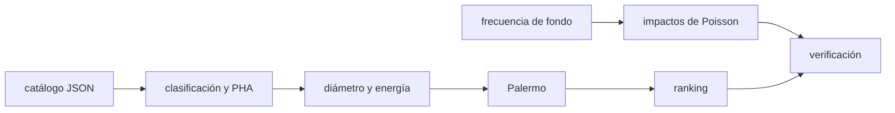

# B58-C20 — Simulador de riesgo de impacto basado en datos

<!-- nav:top -->
[🏠 Programa](../../../../README.md) · [📚 Bloque B58](../../../tronco-comun/B58-asteroides-cometas-y-defensa-planetaria.md) · [← Anterior: B58-C19 — Comunicación pública del riesgo](../B58-C19-comunicacion-publica-del-riesgo/CLASE.md) · [Siguiente: B59-C01 — Concepto de utilización de recursos in situ →](../../../tronco-comun/B59-recursos-in-situ-y-sostenibilidad-extraterrestre.md#b59-c01)
<!-- /nav -->

## 1. Ubicación, nivel y alcance

Clase 20 del bloque B58 (nivel N3). Cierra el bloque con un simulador pequeño que junta clasificación (C01), MOID y PHA (C05), diámetro y energía (C10, C15), puntuación de Palermo (C10) y la frecuencia de fondo de impactos. El catálogo es **sintético**, con los nombres de campo de la API de cuerpos menores del JPL, y el simulador no evalúa ningún objeto real.

## 2. Por qué esta clase existe

Un simulador convierte reglas sueltas en un flujo reproducible: leer datos, filtrar, calcular y ordenar. La decisión central: **¿qué objetos del catálogo merecen atención primero y qué número de impactos de fondo es coherente con la ley de frecuencias?**

## 3. Lo que podrás hacer al terminar

1. Leer un catálogo con campos tipo SBDB.
2. Clasificar y filtrar PHA con los criterios de la fuente.
3. Calcular diámetro, energía y puntuación de Palermo.
4. Ordenar los casos por puntuación.
5. Simular impactos de fondo con un proceso de Poisson.
6. Verificar la simulación con la ley analítica y declarar los límites.

La evidencia es la **ficha del simulador** del ejercicio 12 (sección 20).

## 4. Con qué llegas y cómo comprobarlo

1. ¿Qué es un catálogo?
2. ¿Qué es un proceso de Poisson?
3. ¿Qué es un criterio PHA?
4. ¿Qué es la puntuación de Palermo?
5. ¿Qué es JSON?

<details>
<summary>Ver respuestas</summary>

1. Una lista de objetos con sus atributos. 2. Llegadas independientes con tasa constante. 3. `MOID ≤ 0,05 au` y `H ≤ 22` [S3]. 4. `log10[PI/(f_B DT)]` [S2]. 5. Un formato de texto para datos estructurados.
</details>

Con cuatro o cinco aciertos, sigue; si no, repasa los prerrequisitos.

## 5. Un caso de contexto y casos de referencia

El ejemplo conductor es un catálogo sintético de 300 objetos con los campos `a, e, i, q, ad, H, moid` (nombres de [S5]). El simulador los clasifica (Amor = 57, Apollo = 92, Aten = 19, Atira = 5, no NEO = 127), encuentra 39 PHA sintéticos y los ordena por Palermo (el primero, SINT-007, con `PS = -0.22`). La simulación de fondo da 2926 impactos de ≥ 1 Mt en 100 000 años frente a 3000 esperados.

## 6. Vocabulario

La **API SBDB** del JPL entrega datos de un cuerpo en formato legible por máquina; sus campos incluyen `a`, `e`, `i`, `q`, `ad`, `moid` y, en la parte física, `H` [S5]. Un **proceso de Poisson** modela llegadas independientes. La **frecuencia de fondo** `f_B = 0,03 E^(−4/5)` da los impactos por año con energía al menos `E` Mt [S2]. Un **simulador basado en datos** lee un catálogo y aplica reglas reproducibles.

## 7. Modelo mental: una hoja de cálculo con reglas



*Descripción textual:* el catálogo se lee y se filtra; los PHA reciben energía y puntuación y se ordenan; en paralelo se simulan impactos de fondo y se verifican contra la ley analítica.

Analogía: Como una hoja de cálculo con fórmulas encadenadas y una columna de ordenamiento. Límite: las reglas simplifican; el sistema real incluye incertidumbre orbital y revisión humana.

## 8. La explicación, paso a paso

### 8.1 Lectura y estructura

El laboratorio genera 300 registros con semilla fija, los serializa a JSON y los vuelve a leer, como si vinieran de una consulta. Los nombres de campo (`a`, `e`, `i`, `q`, `ad`, `H`, `moid`) siguen [S5]; los valores son inventados.

### 8.2 Clasificación y diámetro

Se aplican los cortes de [S3] (C01) y `D = 1329 km/√p · 10^(−H/5)` con `p = 0,14`. Un PHA exige `MOID ≤ 0,05 au` y `H ≤ 22`.

### 8.3 Palermo y ranking

A cada PHA sintético se le asigna `PI` (log uniforme 10⁻⁸–10⁻⁴) y `DT` (3–50 años) sintéticos, `E` con `ρ = 2600 kg/m³` y `v = 20 km/s`, y `PS = log10[PI/(f_B DT)]`. La lista ordenada tiene 39 objetos; el primero tiene `PS = -0.22` y energía `74953.7 Mt`.

### 8.4 Impactos de fondo

Con tasa `f_B(1 Mt) = 0,03` por año y energías con `N(>E) ∝ E^(−0,8)`, se simulan 100 000 años: 2926 eventos frente a 3000 ± 55, y una fracción con E > 10 Mt de `0.1538` frente a `0.1585`.

### 8.5 Qué demuestra y qué no

Muestra un flujo reproducible y coherente con las reglas de las fuentes. No dice nada del riesgo de objetos reales: el catálogo, las probabilidades y los tiempos son sintéticos; y la ley de fondo es un promedio, no un pronóstico.

## 9. Magnitudes, símbolos y unidades

| Símbolo | Qué es | Unidad | Valor / nota |
|---|---|---|---|
| `a, e, i` | elementos | au, —, grado | sintéticos |
| `q, ad` | perihelio y afelio | au | `a(1∓e)` |
| `H` | magnitud absoluta | mag | 17–28 |
| `moid` | MOID con la Tierra | au | exponencial, media 0,10 |
| `PI, DT` | probabilidad y años | —, años | sintéticos |
| `E` | energía | Mt | ver ranking |
| `T` | duración simulada | años | 10⁵ |

## 10. Convenciones y referencias

Campos con nombres de [S5]; unidades de la tabla; semilla `20261109`; sin catálogo real.

## 11. De dónde sale lo que afirmamos

| ID | Fuente | Localizador | Respalda | Estado |
|---|---|---|---|---|
| S2 | CNEOS/JPL, *Palermo Technical Impact Hazard Scale* | [https://cneos.jpl.nasa.gov/sentry/palermo_scale.html](https://cneos.jpl.nasa.gov/sentry/palermo_scale.html) | fórmula de Palermo y frecuencia de fondo | Página leída el 2026-11-09 (resumen extraído de la página) |
| S3 | CNEOS/JPL, *NEO Groups* (grupos de objetos cercanos a la Tierra) | [https://cneos.jpl.nasa.gov/about/neo_groups.html](https://cneos.jpl.nasa.gov/about/neo_groups.html) | grupos NEO, criterio PHA y equivalencia de H con tamaño | Página leída el 2026-11-09 (resumen extraído de la página) |
| S5 | JPL SSD/CNEOS, documentación de la *SBDB API* | [https://ssd-api.jpl.nasa.gov/doc/sbdb.html](https://ssd-api.jpl.nasa.gov/doc/sbdb.html) | nombres de campos de la API SBDB (`a`, `e`, `i`, `q`, `ad`, `moid`, `H`) | Página leída el 2026-11-09 (resumen extraído de la página) |

No consultado: datos reales de la base SBDB (no se hizo ninguna consulta a la API), valores de albedo o densidades reales, y la ley de frecuencias fuera de lo que dice [S2].

Límites: las fuentes respaldan reglas y nombres de campo; no respaldan ningún valor del catálogo.

## 12. Cómo ver el flujo del simulador

| Magnitud | Valor |
|---|---|
| objetos / PHA | 300 / 39 |
| primer PS | -0.22 |
| impactos simulados | 2926 (esperados 3000) |
| E > 10 Mt | 0.154 (analítica 0.158) |

Descripción larga: el simulador reproduce la ley de fondo dentro del error de Poisson.

## 13. Ejemplo trabajado: el primer PHA del ranking

**Paso 1 · Registro.** `SINT-007`: `H = 17.65`, `moid = 0.0298 au`.

**Paso 2 · Tamaño.** `D = 1048 m`.

**Paso 3 · Energía.** `74953.7 Mt`.

**Paso 4 · Palermo.** `PS = -0.22` con `PI = 2.1e-05`, `DT = 9`.

## 14. Distintas formas de resolver lo mismo

**Reglas explícitas:** reproducibles. **Probabilístico (Poisson):** reproduce la ley de fondo. Un sistema real añade la propagación de incertidumbre (C08), el seguimiento (C11) y juicio humano.

## 15. Práctica guiada

**Ejercicio 1 · con los pasos indicados.** ¿Qué campo de [S5] es el afelio? *Pista:* sección 8.1.

<details><summary>Solución comentada</summary>

`ad` (aphelion distance, etiquetado `Q`).
</details>

**Ejercicio 2 · con una pista.** ¿Cuántos impactos esperas en 10⁴ años con E ≥ 1 Mt?

<details><summary>Solución comentada</summary>

`0,03·10⁴ = 300`.
</details>

**Ejercicio 3 · casi autónomo.** ¿Y con E ≥ 10 Mt?

<details><summary>Solución comentada</summary>

`0,03·10^(−0,8)·10⁴ = 47,4`.
</details>

## 16. Práctica autónoma, transferencia e integrador

**Ejercicio 4 · autónomo.** ¿Cuál es la fracción de impactos de ≥ 1 Mt que superan 10 Mt?

<details><summary>Solución comentada</summary>

`10^(−0,8) = 0,158`.
</details>

**Ejercicio 5 · autónomo.** Calcula el diámetro de `H = 22`, `p = 0,14`.

<details><summary>Solución comentada</summary>

`141 m`.
</details>

**Ejercicio 6 · autónomo.** ¿Qué exige un PHA según [S3]?

<details><summary>Solución comentada</summary>

`MOID ≤ 0,05 au` y `H ≤ 22`.
</details>

**Ejercicio 7 · autónomo.** ¿Por qué se ordena por Palermo y no por energía?

<details><summary>Solución comentada</summary>

Porque Palermo incluye probabilidad y plazo.
</details>

**Ejercicio 8 · autónomo.** ¿Qué cambia en `PS` si `DT` se duplica?

<details><summary>Solución comentada</summary>

Baja `log10 2 = 0,30`.
</details>

**Ejercicio 9 · transferencia.** **Transferencia.** Un colega usa el simulador para decir «el objeto SINT-017 es seguro». Responde.

<details><summary>Solución comentada</summary>

El objeto es sintético; el simulador no evalúa objetos reales.
</details>

**Ejercicio 10 · transferencia.** **Transferencia.** ¿Qué añadirías para usar datos reales?

<details><summary>Solución comentada</summary>

Una consulta a la API con fecha y versión, una incertidumbre real de `moid` y la procedencia de cada campo.
</details>

**Ejercicio 11 · transferencia.** **Transferencia.** ¿Qué limita la ley de fondo?

<details><summary>Solución comentada</summary>

Es un promedio de largo plazo con su propia incertidumbre.
</details>

**Ejercicio 12 · integrador.** **Integrador.** Elabora tu *ficha del simulador*: flujo, cuentas por grupo, ranking de los cinco primeros PHA y verificación de Poisson.

<details><summary>Solución comentada</summary>

Secciones 8.1–8.5.
</details>

## 17. Laboratorio: simulador de riesgo con catálogo sintético

El script [simulador.py](simulador.py) lee un catálogo sintético, filtra PHA, ordena por Palermo y simula impactos de fondo (**comprueba** 3 desviaciones de Poisson en el conteo, 3 errores binomiales en la fracción > 10 Mt y el orden del ranking).

**Datos:** catálogo **sintético** con campos de [S5]; reglas de [S2] y [S3]; sin consulta a la API. **Predice antes de ejecutar:** ¿Cuántos impactos de fondo con E ≥ 1 Mt habrá en 100 000 años? **Ejecución del 2026-11-09:**

```text
Python 3.12.9 (biblioteca estandar)
Catalogo sintetico: 300 objetos ; grupos: Amor=57, Apollo=92, Aten=19, Atira=5, no NEO=127
PHA sinteticos (MOID <= 0.05 au y H <= 22): 39
objeto         H    D[m]         PI    DT      E[Mt]  Palermo
SINT-007    17.6    1048    2.1e-05     9    74953.7    -0.22
SINT-211    18.1     868    9.7e-05    38    42539.6    -0.37
SINT-038    18.2     829    2.0e-05     7    37050.4    -0.37
SINT-017    17.9     926    9.7e-06     6    51617.0    -0.50
SINT-129    19.5     449    7.8e-05     9     5899.2    -0.52
Impactos de fondo en 100 000 anios con E >= 1 Mt: simulados = 2926 ; esperados = 3000 +- 55
Fraccion con E > 10 Mt: simulada = 0.1538 ; analitica 10^-0.8 = 0.1585
Pruebas superadas.
```

```bash
python programa/clases/B58/B58-C20-simulador-de-riesgo-de-impacto-basado-en-datos/simulador.py
```

**Límites:** catálogo sintético, independencia de variables y ley de fondo exacta; no evalúa objetos reales.

## 18. Errores frecuentes y cómo corregirlos

**Tomar el ranking por una lista de riesgo real.** Se corrige con 8.5.

**Inventar valores del catálogo sin rotularlos.** Se corrige con la sección 10.

**Citar la API sin haberla consultado.** Se corrige con la sección 11.

**Usar la ley de fondo como pronóstico.** Se corrige con 8.4.

## 19. Cómo sabrás que vas bien

Tras la sección 8: ¿cuántos impactos esperabas y cuántos obtuviste? Si dudas, repasa el ejemplo 13. Tras el laboratorio: ¿qué comprueba? (ver la sección 17).

## 20. Qué entregas y cómo se evalúa

El producto es tu **ficha del simulador** (ejercicio 12).

| Criterio | Inicial | En desarrollo | Logrado | Destacado |
|---|---|---|---|---|
| Conceptos | Los confunde | Parciales | Conceptos de la clase | Explica los límites |
| Cálculo | Sin unidades | Con errores | Tablas completas | Calcula casos nuevos |
| Numérico | Sin comprobar | Un caso | Contraste con el análisis | Interpreta las diferencias |
| Fuentes | Sin fuente | Sin fecha | Fuentes con fecha | Declara lo no consultado |
| Límites | No los nombra | Uno | Tres | Discute qué falta del modelo |

**Condiciones críticas (no se compensan con promedio):** rotular todo el catálogo como sintético; no presentar el ranking como evaluación de objetos reales; citar solo lo consultado.

## 21. Ética, seguridad y límites

Clase educativa: los modelos son simplificados y los datos, sintéticos; nada de lo calculado evalúa un objeto real ni sustituye a los sistemas oficiales de monitoreo y alerta.  Accesibilidad: tablas equivalentes a las gráficas, fórmulas en texto, ejercicios sin conexión.

## 22. Para cerrar y seguir

El simulador encadena clasificación, PHA, Palermo y ley de fondo, y reproduce la tasa de impactos (2926 frente a 3000). Es el cierre del bloque B58: cada pieza se verificó con un caso analítico y todo dato fue sintético o consultado con fecha.

**Glosario español–inglés.** simulador · *simulator*; API SBDB · *SBDB API*; proceso de Poisson · *Poisson process*; frecuencia de fondo · *background rate*; ranking · *ranking*.

**Continuidad.** El bloque termina aquí; la continuidad está en los bloques de la guía de áreas vecinas.

**Referencias:** ver sección 11.

<!-- nav:bottom -->
---

[← Anterior: B58-C19 — Comunicación pública del riesgo](../B58-C19-comunicacion-publica-del-riesgo/CLASE.md) · [📚 Bloque B58](../../../tronco-comun/B58-asteroides-cometas-y-defensa-planetaria.md) · [Siguiente: B59-C01 — Concepto de utilización de recursos in situ →](../../../tronco-comun/B59-recursos-in-situ-y-sostenibilidad-extraterrestre.md#b59-c01)
<!-- /nav -->
