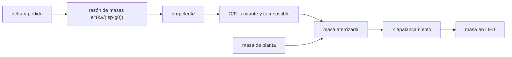

# B59-C01 — Concepto de utilización de recursos in situ

<!-- nav:top -->
[🏠 Programa](../../../../README.md) · [📚 Bloque B59](../../../tronco-comun/B59-recursos-in-situ-y-sostenibilidad-extraterrestre.md) · [← Anterior: B58-C20 — Simulador de riesgo de impacto basado en datos](../../B58/B58-C20-simulador-de-riesgo-de-impacto-basado-en-datos/CLASE.md) · [Siguiente: B59-C02 — Prospección de hielo lunar →](../B59-C02-prospeccion-de-hielo-lunar/CLASE.md)
<!-- /nav -->

## 1. Ubicación, nivel y alcance

Clase 1 del bloque B59. Nivel N3. Abres el bloque preguntando **por qué fabricar en destino** lo que se podría llevar desde la Tierra. Con la ecuación del cohete calculas cuánto propelente exige un ascenso, qué parte es oxidante y cuánta masa de lanzamiento se ahorra si ese oxidante se produce allí. Se deriva aquí lo necesario de la ecuación del cohete. Todas las cifras de la nave son **ilustrativas**.

## 2. Por qué esta clase existe

Cada kilogramo que se lanza arrastra consigo más propelente para lanzarlo. La decisión central: **¿cuánta masa de planta de producción compensa el oxidante que dejas de llevar?** Responder exige una cuenta, no una intuición.

## 3. Lo que podrás hacer al terminar

1. Despejar el propelente de un tramo con la ecuación del cohete.
2. Separar el oxidante y el combustible con la razón O/F.
3. Convertir masa aterrizada en masa de lanzamiento con una razón de apalancamiento.
4. Calcular el ahorro y la masa de planta que lo anula.
5. Verificar el delta-v por integración numérica.
6. Medir la sensibilidad al impulso específico.

La evidencia es la **ficha del concepto ISRU** del ejercicio 12 (sección 20).

## 4. Con qué llegas y cómo comprobarlo

1. ¿Qué es el impulso específico?
2. ¿Qué es el delta-v?
3. ¿Qué es una masa seca?
4. ¿Qué es un valor ilustrativo?
5. ¿Qué es una verificación independiente?

<details>
<summary>Ver respuestas</summary>

1. El empuje por unidad de caudal de peso de propelente; se expresa en segundos y, multiplicado por g₀, da la velocidad efectiva de escape. 2. El cambio de velocidad que un vehículo puede lograr gastando propelente. 3. La masa del vehículo sin propelente. 4. Un valor propuesto para el ejemplo, no medido ni citado. 5. Obtener el mismo resultado por un camino distinto, por ejemplo una integración numérica.
</details>

Con cuatro o cinco aciertos, sigue; si no, repasa los prerrequisitos.

## 5. Un caso de contexto y casos de referencia

Una etapa de ascenso de **2 500 kg** de masa final (seca más carga útil) debe aportar **4 100 m/s** con un motor de oxígeno–metano de **360 s** de impulso específico y razón O/F de **3,5**. Es el **ejemplo conductor**. Resultado: **5 485,6 kg** de propelente, de los cuales **4 266,5 kg (77,8 %)** son oxidante. Con un apalancamiento ilustrativo de **6 kg** en LEO por kg aterrizado, producir el oxidante en destino con una planta de 1 200 kg ahorra **18 399 kg** en LEO. Todo es **ilustrativo** salvo g₀ de NIST.

## 6. Vocabulario

La **utilización de recursos in situ (ISRU)** es el aprovechamiento de los recursos naturales locales del destino, según la definición que usa NASA (S2). El **propelente** es la masa que se expulsa para impulsar. La **razón O/F** es la masa de oxidante por masa de combustible. El **apalancamiento** (*gear ratio*) es cuántos kilogramos hay que lanzar desde la Tierra por cada kilogramo que llega a la superficie del destino. La **masa de equilibrio** de la planta es la que anula el ahorro.

## 7. Modelo mental: cargar el agua o encontrar un pozo

Como en una expedición que decide entre cargar toda el agua o perforar un pozo: el pozo vale la pena si pesa menos que el agua que evita cargar. Límite: el pozo del ejemplo no necesita energía, y la planta ISRU sí.



*Descripción textual:* el delta-v fija el propelente; la razón O/F lo parte; la masa aterrizada, con o sin planta, se multiplica por el apalancamiento para dar la masa en LEO.

## 8. La explicación, paso a paso

### 8.1 Propelente

Con `v_e = Isp·g₀` (`g₀ = 9,806 65 m/s²`, exacta, S1) la masa de propelente es `m_p = m_f (e^{Δv/v_e} − 1)`. Para el ejemplo, `v_e = 3 530,4 m/s`, `Δv/v_e = 1,1613` y la razón de masas es `3,1942`: `m_p = 5 485,6 kg`.

### 8.2 Oxidante y combustible

La razón `O/F = 3,5` reparte `m_p` en `3,5/4,5 = 77,8 %` de oxidante (`4 266,5 kg`) y `1 219,0 kg` de combustible.

### 8.3 Masa aterrizada y masa en LEO

Llevando todo: `2 500 + 5 485,6 = 7 986 kg` aterrizados y `6 × 7 986 = 47 913 kg` en LEO. Con ISRU del oxidante: `2 500 + 1 219 + 1 200 = 4 919 kg` y `29 514 kg`. El ahorro es de `18 399 kg` (38,4 %).

### 8.4 Punto de equilibrio

La planta deja de convenir cuando su masa iguala al oxidante evitado: `4 267 kg` para un solo ascenso. Con 1 200 kg se amortiza en `0,28` ascensos.

### 8.5 Sensibilidad

El propelente es muy sensible al impulso específico: con `Isp × 0,9` crece `+20,1 %` y con `Isp × 1,1` baja `−14,6 %`. La cuenta no incluye la energía de la planta ni su fiabilidad (clases C19–C20).

## 9. Magnitudes, símbolos y unidades

| Símbolo | Qué es | Unidad | Valor / nota |
|---|---|---|---|
| `Isp` | impulso específico | s | 360 (ilustrativo) |
| `g₀` | gravedad estándar | m/s² | 9,806 65 (NIST, exacta) |
| `Δv` | cambio de velocidad | m/s | 4 100 (ilustrativo) |
| `m_f` | masa final | kg | 2 500 (ilustrativo) |
| `m_p` | propelente | kg | 5 485,6 |
| `O/F` | razón oxidante/combustible | — | 3,5 (ilustrativa) |
| `G` | apalancamiento | kg LEO por kg aterrizado | 6 (ilustrativo) |

## 10. Convenciones y referencias

Masas en la superficie del destino y en órbita terrestre baja; delta-v efectivo, sin separar pérdidas; un solo tramo; unidades SI.

## 11. De dónde sale lo que afirmamos

| ID | Fuente | Localizador | Respalda | Estado |
|---|---|---|---|---|
| S1 | NIST, Fundamental Physical Constants, CODATA 2022 (lista ASCII) | https://physics.nist.gov/cuu/Constants/Table/allascii.txt | F = 96 485,332 12… C/mol; R = 8,314 462 618… J/(mol·K); g₀ = 9,806 65 m/s² (exactas) | Consultada (extracto), consultada el 2026-11-09 |
| S2 | NASA, In-Situ Resource Utilization (página de la agencia) | https://www.nasa.gov/isru/ | Definición: aprovechar los recursos naturales locales del destino | Consultada (página), consultada el 2026-11-09 |
| — | No consultado: valores ilustrativos de este laboratorio (se rotulan así en el script y en la clase) | — | Isp, delta-v, masas, O/F y apalancamiento | No consultado |

Límites: solo se consultó la definición de ISRU y g₀; la cifra de apalancamiento no se consultó y se rotula ilustrativa.

## 12. Cómo ver el ahorro de masa

| Caso | Masa aterrizada [kg] | Masa en LEO [kg] |
|---|---|---|
| Todo desde la Tierra | 7 986 | 47 913 |
| Con ISRU del oxidante | 4 919 | 29 514 |
| Ahorro | 3 067 | 18 399 (38,4 %) |

Descripción larga: producir el oxidante en destino reduce la masa lanzada en más de un tercio con estos supuestos.

## 13. Ejemplo trabajado: propelente y ahorro

**Paso 1 · Velocidad de escape.** `3 530,4 m/s`.

**Paso 2 · Razón de masas.** `e^{1,1613} = 3,1942`.

**Paso 3 · Propelente.** `2 500 × 2,1942 = 5 485,6 kg`.

**Paso 4 · Oxidante.** `5 485,6 × 3,5/4,5 = 4 266,5 kg`.

**Paso 5 · Ahorro.** `6 × (4 266,5 − 1 200) = 18 399 kg`.

## 14. Distintas formas de resolver el problema

**Fórmula cerrada:** `m_f (e^{Δv/v_e} − 1)`. **Integración numérica:** sumar `v_e dm/m` en 200 000 trozos (error relativo `3 × 10⁻¹²`). **Biseccionando** el propelente que da el delta-v pedido se obtiene el mismo valor. Tres caminos, una respuesta.

## 15. Práctica guiada

**Ejercicio 1 · con los pasos indicados.** Calcula la velocidad efectiva de escape con `Isp = 360 s` (sección 8.1).

<details><summary>Solución comentada</summary>

`v_e = 360 × 9,806 65 = 3 530,4 m/s`.
</details>

**Ejercicio 2 · con una pista.** Calcula la razón de masas para `Δv = 4 100 m/s` (sección 8.1).

<details><summary>Solución comentada</summary>

`4 100/3 530,4 = 1,1613`; `e^{1,1613} = 3,1942`; el propelente es `2,1942` veces la masa final.
</details>

**Ejercicio 3 · casi autónomo.** Calcula el oxidante con `O/F = 3,5` (sección 8.2).

<details><summary>Solución comentada</summary>

`5 485,6 × 3,5/4,5 = 4 266,5 kg`.
</details>

## 16. Práctica autónoma, transferencia e integrador

**Ejercicio 4.** Con `Isp = 450 s` y el mismo `Δv`, ¿cuánto propelente hace falta? (8.1)

<details><summary>Solución comentada</summary>

Razón de masas `e^{4 100/(450 × 9,806 65)} = 2,532`; `m_p = 2 500 × 1,532 = 3 830 kg`.
</details>

**Ejercicio 5.** Con apalancamiento `G = 4`, ¿cuánto ahorras? (8.3)

<details><summary>Solución comentada</summary>

`4 × (4 266,5 − 1 200) = 12 266 kg`.
</details>

**Ejercicio 6.** Si la planta pesa 5 000 kg, ¿conviene un solo ascenso y cuántos ascensos la amortizan? (8.4)

<details><summary>Solución comentada</summary>

Ahorro `6 × (4 266,5 − 5 000) = −4 401 kg`: no conviene. Se amortiza con `5 000/4 266,5 = 1,17`, o sea 2 ascensos.
</details>

**Ejercicio 7.** ¿Cuánto propelente exige `Δv = 3 000 m/s`? (8.1)

<details><summary>Solución comentada</summary>

`2 500 × (e^{3 000/3 530,4} − 1) = 3 348 kg`.
</details>

**Ejercicio 8.** Con `O/F = 3,0`, ¿cuánto oxidante hay? (8.2)

<details><summary>Solución comentada</summary>

`5 485,6 × 3/4 = 4 114,2 kg`.
</details>

**Ejercicio 9 · transferencia.** Se pide producir `4 266,5 kg` de oxidante en 400 días. ¿Qué tasa horaria es y cuántas unidades de la tasa pico de MOXIE (10,56 g/h, S2 de C08) harían falta?

<details><summary>Solución comentada</summary>

`4 266,5/400 = 10,67 kg/día = 444 g/h`; `444/10,56 ≈ 42` unidades. Es un orden de magnitud, no un diseño.
</details>

**Ejercicio 10 · transferencia.** Un colega dice que ISRU «siempre ahorra masa». Respóndele con los números del ejercicio 3.

<details><summary>Solución comentada</summary>

Con una planta de 5 000 kg el ahorro es negativo en un ascenso; solo se amortiza si se reutiliza. Depende de la masa de planta y del número de usos.
</details>

**Ejercicio 11 · transferencia.** Nombra tres cosas que el modelo omite y que cambiarían la conclusión.

<details><summary>Solución comentada</summary>

Energía y masa de la fuente de potencia, fiabilidad y repuestos, y la masa de los recipientes y del almacenamiento (clases C19–C21).
</details>

**Ejercicio 12 · integrador.** Elabora tu *ficha del concepto ISRU*: propelente, partición O/F, masas aterrizada y en LEO con y sin ISRU, masa de equilibrio y sensibilidad al Isp.

<details><summary>Solución modelo</summary>

Secciones 8.1–8.5; incluye el rótulo de que todas las cifras salvo g₀ son ilustrativas.
</details>

## 17. Laboratorio: apalancamiento de masa de ISRU

El script [apalancamiento.py](apalancamiento.py) calcula el propelente por la fórmula cerrada, lo verifica integrando el delta-v paso a paso y por bisección (**comprueba** `10⁻³` en el delta-v y `10⁻⁶ kg` en la bisección) y compara con y sin ISRU.

**Datos:** solo `g₀` es citado (S1); el resto es **ilustrativo**. **Predice antes de ejecutar:** ¿cuánta masa en LEO se ahorra por ascenso? (≈ un tercio.) **Ejecución del 2026-11-09 (Python 3.12.9):**

```text
Python 3.12.9 (biblioteca estandar)
Razon de masas exp(dv/(Isp g0)) = 3.1942
Propelente total = 5485.6 kg ; oxidante = 4266.5 kg (77.8 %) ; combustible = 1219.0 kg
Delta-v por integracion numerica = 4100.00 m/s ; error relativo = 3.03e-12
Masa aterrizada: todo desde la Tierra = 7986 kg ; con ISRU = 4919 kg
Masa en LEO    : todo desde la Tierra = 47913 kg ; con ISRU = 29514 kg
Ahorro en LEO por un ascenso = 18399 kg (38.4 %)
Masa de planta de equilibrio para un solo ascenso = 4267 kg
Ascensos para amortizar la planta (si se reutiliza) = 0.28
Propelente por biseccion = 5485.554 kg (formula cerrada 5485.554 kg)
Isp x0.9: propelente = 6585 kg (+20.1 %)
Isp x1.1: propelente = 4685 kg (-14.6 %)
Pruebas superadas.
```

```bash
python programa/clases/B59/B59-C01-concepto-de-utilizacion-de-recursos-in-situ/apalancamiento.py
```

**Límites:** un solo tramo, delta-v efectivo y apalancamiento constante.

## 18. Errores frecuentes y cómo corregirlos

**Confundir masa seca con masa final con carga.** Se corrige con la sección 8.1: `m_f` incluye todo lo que no es propelente.

**Olvidar la masa de la planta.** Se corrige con 8.3 y 8.4.

**Tratar el apalancamiento como un dato universal.** Es ilustrativo; se rotula.

**Presentar el ahorro como beneficio sin energía ni fiabilidad.** Se corrige con 8.5 y las clases C19–C20.

## 19. Cómo sabrás que vas bien

Tras la sección 8: ¿qué ahorro esperabas y cuál obtuviste? Si dudas, repasa el ejemplo 13. Tras el laboratorio: ¿qué comprueba? (ver la sección 17).

## 20. Qué entregas y cómo se evalúa

El producto es tu **ficha del concepto ISRU** (ejercicio 12).

| Criterio | Inicial | En desarrollo | Logrado | Destacado |
|---|---|---|---|---|
| Conceptos | Los confunde | Parciales | Conceptos de la clase | Explica los límites |
| Cálculo | Sin unidades | Con errores | Tablas completas | Calcula casos nuevos |
| Numérico | Sin comprobar | Un caso | Contraste con el análisis | Interpreta las diferencias |
| Fuentes | Sin fuente | Sin fecha | Fuentes con fecha | Declara lo ilustrativo |
| Límites | No los nombra | Uno | Tres | Discute qué falta del modelo |

**Condiciones críticas (no se compensan con promedio):** rotular los valores ilustrativos; no presentar el ahorro como general; citar solo lo consultado.

## 21. Ética, seguridad y límites

Clase educativa: los modelos son simplificados y no son un procedimiento de operación. No se diseña ninguna misión real. La definición de ISRU procede de NASA; las cifras son de ejemplo. Accesibilidad: tablas equivalentes a las gráficas, fórmulas en texto, ejercicios sin conexión.

## 22. Para cerrar y seguir

La ecuación del cohete convierte un delta-v en `5 485,6 kg` de propelente, y producir el oxidante en destino ahorra `18 399 kg` en LEO con estos supuestos. Queda una pregunta: ¿dónde hay agua que convertir en oxígeno e hidrógeno?

**Glosario español–inglés.** utilización de recursos in situ · *in-situ resource utilization (ISRU)*; propelente · *propellant*; impulso específico · *specific impulse*; apalancamiento · *gear ratio / mass leverage*; razón de mezcla · *mixture ratio*.

**Continuidad.** [B59-C02](../B59-C02-prospeccion-de-hielo-lunar/CLASE.md) estudia cómo se estima el hielo lunar.

**Referencias:** ver sección 11.

<!-- nav:bottom -->
---

[← Anterior: B58-C20 — Simulador de riesgo de impacto basado en datos](../../B58/B58-C20-simulador-de-riesgo-de-impacto-basado-en-datos/CLASE.md) · [📚 Bloque B59](../../../tronco-comun/B59-recursos-in-situ-y-sostenibilidad-extraterrestre.md) · [Siguiente: B59-C02 — Prospección de hielo lunar →](../B59-C02-prospeccion-de-hielo-lunar/CLASE.md)
<!-- /nav -->
