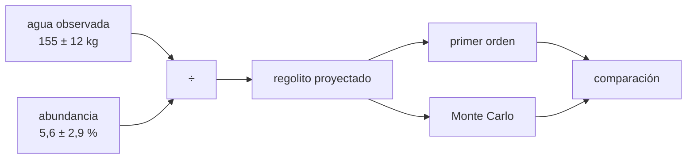

# B59-C02 — Prospección de hielo lunar

<!-- nav:top -->
[🏠 Programa](../../../../README.md) · [📚 Bloque B59](../../../tronco-comun/B59-recursos-in-situ-y-sostenibilidad-extraterrestre.md) · [← Anterior: B59-C01 — Concepto de utilización de recursos in situ](../B59-C01-concepto-de-utilizacion-de-recursos-in-situ/CLASE.md) · [Siguiente: B59-C03 — Agua en regolito y minerales →](../B59-C03-agua-en-regolito-y-minerales/CLASE.md)
<!-- /nav -->

## 1. Ubicación, nivel y alcance

Clase 2 del bloque B59. Nivel N3. Estimas **cuánto hielo hay** a partir de una detección y, sobre todo, **con qué incertidumbre**. Partes del único dato observado que cita la clase: el experimento LCROSS en el cráter Cabeus, en el polo sur lunar (S1). Usas propagación de incertidumbre y Monte Carlo ([B12](../../../tronco-comun/B12-probabilidad-estadistica-e-incertidumbre.md)). El depósito de 1 km² × 1 m es **hipotético**.

## 2. Por qué esta clase existe

Un recurso no se planifica con un valor central sino con un rango. La decisión central: **¿cuánto regolito hay que procesar si la abundancia es 2,7 % en vez de 5,6 %?** La respuesta cambia el tamaño de la planta por un factor dos.

## 3. Lo que podrás hacer al terminar

1. Despejar la masa de regolito proyectada desde la masa de agua y la abundancia.
2. Propagar la incertidumbre de un cociente a primer orden.
3. Comprobar el primer orden con Monte Carlo y ver cuándo falla.
4. Leer percentiles de una distribución asimétrica.
5. Traducir un rango de abundancia en toneladas de un depósito hipotético.
6. Distinguir lo observado de lo hipotético.

La evidencia es la **ficha de la prospección de hielo** del ejercicio 12 (sección 20).

## 4. Con qué llegas y cómo comprobarlo

1. ¿Qué es una incertidumbre?
2. ¿Qué es una fracción másica?
3. ¿Qué es una simulación Monte Carlo?
4. ¿Qué es un percentil?
5. ¿Qué es un valor hipotético?

<details>
<summary>Ver respuestas</summary>

1. Un intervalo en que se espera el valor verdadero. 2. Masa del componente dividida por la masa total. 3. Repetir un cálculo con números aleatorios de semilla fija. 4. El valor bajo el cual cae esa fracción de los datos. 5. Un valor propuesto para razonar, no medido.
</details>

Con cuatro o cinco aciertos, sigue; si no, repasa los prerrequisitos.

## 5. Un caso de contexto y casos de referencia

LCROSS midió, en el campo de visión de su instrumento, un máximo de **155 ± 12 kg** de agua (vapor más hielo) en la nube de eyecta y estimó **5,6 ± 2,9 %** de hielo en masa en el sitio de impacto (S1, solo resumen). Es el **ejemplo conductor**. Dividir da **2 768 kg** de regolito proyectado; a primer orden la incertidumbre es **52 %** (1 449 kg), pero Monte Carlo da una mediana de 2 695 kg y un intervalo del 68 % de 1 796 a 5 044 kg.

## 6. Vocabulario

La **abundancia** `x` es la fracción másica de agua. La **masa proyectada** es `m_reg = m_agua/x`. La **propagación de primer orden** (método delta) aproxima la dispersión de una función con su derivada. Una **cola larga** es una distribución con valores extremos mucho más grandes que su centro. Las **zonas de sombra permanente** son regiones polares que no reciben luz solar directa; COSPAR pide más documentación para ellas (S2).

## 7. Modelo mental: pesar una nube de polvo

Como estimar cuánta harina cae de una nube que solo ves de lejos: la báscula mide lo que cae en un plato, y el resto es extrapolación. Límite: aquí no hay un plato; el agua se infiere por su luz.



*Descripción textual:* el agua observada y la abundancia se dividen para dar la masa de regolito; su incertidumbre se propaga por dos caminos que se comparan.

## 8. La explicación, paso a paso

### 8.1 Masa proyectada

`m_reg = m_agua / x = 155 / 0,056 = 2 768 kg`.

### 8.2 Primer orden

Para un cociente, `(σ_m/m)² = (σ_a/a)² + (σ_x/x)²`: `(12/155)² + (2,9/5,6)²`, de modo que `σ_m/m = 0,524` y `σ_m = 1 449 kg`.

### 8.3 Monte Carlo

Con 200 000 sorteos gaussianos independientes (semilla `20261109`; se descartan abundancias no físicas `x ≤ 0,5 %`) se obtiene media `3 695 kg`, desviación `3 281 kg` y mediana `2 695 kg`. El primer orden predice `0,44` veces la desviación real: **subestima** porque `σ_x/x = 52 %` es grande y `1/x` es muy no lineal. La mediana sí queda cerca del valor central (`−2,6 %`).

### 8.4 Extremos y rango

Con `x = 2,7 %` el regolito sería `5 741 kg`; con `x = 8,5 %`, `1 824 kg`. El intervalo del 68 % (percentiles 16–84) es `1 796–5 044 kg`: asimétrico.

### 8.5 Depósito hipotético

Un depósito de `1 km² × 1 m` con densidad aparente `1 500 kg/m³` (ilustrativa) tiene `1,5 × 10⁹ kg`; con la abundancia central contendría `84 000 t` de agua (`40 500` a `127 500 t` en el rango). Es un ejemplo, no un dato de Cabeus. Los `155 kg` observados son `0,0002 %` de ese agua.

## 9. Magnitudes, símbolos y unidades

| Símbolo | Qué es | Unidad | Valor / nota |
|---|---|---|---|
| `m_agua` | agua en el campo de visión | kg | 155 ± 12 (observado, S1) |
| `x` | abundancia de hielo | fracción másica | 0,056 ± 0,029 (S1) |
| `m_reg` | regolito proyectado | kg | 2 768 |
| `ρ` | densidad aparente | kg/m³ | 1 500 (ilustrativa) |
| `N` | sorteos | — | 200 000 |

## 10. Convenciones y referencias

Fracción másica adimensional; errores gaussianos independientes (supuesto del ejercicio, no de la fuente); semilla `20261109`; sitio: cráter Cabeus, polo sur lunar; sistema de referencia de la superficie, sin coordenadas.

## 11. De dónde sale lo que afirmamos

| ID | Fuente | Localizador | Respalda | Estado |
|---|---|---|---|---|
| S1 | Colaprete, A. et al., Detection of Water in the LCROSS Ejecta Plume, *Science* 330 (2010) 463–468, DOI 10.1126/science.1186986 | https://experts.arizona.edu/en/publications/detection-of-water-in-the-lcross-ejecta-plume/ | 155 ± 12 kg de agua (vapor + hielo) en el campo de visión; 5,6 ± 2,9 % en masa en el sitio de impacto (Cabeus) | Solo resumen, consultada el 2026-11-09 |
| S2 | COSPAR, Panel on Planetary Protection (página) | https://cosparhq.cnes.fr/scientific-structure/panel-on-planetary-protection-ppp/ | Política voluntaria; categorías según cuerpo y misión; regiones polares y sombras permanentes de la Luna exigen más documentación | Consultada (página), consultada el 2026-11-09 |
| — | No consultado: valores ilustrativos de este laboratorio (se rotulan así en el script y en la clase) | — | densidad aparente, área y espesor del depósito hipotético | No consultado |

Límites: solo se leyó el resumen de Colaprete et al. (no el artículo); la independencia y la gaussianidad de los errores son supuestos de la clase; no se consultó el cálculo de los autores.

## 12. Cómo ver el rango de la masa proyectada

| Magnitud | Valor [kg] |
|---|---|
| Cociente central | 2 768 |
| Mediana Monte Carlo | 2 695 |
| Percentil 16 % | 1 796 |
| Percentil 84 % | 5 044 |
| Desviación primer orden | 1 449 |
| Desviación Monte Carlo | 3 281 |

Descripción larga: el intervalo del 68 % va de 1 796 a 5 044 kg y es más ancho por arriba que por abajo.

## 13. Ejemplo trabajado: propagar el cociente

**Paso 1 · Cociente.** `155/0,056 = 2 768 kg`.

**Paso 2 · Errores relativos.** `12/155 = 0,0774`; `2,9/5,6 = 0,5179`.

**Paso 3 · Cuadratura.** `√(0,0774² + 0,5179²) = 0,5237`.

**Paso 4 · Absoluto.** `2 768 × 0,5237 = 1 449 kg`.

**Paso 5 · Comprobación.** Monte Carlo da `3 281 kg`: el primer orden no basta aquí.

## 14. Distintas formas de resolver el problema

**Primer orden:** rápido, válido si los errores relativos son pequeños. **Monte Carlo:** captura la asimetría. **Extremos:** `2,7 %` y `8,5 %` dan el rango máximo plausible pero no una probabilidad. Conviene usar los tres y decir cuál se usa para qué.

## 15. Práctica guiada

**Ejercicio 1 · con los pasos indicados.** Calcula `m_reg` (sección 8.1).

<details><summary>Solución comentada</summary>

`155/0,056 = 2 768 kg`.
</details>

**Ejercicio 2 · con una pista.** Calcula el error relativo combinado (8.2).

<details><summary>Solución comentada</summary>

`√(0,0774² + 0,5179²) = 0,524`.
</details>

**Ejercicio 3 · casi autónomo.** Calcula la desviación absoluta de primer orden (8.2).

<details><summary>Solución comentada</summary>

`2 768 × 0,524 = 1 449 kg`.
</details>

## 16. Práctica autónoma, transferencia e integrador

**Ejercicio 4.** Si la abundancia se conociera con `±1 %` (`0,056 ± 0,010`), ¿cuál sería la incertidumbre de primer orden? (8.2)

<details><summary>Solución comentada</summary>

`√(0,0774² + 0,1786²) = 0,195`; `2 768 × 0,195 = 539 kg`.
</details>

**Ejercicio 5.** ¿Cuánta agua hay en el depósito hipotético con la abundancia central? (8.5)

<details><summary>Solución comentada</summary>

`1,5 × 10⁹ kg × 0,056 = 84 000 t`.
</details>

**Ejercicio 6.** ¿Y con `x = 2,7 %`? (8.5)

<details><summary>Solución comentada</summary>

`1,5 × 10⁹ × 0,027 = 40 500 t`.
</details>

**Ejercicio 7.** Da el intervalo del 68 % del regolito proyectado. (8.3–8.4)

<details><summary>Solución comentada</summary>

De `1 796` a `5 044 kg`.
</details>

**Ejercicio 8.** ¿Qué fracción del agua del depósito hipotético central son los `155 kg` observados? (8.5)

<details><summary>Solución comentada</summary>

`155/84 × 10⁶ = 1,8 × 10⁻⁶`, o `0,0002 %`.
</details>

**Ejercicio 9 · transferencia.** Un colega combina los extremos: `(155−12)/0,085` y `(155+12)/0,027`. ¿Qué obtiene y qué significa?

<details><summary>Solución comentada</summary>

`1 682 kg` y `6 185 kg`: el rango máximo posible, no un intervalo de probabilidad.
</details>

**Ejercicio 10 · transferencia.** Una planta debe producir `1 000 kg` de agua al año. ¿Cuánto regolito procesa con `x = 5,6 %` y con `x = 2,7 %`?

<details><summary>Solución comentada</summary>

`1 000/0,056 = 17 857 kg` y `1 000/0,027 = 37 037 kg` por año, suponiendo extracción total.
</details>

**Ejercicio 11 · transferencia.** ¿Por qué la media de Monte Carlo (3 695 kg) supera al cociente central (2 768 kg)?

<details><summary>Solución comentada</summary>

Porque `1/x` es convexa: la cola de abundancias bajas produce masas muy grandes, y la media de `1/x` supera a `1/` la media de `x`.
</details>

**Ejercicio 12 · integrador.** Elabora tu *ficha de la prospección de hielo*: datos observados con fuente, masa proyectada, incertidumbre por dos métodos, rango de un depósito hipotético y límites.

<details><summary>Solución modelo</summary>

Secciones 8.1–8.5, con la mención explícita de que el depósito es hipotético y de que solo se leyó un resumen.
</details>

## 17. Laboratorio: abundancia de hielo y su incertidumbre

El script [prospeccion.py](prospeccion.py) calcula la masa proyectada, propaga la incertidumbre a primer orden y por Monte Carlo (**comprueba** que el primer orden subestima y que la mediana queda a menos de 5 % del cociente central) y evalúa un depósito hipotético.

**Datos:** agua y abundancia **observadas** (S1, resumen); densidad, área y espesor **ilustrativos**. **Predice antes de ejecutar:** ¿el primer orden sobrestima o subestima la dispersión? (subestima.) **Ejecución del 2026-11-09 (Python 3.12.9):**

```text
Python 3.12.9 (biblioteca estandar)
Regolito proyectado m_reg = m_agua/x = 2768 kg ; incertidumbre de primer orden = 1449 kg (52.4 %)
Monte Carlo (200000 sorteos, semilla 20261109): media = 3695 kg ; desv. = 3281 kg ; mediana = 2695 kg
Percentiles 16/50/84 % del regolito: 1796 ; 2695 ; 5044 kg (distribucion asimetrica)
Cociente de primer orden / Monte Carlo (desviacion) = 0.442
Con x = 2.7 % el regolito seria 5741 kg ; con x = 8.5 %, 1824 kg
Deposito hipotetico central: agua = 84000 t
Deposito hipotetico inferior: agua = 40500 t
Deposito hipotetico superior: agua = 127500 t
El agua observada (155 kg) es 0.0002 % del agua del deposito hipotetico central
Pruebas superadas.
```

```bash
python programa/clases/B59/B59-C02-prospeccion-de-hielo-lunar/prospeccion.py
```

**Límites:** errores gaussianos independientes, sin correlación entre agua y abundancia; truncamiento en `x ≤ 0,5 %`.

## 18. Errores frecuentes y cómo corregirlos

**Dar solo el valor central.** Se corrige con 8.4: se informa un rango.

**Aplicar el primer orden con errores grandes.** Se corrige con 8.3.

**Presentar el depósito hipotético como un recurso.** Se corrige con 8.5 y la sección 10.

**Tomar la abundancia de un sitio como la de toda la Luna.** Es un dato de un cráter; la clase no lo generaliza.

## 19. Cómo sabrás que vas bien

Tras la sección 8: ¿qué rango esperabas y cuál obtuviste? Si dudas, repasa el ejemplo 13. Tras el laboratorio: ¿qué comprueba? (ver la sección 17).

## 20. Qué entregas y cómo se evalúa

El producto es tu **ficha de la prospección de hielo** (ejercicio 12).

| Criterio | Inicial | En desarrollo | Logrado | Destacado |
|---|---|---|---|---|
| Conceptos | Los confunde | Parciales | Conceptos de la clase | Explica los límites |
| Cálculo | Sin unidades | Con errores | Tablas completas | Calcula casos nuevos |
| Numérico | Sin comprobar | Un caso | Contraste con el análisis | Interpreta las diferencias |
| Fuentes | Sin fuente | Sin fecha | Fuentes con fecha | Declara lo ilustrativo |
| Límites | No los nombra | Uno | Tres | Discute qué falta del modelo |

**Condiciones críticas (no se compensan con promedio):** rotular lo hipotético; no presentar el depósito como un recurso real; citar solo lo consultado (un resumen) y decirlo.

## 21. Ética, seguridad y límites

Clase educativa: los modelos son simplificados y no son un procedimiento de operación. La política de COSPAR (S2) pide documentación adicional en regiones polares y sombras permanentes; esta clase no valora ningún sitio para explotación. Accesibilidad: tablas equivalentes a las gráficas, fórmulas en texto, ejercicios sin conexión.

## 22. Para cerrar y seguir

El cociente `155/0,056` da `2 768 kg` de regolito, pero la incertidumbre real es mayor que la de primer orden: el 68 % va de `1 796` a `5 044 kg`. Queda una pregunta: ¿en qué formas está el agua dentro de un regolito o de un mineral?

**Glosario español–inglés.** abundancia · *abundance*; propagación de incertidumbre · *uncertainty propagation*; zona de sombra permanente · *permanently shadowed region*; mediana · *median*; cola larga · *heavy tail*.

**Continuidad.** [B59-C03](../B59-C03-agua-en-regolito-y-minerales/CLASE.md) distingue las formas del agua.

**Referencias:** ver sección 11.

<!-- nav:bottom -->
---

[← Anterior: B59-C01 — Concepto de utilización de recursos in situ](../B59-C01-concepto-de-utilizacion-de-recursos-in-situ/CLASE.md) · [📚 Bloque B59](../../../tronco-comun/B59-recursos-in-situ-y-sostenibilidad-extraterrestre.md) · [Siguiente: B59-C03 — Agua en regolito y minerales →](../B59-C03-agua-en-regolito-y-minerales/CLASE.md)
<!-- /nav -->
