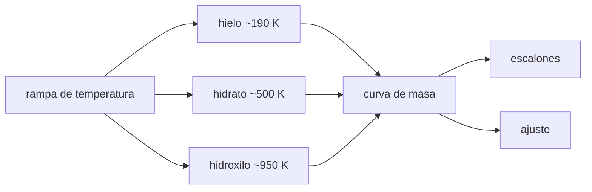

# B59-C03 — Agua en regolito y minerales

<!-- nav:top -->
[🏠 Programa](../../../../README.md) · [📚 Bloque B59](../../../tronco-comun/B59-recursos-in-situ-y-sostenibilidad-extraterrestre.md) · [← Anterior: B59-C02 — Prospección de hielo lunar](../B59-C02-prospeccion-de-hielo-lunar/CLASE.md) · [Siguiente: B59-C04 — Caracterización de regolito lunar →](../B59-C04-caracterizacion-de-regolito-lunar/CLASE.md)
<!-- /nav -->

## 1. Ubicación, nivel y alcance

Clase 3 del bloque B59. Nivel N3. Distingues **tres formas de tener agua** en un regolito: hielo, agua de hidrato e hidroxilo, y aprendes a separarlas por la temperatura a la que se liberan. Trabajas con una curva de pérdida de masa **sintética** (análisis termogravimétrico) y con la estequiometría de un hidrato. Continúa [B59-C02](../B59-C02-prospeccion-de-hielo-lunar/CLASE.md).

## 2. Por qué esta clase existe

No toda el agua es igual de fácil de extraer: el hielo sale con poco calor y el hidroxilo exige temperaturas casi de fusión. La decisión central: **¿qué parte del agua total se obtiene calentando solo hasta 300 K?**

## 3. Lo que podrás hacer al terminar

1. Describir las tres formas de agua y su rango de liberación.
2. Leer una curva de pérdida de masa por escalones.
3. Ajustar las amplitudes de los reservorios por mínimos cuadrados.
4. Calcular la fracción de agua de un hidrato con la masa molar del agua.
5. Comparar el método de escalones con el ajuste.
6. Declarar que los datos son sintéticos.

La evidencia es la **ficha del agua en regolito** del ejercicio 12 (sección 20).

## 4. Con qué llegas y cómo comprobarlo

1. ¿Qué es una fracción másica?
2. ¿Qué es una sigmoide?
3. ¿Qué es una masa molar?
4. ¿Qué es un ajuste de mínimos cuadrados?
5. ¿Qué es un dato sintético?

<details>
<summary>Ver respuestas</summary>

1. Masa del componente dividida por la masa total. 2. Una curva en forma de S que pasa de 0 a 1. 3. La masa de un mol de sustancia, en g/mol. 4. Elegir los parámetros que minimizan la suma de los residuos al cuadrado. 5. Un dato generado por cálculo, no medido.
</details>

Con cuatro o cinco aciertos, sigue; si no, repasa los prerrequisitos.

## 5. Un caso de contexto y casos de referencia

Una muestra sintética contiene **3,0 %** de hielo (se pierde en torno a 190 K), **2,0 %** de agua de hidrato (500 K) y **0,5 %** de hidroxilo (950 K). Es el **ejemplo conductor**. Por escalones se recupera `2,972 / 1,995 / 0,478 %` (total `5,445 %` frente a `5,500 %`); por ajuste, `3,001 / 2,002 / 0,485 %`. La masa molar del agua es `18,0153 g/mol` (S1). **Los datos son sintéticos**, no un análisis de una muestra lunar o marciana.

## 6. Vocabulario

El **hielo** es agua cristalina libre en los poros. El **agua de hidrato** forma parte de la estructura cristalina de un mineral y se libera calentando. El **hidroxilo** (OH) es el grupo unido a la estructura que, al calentar, produce agua. La **termogravimetría (TGA)** mide la masa de una muestra mientras sube la temperatura. Un **escalón** es la pérdida de masa entre dos mesetas.

## 7. Modelo mental: vaciar tres depósitos con grifos distintos

Como vaciar tres depósitos cuyos grifos se abren a temperaturas distintas: al subir la temperatura se vacía primero el más fácil. Límite: los reservorios reales se solapan; aquí están separados por construcción.



*Descripción textual:* la rampa libera cada reservorio a su temperatura; la curva de masa se interpreta por escalones y por ajuste.

## 8. La explicación, paso a paso

### 8.1 Modelo de la curva

Cada reservorio `k` aporta una pérdida `f_k σ((T − T_k)/w)` con `σ` logística. La masa relativa es `m(T) = 1 − Σ f_k σ((T − T_k)/w_k)`, con ruido de balanza gaussiano de `2 × 10⁻⁴`.

### 8.2 Escalones

Entre mesetas (100, 300, 700 y 1 100 K) la diferencia de masa da cada reservorio. Resultado: hielo `2,972 %`, hidrato `1,995 %`, hidroxilo `0,478 %`; diferencias de `−0,028`, `−0,005` y `−0,022` puntos porcentuales. El error pequeño del hielo y del hidroxilo viene de que la sigmoide no ha terminado a la temperatura de la meseta.

### 8.3 Ajuste lineal

Con `T_k` y `w_k` conocidos, las amplitudes `f_k` salen de un sistema lineal 3 × 3 (ecuaciones normales): `3,001 %`, `2,002 %`, `0,485 %`. Es mejor porque usa toda la curva.

### 8.4 Estequiometría de un hidrato

Un hidrato `M·nH₂O` tiene fracción de agua `n M_w/(M + n M_w)` con `M_w = 18,0153 g/mol` (S1). Para un mineral sintético de `M = 172 g/mol`: `n = 2` da `17,32 %`; `n = 7`, `42,30 %`.

### 8.5 Lectura

Calentando solo hasta 300 K se obtiene el hielo, `2,97 %` de los `5,45 %` totales (55 %). El resto exige hidrato e hidroxilo y mucha más energía (clase C06). En el análisis de datos reales los reservorios se solapan y esta separación es una idealización.

## 9. Magnitudes, símbolos y unidades

| Símbolo | Qué es | Unidad | Valor / nota |
|---|---|---|---|
| `f_k` | fracción másica de agua del reservorio k | — | 0,030; 0,020; 0,005 (sintéticas) |
| `T_k` | temperatura central | K | 190; 500; 950 (sintéticas) |
| `w_k` | ancho de la sigmoide | K | 18; 35; 60 (sintéticas) |
| `M_w` | masa molar del agua | g/mol | 18,0153 (NIST) |
| `n` | moléculas de agua por fórmula | — | 2; 7 |

## 10. Convenciones y referencias

Fracción másica adimensional; temperaturas en K; masa relativa a 1 en la meseta inicial; semilla `20261109`; el ruido es de la balanza sintética.

## 11. De dónde sale lo que afirmamos

| ID | Fuente | Localizador | Respalda | Estado |
|---|---|---|---|---|
| S1 | NIST, Chemistry WebBook: agua (CAS 7732-18-5), CO₂ (124-38-9), CH₄ (74-82-8) | https://webbook.nist.gov/cgi/cbook.cgi?ID=C7732185 · …C124389 · …C74828 | Entalpías de formación en gas: H₂O −241,826 ± 0,040; CO₂ −393,51 ± 0,13; CH₄ −74,87 kJ/mol; masas molares 18,0153; 44,0095; 16,0425 g/mol | Consultada (extracto), consultada el 2026-11-09 |
| — | No consultado: valores ilustrativos de este laboratorio (se rotulan así en el script y en la clase) | — | reservorios, temperaturas, anchos, ruido y masa del mineral anhidro | No consultado |

Límites: solo se consultó la masa molar del agua; los rangos de liberación son los de la simulación, no de una referencia.

## 12. Cómo ver los escalones de la curva

| Reservorio | Sembrado [%] | Escalones [%] | Ajuste [%] |
|---|---|---|---|
| Hielo | 3,000 | 2,972 | 3,001 |
| Hidrato | 2,000 | 1,995 | 2,002 |
| Hidroxilo | 0,500 | 0,478 | 0,485 |
| Total | 5,500 | 5,445 | 5,488 |

Descripción larga: la curva baja en tres escalones separados; el primero es el mayor.

## 13. Ejemplo trabajado: fracción de agua de un hidrato

**Paso 1 · Masa del agua.** `2 × 18,0153 = 36,0306 g/mol`.

**Paso 2 · Masa total.** `172 + 36,0306 = 208,0306 g/mol`.

**Paso 3 · Fracción.** `36,0306/208,0306 = 17,32 %`.

## 14. Distintas formas de resolver el problema

**Escalones:** simple y transparente, sesgado si las sigmoides no terminan. **Ajuste lineal:** usa toda la curva, exige conocer `T_k` y `w_k`. **Estequiometría:** da el máximo teórico de un mineral conocido, no la cantidad de la muestra.

## 15. Práctica guiada

**Ejercicio 1 · con los pasos indicados.** Fracción de agua de un hidrato `M = 172`, `n = 2` (8.4).

<details><summary>Solución comentada</summary>

`17,32 %`.
</details>

**Ejercicio 2 · con una pista.** Con `n = 7` (8.4).

<details><summary>Solución comentada</summary>

`7 × 18,0153 = 126,107`; `126,107/298,107 = 42,30 %`.
</details>

**Ejercicio 3 · casi autónomo.** Si la masa relativa es `1,0000` a 100 K y `0,9703` a 300 K, ¿qué hielo hay? (8.2)

<details><summary>Solución comentada</summary>

`1,0000 − 0,9703 = 2,97 %`.
</details>

## 16. Práctica autónoma, transferencia e integrador

**Ejercicio 4.** ¿Cuántos moles de agua hay en `2,0 g` de agua? (S1)

<details><summary>Solución comentada</summary>

`2,0/18,0153 = 0,111 mol`.
</details>

**Ejercicio 5.** ¿Cuánta agua total hay en `1 000 t` de regolito con `5,445 %`? (8.2)

<details><summary>Solución comentada</summary>

`54,45 t`.
</details>

**Ejercicio 6.** ¿Cuál es el error relativo del hidroxilo por escalones? (8.2)

<details><summary>Solución comentada</summary>

`0,022/0,500 = 4,4 %`.
</details>

**Ejercicio 7.** Con ruido `2 × 10⁻⁴` en cada meseta, ¿cuál es el error típico de un escalón? (8.2)

<details><summary>Solución comentada</summary>

`2 × 10⁻⁴ × √2 = 2,8 × 10⁻⁴`, o `0,028` pp.
</details>

**Ejercicio 8.** ¿Cuántos moles de agua por kg de regolito hay en el hidroxilo (`0,5 %`)? (8.1)

<details><summary>Solución comentada</summary>

`5 g/18,0153 = 0,278 mol/kg`.
</details>

**Ejercicio 9 · transferencia.** Un ensayo real tiene dos reservorios que se liberan a 480 y 520 K. ¿Qué método de la clase deja de funcionar?

<details><summary>Solución comentada</summary>

Los escalones, porque no hay meseta entre ambos; hace falta un ajuste con ancho conocido.
</details>

**Ejercicio 10 · transferencia.** Un instrumento remoto informa `5,6 %` de «hielo». ¿Por qué no es lo mismo que el agua total de la muestra de esta clase?

<details><summary>Solución comentada</summary>

Mide una forma o una mezcla distinta y en otra escala; la comparación exige definir qué reservorio se mide.
</details>

**Ejercicio 11 · transferencia.** ¿Qué porcentaje del agua de la muestra se obtiene calentando solo hasta 300 K?

<details><summary>Solución comentada</summary>

`2,972/5,445 = 55 %`.
</details>

**Ejercicio 12 · integrador.** Elabora tu *ficha del agua en regolito*: reservorios, método de escalones, ajuste, fracción de un hidrato y fracción extraíble a 300 K, con el rótulo de datos sintéticos.

<details><summary>Solución modelo</summary>

Secciones 8.1–8.5.
</details>

## 17. Laboratorio: curva de pérdida de masa sintética

El script [agua_ligada.py](agua_ligada.py) genera la curva con ruido, recupera las fracciones por escalones y por ajuste lineal (**comprueba** `5 × 10⁻⁴` en cada fracción) y calcula la estequiometría de un hidrato.

**Datos:** curva **sintética** con semilla `20261109`; masa molar del agua de NIST (S1). **Predice antes de ejecutar:** ¿qué método se acerca más a lo sembrado? (el ajuste.) **Ejecución del 2026-11-09 (Python 3.12.9):**

```text
Python 3.12.9 (biblioteca estandar)
Reservorio   sembrado[%]  recuperado[%]  diferencia[pp]
hielo            3.000         2.972         -0.028
hidrato          2.000         1.995         -0.005
hidroxilo        0.500         0.478         -0.022
Agua total recuperada = 5.445 % en masa (sembrada 5.500 %)
Ajuste hielo     : 3.001 % (sembrado 3.000 %)
Ajuste hidrato   : 2.002 % (sembrado 2.000 %)
Ajuste hidroxilo : 0.485 % (sembrado 0.500 %)
Hidrato M=172 g/mol, n=2: agua = 17.32 % en masa
Hidrato M=172 g/mol, n=7: agua = 42.30 % en masa
Pruebas superadas.
```

```bash
python programa/clases/B59/B59-C03-agua-en-regolito-y-minerales/agua_ligada.py
```

**Límites:** reservorios separados y con forma sigmoide conocida; no es un análisis de muestras reales.

## 18. Errores frecuentes y cómo corregirlos

**Llamar «hielo» a toda el agua.** Se corrige con 8.5.

**Ignorar que los escalones reales se solapan.** Se corrige con la sección 14.

**Usar la estequiometría como medida de una muestra.** Es un máximo teórico.

**Presentar la curva como medida.** Es sintética; se rotula en la sección 10.

## 19. Cómo sabrás que vas bien

Tras la sección 8: ¿qué fracción esperabas y cuál obtuviste? Si dudas, repasa el ejemplo 13. Tras el laboratorio: ¿qué comprueba? (ver la sección 17).

## 20. Qué entregas y cómo se evalúa

El producto es tu **ficha del agua en regolito** (ejercicio 12).

| Criterio | Inicial | En desarrollo | Logrado | Destacado |
|---|---|---|---|---|
| Conceptos | Los confunde | Parciales | Conceptos de la clase | Explica los límites |
| Cálculo | Sin unidades | Con errores | Tablas completas | Calcula casos nuevos |
| Numérico | Sin comprobar | Un caso | Contraste con el análisis | Interpreta las diferencias |
| Fuentes | Sin fuente | Sin fecha | Fuentes con fecha | Declara lo ilustrativo |
| Límites | No los nombra | Uno | Tres | Discute qué falta del modelo |

**Condiciones críticas (no se compensan con promedio):** rotular la curva como sintética; no atribuirle una muestra; citar solo lo consultado.

## 21. Ética, seguridad y límites

Clase educativa: los modelos son simplificados y no son un procedimiento de operación. Ningún dato de esta clase proviene de una muestra lunar o marciana. Accesibilidad: tablas equivalentes a las gráficas, fórmulas en texto, ejercicios sin conexión.

## 22. Para cerrar y seguir

La suma de los escalones da `5,445 %` y el ajuste `5,488 %`, y solo el `55 %` se libera por debajo de 300 K. Queda una pregunta: ¿cómo se describe el regolito que contiene esa agua?

**Glosario español–inglés.** hielo · *ice*; hidrato · *hydrate*; hidroxilo · *hydroxyl*; termogravimetría · *thermogravimetric analysis (TGA)*; escalón · *step*.

**Continuidad.** [B59-C04](../B59-C04-caracterizacion-de-regolito-lunar/CLASE.md) caracteriza el regolito.

**Referencias:** ver sección 11.

<!-- nav:bottom -->
---

[← Anterior: B59-C02 — Prospección de hielo lunar](../B59-C02-prospeccion-de-hielo-lunar/CLASE.md) · [📚 Bloque B59](../../../tronco-comun/B59-recursos-in-situ-y-sostenibilidad-extraterrestre.md) · [Siguiente: B59-C04 — Caracterización de regolito lunar →](../B59-C04-caracterizacion-de-regolito-lunar/CLASE.md)
<!-- /nav -->
