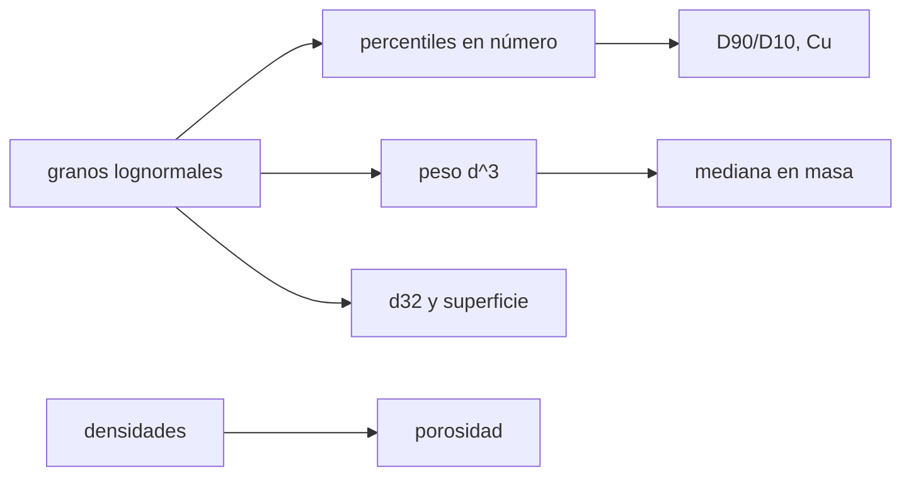

# B59-C04 — Caracterización de regolito lunar

<!-- nav:top -->
[🏠 Programa](../../../../README.md) · [📚 Bloque B59](../../../tronco-comun/B59-recursos-in-situ-y-sostenibilidad-extraterrestre.md) · [← Anterior: B59-C03 — Agua en regolito y minerales](../B59-C03-agua-en-regolito-y-minerales/CLASE.md) · [Siguiente: B59-C05 — Minerales marcianos →](../B59-C05-minerales-marcianos/CLASE.md)
<!-- /nav -->

## 1. Ubicación, nivel y alcance

Clase 4 del bloque B59. Nivel N3. Describes un regolito con sus **números**: la distribución de tamaños de grano, los percentiles `D10`, `D50` y `D90`, los coeficientes que resumen su amplitud, la porosidad y la superficie específica. Usas la distribución lognormal ([B12](../../../tronco-comun/B12-probabilidad-estadistica-e-incertidumbre.md)). Los datos son **sintéticos**; las propiedades del regolito lunar real no se consultaron.

## 2. Por qué esta clase existe

Un tamiz, una tolva o un horno de sinterización se diseñan para una distribución de tamaños, no para un grano. La decisión central: **¿qué fracción de la masa es fina (menor de 20 µm) y cuánto cambia si hablo de número o de masa?**

## 3. Lo que podrás hacer al terminar

1. Generar una muestra lognormal con semilla fija y leer sus percentiles.
2. Distinguir la mediana en número de la mediana en masa.
3. Calcular `D90/D10` y el coeficiente de uniformidad.
4. Calcular la porosidad desde dos densidades.
5. Obtener el diámetro de Sauter y la superficie específica.
6. Contrastar la muestra con el valor analítico.

La evidencia es la **ficha de caracterización del regolito** del ejercicio 12 (sección 20).

## 4. Con qué llegas y cómo comprobarlo

1. ¿Qué es una distribución lognormal?
2. ¿Qué es un percentil?
3. ¿Qué es una densidad aparente?
4. ¿Qué es una porosidad?
5. ¿Qué es un valor ilustrativo?

<details>
<summary>Ver respuestas</summary>

1. Una distribución cuyo logaritmo es normal. 2. El valor bajo el cual cae esa fracción de los datos. 3. Masa del material seco dividida por el volumen total, poros incluidos. 4. Fracción del volumen que es vacío. 5. Un valor propuesto para el ejemplo, no medido ni citado.
</details>

Con cuatro o cinco aciertos, sigue; si no, repasa los prerrequisitos.

## 5. Un caso de contexto y casos de referencia

Se simulan **50 000 granos** con mediana **en masa** de 70 µm y desviación geométrica 2,6 (ambas **ilustrativas**). Es el **ejemplo conductor**. La mediana en número resulta `4,52 µm`; `D10 = 1,31`, `D50 = 4,51` y `D90 = 15,36 µm` (muestra) frente a `1,33`, `4,52` y `15,39 µm` (analítico). El `9,5 %` de la masa es menor de 20 µm; la porosidad, con 1 500 y 3 000 kg/m³, es `0,500`.

## 6. Vocabulario

`D_p` es el diámetro bajo el cual está la fracción `p` de los granos. La **desviación geométrica** (`GSD`) es `e^σ`, con `σ` la desviación del logaritmo del diámetro. El **coeficiente de uniformidad** es `D60/D10`. El **diámetro de Sauter** `d₃₂` es el de una esfera con la misma razón volumen/superficie que el conjunto. La **superficie específica** es el área por unidad de masa.

## 7. Modelo mental: una bolsa de arena con piedras y harina

Como una bolsa que mezcla harina y piedrecillas: hay muchísimos granos de harina pero la masa la ponen las piedras. Límite: el regolito real tiene granos irregulares, no esferas.



*Descripción textual:* la muestra de granos da percentiles en número; ponderada por el volumen da la mediana en masa; las densidades dan la porosidad.

## 8. La explicación, paso a paso

### 8.1 Percentiles

Si `ln d ~ N(μ, σ)`, entonces `D_p = e^{μ + z_p σ}`. Con `GSD = 2,6`, `σ = ln 2,6 = 0,9555`. Para que la mediana **en masa** sea 70 µm hace falta `μ = ln 70 − 3σ² `, de modo que la mediana en número es `4,52 µm`. Los percentiles muestrales difieren del analítico en `−1,24 %`, `−0,33 %` y `−0,20 %`.

### 8.2 Amplitud

`D90/D10 = e^{2·1,2816·σ} = 11,58`. El coeficiente de uniformidad `D60/D10 = e^{(0,2533+1,2816)σ} = 4,33`.

### 8.3 En masa

Un grano esférico pesa como `d³`; la distribución en masa tiene la misma forma con `μ_m = μ + 3σ²`. La mediana en masa muestral es `64 µm` frente a `70 µm` analítico (la cola gruesa hace ruidosa la mediana en masa). La fracción en masa menor de 20 µm es `9,49 %` analítica y `10,28 %` muestral.

### 8.4 Porosidad y superficie

`φ = 1 − ρ_ap/ρ_grano = 1 − 1 500/3 000 = 0,500`. El diámetro de Sauter es `d₃₂ = e^{μ + 2,5σ²} = 44,3 µm` y la superficie específica de esferas, `6/(ρ_grano d₃₂) = 45,1 m²/kg`.

### 8.5 Lectura

Hablar de «tamaño medio» sin decir si es de número o de masa cambia el valor un factor 15. Lo importante para un proceso (tamizado, transporte, calentamiento) es la distribución en masa.

## 9. Magnitudes, símbolos y unidades

| Símbolo | Qué es | Unidad | Valor / nota |
|---|---|---|---|
| `σ` | desviación del logaritmo del diámetro | — | 0,9555 (ilustrativa) |
| `GSD` | desviación geométrica | — | 2,6 (ilustrativa) |
| `D_p` | percentil de diámetro | µm | ver tabla |
| `ρ_grano` | densidad de grano | kg/m³ | 3 000 (ilustrativa) |
| `ρ_ap` | densidad aparente | kg/m³ | 1 500 (ilustrativa) |
| `φ` | porosidad | — | 0,500 |
| `d₃₂` | diámetro de Sauter | µm | 44,3 |

## 10. Convenciones y referencias

Diámetros en µm; distribución lognormal; granos esféricos; masa proporcional a `d³`; semilla `20261109`; `N = 50 000`.

## 11. De dónde sale lo que afirmamos

| ID | Fuente | Localizador | Respalda | Estado |
|---|---|---|---|---|
| — | No consultado: valores ilustrativos de este laboratorio (se rotulan así en el script y en la clase) | — | mediana, desviación geométrica, densidades | No consultado |

Límites: no se consultó ninguna fuente sobre el regolito lunar real; los valores son de ejemplo.

## 12. Cómo ver la distribución de tamaños

| Percentil | Muestra [µm] | Analítico [µm] |
|---|---|---|
| D10 | 1,31 | 1,33 |
| D50 | 4,51 | 4,52 |
| D90 | 15,36 | 15,39 |
| D50 en masa | 64 | 70 |

Descripción larga: la mediana en número (4,5 µm) está 15 veces por debajo de la mediana en masa (70 µm).

## 13. Ejemplo trabajado: D90 de la muestra

**Paso 1 · σ.** `ln 2,6 = 0,9555`.

**Paso 2 · μ.** `ln 70 − 3 × 0,9130 = 1,5095`; `e^{1,5095} = 4,52 µm`.

**Paso 3 · z.** `z₀,₉ = 1,2816`.

**Paso 4 · D90.** `4,52 × e^{1,2816 × 0,9555} = 15,39 µm`.

## 14. Distintas formas de resolver el problema

**Muestra:** simple, ruidosa en las colas. **Analítico:** exacto bajo el modelo lognormal. **Tamizado real:** da masas por tamiz y exige interpolar; aquí no se simula.

## 15. Práctica guiada

**Ejercicio 1 · con los pasos indicados.** Calcula `σ` con `GSD = 2,6` (8.1).

<details><summary>Solución comentada</summary>

`ln 2,6 = 0,9555`.
</details>

**Ejercicio 2 · con una pista.** Calcula la porosidad con 1 500 y 3 000 kg/m³ (8.4).

<details><summary>Solución comentada</summary>

`1 − 0,5 = 0,500`.
</details>

**Ejercicio 3 · casi autónomo.** Calcula `D90/D10` (8.2).

<details><summary>Solución comentada</summary>

`e^{2 × 1,2816 × 0,9555} = 11,58`.
</details>

## 16. Práctica autónoma, transferencia e integrador

**Ejercicio 4.** Calcula el coeficiente de uniformidad `D60/D10` (8.2).

<details><summary>Solución comentada</summary>

`z₀,₆ = 0,2533`; `e^{(0,2533+1,2816) × 0,9555} = 4,33`.
</details>

**Ejercicio 5.** Calcula la mediana en número desde la de masa (8.1).

<details><summary>Solución comentada</summary>

`70/e^{3σ²} = 70/15,47 = 4,52 µm`.
</details>

**Ejercicio 6.** Calcula `d₃₂` (8.4).

<details><summary>Solución comentada</summary>

`4,52 × e^{2,5 × 0,913} = 44,3 µm`.
</details>

**Ejercicio 7.** Calcula la superficie específica de esferas (8.4).

<details><summary>Solución comentada</summary>

`6/(3 000 × 44,3 × 10⁻⁶) = 45,1 m²/kg`.
</details>

**Ejercicio 8.** Con `GSD = 2,0`, ¿cuánto vale `D90/D10`? (8.2)

<details><summary>Solución comentada</summary>

`σ = 0,6931`; `e^{2,5632 × 0,6931} = 5,91`.
</details>

**Ejercicio 9 · transferencia.** Se tamizan `1 000 kg` de alimentación. ¿Cuánto pasa por una malla de 20 µm en el modelo? (8.3)

<details><summary>Solución comentada</summary>

`9,49 % → 95 kg`.
</details>

**Ejercicio 10 · transferencia.** ¿Por qué un «tamaño medio de 70 µm» puede ser engañoso?

<details><summary>Solución comentada</summary>

Si es en masa, la mediana en número es 4,5 µm; hay que declarar la base.
</details>

**Ejercicio 11 · transferencia.** Con porosidad `0,40` y `ρ_grano = 3 000`, ¿cuál es la densidad aparente?

<details><summary>Solución comentada</summary>

`3 000 × 0,60 = 1 800 kg/m³`.
</details>

**Ejercicio 12 · integrador.** Elabora tu *ficha de caracterización del regolito*: distribución, percentiles, base (número o masa), porosidad, superficie específica y el rótulo de datos sintéticos.

<details><summary>Solución modelo</summary>

Secciones 8.1–8.5.
</details>

## 17. Laboratorio: granulometría lognormal sintética

El script [granulometria.py](granulometria.py) genera 50 000 granos, calcula los percentiles y los contrasta con el valor analítico (**comprueba** 2 % en los percentiles y 25 % en la mediana en masa) y calcula la porosidad y la superficie.

**Datos:** muestra **sintética** con semilla `20261109`; todos los parámetros **ilustrativos**. **Predice antes de ejecutar:** ¿la mediana en número es mayor o menor que la mediana en masa? (menor.) **Ejecución del 2026-11-09 (Python 3.12.9):**

```text
Python 3.12.9 (biblioteca estandar)
Mediana en numero implicita = 4.52 µm ; mediana en masa impuesta = 70 µm
percentil  muestral[µm]  analitico[µm]  diferencia[%]
D10             1.31           1.33         -1.24
D50             4.51           4.52         -0.33
D90            15.36          15.39         -0.20
Razon D90/D10 analitica = 11.58 ; con D60/D10 (coeficiente de uniformidad Cu) = 4.33
D50 en masa: muestral = 64 µm ; analitico = 70 µm 
Fraccion en masa < 20 µm: analitica = 9.49 % ; muestral = 10.28 %
Porosidad = 1 - rho_ap/rho_grano = 0.500
Diametro de Sauter d32 = 44.3 µm ; superficie especifica de esferas = 45.1 m^2/kg
Pruebas superadas.
```

```bash
python programa/clases/B59/B59-C04-caracterizacion-de-regolito-lunar/granulometria.py
```

**Límites:** granos esféricos, distribución lognormal pura, sin finos adheridos ni forma irregular.

## 18. Errores frecuentes y cómo corregirlos

**Mezclar medianas en número y en masa.** Se corrige con 8.3 y 8.5.

**Creer que la porosidad es una densidad.** Se corrige con 8.4.

**Usar el diámetro medio aritmético en lugar del de Sauter para la superficie.** Se corrige con 8.4.

**Presentar los parámetros como los del regolito lunar.** Son ilustrativos.

## 19. Cómo sabrás que vas bien

Tras la sección 8: ¿qué percentil esperabas y cuál obtuviste? Si dudas, repasa el ejemplo 13. Tras el laboratorio: ¿qué comprueba? (ver la sección 17).

## 20. Qué entregas y cómo se evalúa

El producto es tu **ficha de caracterización del regolito** (ejercicio 12).

| Criterio | Inicial | En desarrollo | Logrado | Destacado |
|---|---|---|---|---|
| Conceptos | Los confunde | Parciales | Conceptos de la clase | Explica los límites |
| Cálculo | Sin unidades | Con errores | Tablas completas | Calcula casos nuevos |
| Numérico | Sin comprobar | Un caso | Contraste con el análisis | Interpreta las diferencias |
| Fuentes | Sin fuente | Sin fecha | Fuentes con fecha | Declara lo ilustrativo |
| Límites | No los nombra | Uno | Tres | Discute qué falta del modelo |

**Condiciones críticas (no se compensan con promedio):** rotular los parámetros como ilustrativos; indicar siempre la base (número o masa); no atribuirlos al regolito lunar real.

## 21. Ética, seguridad y límites

Clase educativa: los modelos son simplificados y no son un procedimiento de operación. No se afirma ninguna propiedad del regolito real; las muestras de la Luna tienen distribuciones que debe consultar la literatura. Accesibilidad: tablas equivalentes a las gráficas, fórmulas en texto, ejercicios sin conexión.

## 22. Para cerrar y seguir

Con una mediana en masa de `70 µm` y `GSD = 2,6`, la mediana en número es `4,52 µm`, el `9,5 %` de la masa es menor de 20 µm y la porosidad es `0,50`. Queda una pregunta: ¿cómo se reconoce de qué minerales está hecho el regolito de otro mundo?

**Glosario español–inglés.** granulometría · *particle-size distribution*; percentil · *percentile*; porosidad · *porosity*; diámetro de Sauter · *Sauter mean diameter*; superficie específica · *specific surface area*.

**Continuidad.** [B59-C05](../B59-C05-minerales-marcianos/CLASE.md) desmezcla minerales.

**Referencias:** ver sección 11.

<!-- nav:bottom -->
---

[← Anterior: B59-C03 — Agua en regolito y minerales](../B59-C03-agua-en-regolito-y-minerales/CLASE.md) · [📚 Bloque B59](../../../tronco-comun/B59-recursos-in-situ-y-sostenibilidad-extraterrestre.md) · [Siguiente: B59-C05 — Minerales marcianos →](../B59-C05-minerales-marcianos/CLASE.md)
<!-- /nav -->
