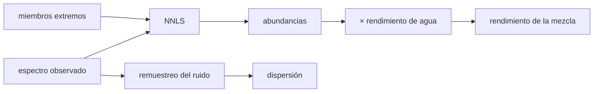

# B59-C05 — Minerales marcianos

<!-- nav:top -->
[🏠 Programa](../../../../README.md) · [📚 Bloque B59](../../../tronco-comun/B59-recursos-in-situ-y-sostenibilidad-extraterrestre.md) · [← Anterior: B59-C04 — Caracterización de regolito lunar](../B59-C04-caracterizacion-de-regolito-lunar/CLASE.md) · [Siguiente: B59-C06 — Extracción y procesamiento de volátiles →](../../../tronco-comun/B59-recursos-in-situ-y-sostenibilidad-extraterrestre.md#b59-c06)
<!-- /nav -->

## 1. Ubicación, nivel y alcance

Clase 5 del bloque B59. Nivel N3. Aprendes a **estimar la mezcla de minerales** de una superficie a partir de su espectro y a convertir esa mezcla en un rendimiento de agua extraíble. Se usa la desmezcla lineal con mínimos cuadrados no negativos ([B12](../../../tronco-comun/B12-probabilidad-estadistica-e-incertidumbre.md)). **Los miembros extremos y sus rendimientos son sintéticos**: la clase enseña el método y no afirma la mineralogía real de Marte, que no se consultó.

## 2. Por qué esta clase existe

Antes de excavar hay que saber qué se excava. La decisión central: **¿qué rendimiento de agua se espera de una mezcla y con qué dispersión por el ruido?**

## 3. Lo que podrás hacer al terminar

1. Plantear la mezcla lineal `y = E a` con abundancias no negativas.
2. Resolver con mínimos cuadrados no negativos y contrastar con SciPy.
3. Calcular el rendimiento de agua de una mezcla.
4. Estimar su dispersión por remuestreo del ruido.
5. Interpretar el número de condición.
6. Reconocer cuándo la mezcla lineal deja de valer.

La evidencia es la **ficha de la mezcla mineral** del ejercicio 12 (sección 20).

## 4. Con qué llegas y cómo comprobarlo

1. ¿Qué es un espectro?
2. ¿Qué es un vector?
3. ¿Qué es un mínimo cuadrado?
4. ¿Qué es una restricción de no negatividad?
5. ¿Qué es un dato sintético?

<details>
<summary>Ver respuestas</summary>

1. La intensidad (aquí reflectancia) en función de la longitud de onda. 2. Una lista ordenada de números. 3. Elegir los parámetros que minimizan la suma de los residuos al cuadrado. 4. Exigir que las abundancias no sean negativas. 5. Un dato generado por cálculo, no medido.
</details>

Con cuatro o cinco aciertos, sigue; si no, repasa los prerrequisitos.

## 5. Un caso de contexto y casos de referencia

Una mezcla sintética de cuatro miembros con abundancias `0,45 / 0,30 / 0,15 / 0,10` se observa en **12 bandas** con ruido de `0,003`. Es el **ejemplo conductor**. Se recupera `0,447 / 0,293 / 0,161 / 0,100` (suma `1,001`) y un rendimiento de agua de `5,10 %` frente al `5,00 %` sembrado; el ruido produce una dispersión de `0,30` puntos porcentuales. Nada de esto es mineralogía marciana.

## 6. Vocabulario

Un **miembro extremo** (*endmember*) es el espectro de un mineral puro. La **desmezcla lineal** supone que el espectro de la mezcla es la suma ponderada de los de sus miembros. Los **mínimos cuadrados no negativos (NNLS)** buscan las abundancias que mejor ajustan sin salir de `a ≥ 0`. El **número de condición** mide cuánto amplifica el ruido el sistema. El **rendimiento de agua** es la masa de agua extraíble por masa de roca.

## 7. Modelo mental: mezclar pinturas

Como averiguar qué mezcla de cuatro pinturas da un color: se prueban proporciones hasta igualarlo. Límite: en los granos reales la luz rebota varias veces y la mezcla no es lineal.



*Descripción textual:* el espectro y los miembros extremos dan las abundancias por NNLS; ponderadas por el rendimiento dan el agua; el remuestreo del ruido da su dispersión.

## 8. La explicación, paso a paso

### 8.1 Modelo

`y = E a + ε`, con `E` de 12 × 4 (cada columna, un miembro extremo sintético), `a ≥ 0` y `ε ~ N(0, 0,003²)`. Se resuelve con un algoritmo de conjunto activo propio y se contrasta con `scipy.optimize.nnls`: la máxima diferencia es `1,4 × 10⁻¹⁵`.

### 8.2 Abundancias

`0,447 / 0,293 / 0,161 / 0,100` frente a `0,45 / 0,30 / 0,15 / 0,10`. La suma `1,001` no se impone; sirve de control de calidad.

### 8.3 Rendimiento

Con rendimientos sintéticos `0 / 0,08 / 0,14 / 0,05 kg/kg`, el sembrado es `0,45·0 + 0,30·0,08 + 0,15·0,14 + 0,10·0,05 = 5,00 %`. El estimado (abundancias normalizadas) es `5,10 %`, `+0,097` pp.

### 8.4 Dispersión

Remuestreando el ruido 200 veces: media `4,96 %` y desviación `0,300` pp (relativa `6 %`).

### 8.5 Condicionamiento

El número de condición de `E` es `149,9`: el ruido puede amplificarse hasta unas 150 veces en las abundancias. Miembros más parecidos entre sí lo aumentan.

### 8.6 Cuándo falla

Si los granos son íntimos, la luz se dispersa varias veces y la mezcla deja de ser lineal; entonces se transforma el espectro (por ejemplo, a albedo de dispersión simple) antes de desmezclar. La clase no lo simula.

## 9. Magnitudes, símbolos y unidades

| Símbolo | Qué es | Unidad | Valor / nota |
|---|---|---|---|
| `E` | matriz de miembros extremos | reflectancia | 12 × 4 (sintética) |
| `a` | abundancias | fracción másica | ≥ 0 |
| `w` | rendimiento de agua del miembro | kg/kg | 0; 0,08; 0,14; 0,05 (sintéticos) |
| `σ` | ruido por banda | reflectancia | 0,003 |
| `κ` | número de condición | — | 149,9 |

## 10. Convenciones y referencias

Reflectancia adimensional en 12 bandas; abundancias como fracción másica (supuesto lineal); semilla `20261109`; NNLS con tolerancia `10⁻¹²`.

## 11. De dónde sale lo que afirmamos

| ID | Fuente | Localizador | Respalda | Estado |
|---|---|---|---|---|
| — | No consultado: valores ilustrativos de este laboratorio (se rotulan así en el script y en la clase) | — | espectros y rendimientos sintéticos; mineralogía real de Marte | No consultado |

Límites: no se consultó ninguna fuente sobre la mineralogía de Marte; todo es sintético.

## 12. Cómo ver la mezcla recuperada

| Miembro | Sembrado | Recuperado |
|---|---|---|
| A | 0,450 | 0,447 |
| B | 0,300 | 0,293 |
| C | 0,150 | 0,161 |
| D | 0,100 | 0,100 |

Descripción larga: las cuatro abundancias se recuperan a menos de 0,011.

## 13. Ejemplo trabajado: rendimiento de agua de una mezcla

**Paso 1 · Ponderar.** `0,45·0 = 0`; `0,30·0,08 = 0,024`; `0,15·0,14 = 0,021`; `0,10·0,05 = 0,005`.

**Paso 2 · Sumar.** `0,050 = 5,0 %`.

**Paso 3 · Comparar.** El estimado es `5,10 %`, `+0,097` pp.

## 14. Distintas formas de resolver el problema

**NNLS propio:** transparente. **SciPy `nnls`:** mismo resultado a `10⁻¹⁵`. **Mínimos cuadrados sin restricción:** puede dar abundancias negativas sin sentido físico.

## 15. Práctica guiada

**Ejercicio 1 · con los pasos indicados.** Rendimiento sembrado (8.3).

<details><summary>Solución comentada</summary>

`5,0 %`.
</details>

**Ejercicio 2 · con una pista.** Suma de las abundancias recuperadas (8.2).

<details><summary>Solución comentada</summary>

`0,447 + 0,293 + 0,161 + 0,100 = 1,001`.
</details>

**Ejercicio 3 · casi autónomo.** Error del rendimiento estimado (8.3).

<details><summary>Solución comentada</summary>

`5,10 − 5,00 = +0,10` pp.
</details>

## 16. Práctica autónoma, transferencia e integrador

**Ejercicio 4.** Error relativo del rendimiento estimado (8.3).

<details><summary>Solución comentada</summary>

`0,097/5,00 = 1,9 %`.
</details>

**Ejercicio 5.** Agua en `1 000 kg` de roca con `5,0 %` (8.3).

<details><summary>Solución comentada</summary>

`50 kg`.
</details>

**Ejercicio 6.** Rendimiento de una mezcla `0,2 / 0,2 / 0,3 / 0,3` (8.3).

<details><summary>Solución comentada</summary>

`0,016 + 0,042 + 0,015 = 7,3 %`.
</details>

**Ejercicio 7.** Intervalo de ±1σ del rendimiento (8.4).

<details><summary>Solución comentada</summary>

`4,96 ± 0,30 → 4,66 a 5,26 %`.
</details>

**Ejercicio 8.** Si un miembro es 100 % del terreno con `w = 0`, ¿qué rendimiento hay? (8.3)

<details><summary>Solución comentada</summary>

`0 %`.
</details>

**Ejercicio 9 · transferencia.** ¿Por qué una abundancia negativa no tiene sentido y cómo la evita el método?

<details><summary>Solución comentada</summary>

No existe masa negativa; NNLS impone `a ≥ 0` en la minimización.
</details>

**Ejercicio 10 · transferencia.** El número de condición sube a 1 500. ¿Qué cambia para el resultado?

<details><summary>Solución comentada</summary>

El ruido se amplifica 10 veces más: la dispersión del rendimiento crece en proporción y la desmezcla se vuelve poco fiable.
</details>

**Ejercicio 11 · transferencia.** Un colega aplica la clase al polvo real de otro cuerpo con granos íntimos. ¿Qué le adviertes?

<details><summary>Solución comentada</summary>

La mezcla no es lineal y los miembros no son los de esta clase; hay que transformar los espectros y validar con medidas independientes.
</details>

**Ejercicio 12 · integrador.** Elabora tu *ficha de la mezcla mineral*: modelo, abundancias, rendimiento, dispersión, condicionamiento y el rótulo de que los miembros son sintéticos.

<details><summary>Solución modelo</summary>

Secciones 8.1–8.6.
</details>

## 17. Laboratorio: desmezcla lineal sintética

El script [desmezcla.py](desmezcla.py) construye 4 miembros sintéticos, genera un espectro con ruido, resuelve NNLS con un algoritmo propio y con SciPy (**comprueba** `0,02` en las abundancias y `10⁻⁹` entre ambos) y calcula el rendimiento y su dispersión.

**Datos:** espectros y rendimientos **sintéticos**; semilla `20261109`; NumPy y SciPy se imprimen al inicio. **Predice antes de ejecutar:** ¿qué miembro se recupera peor? (el de mayor solapamiento espectral; aquí C.) **Ejecución del 2026-11-09 (Python 3.12.9):**

```text
Python 3.12.9 ; numpy 2.4.4 ; scipy 1.17.1
miembro                  sembrado   recuperado
miembro A (sintetico)       0.450       0.447
miembro B (sintetico)       0.300       0.293
miembro C (sintetico)       0.150       0.161
miembro D (sintetico)       0.100       0.100
Suma de abundancias recuperadas = 1.001 (no se impone; sirve de control)
Maxima diferencia con scipy.optimize.nnls = 1.43e-15
Rendimiento de agua: sembrado = 5.00 % ; estimado = 5.10 % ; diferencia = +0.097 pp
Dispersion del rendimiento por ruido (200 repeticiones): media = 4.96 % ; desv. = 0.300 pp
Numero de condicion de la matriz de miembros extremos = 149.9
Pruebas superadas.
```

```bash
python programa/clases/B59/B59-C05-minerales-marcianos/desmezcla.py
```

**Límites:** mezcla lineal, ruido gaussiano, miembros conocidos; no es mineralogía de Marte.

## 18. Errores frecuentes y cómo corregirlos

**Usar mínimos cuadrados sin restricción.** Se corrige con 8.1.

**No mirar el condicionamiento.** Se corrige con 8.5.

**Atribuir los miembros a Marte.** Son sintéticos; se rotulan.

**Asumir mezcla lineal siempre.** Se corrige con 8.6.

## 19. Cómo sabrás que vas bien

Tras la sección 8: ¿qué rendimiento esperabas y cuál obtuviste? Si dudas, repasa el ejemplo 13. Tras el laboratorio: ¿qué comprueba? (ver la sección 17).

## 20. Qué entregas y cómo se evalúa

El producto es tu **ficha de la mezcla mineral** (ejercicio 12).

| Criterio | Inicial | En desarrollo | Logrado | Destacado |
|---|---|---|---|---|
| Conceptos | Los confunde | Parciales | Conceptos de la clase | Explica los límites |
| Cálculo | Sin unidades | Con errores | Tablas completas | Calcula casos nuevos |
| Numérico | Sin comprobar | Un caso | Contraste con el análisis | Interpreta las diferencias |
| Fuentes | Sin fuente | Sin fecha | Fuentes con fecha | Declara lo ilustrativo |
| Límites | No los nombra | Uno | Tres | Discute qué falta del modelo |

**Condiciones críticas (no se compensan con promedio):** rotular los miembros como sintéticos; no presentar la mineralogía marciana; citar solo lo consultado.

## 21. Ética, seguridad y límites

Clase educativa: los modelos son simplificados y no son un procedimiento de operación. El título trata de minerales marcianos, pero esta clase enseña el método con datos sintéticos; la mineralogía real exige datos de misión con procedencia (por ejemplo, el Planetary Data System, no consultado aquí). Accesibilidad: tablas equivalentes a las gráficas, fórmulas en texto, ejercicios sin conexión.

## 22. Para cerrar y seguir

La desmezcla recupera las abundancias a menos de `0,011` y un rendimiento de `5,10 ± 0,30 %`. Con esto termina el tramo de prospección. Queda una pregunta: ¿cómo se separa el regolito antes de procesarlo?

**Glosario español–inglés.** miembro extremo · *endmember*; desmezcla · *unmixing*; mínimos cuadrados no negativos · *non-negative least squares*; número de condición · *condition number*; rendimiento · *yield*.

**Continuidad.** [B59-C22](../B59-C22-beneficio-y-separacion-granulometrica-de-regolito/CLASE.md) trata el beneficio del regolito.

**Referencias:** ver sección 11.

<!-- nav:bottom -->
---

[← Anterior: B59-C04 — Caracterización de regolito lunar](../B59-C04-caracterizacion-de-regolito-lunar/CLASE.md) · [📚 Bloque B59](../../../tronco-comun/B59-recursos-in-situ-y-sostenibilidad-extraterrestre.md) · [Siguiente: B59-C06 — Extracción y procesamiento de volátiles →](../../../tronco-comun/B59-recursos-in-situ-y-sostenibilidad-extraterrestre.md#b59-c06)
<!-- /nav -->
