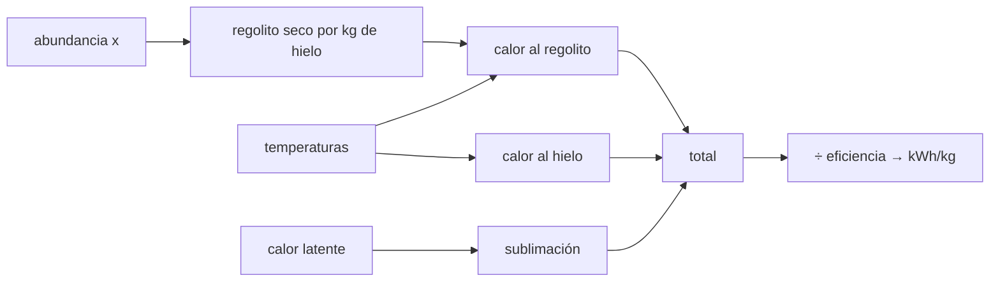

# B59-C06 — Extracción y procesamiento de volátiles

<!-- nav:top -->
[🏠 Programa](../../../../README.md) · [📚 Bloque B59](../../../tronco-comun/B59-recursos-in-situ-y-sostenibilidad-extraterrestre.md) · [← Anterior: B59-C05 — Minerales marcianos](../B59-C05-minerales-marcianos/CLASE.md) · [Siguiente: B59-C07 — Purificación de agua →](../B59-C07-purificacion-de-agua/CLASE.md)
<!-- /nav -->

## 1. Ubicación, nivel y alcance

Clase 6 del bloque B59. Nivel N3. Calculas **cuánta energía cuesta obtener un kilogramo de agua** de un regolito con hielo calentándolo. Es un balance de energía con integrales de calor específico y calor latente. La abundancia es la observada por LCROSS en un sitio (S1); las propiedades térmicas son **ilustrativas**. Continúa [B59-C22](../B59-C22-beneficio-y-separacion-granulometrica-de-regolito/CLASE.md).

## 2. Por qué esta clase existe

Con poco hielo hay que calentar mucha roca. La decisión central: **¿cuánta energía por kilogramo de agua pide una abundancia de 5,6 % frente a 2,7 %?**

## 3. Lo que podrás hacer al terminar

1. Plantear el balance de calor del regolito, del hielo y de la sublimación.
2. Integrar un calor específico que depende de la temperatura.
3. Convertir joules en kWh.
4. Aplicar una eficiencia de captura.
5. Ver cómo escala la energía con la abundancia.
6. Verificar la fórmula cerrada con la regla del trapecio.

La evidencia es la **ficha de la extracción térmica** del ejercicio 12 (sección 20).

## 4. Con qué llegas y cómo comprobarlo

1. ¿Qué es un calor específico?
2. ¿Qué es un calor latente?
3. ¿Cuántos joules tiene un kWh?
4. ¿Qué es una integral?
5. ¿Qué es una eficiencia?

<details>
<summary>Ver respuestas</summary>

1. La energía por unidad de masa y de kelvin para subir la temperatura. 2. La energía por unidad de masa para cambiar de fase sin cambiar de temperatura. 3. 3,6 millones. 4. La suma continua de una magnitud sobre un intervalo. 5. El cociente entre lo útil y lo gastado.
</details>

Con cuatro o cinco aciertos, sigue; si no, repasa los prerrequisitos.

## 5. Un caso de contexto y casos de referencia

Un regolito con **5,6 %** de hielo en masa (observado en un sitio, S1) se calienta desde 100 K: el regolito hasta 350 K, el hielo hasta 250 K, donde sublima. Es el **ejemplo conductor**. Por kilogramo de agua hay `16,86 kg` de regolito seco; el calor total es `6,030 MJ` (regolito `3,003`, hielo `0,197`, sublimación `2,830`), o sea `1,675 kWh`; con captura del 50 %, `3,350 kWh/kg`.

## 6. Vocabulario

La **sublimación** es el paso de sólido a vapor. El **regolito seco** por kilogramo de hielo es `(1 − x)/x`. La **eficiencia de captura** es la fracción del calor producido que llega al material. El **lecho** es el regolito dentro del recipiente. El **calor sensible** es el de cambiar la temperatura.

## 7. Modelo mental: hervir agua en una olla pesada

Como hervir una taza de agua en una olla enorme: casi toda la energía calienta la olla. Límite: en el lecho la conducción es lenta y la olla no es uniforme.



*Descripción textual:* la abundancia fija cuánta roca se calienta por kilogramo de hielo; los tres calores se suman y se dividen por la eficiencia.

## 8. La explicación, paso a paso

### 8.1 Balance

Por kilogramo de agua: `Q = [(1 − x)/x] ∫ c_reg dT + ∫ c_hielo dT + L`. Con `c_reg = 150 + 2,5 T` y `c_hielo = 7,5 T` (J/kg·K, ilustrativos): `∫ c_reg dT = 150 (T − T₀) + 1,25 (T² − T₀²)`.

### 8.2 Números

`(1 − 0,056)/0,056 = 16,86 kg`. Regolito 100→350 K: `178 125 J/kg` por kg de roca, `3,003 MJ` por kg de agua. Hielo 100→250 K: `196 875 J`. Sublimación `L = 2,83 MJ/kg` (ilustrativo). Total `6,030 MJ`: regolito `49,8 %`, hielo `3,3 %`, sublimación `46,9 %`. La regla del trapecio coincide con la fórmula cerrada (error relativo `0`).

### 8.3 Unidades

`6,030 MJ / 3,6 = 1,675 kWh/kg`; con eficiencia `0,5`, `3,350 kWh/kg`.

### 8.4 Dependencia de la abundancia

`x = 2,7 %`: `36,04 kg` de roca y `9,446 MJ/kg`. `x = 8,5 %`: `10,76 kg` y `4,944 MJ/kg`. `x = 15 %`: `5,67 kg` y `4,036 MJ/kg`. Con poco hielo el costo se dispara porque casi todo es roca.

### 8.5 Recuperación parcial

Si solo se libera el 90 % del hielo, la energía por kilogramo recuperado sube `1/0,9`: `6,700 MJ` (`+11,1 %`).

## 9. Magnitudes, símbolos y unidades

| Símbolo | Qué es | Unidad | Valor / nota |
|---|---|---|---|
| `x` | fracción másica de hielo | — | 0,056 (observada en un sitio, S1) |
| `c_reg` | calor específico del regolito | J/(kg·K) | 150 + 2,5 T (ilustrativo) |
| `c_hielo` | del hielo | J/(kg·K) | 7,5 T (ilustrativo) |
| `L` | calor de sublimación | MJ/kg | 2,83 (ilustrativo) |
| `η` | eficiencia de captura | — | 0,5 (ilustrativa) |
| `Q` | calor por kg de agua | MJ/kg | 6,030 |

## 10. Convenciones y referencias

Energía por kg de agua recuperada; 1 kWh = 3,6 MJ; temperaturas en K; sin pérdidas de vapor ni conducción; régimen cuasi-estático.

## 11. De dónde sale lo que afirmamos

| ID | Fuente | Localizador | Respalda | Estado |
|---|---|---|---|---|
| S1 | Colaprete, A. et al., Detection of Water in the LCROSS Ejecta Plume, *Science* 330 (2010) 463–468, DOI 10.1126/science.1186986 | https://experts.arizona.edu/en/publications/detection-of-water-in-the-lcross-ejecta-plume/ | 155 ± 12 kg de agua (vapor + hielo) en el campo de visión; 5,6 ± 2,9 % en masa en el sitio de impacto (Cabeus) | Solo resumen, consultada el 2026-11-09 |
| — | No consultado: valores ilustrativos de este laboratorio (se rotulan así en el script y en la clase) | — | calores específicos, calor latente, temperaturas y eficiencia | No consultado |

Límites: solo se leyó el resumen de Colaprete et al.; las propiedades térmicas no se consultaron y son de ejemplo.

## 12. Cómo ver el reparto del calor

| Término | Energía [MJ/kg agua] | Parte |
|---|---|---|
| Regolito | 3,003 | 49,8 % |
| Hielo | 0,197 | 3,3 % |
| Sublimación | 2,830 | 46,9 % |
| Total | 6,030 | 100 % |

Descripción larga: la mitad del calor calienta la roca y la otra mitad sublima el hielo.

## 13. Ejemplo trabajado: calor al regolito

**Paso 1 · Roca por kg de agua.** `0,944/0,056 = 16,86 kg`.

**Paso 2 · Integral.** `150 × 250 + 1,25 × (350² − 100²) = 37 500 + 140 625 = 178 125 J/kg`.

**Paso 3 · Calor.** `16,86 × 178 125 = 3,003 MJ`.

## 14. Distintas formas de resolver el problema

**Fórmula cerrada:** exacta para un `c` polinómico. **Trapecio:** sirve para cualquier `c(T)` tabulado. **Medida calorimétrica:** daría el valor real, que aquí no se tiene.

## 15. Práctica guiada

**Ejercicio 1 · con los pasos indicados.** Regolito seco por kg de hielo (8.2).

<details><summary>Solución comentada</summary>

`(1 − 0,056)/0,056 = 16,86 kg`.
</details>

**Ejercicio 2 · con una pista.** Calor por kg de roca de 100 a 350 K (8.1).

<details><summary>Solución comentada</summary>

`178 125 J = 0,178 MJ`.
</details>

**Ejercicio 3 · casi autónomo.** Calor total al regolito por kg de agua (8.2).

<details><summary>Solución comentada</summary>

`16,86 × 0,178125 = 3,003 MJ`.
</details>

## 16. Práctica autónoma, transferencia e integrador

**Ejercicio 4.** Calor al hielo de 100 a 250 K (8.1).

<details><summary>Solución comentada</summary>

`3,75 × (250² − 100²) = 196 875 J`.
</details>

**Ejercicio 5.** Calor total (8.2).

<details><summary>Solución comentada</summary>

`3,003 + 0,197 + 2,830 = 6,030 MJ`.
</details>

**Ejercicio 6.** Pásalo a kWh (8.3).

<details><summary>Solución comentada</summary>

`6,030/3,6 = 1,675 kWh`.
</details>

**Ejercicio 7.** Con eficiencia 0,5 (8.3).

<details><summary>Solución comentada</summary>

`3,350 kWh/kg`.
</details>

**Ejercicio 8.** Agua obtenida procesando `1 000 kg` de regolito (8.2).

<details><summary>Solución comentada</summary>

`1 000 × 0,056 = 56 kg` si se recupera todo.
</details>

**Ejercicio 9 · transferencia.** Si la abundancia cae a la mitad (2,7 %), ¿por cuánto se multiplica la energía?

<details><summary>Solución comentada</summary>

`9,446/6,030 = 1,57`.
</details>

**Ejercicio 10 · transferencia.** ¿Por qué la energía por kg recuperado sube al `1/0,9` si se pierde un 10 %?

<details><summary>Solución comentada</summary>

Porque se gasta la energía de todo el material pero solo se recupera el 90 % del agua.
</details>

**Ejercicio 11 · transferencia.** ¿Qué término domina a abundancias bajas y por qué?

<details><summary>Solución comentada</summary>

El del regolito, porque la masa de roca por kg de hielo crece como `1/x`.
</details>

**Ejercicio 12 · integrador.** Elabora tu *ficha de la extracción térmica*: balance, números por término, kWh/kg con eficiencia, sensibilidad a `x` y rótulo de lo ilustrativo.

<details><summary>Solución modelo</summary>

Secciones 8.1–8.5.
</details>

## 17. Laboratorio: energía de extracción térmica

El script [extraccion_termica.py](extraccion_termica.py) calcula la energía por kg de agua con fórmula cerrada, la verifica por trapecio (**comprueba** `10⁻⁶`) y barre la abundancia y la recuperación.

**Datos:** abundancia **observada** en un sitio (S1, resumen); propiedades térmicas **ilustrativas**. **Predice antes de ejecutar:** ¿qué término domina la energía? (regolito y sublimación casi por igual.) **Ejecución del 2026-11-09 (Python 3.12.9):**

```text
Python 3.12.9 (biblioteca estandar)
Regolito seco por kg de hielo = 16.86 kg
Calor al regolito = 3.003 MJ ; al hielo = 0.197 MJ ; sublimacion = 2.830 MJ ; total = 6.030 MJ por kg de agua
Reparto: regolito 49.8 % ; hielo 3.3 % ; sublimacion 46.9 %
Total por trapecio = 6.029554 MJ ; error relativo = 0.0e+00
Energia termica = 1.675 kWh/kg ; con eficiencia de captura 50 % = 3.350 kWh/kg de agua
abundancia x [%]   regolito seco [kg/kg]   energia total [MJ/kg agua]
         2.7                36.04                    9.446
         5.6                16.86                    6.030
         8.5                10.76                    4.944
        15.0                 5.67                    4.036
Con 90 % de recuperacion: 6.700 MJ por kg de agua recuperada (+11.1 %)
Pruebas superadas.
```

```bash
python programa/clases/B59/B59-C06-extraccion-y-procesamiento-de-volatiles/extraccion_termica.py
```

**Límites:** sin conducción en el lecho, sin pérdidas, sin energía de excavación ni de transporte.

## 18. Errores frecuentes y cómo corregirlos

**Contar solo el calor latente.** Se corrige con 8.2.

**Olvidar la eficiencia.** Se corrige con 8.3.

**Usar kWh y MJ sin convertir.** Se corrige con 8.3.

**Generalizar la abundancia de un sitio.** Es de un cráter; se declara en la sección 10.

## 19. Cómo sabrás que vas bien

Tras la sección 8: ¿qué energía esperabas y cuál obtuviste? Si dudas, repasa el ejemplo 13. Tras el laboratorio: ¿qué comprueba? (ver la sección 17).

## 20. Qué entregas y cómo se evalúa

El producto es tu **ficha de la extracción térmica** (ejercicio 12).

| Criterio | Inicial | En desarrollo | Logrado | Destacado |
|---|---|---|---|---|
| Conceptos | Los confunde | Parciales | Conceptos de la clase | Explica los límites |
| Cálculo | Sin unidades | Con errores | Tablas completas | Calcula casos nuevos |
| Numérico | Sin comprobar | Un caso | Contraste con el análisis | Interpreta las diferencias |
| Fuentes | Sin fuente | Sin fecha | Fuentes con fecha | Declara lo ilustrativo |
| Límites | No los nombra | Uno | Tres | Discute qué falta del modelo |

**Condiciones críticas (no se compensan con promedio):** rotular lo ilustrativo; no generalizar la abundancia; citar solo lo consultado.

## 21. Ética, seguridad y límites

Clase educativa: los modelos son simplificados y no son un procedimiento de operación. Calentar volátiles puede liberarlos a la atmósfera tenue o a zonas frías cercanas; el impacto se trata en C17. Accesibilidad: tablas equivalentes a las gráficas, fórmulas en texto, ejercicios sin conexión.

## 22. Para cerrar y seguir

Obtener un kilogramo de agua cuesta `6,03 MJ` (`3,35 kWh` con captura del 50 %) y se duplica casi con la mitad de hielo. Queda una pregunta: ¿cómo se guarda lo extraído sin perderlo?

**Glosario español–inglés.** sublimación · *sublimation*; calor latente · *latent heat*; calor específico · *specific heat*; lecho · *bed*; eficiencia · *efficiency*.

**Continuidad.** [B59-C21](../B59-C21-almacenamiento-criogenico-y-aislado-de-volatiles-extraidos/CLASE.md) trata el almacenamiento.

**Referencias:** ver sección 11.

<!-- nav:bottom -->
---

[← Anterior: B59-C05 — Minerales marcianos](../B59-C05-minerales-marcianos/CLASE.md) · [📚 Bloque B59](../../../tronco-comun/B59-recursos-in-situ-y-sostenibilidad-extraterrestre.md) · [Siguiente: B59-C07 — Purificación de agua →](../B59-C07-purificacion-de-agua/CLASE.md)
<!-- /nav -->
