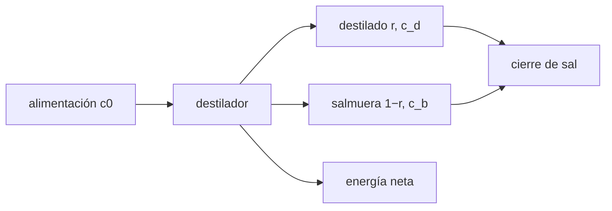

# B59-C07 — Purificación de agua

<!-- nav:top -->
[🏠 Programa](../../../../README.md) · [📚 Bloque B59](../../../tronco-comun/B59-recursos-in-situ-y-sostenibilidad-extraterrestre.md) · [← Anterior: B59-C06 — Extracción y procesamiento de volátiles](../B59-C06-extraccion-y-procesamiento-de-volatiles/CLASE.md) · [Siguiente: B59-C08 — Producción de oxígeno →](../../../tronco-comun/B59-recursos-in-situ-y-sostenibilidad-extraterrestre.md#b59-c08)
<!-- /nav -->

## 1. Ubicación, nivel y alcance

Clase 7 del bloque B59. Nivel N3. Aprendes a **depurar el agua extraída** por destilación: el balance de sales, el límite de recuperación por solubilidad y la energía neta con recuperación de calor. Datos **ilustrativos**; solo la masa molar del agua es citada (S1). Continúa [B59-C21](../B59-C21-almacenamiento-criogenico-y-aislado-de-volatiles-extraidos/CLASE.md).

## 2. Por qué esta clase existe

El agua extraída trae sales y otros solutos, y recuperar más agua concentra la salmuera. La decisión central: **¿qué recuperación se fija para no saturar la salmuera y qué energía cuesta?**

## 3. Lo que podrás hacer al terminar

1. Plantear el balance de sal de un destilador continuo.
2. Calcular la concentración de salmuera y la pureza del destilado con arrastre.
3. Obtener la recuperación máxima por solubilidad.
4. Verificar un destilador por lotes con la fórmula de Rayleigh.
5. Calcular la energía neta con recuperación de calor.
6. Interpretar la salmuera como residuo a gestionar.

La evidencia es la **ficha de la purificación** del ejercicio 12 (sección 20).

## 4. Con qué llegas y cómo comprobarlo

1. ¿Qué es una concentración?
2. ¿Qué es un balance de masa?
3. ¿Qué es una solubilidad?
4. ¿Qué es un calor latente?
5. ¿Qué es una masa molar?

<details>
<summary>Ver respuestas</summary>

1. La masa de soluto por masa de disolución. 2. Lo que entra es igual a lo que sale más lo que se acumula. 3. La máxima concentración que un disolvente admite. 4. La energía por kg para cambiar de fase. 5. La masa de un mol, en g/mol.
</details>

Con cuatro o cinco aciertos, sigue; si no, repasa los prerrequisitos.

## 5. Un caso de contexto y casos de referencia

Una alimentación de **2 g/kg** de sales (ilustrativa) se destila con arrastre de salmuera `10⁻⁴`. Es el **ejemplo conductor**. Con recuperación `90 %` la salmuera llega a `19,98 g/kg` y el destilado a `0,0020 g/kg`; el máximo por solubilidad (250 g/kg) es `99,20 %`. Con recuperación de calor `0,85`, la energía neta es `0,339 MJ/kg` (`0,0942 kWh/kg`).

## 6. Vocabulario

La **recuperación** `r` es la fracción de la alimentación que sale como destilado. La **salmuera** es el líquido concentrado que queda. El **arrastre** `φ` es la fracción de la concentración de la salmuera que pasa al vapor. La **destilación por lotes** evapora un volumen cerrado hasta cierta fracción. La **efectividad de recuperación de calor** es la fracción del calor latente que se reutiliza.

## 7. Modelo mental: exprimir una esponja salada

Como exprimir una esponja con sal: el agua que sale es limpia pero lo que queda sabe cada vez más salado. Límite: en el destilador la sal cristaliza al pasar la solubilidad.



*Descripción textual:* la alimentación se parte en destilado y salmuera; la sal debe cerrar y la energía depende de la recuperación de calor.

## 8. La explicación, paso a paso

### 8.1 Régimen continuo

Con arrastre `φ`: `c_b = c₀/(1 − r + rφ)`, `c_d = φ c_b` y el balance `c₀ = r c_d + (1 − r) c_b` cierra a `10⁻¹²`. Para `r = 50, 90, 99 %`: `c_b = 4,00; 19,98; 198,04 g/kg`, `c_d = 0,0004; 0,0020; 0,0198 g/kg`.

### 8.2 Límite de solubilidad

Sin arrastre, `c_b = c₀/(1 − r) ≤ c_max`, de modo que `r_max = 1 − c₀/c_max = 1 − 2/250 = 99,20 %`.

### 8.3 Lote

Una destilación por lotes que deja la fracción `f` del líquido concentra la salmuera como `c₀ f^{−(1−φ)}`. Con `f = 50, 10, 1 %`: `4,000; 19,995; 199,908 g/kg`; la integración numérica coincide (error `≤ 2,5 × 10⁻⁸`).

### 8.4 Energía

`E_neta = L (1 − ε) = 2,26 × 0,15 = 0,339 MJ/kg` de destilado (`0,0942 kWh/kg`); por kg de alimentación, `r E_neta`: `0,170; 0,305; 0,336 MJ` para `r = 50, 90, 99 %`. La salmuera restante es `0,50; 0,10; 0,01 kg/kg`.

### 8.5 Lectura

Subir la recuperación ahorra agua y reduce la salmuera, pero multiplica por 50 la concentración de la salmuera entre `r = 50 %` y `r = 99 %`. La salmuera es un residuo que se gestiona (C23).

## 9. Magnitudes, símbolos y unidades

| Símbolo | Qué es | Unidad | Valor / nota |
|---|---|---|---|
| `c₀` | salinidad de alimentación | g/kg | 2 (ilustrativa) |
| `r` | recuperación | — | 0,5–0,99 |
| `φ` | arrastre | — | 10⁻⁴ (ilustrativo) |
| `c_max` | solubilidad | g/kg | 250 (ilustrativa) |
| `L` | calor latente | MJ/kg | 2,26 (ilustrativo) |
| `ε` | recuperación de calor | — | 0,85 (ilustrativa) |
| `M_w` | masa molar del agua | g/mol | 18,0153 (NIST) |

## 10. Convenciones y referencias

Concentraciones en g de sal por kg de líquido; masas en kg; régimen estacionario; sin incrustación ni volátiles; sin energía de bombeo.

## 11. De dónde sale lo que afirmamos

| ID | Fuente | Localizador | Respalda | Estado |
|---|---|---|---|---|
| S1 | NIST, Chemistry WebBook: agua (CAS 7732-18-5), CO₂ (124-38-9), CH₄ (74-82-8) | https://webbook.nist.gov/cgi/cbook.cgi?ID=C7732185 · …C124389 · …C74828 | Entalpías de formación en gas: H₂O −241,826 ± 0,040; CO₂ −393,51 ± 0,13; CH₄ −74,87 kJ/mol; masas molares 18,0153; 44,0095; 16,0425 g/mol | Consultada (extracto), consultada el 2026-11-09 |
| — | No consultado: valores ilustrativos de este laboratorio (se rotulan así en el script y en la clase) | — | salinidad, solubilidad, arrastre, calor latente y efectividad | No consultado |

Límites: solo se consultó la masa molar del agua; el resto no se consultó.

## 12. Cómo ver recuperación frente a salmuera

| `r` [%] | `c_b` [g/kg] | `c_d` [g/kg] | Energía [MJ/kg alim.] |
|---|---|---|---|
| 50 | 4,00 | 0,0004 | 0,170 |
| 90 | 19,98 | 0,0020 | 0,305 |
| 99 | 198,04 | 0,0198 | 0,336 |

Descripción larga: la salmuera pasa de 4 a 198 g/kg al subir `r` de 50 a 99 %.

## 13. Ejemplo trabajado: recuperación del 90 %

**Paso 1 · Salmuera.** `2/(1 − 0,9 + 0,9 × 10⁻⁴) = 19,98 g/kg`.

**Paso 2 · Destilado.** `10⁻⁴ × 19,98 = 0,0020 g/kg`.

**Paso 3 · Cierre.** `0,9 × 0,0020 + 0,1 × 19,98 = 2,000`.

## 14. Distintas formas de resolver el problema

**Continuo:** fórmula directa. **Lote:** integración paso a paso contra la fórmula de Rayleigh. Ambos coinciden en el límite `φ → 0`: `c = c₀/(1 − r)`.

## 15. Práctica guiada

**Ejercicio 1 · con los pasos indicados.** Salmuera con `r = 0,5` y `φ = 0` (8.1).

<details><summary>Solución comentada</summary>

`2/0,5 = 4,0 g/kg`.
</details>

**Ejercicio 2 · con una pista.** Salmuera con `r = 0,9` y `φ = 0` (8.1).

<details><summary>Solución comentada</summary>

`2/0,1 = 20 g/kg` (19,98 con arrastre).
</details>

**Ejercicio 3 · casi autónomo.** Destilado con `φ = 10⁻⁴` y `c_b = 19,98` (8.1).

<details><summary>Solución comentada</summary>

`0,0020 g/kg`.
</details>

## 16. Práctica autónoma, transferencia e integrador

**Ejercicio 4.** Recuperación máxima con `c₀ = 2` y `c_max = 250` (8.2).

<details><summary>Solución comentada</summary>

`99,20 %`.
</details>

**Ejercicio 5.** Energía neta con `ε = 0,85` (8.4).

<details><summary>Solución comentada</summary>

`2,26 × 0,15 = 0,339 MJ/kg`.
</details>

**Ejercicio 6.** Pásala a kWh (8.4).

<details><summary>Solución comentada</summary>

`0,339/3,6 = 0,0942 kWh/kg`.
</details>

**Ejercicio 7.** Energía por kg de alimentación con `r = 0,9` (8.4).

<details><summary>Solución comentada</summary>

`0,9 × 0,339 = 0,305 MJ`.
</details>

**Ejercicio 8.** Salmuera por cada `100 kg` de alimentación con `r = 0,99` (8.4).

<details><summary>Solución comentada</summary>

`1 kg`.
</details>

**Ejercicio 9 · transferencia.** Con `c₀ = 10 g/kg`, ¿cuál es la recuperación máxima?

<details><summary>Solución comentada</summary>

`1 − 10/250 = 96 %`.
</details>

**Ejercicio 10 · transferencia.** Sin recuperación de calor (`ε = 0`), ¿cuánto sube la energía?

<details><summary>Solución comentada</summary>

De `0,339` a `2,26 MJ/kg`, unas 6,7 veces.
</details>

**Ejercicio 11 · transferencia.** ¿A dónde va la salmuera y qué otra clase lo trata?

<details><summary>Solución comentada</summary>

Es un residuo concentrado; se gestiona como subproducto (C23) o se recicla (C16).
</details>

**Ejercicio 12 · integrador.** Elabora tu *ficha de la purificación*: balance de sal, recuperación máxima, lote, energía neta y rótulo de lo ilustrativo.

<details><summary>Solución modelo</summary>

Secciones 8.1–8.5.
</details>

## 17. Laboratorio: destilación: balance de sal y energía

El script [destilacion.py](destilacion.py) calcula salmuera y destilado, verifica el cierre de sal (**comprueba** `10⁻¹²`) y el lote contra la fórmula cerrada (`10⁻⁴`), y la energía neta.

**Datos:** `M_w` de NIST (S1); el resto **ilustrativo**. **Predice antes de ejecutar:** ¿a qué recuperación se satura la salmuera? (≈ 99,2 %.) **Ejecución del 2026-11-09 (Python 3.12.9):**

```text
Python 3.12.9 (biblioteca estandar)
 r [%]   c_salmuera [g/kg]   c_destilado [g/kg]   cierre de sal [g/kg]
  50.0               4.00              0.0004              0.00e+00
  90.0              19.98              0.0020              0.00e+00
  99.0             198.04              0.0198             -2.22e-16
Recuperacion maxima por solubilidad (phi = 0): r_max = 1 - c0/c_max = 99.20 %
Lote: queda 50 % del liquido -> salmuera numerica 4.000 g/kg ; cerrada 4.000 g/kg ; error 1.3e-10
Lote: queda 10 % del liquido -> salmuera numerica 19.995 g/kg ; cerrada 19.995 g/kg ; error 2.0e-09
Lote: queda 1 % del liquido -> salmuera numerica 199.908 g/kg ; cerrada 199.908 g/kg ; error 2.5e-08
Calor latente bruto = 2.26 MJ/kg ; neto con recuperacion 0.85 = 0.339 MJ/kg = 0.0942 kWh/kg de destilado
r = 50 %: 0.170 MJ por kg de alimentacion ; salmuera a desechar = 0.50 kg/kg
r = 90 %: 0.305 MJ por kg de alimentacion ; salmuera a desechar = 0.10 kg/kg
r = 99 %: 0.336 MJ por kg de alimentacion ; salmuera a desechar = 0.01 kg/kg
Moles de agua en 1 kg = 55.51 mol
Pruebas superadas.
```

```bash
python programa/clases/B59/B59-C07-purificacion-de-agua/destilacion.py
```

**Límites:** sal única, sin incrustación, sin volátiles (amoníaco, orgánicos), sin energía de bombeo.

## 18. Errores frecuentes y cómo corregirlos

**Creer que se puede recuperar el 100 %.** Se corrige con 8.2.

**Olvidar el arrastre.** Se corrige con 8.1.

**Contar el calor latente sin recuperación.** Se corrige con 8.4.

**Ignorar la salmuera como residuo.** Se corrige con 8.5.

## 19. Cómo sabrás que vas bien

Tras la sección 8: ¿qué recuperación esperabas y cuál obtuviste? Si dudas, repasa el ejemplo 13. Tras el laboratorio: ¿qué comprueba? (ver la sección 17).

## 20. Qué entregas y cómo se evalúa

El producto es tu **ficha de la purificación** (ejercicio 12).

| Criterio | Inicial | En desarrollo | Logrado | Destacado |
|---|---|---|---|---|
| Conceptos | Los confunde | Parciales | Conceptos de la clase | Explica los límites |
| Cálculo | Sin unidades | Con errores | Tablas completas | Calcula casos nuevos |
| Numérico | Sin comprobar | Un caso | Contraste con el análisis | Interpreta las diferencias |
| Fuentes | Sin fuente | Sin fecha | Fuentes con fecha | Declara lo ilustrativo |
| Límites | No los nombra | Uno | Tres | Discute qué falta del modelo |

**Condiciones críticas (no se compensan con promedio):** rotular lo ilustrativo; cerrar el balance de sal; no presentar el agua como potable sin ensayos.

## 21. Ética, seguridad y límites

Clase educativa: los modelos son simplificados y no son un procedimiento de operación. Esta clase no certifica agua potable; la calidad real exige análisis de solutos, volátiles y microorganismos que no se tratan aquí. Accesibilidad: tablas equivalentes a las gráficas, fórmulas en texto, ejercicios sin conexión.

## 22. Para cerrar y seguir

Con recuperación `90 %` la salmuera llega a `19,98 g/kg` y la energía neta es `0,339 MJ/kg` con recuperación de calor. Con esto termina el tramo de extracción. Queda una pregunta: ¿cómo se produce oxígeno a partir de dióxido de carbono?

**Glosario español–inglés.** destilación · *distillation*; salmuera · *brine*; recuperación · *recovery*; arrastre · *carryover*; solubilidad · *solubility*.

**Continuidad.** [B59-C08](../B59-C08-produccion-de-oxigeno/CLASE.md) estudia la producción de oxígeno.

**Referencias:** ver sección 11.

<!-- nav:bottom -->
---

[← Anterior: B59-C06 — Extracción y procesamiento de volátiles](../B59-C06-extraccion-y-procesamiento-de-volatiles/CLASE.md) · [📚 Bloque B59](../../../tronco-comun/B59-recursos-in-situ-y-sostenibilidad-extraterrestre.md) · [Siguiente: B59-C08 — Producción de oxígeno →](../../../tronco-comun/B59-recursos-in-situ-y-sostenibilidad-extraterrestre.md#b59-c08)
<!-- /nav -->
