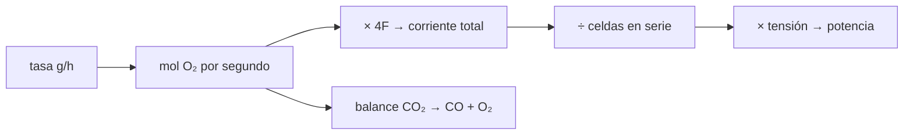

# B59-C08 — Producción de oxígeno

<!-- nav:top -->
[🏠 Programa](../../../../README.md) · [📚 Bloque B59](../../../tronco-comun/B59-recursos-in-situ-y-sostenibilidad-extraterrestre.md) · [← Anterior: B59-C07 — Purificación de agua](../B59-C07-purificacion-de-agua/CLASE.md) · [Siguiente: B59-C09 — Fabricación de combustibles conceptuales →](../B59-C09-fabricacion-de-combustibles-conceptuales/CLASE.md)
<!-- /nav -->

## 1. Ubicación, nivel y alcance

Clase 8 del bloque B59. Nivel N3. Conectas una **tasa de oxígeno** con la **corriente eléctrica** que la produce, usando la ley de Faraday y las tasas observadas por MOXIE en Marte (S4). Es electroquímica básica con una reacción de CO₂. El número de celdas y la tensión de celda son **ilustrativos**. Continúa [B59-C07](../B59-C07-purificacion-de-agua/CLASE.md).

## 2. Por qué esta clase existe

Un oxidante producido en destino se mide en gramos por hora, pero el diseñador piensa en amperios y vatios. La decisión central: **¿qué corriente y qué potencia exige una tasa de oxígeno dada?**

## 3. Lo que podrás hacer al terminar

1. Escribir la reacción global `2 CO₂ → 2 CO + O₂` y sus 4 electrones por O₂.
2. Aplicar la ley de Faraday para pasar de g/h a amperios.
3. Ver cómo reparte la corriente un conjunto de celdas en serie.
4. Calcular la energía por kg de O₂ a una tensión de celda.
5. Cerrar el balance de masa de la reacción.
6. Distinguir lo observado (tasas de MOXIE) de lo ilustrativo (celdas y tensión).

La evidencia es la **ficha de la producción de oxígeno** del ejercicio 12 (sección 20).

## 4. Con qué llegas y cómo comprobarlo

1. ¿Qué es un mol?
2. ¿Qué es la constante de Faraday?
3. ¿Qué es un amperio?
4. ¿Qué es una celda en serie?
5. ¿Qué es un balance de masa?

<details>
<summary>Ver respuestas</summary>

1. Una cantidad de sustancia: 6,022 × 10²³ entidades. 2. La carga de un mol de electrones, 96 485 C/mol. 3. Un coulomb por segundo. 4. Una celda por la que pasa la misma corriente que por las demás. 5. Lo que entra es igual a lo que sale.
</details>

Con cuatro o cinco aciertos, sigue; si no, repasa los prerrequisitos.

## 5. Un caso de contexto y casos de referencia

La nota de NASA (S4) informa de picos de **10,44 g/h** (sol 534) y casi **10,56 g/h** (sol 630) de O₂ por electrólisis de óxido sólido de CO₂, frente a una meta de diseño de 6 g/h, y de 9,79 g/h sostenidos casi 40 min. Es el **ejemplo conductor**. A 10,56 g/h la carga que circula es `35,38 A` por celda (o `3,54 A` si hay 10 celdas en serie, hipótesis ilustrativa), con `3,350 kWh/kg` a 1,0 V por celda.

## 6. Vocabulario

La **electrólisis de óxido sólido** usa una cerámica que conduce iones de oxígeno a alta temperatura. Los **electrones por O₂** son 4. La **ley de Faraday** dice `n = I t/(z F)`. Una **celda en serie** comparte la corriente con las demás: `N` celdas multiplican la tasa por `N` con la misma corriente. El **subproducto** aquí es el monóxido de carbono.

## 7. Modelo mental: una cinta transportadora de átomos

Como una cinta que mueve una caja de oxígeno por cada cuatro electrones: la tasa depende de la corriente. Límite: la cinta real tiene pérdidas por corriente que no produce O₂ (eficiencia farádica); aquí se supone 1.



*Descripción textual:* la tasa se convierte en moles, luego en corriente por la ley de Faraday, y en potencia con la tensión; el balance de masa cierra la reacción.

## 8. La explicación, paso a paso

### 8.1 Reacción y masas

`2 CO₂ → 2 CO + O₂`. Con pesos atómicos de NIST (S2; C = 12,0106, O = 15,9994): `M(O₂) = 31,9988`, `M(CO) = 28,0100`, `M(CO₂) = 44,0094 g/mol` (WebBook, S3: 44,0095). Reactivos `88,0188` y productos `88,0188 g` por mol de reacción: el balance cierra. Por kg de O₂ se consumen `2,7507 kg` de CO₂ y se producen `1,7507 kg` de CO.

### 8.2 Ley de Faraday

`ṅ_O₂ = N I/(4F)` con `F = 96 485,332 12 C/mol` (S1). Para 10,56 g/h: `ṅ = 10,56/31,9988/3 600 = 9,17 × 10⁻⁵ mol/s`; `I_total = 4 F ṅ = 35,38 A`; con `N = 10`, `3,538 A`.

### 8.3 Tabla de tasas

`6,00 g/h → 2,010 A` (N = 10); `9,79 → 3,280 A`; `10,44 → 3,498 A`; `10,56 → 3,538 A`. Con `N = 1` las corrientes son diez veces mayores. Con `1,0 V` por celda la potencia es `20,1; 32,8; 35,0; 35,4 W`.

### 8.4 Energía por kg

`E = 4 F V/M(O₂) = 3,350 kWh/kg` a 1,0 V por celda, independiente de `N`. Es un mínimo eléctrico del electrolizador; no incluye calentamiento, compresión ni bombeo.

### 8.5 Escala

A 10,56 g/h se producen `253,4 g/día`. Si una unidad de misión humana fuera unas 200 veces más rápida (idea de la nota, S4), serían `2,112 kg/h` y `50,7 kg/día`: un orden de magnitud, no un diseño.

## 9. Magnitudes, símbolos y unidades

| Símbolo | Qué es | Unidad | Valor / nota |
|---|---|---|---|
| `F` | constante de Faraday | C/mol | 96 485,332 12 (NIST) |
| `ṅ` | caudal molar de O₂ | mol/s | 9,17 × 10⁻⁵ a 10,56 g/h |
| `I` | corriente | A | ver tabla |
| `N` | celdas en serie | — | 10 (ilustrativo) |
| `V` | tensión de celda | V | 1,0 (ilustrativa) |
| `E` | energía eléctrica por kg de O₂ | kWh/kg | 3,350 |

## 10. Convenciones y referencias

Eficiencia farádica 1; reacción completa; pesos atómicos NIST (punto medio); tasas de MOXIE tomadas de la nota de NASA; unidades SI.

## 11. De dónde sale lo que afirmamos

| ID | Fuente | Localizador | Respalda | Estado |
|---|---|---|---|---|
| S1 | NIST, Fundamental Physical Constants, CODATA 2022 (lista ASCII) | https://physics.nist.gov/cuu/Constants/Table/allascii.txt | F = 96 485,332 12… C/mol; R = 8,314 462 618… J/(mol·K); g₀ = 9,806 65 m/s² (exactas) | Consultada (extracto), consultada el 2026-11-09 |
| S2 | NIST, Atomic Weights and Isotopic Compositions for All Elements | https://physics.nist.gov/cgi-bin/Compositions/stand_alone.pl | Pesos atómicos estándar (H, C, N, O, Mg, Al, Si, Ca, Ti, Fe); se usa el punto medio del intervalo cuando se da un intervalo | Consultada (extracto), consultada el 2026-11-09 |
| S3 | NIST, Chemistry WebBook: agua (CAS 7732-18-5), CO₂ (124-38-9), CH₄ (74-82-8) | https://webbook.nist.gov/cgi/cbook.cgi?ID=C7732185 · …C124389 · …C74828 | Entalpías de formación en gas: H₂O −241,826 ± 0,040; CO₂ −393,51 ± 0,13; CH₄ −74,87 kJ/mol; masas molares 18,0153; 44,0095; 16,0425 g/mol | Consultada (extracto), consultada el 2026-11-09 |
| S4 | NASA, MOXIE sets consecutive personal bests and Mars records for oxygen production (22 dic. 2022) | https://science.nasa.gov/missions/mars-2020-perseverance/moxie-sets-consecutive-personal-bests-and-mars-records-for-oxygen-production | Electrólisis de óxido sólido de CO₂; 10,44 g/h (sol 534) y casi 10,56 g/h (sol 630) de pico; meta de diseño 6 g/h | Consultada (nota), consultada el 2026-11-09 |
| — | No consultado: valores ilustrativos de este laboratorio (se rotulan así en el script y en la clase) | — | número de celdas y tensión de celda | No consultado |

Límites: la nota de NASA no da pureza ni temperatura en cifras; no se consultó el artículo científico de MOXIE; el número de celdas es hipótesis de la clase.

## 12. Cómo ver corriente según la tasa

| Tasa [g/h] | Origen | I con N = 10 [A] | I con N = 1 [A] |
|---|---|---|---|
| 6,00 | meta de diseño | 2,010 | 20,10 |
| 9,79 | sostenida | 3,280 | 32,80 |
| 10,44 | pico sol 534 | 3,498 | 34,98 |
| 10,56 | pico sol 630 | 3,538 | 35,38 |

Descripción larga: la corriente crece linealmente con la tasa.

## 13. Ejemplo trabajado: corriente para 10,56 g/h

**Paso 1 · Moles por hora.** `10,56/31,9988 = 0,3300 mol/h`.

**Paso 2 · Por segundo.** `9,167 × 10⁻⁵ mol/s`.

**Paso 3 · Corriente.** `4 × 96 485,33 × 9,167 × 10⁻⁵ = 35,38 A`.

**Paso 4 · Con 10 celdas en serie.** `3,538 A`.

## 14. Distintas formas de resolver el problema

**Faraday directo** y **ida y vuelta** (de A a g/h) coinciden a `10⁻¹²`. **Energía por kg** (`4FV/M`) y **potencia/tasa** dan el mismo `3,350 kWh/kg`.

## 15. Práctica guiada

**Ejercicio 1 · con los pasos indicados.** Moles por hora a 10,56 g/h (8.2).

<details><summary>Solución comentada</summary>

`0,3300 mol/h`.
</details>

**Ejercicio 2 · con una pista.** Moles por segundo (8.2).

<details><summary>Solución comentada</summary>

`9,17 × 10⁻⁵ mol/s`.
</details>

**Ejercicio 3 · casi autónomo.** Corriente total (8.2).

<details><summary>Solución comentada</summary>

`35,38 A`.
</details>

## 16. Práctica autónoma, transferencia e integrador

**Ejercicio 4.** Corriente con 10 celdas (8.2).

<details><summary>Solución comentada</summary>

`3,538 A`.
</details>

**Ejercicio 5.** Corriente para la meta de diseño de 6 g/h con 10 celdas (8.3).

<details><summary>Solución comentada</summary>

`2,010 A`.
</details>

**Ejercicio 6.** CO producido a 10,56 g/h (8.1).

<details><summary>Solución comentada</summary>

`1,7507 × 10,56 = 18,49 g/h`.
</details>

**Ejercicio 7.** CO₂ consumido a 10,56 g/h (8.1).

<details><summary>Solución comentada</summary>

`2,7507 × 10,56 = 29,05 g/h`.
</details>

**Ejercicio 8.** Energía por kg a 1,2 V por celda (8.4).

<details><summary>Solución comentada</summary>

`3,350 × 1,2 = 4,02 kWh/kg`.
</details>

**Ejercicio 9 · transferencia.** Una unidad 200 veces más rápida que el pico, ¿cuánto produce al día? (8.5)

<details><summary>Solución comentada</summary>

`50,7 kg/día`.
</details>

**Ejercicio 10 · transferencia.** ¿Por qué la energía por kg no depende del número de celdas?

<details><summary>Solución comentada</summary>

Porque cada celda produce O₂ con los mismos 4 electrones por molécula; la corriente se reparte entre más celdas pero la carga por kg es la misma.
</details>

**Ejercicio 11 · transferencia.** ¿Qué hacer con el CO que sale a `1,75 kg` por kg de O₂?

<details><summary>Solución comentada</summary>

Es un subproducto que se gestiona o aprovecha (C23).
</details>

**Ejercicio 12 · integrador.** Elabora tu *ficha de la producción de oxígeno*: reacción, balance de masa, corriente para tres tasas, energía por kg y el rótulo de lo observado frente a lo ilustrativo.

<details><summary>Solución modelo</summary>

Secciones 8.1–8.5.
</details>

## 17. Laboratorio: corriente de Faraday para MOXIE

El script [oxigeno.py](oxigeno.py) calcula la corriente para las tasas de la nota de NASA, verifica el balance de masa (**comprueba** `10⁻⁹`) y la ida y vuelta de Faraday (`10⁻⁹`).

**Datos:** `F`, pesos atómicos y tasas **citados** (S1–S4); celdas y tensión **ilustrativas**. **Predice antes de ejecutar:** ¿cuánta corriente exige el pico de 10,56 g/h con una sola celda? (≈ 35 A.) **Ejecución del 2026-11-09 (Python 3.12.9):**

```text
Python 3.12.9 (biblioteca estandar)
M(O2) = 31.9988 g/mol ; M(CO) = 28.0100 g/mol ; M(CO2) = 44.0094 g/mol (WebBook 44.0095)
Balance de masa: reactivos 88.0188 g/mol de reaccion ; productos 88.0188 ; diferencia 0.0e+00
Por kg de O2: CO2 consumido = 2.7507 kg ; CO producido = 1.7507 kg

Tasa [g/h]  origen                      I con N=10 [A]   I con N=1 [A]   potencia N=10 [W]   energia [kWh/kg O2]
     6.00  meta de diseno (NASA)               2.010         20.102             20.10               3.350
     9.79  sostenida ~40 min (NASA)            3.280         32.800             32.80               3.350
    10.44  pico sol 534 (NASA)                 3.498         34.977             34.98               3.350
    10.56  pico sol 630 (NASA)                 3.538         35.379             35.38               3.350
Energia electrica por kg de O2 a 1.0 V por celda = 4 F V/M = 3.350 kWh/kg (independiente de N)
A 10,56 g/h: 253.4 g/dia ; a 200 veces esa tasa: 2.112 kg/h = 50.7 kg/dia
Pruebas superadas.
```

```bash
python programa/clases/B59/B59-C08-produccion-de-oxigeno/oxigeno.py
```

**Límites:** eficiencia farádica 1; sin calentamiento ni bombeo; no se modela MOXIE real.

## 18. Errores frecuentes y cómo corregirlos

**Usar 2 electrones por O₂.** Son 4; se corrige con 8.1.

**Olvidar que las celdas en serie comparten la corriente.** Se corrige con 8.3.

**Presentar `N = 10` como el valor de MOXIE.** Es ilustrativo.

**Ignorar el CO.** Se corrige con 8.1.

## 19. Cómo sabrás que vas bien

Tras la sección 8: ¿qué corriente esperabas y cuál obtuviste? Si dudas, repasa el ejemplo 13. Tras el laboratorio: ¿qué comprueba? (ver la sección 17).

## 20. Qué entregas y cómo se evalúa

El producto es tu **ficha de la producción de oxígeno** (ejercicio 12).

| Criterio | Inicial | En desarrollo | Logrado | Destacado |
|---|---|---|---|---|
| Conceptos | Los confunde | Parciales | Conceptos de la clase | Explica los límites |
| Cálculo | Sin unidades | Con errores | Tablas completas | Calcula casos nuevos |
| Numérico | Sin comprobar | Un caso | Contraste con el análisis | Interpreta las diferencias |
| Fuentes | Sin fuente | Sin fecha | Fuentes con fecha | Declara lo ilustrativo |
| Límites | No los nombra | Uno | Tres | Discute qué falta del modelo |

**Condiciones críticas (no se compensan con promedio):** distinguir lo observado (tasas) de lo ilustrativo (celdas, tensión); cerrar el balance; citar solo lo consultado.

## 21. Ética, seguridad y límites

Clase educativa: los modelos son simplificados y no son un procedimiento de operación. Esta clase no describe el diseño de MOXIE ni da un procedimiento; el oxígeno concentrado es un riesgo de incendio. Accesibilidad: tablas equivalentes a las gráficas, fórmulas en texto, ejercicios sin conexión.

## 22. Para cerrar y seguir

Producir `10,56 g/h` de O₂ pide `35,4 A` en total (`3,54 A` con 10 celdas en serie) y `3,35 kWh/kg` a 1 V por celda, con `1,75 kg` de CO por kg de O₂. Queda una pregunta: ¿cómo se hace combustible con el carbono y el hidrógeno disponibles?

**Glosario español–inglés.** electrólisis de óxido sólido · *solid oxide electrolysis*; ley de Faraday · *Faraday's law*; celda · *cell*; subproducto · *by-product*; eficiencia farádica · *Faradaic efficiency*.

**Continuidad.** [B59-C09](../B59-C09-fabricacion-de-combustibles-conceptuales/CLASE.md) estudia el combustible conceptual.

**Referencias:** ver sección 11.

<!-- nav:bottom -->
---

[← Anterior: B59-C07 — Purificación de agua](../B59-C07-purificacion-de-agua/CLASE.md) · [📚 Bloque B59](../../../tronco-comun/B59-recursos-in-situ-y-sostenibilidad-extraterrestre.md) · [Siguiente: B59-C09 — Fabricación de combustibles conceptuales →](../B59-C09-fabricacion-de-combustibles-conceptuales/CLASE.md)
<!-- /nav -->
