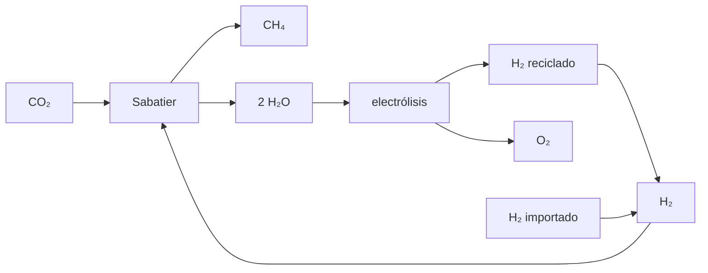

# B59-C09 — Fabricación de combustibles conceptuales

<!-- nav:top -->
[🏠 Programa](../../../../README.md) · [📚 Bloque B59](../../../tronco-comun/B59-recursos-in-situ-y-sostenibilidad-extraterrestre.md) · [← Anterior: B59-C08 — Producción de oxígeno](../B59-C08-produccion-de-oxigeno/CLASE.md) · [Siguiente: B59-C10 — Electrólisis y balances energéticos →](../B59-C10-electrolisis-y-balances-energeticos/CLASE.md)
<!-- /nav -->

## 1. Ubicación, nivel y alcance

Clase 9 del bloque B59. Nivel N3. Cierras el **balance de materia y de energía de un combustible conceptual** de metano y oxígeno: la reacción de Sabatier, el lazo del agua con electrólisis y la mezcla O/F. Las entalpías y masas molares son de NIST (S1–S2). La mezcla y la cantidad son **ilustrativas**. Continúa [B59-C08](../B59-C08-produccion-de-oxigeno/CLASE.md).

## 2. Por qué esta clase existe

Un combustible fabricado en destino depende de qué parte del hidrógeno se recicla. La decisión central: **¿cuánto hidrógeno hay que importar para fabricar 1 000 kg de propelente O₂/CH₄?**

## 3. Lo que podrás hacer al terminar

1. Escribir y balancear la reacción de Sabatier por elementos.
2. Calcular su entalpía a partir de entalpías de formación.
3. Repartir un propelente en CH₄ y O₂ con la razón O/F.
4. Cerrar el lazo del agua con electrólisis y hallar el H₂ a importar.
5. Hallar cuánto O₂ falta y de dónde debe venir.
6. Calcular el calor a evacuar.

La evidencia es la **ficha del combustible conceptual** del ejercicio 12 (sección 20).

## 4. Con qué llegas y cómo comprobarlo

1. ¿Qué es una entalpía de formación?
2. ¿Qué es una reacción exotérmica?
3. ¿Qué es la razón O/F?
4. ¿Cómo se balancea una reacción?
5. ¿Qué es un lazo?

<details>
<summary>Ver respuestas</summary>

1. El cambio de entalpía al formar un mol de compuesto desde sus elementos. 2. La que libera calor. 3. Masa de oxidante por masa de combustible. 4. Igualando el número de átomos de cada elemento. 5. Un flujo que se recicla.
</details>

Con cuatro o cinco aciertos, sigue; si no, repasa los prerrequisitos.

## 5. Un caso de contexto y casos de referencia

Para **1 000 kg** de propelente con `O/F = 3,5` (ilustrativo) hacen falta `222,2 kg` de CH₄ y `777,8 kg` de O₂. Es el **ejemplo conductor**. Sabatier consume `609,6 kg` de CO₂ y `111,7 kg` de H₂ y produce `499,1 kg` de agua; electrolizarla devuelve `55,9 kg` de H₂, así que hay que importar `55,9 kg` (la mitad). El O₂ del lazo es `443,3 kg`: faltan `334,5 kg`. La reacción libera `165,01 kJ/mol`.

## 6. Vocabulario

La **reacción de Sabatier** combina CO₂ e H₂ para dar CH₄ y agua. El **lazo del agua** electroliza esa agua para recuperar hidrógeno. La **razón O/F** de 3,5 es **rica en combustible** frente a la estequiométrica (3,99). El **hidrógeno importado** es el que no se recupera. El **calor de reacción** debe evacuarse del reactor.

## 7. Modelo mental: una receta con un ingrediente que se recicla a medias

Como una receta que devuelve la mitad de un ingrediente al cocinar: hay que reponer la otra mitad. Límite: la conversión real del reactor no es total.



*Descripción textual:* Sabatier produce metano y agua; la electrólisis del agua devuelve hidrógeno al reactor y oxígeno al propelente; el hidrógeno que falta se importa.

## 8. La explicación, paso a paso

### 8.1 Reacción y entalpía

`CO₂ + 4 H₂ → CH₄ + 2 H₂O`: izquierda `{C: 1, H: 8, O: 2}`, derecha igual. Con `ΔfH°` (gas) de NIST (S1): `ΔH = −74,87 + 2(−241,826) − (−393,51) = −165,01 kJ/mol` de CH₄ (agua como gas).

### 8.2 Propelente

`m_CH₄ = 1 000/(1 + 3,5) = 222,2 kg` (`13 852 mol` con `M = 16,0425 g/mol`) y `m_O₂ = 777,8 kg`.

### 8.3 Sabatier

Consume `13 852` mol de CO₂ (`609,6 kg`) y `55 408` mol de H₂ (`111,7 kg`) y produce `27 704` mol de agua (`499,1 kg`).

### 8.4 Lazo

Electrolizar esa agua da `27 704` mol de H₂ (`55,9 kg`) y `13 852` mol de O₂ (`443,3 kg`). El H₂ a importar es `55 408 − 27 704 = 27 704 mol = 55,9 kg`, es decir, la mitad. El balance global del lazo (entran CO₂ e H₂ importado, salen CH₄ y O₂) cierra para C, H y O a `10⁻⁹`.

### 8.5 Lo que falta

El lazo aporta `443,3 kg` de O₂ y faltan `334,5 kg` para la mezcla pedida; deben venir de otro proceso (por ejemplo, C08). El calor de Sabatier es `2,286 GJ = 635 kWh` térmicos.

## 9. Magnitudes, símbolos y unidades

| Símbolo | Qué es | Unidad | Valor / nota |
|---|---|---|---|
| `ΔH` | entalpía de Sabatier | kJ/mol de CH₄ | −165,01 (NIST) |
| `M(CH₄)` | masa molar | g/mol | 16,0425 (NIST) |
| `O/F` | razón de mezcla | — | 3,5 (ilustrativa) |
| `m_prop` | propelente objetivo | kg | 1 000 (ilustrativo) |
| `H₂_imp` | hidrógeno importado | kg | 55,9 |

## 10. Convenciones y referencias

Conversión completa en el reactor; entalpías en gas a 298,15 K; sin cinética ni pureza; unidades de mol y kg.

## 11. De dónde sale lo que afirmamos

| ID | Fuente | Localizador | Respalda | Estado |
|---|---|---|---|---|
| S1 | NIST, Chemistry WebBook: agua (CAS 7732-18-5), CO₂ (124-38-9), CH₄ (74-82-8) | https://webbook.nist.gov/cgi/cbook.cgi?ID=C7732185 · …C124389 · …C74828 | Entalpías de formación en gas: H₂O −241,826 ± 0,040; CO₂ −393,51 ± 0,13; CH₄ −74,87 kJ/mol; masas molares 18,0153; 44,0095; 16,0425 g/mol | Consultada (extracto), consultada el 2026-11-09 |
| S2 | NIST, Atomic Weights and Isotopic Compositions for All Elements | https://physics.nist.gov/cgi-bin/Compositions/stand_alone.pl | Pesos atómicos estándar (H, C, N, O, Mg, Al, Si, Ca, Ti, Fe); se usa el punto medio del intervalo cuando se da un intervalo | Consultada (extracto), consultada el 2026-11-09 |
| — | No consultado: valores ilustrativos de este laboratorio (se rotulan así en el script y en la clase) | — | razón O/F y masa de propelente | No consultado |

Límites: las entalpías y masas molares se tomaron de las páginas del WebBook; el equilibrio químico del reactor no se consultó ni se calcula.

## 12. Cómo ver el lazo de materia

| Corriente | Masa [kg] |
|---|---|
| CO₂ consumido | 609,6 |
| H₂ en Sabatier | 111,7 |
| H₂O producida | 499,1 |
| H₂ recuperado | 55,9 |
| H₂ importado | 55,9 |
| O₂ de la electrólisis | 443,3 |
| CH₄ | 222,2 |

Descripción larga: la mitad del hidrógeno del reactor se recupera del agua.

## 13. Ejemplo trabajado: hidrógeno importado

**Paso 1 · CH₄.** `222,2 kg → 13 852 mol`.

**Paso 2 · H₂ de Sabatier.** `4 × 13 852 = 55 408 mol`.

**Paso 3 · H₂ recuperado.** `2 × 13 852 = 27 704 mol`.

**Paso 4 · Importado.** `27 704 mol × 2,016 g/mol = 55,9 kg`.

## 14. Distintas formas de resolver el problema

**Por elementos:** comprueba que la reacción balancea. **Por entalpías:** da el calor. **Por lazo:** da el hidrógeno importado. Los tres deben concordar con la estequiometría.

## 15. Práctica guiada

**Ejercicio 1 · con los pasos indicados.** Entalpía de Sabatier (8.1).

<details><summary>Solución comentada</summary>

`−165,01 kJ/mol`.
</details>

**Ejercicio 2 · con una pista.** Masa de CH₄ para 1 000 kg con `O/F = 3,5` (8.2).

<details><summary>Solución comentada</summary>

`222,2 kg`.
</details>

**Ejercicio 3 · casi autónomo.** Masa de O₂ (8.2).

<details><summary>Solución comentada</summary>

`777,8 kg`.
</details>

## 16. Práctica autónoma, transferencia e integrador

**Ejercicio 4.** Moles de CH₄ (8.2).

<details><summary>Solución comentada</summary>

`222 200/16,0425 = 13 852 mol`.
</details>

**Ejercicio 5.** H₂ que consume Sabatier (8.3).

<details><summary>Solución comentada</summary>

`4 × 13 852 × 2,016 = 111,7 kg`.
</details>

**Ejercicio 6.** Agua producida (8.3).

<details><summary>Solución comentada</summary>

`2 × 13 852 × 18,0153 = 499,1 kg`.
</details>

**Ejercicio 7.** H₂ a importar (8.4).

<details><summary>Solución comentada</summary>

`55,9 kg`.
</details>

**Ejercicio 8.** Calor total a evacuar (8.5).

<details><summary>Solución comentada</summary>

`165,01 kJ × 13 852 = 2,286 GJ = 635 kWh`.
</details>

**Ejercicio 9 · transferencia.** La razón estequiométrica de `CH₄ + 2 O₂` es `64/16,04`. ¿Cuánto vale y qué significa que 3,5 sea menor?

<details><summary>Solución comentada</summary>

`3,99`; 3,5 es una mezcla rica en combustible.
</details>

**Ejercicio 10 · transferencia.** ¿Cuánto O₂ debe aportar otro proceso para llegar a 777,8 kg?

<details><summary>Solución comentada</summary>

`777,8 − 443,3 = 334,5 kg`.
</details>

**Ejercicio 11 · transferencia.** Si el agua no se reciclara, ¿cuánto H₂ habría que importar?

<details><summary>Solución comentada</summary>

Todo el de Sabatier, `111,7 kg`: el doble.
</details>

**Ejercicio 12 · integrador.** Elabora tu *ficha del combustible conceptual*: reacciones, entalpía, masas por corriente, hidrógeno importado, O₂ que falta y calor a evacuar.

<details><summary>Solución modelo</summary>

Secciones 8.1–8.5.
</details>

## 17. Laboratorio: balance de Sabatier y electrólisis

El script [sabatier.py](sabatier.py) verifica la conservación de elementos con una matriz (**comprueba** igualdad exacta y `10⁻⁹`), calcula la entalpía con datos de NIST y cierra el lazo de H₂.

**Datos:** entalpías y masas molares **citadas** (S1–S2); `O/F` y masa **ilustrativas**. **Predice antes de ejecutar:** ¿qué fracción del H₂ de Sabatier se importa? (50 %.) **Ejecución del 2026-11-09 (Python 3.12.9):**

```text
Python 3.12.9 (biblioteca estandar)
M(CO2) = 44.0094 g/mol
M(CH4) = 16.0425 g/mol
M(H2O) = 18.0153 g/mol
M(H2) = 2.0160 g/mol
M(O2) = 31.9988 g/mol
Sabatier: elementos izquierda {'C': 1.0, 'H': 8.0, 'O': 2.0} ; derecha {'C': 1.0, 'H': 8.0, 'O': 2.0}
Entalpia de la reaccion de Sabatier (agua en gas) = -165.01 kJ/mol de CH4 (exotermica)
Propelente 1000 kg con O/F = 3.5: CH4 = 222.2 kg (13852 mol) ; O2 = 777.8 kg
Sabatier consume CO2 = 609.6 kg y H2 = 111.7 kg ; produce H2O = 499.1 kg
Electrolisis del agua del lazo: H2 recuperado = 55.9 kg ; O2 = 443.3 kg
Hidrogeno a importar = 55.9 kg (50 % del que consume Sabatier)
Lazo cerrado: entran {'C': 13852.094263501462, 'H': 55408.37705400585, 'O': 27704.188527002923} ; salen {'C': 13852.094263501462, 'H': 55408.37705400585, 'O': 27704.188527002923}
O2 del lazo = 443.3 kg ; falta para O/F = 334.5 kg que debe venir de otro proceso (C08)
Calor de Sabatier a evacuar = 2.286 GJ = 635 kWh termicos
Pruebas superadas.
```

```bash
python programa/clases/B59/B59-C09-fabricacion-de-combustibles-conceptuales/sabatier.py
```

**Límites:** conversión total, sin equilibrio ni catalizador, agua en gas.

## 18. Errores frecuentes y cómo corregirlos

**Suponer reciclaje del 100 % del hidrógeno.** Se corrige con 8.4.

**Confundir entalpía de reacción con calor por kg.** Se corrige con 8.5.

**Tomar `O/F = 3,5` como óptimo.** Es ilustrativa.

**No cerrar los elementos.** Se corrige con 8.1 y 8.4.

## 19. Cómo sabrás que vas bien

Tras la sección 8: ¿qué H₂ esperabas y cuál obtuviste? Si dudas, repasa el ejemplo 13. Tras el laboratorio: ¿qué comprueba? (ver la sección 17).

## 20. Qué entregas y cómo se evalúa

El producto es tu **ficha del combustible conceptual** (ejercicio 12).

| Criterio | Inicial | En desarrollo | Logrado | Destacado |
|---|---|---|---|---|
| Conceptos | Los confunde | Parciales | Conceptos de la clase | Explica los límites |
| Cálculo | Sin unidades | Con errores | Tablas completas | Calcula casos nuevos |
| Numérico | Sin comprobar | Un caso | Contraste con el análisis | Interpreta las diferencias |
| Fuentes | Sin fuente | Sin fecha | Fuentes con fecha | Declara lo ilustrativo |
| Límites | No los nombra | Uno | Tres | Discute qué falta del modelo |

**Condiciones críticas (no se compensan con promedio):** cerrar el balance de elementos; rotular `O/F` como ilustrativa; citar solo lo consultado.

## 21. Ética, seguridad y límites

Clase educativa: los modelos son simplificados y no son un procedimiento de operación. El hidrógeno y el metano son inflamables; esta clase no es un procedimiento de síntesis ni de manejo. Accesibilidad: tablas equivalentes a las gráficas, fórmulas en texto, ejercicios sin conexión.

## 22. Para cerrar y seguir

Fabricar `1 000 kg` de O₂/CH₄ exige importar `55,9 kg` de H₂ y evacuar `2,29 GJ` de calor, y deja `334,5 kg` de O₂ por producir por otra vía. Queda una pregunta: ¿cuánta energía cuesta electrolizar el agua del lazo?

**Glosario español–inglés.** reacción de Sabatier · *Sabatier reaction*; entalpía de formación · *enthalpy of formation*; lazo · *loop*; razón de mezcla · *mixture ratio*; estequiometría · *stoichiometry*.

**Continuidad.** [B59-C10](../B59-C10-electrolisis-y-balances-energeticos/CLASE.md) calcula el balance de la electrólisis.

**Referencias:** ver sección 11.

<!-- nav:bottom -->
---

[← Anterior: B59-C08 — Producción de oxígeno](../B59-C08-produccion-de-oxigeno/CLASE.md) · [📚 Bloque B59](../../../tronco-comun/B59-recursos-in-situ-y-sostenibilidad-extraterrestre.md) · [Siguiente: B59-C10 — Electrólisis y balances energéticos →](../B59-C10-electrolisis-y-balances-energeticos/CLASE.md)
<!-- /nav -->
