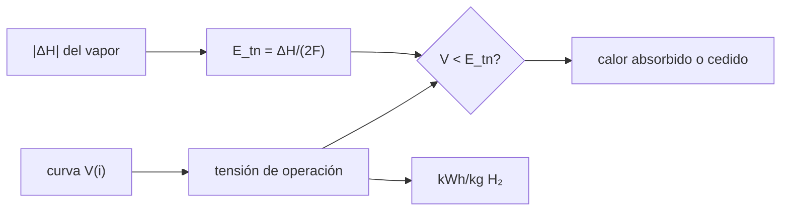

# B59-C10 — Electrólisis y balances energéticos

<!-- nav:top -->
[🏠 Programa](../../../../README.md) · [📚 Bloque B59](../../../tronco-comun/B59-recursos-in-situ-y-sostenibilidad-extraterrestre.md) · [← Anterior: B59-C09 — Fabricación de combustibles conceptuales](../B59-C09-fabricacion-de-combustibles-conceptuales/CLASE.md) · [Siguiente: B59-C11 — Construcción con regolito →](../../../tronco-comun/B59-recursos-in-situ-y-sostenibilidad-extraterrestre.md#b59-c11)
<!-- /nav -->

## 1. Ubicación, nivel y alcance

Clase 10 del bloque B59. Nivel N3. Calculas **cuánta electricidad cuesta un kilogramo de hidrógeno** y cuánto calor intercambia el electrolizador, con la tensión termoneutra de NIST (S1–S2) y una curva de polarización **ilustrativa**. Continúa [B59-C09](../B59-C09-fabricacion-de-combustibles-conceptuales/CLASE.md).

## 2. Por qué esta clase existe

La electrólisis es el mayor consumidor de energía de la planta. La decisión central: **¿a qué densidad de corriente conviene operar, entre una celda pequeña que gasta más electricidad y una grande que gasta menos?**

## 3. Lo que podrás hacer al terminar

1. Calcular la tensión termoneutra de la electrólisis de vapor.
2. Obtener la energía mínima por kg de H₂.
3. Leer una curva de polarización y su eficiencia.
4. Dimensionar corriente y área para una potencia dada.
5. Cerrar el balance electricidad = química + calor.
6. Distinguir los modos endotérmico y exotérmico.

La evidencia es la **ficha del balance de electrólisis** del ejercicio 12 (sección 20).

## 4. Con qué llegas y cómo comprobarlo

1. ¿Qué es una entalpía de formación?
2. ¿Qué es una tensión?
3. ¿Qué es una densidad de corriente?
4. ¿Qué es un balance de energía?
5. ¿Qué es una eficiencia?

<details>
<summary>Ver respuestas</summary>

1. El cambio de entalpía al formar un mol de compuesto desde sus elementos. 2. La energía por unidad de carga, en voltios. 3. La corriente por unidad de área, en A/cm². 4. La energía que entra es igual a la que sale más la acumulada. 5. El cociente entre lo útil y lo gastado.
</details>

Con cuatro o cinco aciertos, sigue; si no, repasa los prerrequisitos.

## 5. Un caso de contexto y casos de referencia

La entalpía de formación del vapor es `−241,826 kJ/mol` (S2): la tensión termoneutra es `1,2532 V` y la energía mínima, `33,32 kWh/kg` de H₂. Es el **ejemplo conductor**. Una planta ilustrativa de **10 kW** a `0,5 A/cm²` (tensión `1,144 V`) necesita `8 741 A` y `17 481 cm²` y produce `7,495 kg/día` de H₂ y `59,5 kg/día` de O₂; como `1,144 V < 1,2532 V`, trabaja en modo **endotérmico**: absorbe `406 W` de calor.

## 6. Vocabulario

La **tensión termoneutra** `E_tn = |ΔH|/(2F)` es aquella a la que la celda no intercambia calor con el entorno. En **modo endotérmico** (`V < E_tn`) la celda absorbe calor; en **exotérmico** (`V > E_tn`) lo cede. La **curva de polarización** `V(i)` suma el potencial reversible, la caída óhmica y la activación. La **eficiencia farádica** es la fracción de la corriente que produce H₂.

## 7. Modelo mental: subir una cuesta con y sin viento

Como subir una cuesta: la tensión termoneutra es la altura de la cima; por debajo hay que tomar calor del entorno (viento a favor) y por encima se disipa calor (esfuerzo). Límite: la cuesta real depende de la temperatura de la celda.



*Descripción textual:* la entalpía fija la tensión termoneutra; la curva de polarización da la tensión de operación; su comparación indica si la celda absorbe o cede calor.

## 8. La explicación, paso a paso

### 8.1 Tensión termoneutra y energía mínima

`E_tn = 241 826/(2 × 96 485,33) = 1,2532 V` (S1, S2). La energía mínima es `|ΔH|/M(H₂) = 33,32 kWh/kg` (con `M(H₂) = 2,01595 g/mol`, S3); el laboratorio comprueba que ambas fórmulas coinciden a `10⁻⁹`.

### 8.2 Curva de polarización ilustrativa

`V(i) = 0,95 + 0,25 i + 0,03 ln(i/0,05)` (V, con `i` en A/cm²): `0,1 → 0,996 V`; `0,5 → 1,144 V`; `1,0 → 1,290 V`; `1,5 → 1,427 V`. Con eficiencia farádica `0,95` la energía por kg es `27,87; 32,02; 36,10; 39,94 kWh/kg` para `0,1; 0,5; 1,0; 1,5 A/cm²`.

### 8.3 Modos

`V < E_tn` (hasta ≈ 0,9 A/cm² aquí) es endotérmico; `V > E_tn` exotérmico: a `1,5 A/cm²` el `12,2 %` de la electricidad se vuelve calor a evacuar.

### 8.4 Planta de 10 kW

A `0,5 A/cm²`: `I = 10 000/1,144 = 8 741 A`, `área = 17 481 cm²`, `H₂ = 0,95 I/(2F) = 7,495 kg/día` y `O₂ = 59,48 kg/día` (razón másica `7,936`, estequiométrica `15,9994/2,01595`).

### 8.5 Balance

`P = P_quím + Q`: `P_quím = 10 405,9 W` (entalpía del H₂ producido) y `Q = −405,9 W`: la celda absorbe `406 W` del entorno (se suministra a la temperatura de operación). Menor densidad de corriente ahorra electricidad por kg pero exige más área.

## 9. Magnitudes, símbolos y unidades

| Símbolo | Qué es | Unidad | Valor / nota |
|---|---|---|---|
| `F` | constante de Faraday | C/mol | 96 485,332 12 (NIST) |
| `ΔH` | entalpía de formación del vapor | kJ/mol | −241,826 (NIST) |
| `E_tn` | tensión termoneutra | V | 1,2532 |
| `i` | densidad de corriente | A/cm² | 0,1–1,5 |
| `η_F` | eficiencia farádica | — | 0,95 (ilustrativa) |
| `V₀, r, b, i₀` | parámetros de polarización | V, Ω·cm², V, A/cm² | 0,95; 0,25; 0,03; 0,05 (ilustrativos) |

## 10. Convenciones y referencias

Electrólisis de vapor a temperatura fija; polarización ilustrativa sin dependencia de la temperatura; unidades SI y kWh.

## 11. De dónde sale lo que afirmamos

| ID | Fuente | Localizador | Respalda | Estado |
|---|---|---|---|---|
| S1 | NIST, Fundamental Physical Constants, CODATA 2022 (lista ASCII) | https://physics.nist.gov/cuu/Constants/Table/allascii.txt | F = 96 485,332 12… C/mol; R = 8,314 462 618… J/(mol·K); g₀ = 9,806 65 m/s² (exactas) | Consultada (extracto), consultada el 2026-11-09 |
| S2 | NIST, Chemistry WebBook: agua (CAS 7732-18-5), CO₂ (124-38-9), CH₄ (74-82-8) | https://webbook.nist.gov/cgi/cbook.cgi?ID=C7732185 · …C124389 · …C74828 | Entalpías de formación en gas: H₂O −241,826 ± 0,040; CO₂ −393,51 ± 0,13; CH₄ −74,87 kJ/mol; masas molares 18,0153; 44,0095; 16,0425 g/mol | Consultada (extracto), consultada el 2026-11-09 |
| S3 | NIST, Atomic Weights and Isotopic Compositions for All Elements | https://physics.nist.gov/cgi-bin/Compositions/stand_alone.pl | Pesos atómicos estándar (H, C, N, O, Mg, Al, Si, Ca, Ti, Fe); se usa el punto medio del intervalo cuando se da un intervalo | Consultada (extracto), consultada el 2026-11-09 |
| — | No consultado: valores ilustrativos de este laboratorio (se rotulan así en el script y en la clase) | — | parámetros de la curva de polarización, eficiencia farádica y potencia | No consultado |

Límites: no se consultó ninguna curva de polarización real; los parámetros son de ejemplo.

## 12. Cómo ver energía y modo según la densidad de corriente

| `i` [A/cm²] | `V` [V] | `E_tn/V` | kWh/kg H₂ |
|---|---|---|---|
| 0,1 | 0,996 | 1,258 | 27,87 |
| 0,5 | 1,144 | 1,095 | 32,02 |
| 1,0 | 1,290 | 0,972 | 36,10 |
| 1,5 | 1,427 | 0,878 | 39,94 |

Descripción larga: la energía por kg crece con la densidad de corriente.

## 13. Ejemplo trabajado: planta de 10 kW

**Paso 1 · Tensión.** `V(0,5) = 0,95 + 0,125 + 0,03 ln 10 = 1,144 V`.

**Paso 2 · Corriente.** `10 000/1,144 = 8 741 A`.

**Paso 3 · Área.** `8 741/0,5 = 17 481 cm²`.

**Paso 4 · H₂.** `0,95 × 8 741/(2 × 96 485) × 2,016 g × 86 400 = 7,495 kg/día`.

## 14. Distintas formas de resolver el problema

**Energía mínima** (`ΔH/M`) y **a tensión de operación** (`2FV/(η M)`) difieren por la sobretensión y la eficiencia farádica. **Termoneutra** es el cruce entre modos.

## 15. Práctica guiada

**Ejercicio 1 · con los pasos indicados.** Tensión termoneutra (8.1).

<details><summary>Solución comentada</summary>

`241 826/(2 × 96 485,33) = 1,2532 V`.
</details>

**Ejercicio 2 · con una pista.** Energía mínima por kg de H₂ (8.1).

<details><summary>Solución comentada</summary>

`33,32 kWh/kg`.
</details>

**Ejercicio 3 · casi autónomo.** Tensión a 1,0 A/cm² (8.2).

<details><summary>Solución comentada</summary>

`0,95 + 0,25 + 0,03 ln 20 = 1,290 V`.
</details>

## 16. Práctica autónoma, transferencia e integrador

**Ejercicio 4.** Energía por kg a 1,5 A/cm² (8.2).

<details><summary>Solución comentada</summary>

`39,94 kWh/kg`.
</details>

**Ejercicio 5.** Corriente de la planta (8.4).

<details><summary>Solución comentada</summary>

`8 741 A`.
</details>

**Ejercicio 6.** Área de la planta (8.4).

<details><summary>Solución comentada</summary>

`17 481 cm²`.
</details>

**Ejercicio 7.** H₂ por día de la planta (8.4).

<details><summary>Solución comentada</summary>

`7,495 kg/día`.
</details>

**Ejercicio 8.** Razón másica O₂/H₂ (8.4).

<details><summary>Solución comentada</summary>

`7,936`.
</details>

**Ejercicio 9 · transferencia.** A 1,5 A/cm², ¿qué fracción de la electricidad hay que evacuar como calor?

<details><summary>Solución comentada</summary>

`(1,427 − 1,2532)/1,427 = 12,2 %`.
</details>

**Ejercicio 10 · transferencia.** A 0,5 A/cm², ¿qué calor debe suministrarse?

<details><summary>Solución comentada</summary>

`406 W` (`4,1 %` de 10 kW).
</details>

**Ejercicio 11 · transferencia.** Si se duplica la densidad de corriente, ¿qué pasa con el área para la misma corriente y con la energía por kg?

<details><summary>Solución comentada</summary>

El área se reduce a la mitad; la energía por kg sube (de 32,02 a 36,10 kWh/kg al pasar de 0,5 a 1,0 A/cm²).
</details>

**Ejercicio 12 · integrador.** Elabora tu *ficha del balance de electrólisis*: tensión termoneutra, curva, energía por kg, planta de 10 kW, modo térmico y rótulo de lo ilustrativo.

<details><summary>Solución modelo</summary>

Secciones 8.1–8.5.
</details>

## 17. Laboratorio: electrólisis de vapor y balance térmico

El script [electrolisis.py](electrolisis.py) calcula la tensión termoneutra, la energía por kg, la planta de 10 kW y el balance (**comprueba** `10⁻⁹` y `10⁻¹²` en Faraday).

**Datos:** `F`, entalpía y pesos atómicos **citados** (S1–S3); polarización y eficiencia **ilustrativas**. **Predice antes de ejecutar:** ¿la planta de 10 kW a 0,5 A/cm² cede o absorbe calor? (absorbe.) **Ejecución del 2026-11-09 (Python 3.12.9):**

```text
Python 3.12.9 (biblioteca estandar)
Tension termoneutra (vapor) E_tn = |dH|/(2F) = 1.2532 V
Energia minima (a E_tn) = 33.32 kWh por kg de H2 (= entalpia/masa molar, 33.32 kWh/kg)

i [A/cm2]  V [V]   E_tn/V (>1: endotermico)   calor generado/electricidad   energia [kWh/kg H2]
     0.10  0.996              1.258               0.000               27.87
     0.30  1.079              1.162               0.000               30.19
     0.50  1.144              1.095               0.000               32.02
     1.00  1.290              0.972               0.028               36.10
     1.50  1.427              0.878               0.122               39.94

Planta de 10 kW a i = 0.5 A/cm2: V = 1.144 V ; I = 8740.7 A ; area = 17481 cm2 ; H2 = 7.495 kg/dia
Potencia quimica en H2 (entalpia) = 10405.9 W ; calor intercambiado con el entorno P - P_quim = -405.9 W (-4.1 % de la entrada; negativo = la celda absorbe calor)
O2 coproducido = 59.483 kg/dia (razon masica O2/H2 = 7.936, estequiometrica 7.94)
Pruebas superadas.
```

```bash
python programa/clases/B59/B59-C10-electrolisis-y-balances-energeticos/electrolisis.py
```

**Límites:** curva de polarización ilustrativa, sin dependencia de la temperatura, sin compresión ni purificación del H₂.

## 18. Errores frecuentes y cómo corregirlos

**Usar la entalpía del agua líquida con vapor.** Se corrige con 8.1: aquí es la del gas.

**Creer que más corriente es siempre mejor.** Se corrige con 8.2.

**Ignorar el modo endotérmico.** Se corrige con 8.3.

**Tomar la curva como real.** Es ilustrativa.

## 19. Cómo sabrás que vas bien

Tras la sección 8: ¿qué modo esperabas y cuál obtuviste? Si dudas, repasa el ejemplo 13. Tras el laboratorio: ¿qué comprueba? (ver la sección 17).

## 20. Qué entregas y cómo se evalúa

El producto es tu **ficha del balance de electrólisis** (ejercicio 12).

| Criterio | Inicial | En desarrollo | Logrado | Destacado |
|---|---|---|---|---|
| Conceptos | Los confunde | Parciales | Conceptos de la clase | Explica los límites |
| Cálculo | Sin unidades | Con errores | Tablas completas | Calcula casos nuevos |
| Numérico | Sin comprobar | Un caso | Contraste con el análisis | Interpreta las diferencias |
| Fuentes | Sin fuente | Sin fecha | Fuentes con fecha | Declara lo ilustrativo |
| Límites | No los nombra | Uno | Tres | Discute qué falta del modelo |

**Condiciones críticas (no se compensan con promedio):** rotular la curva como ilustrativa; indicar la fase del agua; citar solo lo consultado.

## 21. Ética, seguridad y límites

Clase educativa: los modelos son simplificados y no son un procedimiento de operación. La mezcla de hidrógeno y oxígeno es explosiva; esta clase no es un procedimiento de diseño ni de operación. Accesibilidad: tablas equivalentes a las gráficas, fórmulas en texto, ejercicios sin conexión.

## 22. Para cerrar y seguir

La tensión termoneutra es `1,2532 V` (`33,32 kWh/kg`); la planta ilustrativa de 10 kW produce `7,5 kg/día` de H₂ con `17 481 cm²` y absorbe `406 W`. Con esto termina el tramo de oxígeno y combustibles. Queda una pregunta: ¿qué se hace con los subproductos de estos procesos?

**Glosario español–inglés.** tensión termoneutra · *thermoneutral voltage*; curva de polarización · *polarization curve*; densidad de corriente · *current density*; endotérmico · *endothermic*; electrolizador · *electrolyzer*.

**Continuidad.** [B59-C23](../B59-C23-subproductos-y-flujos-residuales-de-procesos-isru/CLASE.md) trata los subproductos.

**Referencias:** ver sección 11.

<!-- nav:bottom -->
---

[← Anterior: B59-C09 — Fabricación de combustibles conceptuales](../B59-C09-fabricacion-de-combustibles-conceptuales/CLASE.md) · [📚 Bloque B59](../../../tronco-comun/B59-recursos-in-situ-y-sostenibilidad-extraterrestre.md) · [Siguiente: B59-C11 — Construcción con regolito →](../../../tronco-comun/B59-recursos-in-situ-y-sostenibilidad-extraterrestre.md#b59-c11)
<!-- /nav -->
