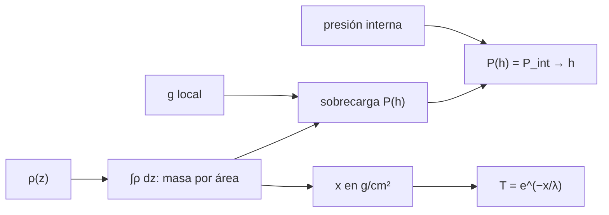

# B59-C11 — Construcción con regolito

<!-- nav:top -->
[🏠 Programa](../../../../README.md) · [📚 Bloque B59](../../../tronco-comun/B59-recursos-in-situ-y-sostenibilidad-extraterrestre.md) · [← Anterior: B59-C10 — Electrólisis y balances energéticos](../B59-C10-electrolisis-y-balances-energeticos/CLASE.md) · [Siguiente: B59-C12 — Sinterización de materiales →](../B59-C12-sinterizacion-de-materiales/CLASE.md)
<!-- /nav -->

## 1. Ubicación, nivel y alcance

Clase 11 del bloque B59. Nivel N3. Calculas **qué hace el regolito como material de construcción**: cuánta presión ejerce una capa sobre un recipiente enterrado, a qué profundidad equilibra la presión interna de un hábitat y cuánto blindaje contra la radiación da. Todo con propiedades **ilustrativas** del regolito. Continúa [B59-C23](../B59-C23-subproductos-y-flujos-residuales-de-procesos-isru/CLASE.md).

## 2. Por qué esta clase existe

Enterrar o cubrir un hábitat con regolito protege, pero no sustituye a la estructura. La decisión central: **¿cuánto espesor de regolito hace falta para blindar y cuánto para contener la presión interna?** Las respuestas difieren en un orden de magnitud.

## 3. Lo que podrás hacer al terminar

1. Integrar una densidad que crece con la profundidad.
2. Calcular la presión de sobrecarga con la gravedad local.
3. Hallar por bisección la profundidad que equilibra una presión interna.
4. Calcular el esfuerzo de aro de un recipiente de pared delgada.
5. Calcular la transmisión de radiación con un modelo exponencial.
6. Ver que blindar y contener son requisitos distintos.

La evidencia es la **ficha de la estructura de regolito** del ejercicio 12 (sección 20).

## 4. Con qué llegas y cómo comprobarlo

1. ¿Qué es una presión?
2. ¿Qué es una integral?
3. ¿Qué es un esfuerzo de aro?
4. ¿Qué es una atenuación exponencial?
5. ¿Qué es un valor ilustrativo?

<details>
<summary>Ver respuestas</summary>

1. La fuerza por unidad de área, en pascales. 2. La suma continua de una magnitud sobre un intervalo. 3. La tensión circunferencial `P r/t` de un cilindro presurizado. 4. Una disminución proporcional por cada espesor atravesado. 5. Un valor propuesto para el ejemplo, no medido.
</details>

Con cuatro o cinco aciertos, sigue; si no, repasa los prerrequisitos.

## 5. Un caso de contexto y casos de referencia

Un recipiente cilíndrico de 2 m de radio, con **60 kPa** interiores, quiere cubrirse con regolito de densidad `ρ(z) = 1 300 + 600 z/(z + 0,5) kg/m³` y `g = 1,62 m/s²` (todo **ilustrativo**). Es el **ejemplo conductor**. La sobrecarga equilibra la presión interna a `20,1 m` (con densidad constante de 1 500 kg/m³, `24,7 m`); en cambio, para reducir la radiación al 10 % bastan `1,16 m`. El recipiente de 3 mm soporta `40,0 MPa`, con margen `3,75`.

## 6. Vocabulario

La **sobrecarga** es la presión del material que está encima. La **densidad aparente** incluye los poros. El **esfuerzo de aro** de un cilindro delgado es `σ = P r/t`. La **masa por área** (espesor másico) es lo que cuenta para el blindaje. La **longitud de atenuación** `λ` es la masa por área que reduce la dosis en un factor `e`.

## 7. Modelo mental: una manta pesada sobre un globo

Como poner una manta sobre un globo: protege del frío, pero no impide que el globo se infle; para contenerlo hace falta una manta enorme o una cuerda. Límite: el regolito sin cohesión no se comporta como una manta continua.



*Descripción textual:* la densidad integrada da la masa por área; con la gravedad da la sobrecarga; con la presión interna fija la profundidad de equilibrio; en g/cm² fija la transmisión de radiación.

## 8. La explicación, paso a paso

### 8.1 Masa por área

`∫₀ʰ ρ dz = 1 300 h + 600 [h − 0,5 ln(1 + h/0,5)]`. Para `h = 0,5; 2; 5 m`: `742,06; 3 317,17; 8 780,63 kg/m²`; la cuadratura numérica coincide a `10⁻¹¹`.

### 8.2 Equilibrio de presión

`P(h) = g ∫ρ dz`. Para `P_int = 60 kPa` la bisección da `h = 20,08 m` (`37,0 t/m²`) frente a `24,69 m` con `ρ = 1 500` constante (`P/(ρ g)`). Para `101 kPa`, `33,5 m`. Con 2 m de regolito la sobrecarga es `5,4 kPa`, el `9 %` de 60 kPa.

### 8.3 Recipiente

`σ = P r/t = 60 000 × 2/0,003 = 40,0 MPa`; con admisible `150 MPa`, el margen es `3,75` y el espesor mínimo `0,80 mm`. El recipiente soporta la presión por sí mismo; el regolito no lo hace.

### 8.4 Blindaje

`T = e^{−x/λ}` con `λ = 80 g/cm²` (ilustrativa) y `x` en g/cm² (1 kg/m² = 0,1 g/cm²): `0,5 m → 74,2 g/cm², T = 0,396`; `1 m → 157,0, 0,140`; `2 m → 331,7, 0,0158`; `3 m → 511,6, 0,00167`. Para `T = 0,1`, `x = λ ln 10 = 184,2 g/cm²` y `h = 1,16 m`.

### 8.5 Lectura

Blindar exige ~1 m; contener la presión exige ~20 m. Por eso el regolito se usa como **capa de protección** sobre una estructura que sostiene la presión.

## 9. Magnitudes, símbolos y unidades

| Símbolo | Qué es | Unidad | Valor / nota |
|---|---|---|---|
| `g` | gravedad superficial | m/s² | 1,62 (ilustrativa) |
| `ρ(z)` | densidad aparente | kg/m³ | 1 300 → 1 900 (ilustrativa) |
| `P` | presión de sobrecarga | Pa | `g ∫ρ dz` |
| `P_int` | presión interna | kPa | 60 (ilustrativa) |
| `λ` | longitud de atenuación | g/cm² | 80 (ilustrativa) |
| `σ` | esfuerzo de aro | MPa | 40,0 |

## 10. Convenciones y referencias

Regolito sin cohesión; sobrecarga hidrostática; gravedad constante; atenuación exponencial de un solo tipo de radiación; sin cargas térmicas ni sísmicas.

## 11. De dónde sale lo que afirmamos

| ID | Fuente | Localizador | Respalda | Estado |
|---|---|---|---|---|
| — | No consultado: valores ilustrativos de este laboratorio (se rotulan así en el script y en la clase) | — | gravedad, densidad, longitud de atenuación y presión interna | No consultado |

Límites: no se consultó ninguna fuente sobre propiedades del regolito ni sobre blindaje; los valores son de ejemplo.

## 12. Cómo ver el blindaje según el espesor

| Espesor [m] | Masa por área [g/cm²] | Transmisión |
|---|---|---|
| 0,5 | 74,2 | 0,396 |
| 1,0 | 157,0 | 0,140 |
| 2,0 | 331,7 | 0,0158 |
| 3,0 | 511,6 | 0,00167 |

Descripción larga: la transmisión cae un orden de magnitud cada 1,2 m aproximadamente.

## 13. Ejemplo trabajado: espesor para transmitir el 10 %

**Paso 1 · Masa por área.** `x = 80 ln 10 = 184,2 g/cm² = 1 842 kg/m²`.

**Paso 2 · Resolver `∫ρ dz = 1 842`.** Bisección: `h = 1,16 m`.

**Paso 3 · Comprobar.** `e^{−184,2/80} = 0,100`.

## 14. Distintas formas de resolver el problema

**Densidad constante:** `h = P/(ρ g)`, simple y sin cuadratura. **Densidad variable:** la integral analítica y la numérica coinciden. Con densidad menor en la superficie, la profundidad necesaria baja un 19 % aquí, por el aumento de densidad con la profundidad.

## 15. Práctica guiada

**Ejercicio 1 · con los pasos indicados.** Profundidad de equilibrio con `ρ = 1 500` constante (8.2).

<details><summary>Solución comentada</summary>

`60 000/(1,62 × 1 500) = 24,69 m`.
</details>

**Ejercicio 2 · con una pista.** Esfuerzo de aro (8.3).

<details><summary>Solución comentada</summary>

`60 000 × 2/0,003 = 40,0 MPa`.
</details>

**Ejercicio 3 · casi autónomo.** Espesor mínimo de pared (8.3).

<details><summary>Solución comentada</summary>

`60 000 × 2/150 × 10⁶ = 0,80 mm`.
</details>

## 16. Práctica autónoma, transferencia e integrador

**Ejercicio 4.** Transmisión a 1 m (8.4).

<details><summary>Solución comentada</summary>

`e^{−157,0/80} = 0,140`.
</details>

**Ejercicio 5.** Masa por área para `T = 0,1` (8.4).

<details><summary>Solución comentada</summary>

`80 ln 10 = 184,2 g/cm²`.
</details>

**Ejercicio 6.** Presión de sobrecarga a 0,5 m (8.1).

<details><summary>Solución comentada</summary>

`1,62 × 742,06 = 1 202 Pa`.
</details>

**Ejercicio 7.** Profundidad con `ρ = 1 500` para 101 kPa (8.2).

<details><summary>Solución comentada</summary>

`101 000/(1,62 × 1 500) = 41,6 m`.
</details>

**Ejercicio 8.** Fracción de 60 kPa que da 2 m de regolito (8.2).

<details><summary>Solución comentada</summary>

`5 374/60 000 = 9,0 %`.
</details>

**Ejercicio 9 · transferencia.** ¿Por qué no se confía en el regolito para contener la presión de un hábitat?

<details><summary>Solución comentada</summary>

Haría falta unos 20 m de espesor; en la práctica la estructura sostiene la presión y el regolito blinda.
</details>

**Ejercicio 10 · transferencia.** Con gravedad 3,7 m/s² (ilustrativa), ¿qué profundidad equilibra 60 kPa con `ρ = 1 500`?

<details><summary>Solución comentada</summary>

`60 000/(3,7 × 1 500) = 10,8 m`.
</details>

**Ejercicio 11 · transferencia.** Si `λ` fuera 60 g/cm² en vez de 80, ¿qué masa por área da `T = 0,1`?

<details><summary>Solución comentada</summary>

`60 ln 10 = 138 g/cm²`: un 25 % menos.
</details>

**Ejercicio 12 · integrador.** Elabora tu *ficha de la estructura de regolito*: masa por área, profundidad de equilibrio, esfuerzo del recipiente, blindaje para `T = 0,1` y el rótulo de lo ilustrativo.

<details><summary>Solución modelo</summary>

Secciones 8.1–8.5.
</details>

## 17. Laboratorio: sobrecarga, equilibrio y blindaje

El script [sobrecarga.py](sobrecarga.py) integra la densidad, resuelve por bisección el equilibrio de presión y calcula el blindaje (**comprueba** `10⁻⁸` en la integral y `10⁻⁹` en la bisección).

**Datos:** todos los parámetros **ilustrativos**. **Predice antes de ejecutar:** ¿cuántas veces mayor es la profundidad de equilibrio que la de blindaje? (≈ 17.) **Ejecución del 2026-11-09 (Python 3.12.9):**

```text
Python 3.12.9 (biblioteca estandar)
h =  0.5 m: masa por area numerica =    742.056 kg/m^2 ; analitica =    742.056 ; error 6.3e-13
h =  2.0 m: masa por area numerica =   3317.169 kg/m^2 ; analitica =   3317.169 ; error 2.9e-12
h =  5.0 m: masa por area numerica =   8780.631 kg/m^2 ; analitica =   8780.631 ; error 7.1e-12
Profundidad de equilibrio con rho(z) variable = 20.08 m ; con rho = 1500 constante = 24.69 m
Profundidad para equilibrar 60 kPa = 20.1 m (37.0 t/m^2)
Profundidad para equilibrar 101 kPa = 33.5 m (62.3 t/m^2)
Esfuerzo de aro P r / t = 40.0 MPa (admisible 150 MPa) ; margen = 3.75
Espesor minimo de pared = 0.80 mm

Espesor de regolito [m]   masa por area [g/cm^2]   transmision exp(-x/lambda)
                   0.5                   74.2                   3.96e-01
                   1.0                  157.0                   1.40e-01
                   2.0                  331.7                   1.58e-02
                   3.0                  511.6                   1.67e-03
Para transmitir el 10 %: x = lambda ln10 = 184.2 g/cm^2 -> espesor = 1.16 m
Pruebas superadas.
```

```bash
python programa/clases/B59/B59-C11-construccion-con-regolito/sobrecarga.py
```

**Límites:** regolito sin cohesión, atenuación de un solo tipo, sin cargas dinámicas.

## 18. Errores frecuentes y cómo corregirlos

**Confundir blindar con contener.** Se corrige con 8.5.

**Usar la densidad en la superficie para todo el espesor.** Se corrige con 8.1.

**Olvidar convertir kg/m² a g/cm².** 1 kg/m² = 0,1 g/cm²; se corrige con 8.4.

**Tomar los parámetros como del regolito real.** Son ilustrativos.

## 19. Cómo sabrás que vas bien

Tras la sección 8: ¿qué espesor esperabas y cuál obtuviste? Si dudas, repasa el ejemplo 13. Tras el laboratorio: ¿qué comprueba? (ver la sección 17).

## 20. Qué entregas y cómo se evalúa

El producto es tu **ficha de la estructura de regolito** (ejercicio 12).

| Criterio | Inicial | En desarrollo | Logrado | Destacado |
|---|---|---|---|---|
| Conceptos | Los confunde | Parciales | Conceptos de la clase | Explica los límites |
| Cálculo | Sin unidades | Con errores | Tablas completas | Calcula casos nuevos |
| Numérico | Sin comprobar | Un caso | Contraste con el análisis | Interpreta las diferencias |
| Fuentes | Sin fuente | Sin fecha | Fuentes con fecha | Declara lo ilustrativo |
| Límites | No los nombra | Uno | Tres | Discute qué falta del modelo |

**Condiciones críticas (no se compensan con promedio):** rotular lo ilustrativo; no presentar el regolito como estructura portante; citar solo lo consultado.

## 21. Ética, seguridad y límites

Clase educativa: los modelos son simplificados y no son un procedimiento de operación. Esta clase no certifica ninguna estructura ni blindaje para personas. Accesibilidad: tablas equivalentes a las gráficas, fórmulas en texto, ejercicios sin conexión.

## 22. Para cerrar y seguir

Para la presión de 60 kPa el regolito necesitaría `20,1 m`, pero para blindar al 10 % basta `1,16 m`: sirve de capa de protección, no de contención. Queda una pregunta: ¿cómo se convierte el regolito suelto en un material sólido?

**Glosario español–inglés.** sobrecarga · *overburden*; espesor másico · *areal density*; esfuerzo de aro · *hoop stress*; atenuación · *attenuation*; blindaje · *shielding*.

**Continuidad.** [B59-C12](../B59-C12-sinterizacion-de-materiales/CLASE.md) estudia la sinterización.

**Referencias:** ver sección 11.

<!-- nav:bottom -->
---

[← Anterior: B59-C10 — Electrólisis y balances energéticos](../B59-C10-electrolisis-y-balances-energeticos/CLASE.md) · [📚 Bloque B59](../../../tronco-comun/B59-recursos-in-situ-y-sostenibilidad-extraterrestre.md) · [Siguiente: B59-C12 — Sinterización de materiales →](../B59-C12-sinterizacion-de-materiales/CLASE.md)
<!-- /nav -->
