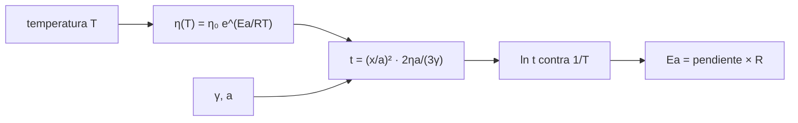

# B59-C12 — Sinterización de materiales

<!-- nav:top -->
[🏠 Programa](../../../../README.md) · [📚 Bloque B59](../../../tronco-comun/B59-recursos-in-situ-y-sostenibilidad-extraterrestre.md) · [← Anterior: B59-C11 — Construcción con regolito](../B59-C11-construccion-con-regolito/CLASE.md) · [Siguiente: B59-C13 — Impresión 3D extraterrestre →](../B59-C13-impresion-3d-extraterrestre/CLASE.md)
<!-- /nav -->

## 1. Ubicación, nivel y alcance

Clase 12 del bloque B59. Nivel N3. Estudias cómo las partículas de regolito se **funden en un sólido por calentamiento**: el modelo de sinterización viscosa de Frenkel y la dependencia de la viscosidad con la temperatura (ley de Arrhenius). Recuperas la energía de activación ajustando tiempos sintéticos. La constante `R` es de NIST (S1); el resto es **sintético o ilustrativo**. Continúa [B59-C11](../B59-C11-construccion-con-regolito/CLASE.md).

## 2. Por qué esta clase existe

Una variación de 50 K en el horno cambia el tiempo de sinterización en un factor 2,6. La decisión central: **¿con qué precisión hay que controlar la temperatura, y cuánta energía cuesta alcanzarla?**

## 3. Lo que podrás hacer al terminar

1. Aplicar la ley de Frenkel para el tiempo de un cuello dado.
2. Usar la viscosidad de Arrhenius.
3. Ajustar la energía de activación por regresión de `ln t` contra `1/T`.
4. Contrastar con los datos sin ruido.
5. Calcular la sensibilidad del tiempo a la temperatura.
6. Estimar la energía de calentamiento por kg.

La evidencia es la **ficha de la sinterización** del ejercicio 12 (sección 20).

## 4. Con qué llegas y cómo comprobarlo

1. ¿Qué es una viscosidad?
2. ¿Qué es una energía de activación?
3. ¿Qué es una regresión lineal?
4. ¿Qué es una constante molar de los gases?
5. ¿Qué es un dato sintético?

<details>
<summary>Ver respuestas</summary>

1. La resistencia de un fluido a fluir, en Pa·s. 2. La barrera de energía de un proceso que depende de la temperatura. 3. El ajuste de una recta a datos por mínimos cuadrados. 4. `R = 8,314 J/(mol·K)`. 5. Un dato generado por cálculo, no medido.
</details>

Con cuatro o cinco aciertos, sigue; si no, repasa los prerrequisitos.

## 5. Un caso de contexto y casos de referencia

Partículas de **20 µm** de radio, tensión superficial `0,3 J/m²` y viscosidad `10⁸ Pa·s` a 1 400 K con `E_a = 300 kJ/mol` (todo **sintético**). Es el **ejemplo conductor**. El cuello `x/a = 0,4` se alcanza en `0,198 h` a 1 400 K; a 1 350 K tarda `2,60` veces más y a 1 450 K, `0,411` veces. El ajuste de 7 temperaturas con ruido del 3 % recupera `297,2 kJ/mol` (error `0,92 %`).

## 6. Vocabulario

La **sinterización** une partículas por difusión o flujo viscoso sin fundirlas del todo. El **cuello** es la zona de unión entre dos partículas y `x/a` su razón. La **ley de Frenkel** da `(x/a)² = 3γt/(2ηa)` para flujo viscoso a pequeños cuellos. La **ley de Arrhenius** da `η = η₀ exp(E_a/RT)`. La **regresión de Arrhenius** ajusta `ln t` contra `1/T`.

## 7. Modelo mental: miel que se enfría

Como miel que se espesa al enfriarse: a baja temperatura casi no fluye y el cuello crece muy despacio. Límite: la ley de Frenkel supone flujo viscoso newtoniano y cuellos pequeños; el regolito real puede cristalizar.



*Descripción textual:* la temperatura fija la viscosidad; la ley de Frenkel da el tiempo para un cuello; la regresión del logaritmo del tiempo recupera la energía de activación.

## 8. La explicación, paso a paso

### 8.1 Ley de Frenkel

`(x/a)² = 3γt/(2ηa)`, o sea `t = (x/a)² · 2ηa/(3γ)`. A 1 400 K (`η = 10⁸ Pa·s`): `t = 0,16 × 2 × 10⁸ × 20 × 10⁻⁶/(3 × 0,3) = 711 s = 0,198 h`. Una prueba del código confirma que el tiempo exacto cumple la ley.

### 8.2 Arrhenius

`η(T) = 10⁸ exp[(E_a/R)(1/T − 1/1 400)]`, con `R = 8,314 462 618 J/(mol·K)` (S1). Entre 1 250 y 1 550 K la viscosidad cae de `2,2 × 10⁹` a `8,3 × 10⁶ Pa·s`; el tiempo de `4,35 h` a `0,016 h` (≈ 58 s).

### 8.3 Ajuste

`ln t = c + (E_a/R)(1/T)`. Con ruido logarítmico del 3 % (semilla `20261109`) la pendiente da `E_a = 297,2 kJ/mol` (error `0,92 %`). Sin ruido recupera `300,000000 kJ/mol` a `10⁻⁹`.

### 8.4 Sensibilidad

`t(1 350 K)/t(1 400 K) = 2,60`; `t(1 450 K)/t(1 400 K) = 0,411`. Controlar la temperatura a ±50 K es la diferencia entre horas y minutos.

### 8.5 Energía

Calentar 1 kg de 300 a 1 400 K con `c = 1 200 J/(kg·K)` cuesta `1,32 MJ = 0,367 kWh` (a 1 350 K, `0,350`; a 1 450 K, `0,383`). Este modelo cuenta solo el calentamiento, no las pérdidas durante la espera.

## 9. Magnitudes, símbolos y unidades

| Símbolo | Qué es | Unidad | Valor / nota |
|---|---|---|---|
| `R` | constante molar de los gases | J/(mol·K) | 8,314 462 618 (NIST) |
| `γ` | tensión superficial | J/m² | 0,3 (ilustrativa) |
| `a` | radio de partícula | µm | 20 (ilustrativo) |
| `η` | viscosidad | Pa·s | 10⁸ a 1 400 K (sintética) |
| `E_a` | energía de activación | kJ/mol | 300 (sintética) |
| `x/a` | razón de cuello | — | 0,4 |

## 10. Convenciones y referencias

Flujo viscoso newtoniano, partículas esféricas iguales, cuellos pequeños; viscosidad de Arrhenius; ruido logarítmico gaussiano; sin cristalización.

## 11. De dónde sale lo que afirmamos

| ID | Fuente | Localizador | Respalda | Estado |
|---|---|---|---|---|
| S1 | NIST, Fundamental Physical Constants, CODATA 2022 (lista ASCII) | https://physics.nist.gov/cuu/Constants/Table/allascii.txt | F = 96 485,332 12… C/mol; R = 8,314 462 618… J/(mol·K); g₀ = 9,806 65 m/s² (exactas) | Consultada (extracto), consultada el 2026-11-09 |
| — | No consultado: valores ilustrativos de este laboratorio (se rotulan así en el script y en la clase) | — | tensión superficial, radio, viscosidad, energía de activación y calor específico | No consultado |

Límites: solo se consultó `R`; no se consultó ninguna medida de viscosidad del regolito fundido.

## 12. Cómo ver el tiempo según la temperatura

| T [K] | `η` [Pa·s] | `t` exacto [h] |
|---|---|---|
| 1 250 | 2,2 × 10⁹ | 4,353 |
| 1 350 | 2,6 × 10⁸ | 0,513 |
| 1 400 | 1,0 × 10⁸ | 0,198 |
| 1 450 | 4,1 × 10⁷ | 0,081 |
| 1 550 | 8,3 × 10⁶ | 0,016 |

Descripción larga: el tiempo cae unos tres órdenes de magnitud entre 1 250 y 1 550 K.

## 13. Ejemplo trabajado: tiempo a 1 400 K

**Paso 1 · Constantes.** `2ηa = 4 000`; `3γ = 0,9`.

**Paso 2 · Cociente.** `4 000/0,9 = 4 444 s`.

**Paso 3 · Cuello.** `(0,4)² = 0,16`.

**Paso 4 · Tiempo.** `0,16 × 4 444 = 711 s = 0,198 h`.

## 14. Distintas formas de resolver el problema

**Ajuste con ruido:** error `0,92 %`. **Ajuste sin ruido:** exacto. Medir a más temperaturas y más separadas mejora el ajuste.

## 15. Práctica guiada

**Ejercicio 1 · con los pasos indicados.** Viscosidad a 1 400 K (caso).

<details><summary>Solución comentada</summary>

`10⁸ Pa·s`.
</details>

**Ejercicio 2 · con una pista.** Tiempo a 1 400 K para `x/a = 0,4` (8.1).

<details><summary>Solución comentada</summary>

`711 s = 0,198 h`.
</details>

**Ejercicio 3 · casi autónomo.** Razón de cuello tras 300 s a 1 400 K (8.1).

<details><summary>Solución comentada</summary>

`(x/a)² = 0,16 × 300/711 = 0,0675`; `x/a = 0,26`.
</details>

## 16. Práctica autónoma, transferencia e integrador

**Ejercicio 4.** Factor de tiempo entre 1 400 y 1 350 K (8.4).

<details><summary>Solución comentada</summary>

`exp[(300 000/8,3145)(1/1 350 − 1/1 400)] = 2,60`.
</details>

**Ejercicio 5.** Pendiente `E_a/R` (8.3).

<details><summary>Solución comentada</summary>

`300 000/8,3145 = 36 082 K`.
</details>

**Ejercicio 6.** Energía para calentar 1 kg a 1 400 K (8.5).

<details><summary>Solución comentada</summary>

`1 200 × 1 100 = 1,32 MJ = 0,367 kWh`.
</details>

**Ejercicio 7.** Tiempo a 1 550 K en segundos (8.2).

<details><summary>Solución comentada</summary>

`0,016 h ≈ 58 s`.
</details>

**Ejercicio 8.** Error del ajuste con ruido (8.3).

<details><summary>Solución comentada</summary>

`(300 − 297,2)/300 = 0,92 %`.
</details>

**Ejercicio 9 · transferencia.** ¿Cuándo deja de valer la ley de Frenkel?

<details><summary>Solución comentada</summary>

Para cuellos grandes, cuando hay cristalización o poros cerrados, o si el flujo no es viscoso newtoniano.
</details>

**Ejercicio 10 · transferencia.** Un horno oscila ±50 K. ¿Qué rango de tiempos produce?

<details><summary>Solución comentada</summary>

De `0,411` a `2,60` veces el tiempo nominal.
</details>

**Ejercicio 11 · transferencia.** ¿Qué no cuenta la energía de 0,367 kWh/kg?

<details><summary>Solución comentada</summary>

Las pérdidas durante la espera, el calentamiento del horno y la energía de la fuente.
</details>

**Ejercicio 12 · integrador.** Elabora tu *ficha de la sinterización*: ley de Frenkel, viscosidad de Arrhenius, ajuste de `E_a`, sensibilidad a la temperatura y energía, con el rótulo de lo sintético.

<details><summary>Solución modelo</summary>

Secciones 8.1–8.5.
</details>

## 17. Laboratorio: sinterización de Frenkel y ajuste de Arrhenius

El script [frenkel.py](frenkel.py) genera tiempos sintéticos con ruido, ajusta `E_a` por regresión (**comprueba** 3 % con ruido y `10⁻⁹` sin ruido) y verifica Frenkel.

**Datos:** `R` de NIST (S1); el resto **sintético / ilustrativo**; semilla `20261109`. **Predice antes de ejecutar:** ¿por cuánto cambia el tiempo si baja la temperatura 50 K? (×2,6.) **Ejecución del 2026-11-09 (Python 3.12.9):**

```text
Python 3.12.9 (biblioteca estandar)
T [K]   eta [Pa s]   t exacto [h]   t con ruido [h]
  1250   2.204e+09         4.353           4.415
  1300   7.261e+08         1.434           1.481
  1350   2.597e+08         0.513           0.501
  1400   1.000e+08         0.198           0.193
  1450   4.112e+07         0.081           0.083
  1500   1.794e+07         0.035           0.037
  1550   8.257e+06         0.016           0.017
Comprobacion de Frenkel a 1400 K: (x/a)^2 = 0.1600 (esperado 0.1600)
Energia de activacion ajustada = 297.2 kJ/mol (sembrada 300) ; error relativo = 0.92 %
Sin ruido el ajuste recupera Ea exactamente: 300.000000 kJ/mol
Factor de tiempo entre 1400 y 1350 K = 2.60 ; entre 1400 y 1450 K = 0.411
Calentar 1 kg de 300 a 1350 K: 1.260 MJ = 0.350 kWh ; mantener 0.51 h
Calentar 1 kg de 300 a 1400 K: 1.320 MJ = 0.367 kWh ; mantener 0.20 h
Calentar 1 kg de 300 a 1450 K: 1.380 MJ = 0.383 kWh ; mantener 0.08 h
Pruebas superadas.
```

```bash
python programa/clases/B59/B59-C12-sinterizacion-de-materiales/frenkel.py
```

**Límites:** flujo viscoso newtoniano, sin cristalización, cuellos pequeños.

## 18. Errores frecuentes y cómo corregirlos

**Ajustar `t` contra `T` en lugar de `ln t` contra `1/T`.** Se corrige con 8.3.

**Usar ºC en la ley de Arrhenius.** Siempre en kelvin; sección 10.

**Extrapolar Frenkel a cuellos grandes.** Se corrige con la sección 14.

**Presentar los parámetros como del regolito real.** Son sintéticos.

## 19. Cómo sabrás que vas bien

Tras la sección 8: ¿qué factor esperabas y cuál obtuviste? Si dudas, repasa el ejemplo 13. Tras el laboratorio: ¿qué comprueba? (ver la sección 17).

## 20. Qué entregas y cómo se evalúa

El producto es tu **ficha de la sinterización** (ejercicio 12).

| Criterio | Inicial | En desarrollo | Logrado | Destacado |
|---|---|---|---|---|
| Conceptos | Los confunde | Parciales | Conceptos de la clase | Explica los límites |
| Cálculo | Sin unidades | Con errores | Tablas completas | Calcula casos nuevos |
| Numérico | Sin comprobar | Un caso | Contraste con el análisis | Interpreta las diferencias |
| Fuentes | Sin fuente | Sin fecha | Fuentes con fecha | Declara lo ilustrativo |
| Límites | No los nombra | Uno | Tres | Discute qué falta del modelo |

**Condiciones críticas (no se compensan con promedio):** rotular lo sintético; usar kelvin; citar solo lo consultado.

## 21. Ética, seguridad y límites

Clase educativa: los modelos son simplificados y no son un procedimiento de operación. Los hornos de alta temperatura son peligrosos; esta clase no es un procedimiento. Accesibilidad: tablas equivalentes a las gráficas, fórmulas en texto, ejercicios sin conexión.

## 22. Para cerrar y seguir

A 1 400 K el cuello `0,4` tarda `0,198 h`, 2,6 veces más a 50 K menos, y el ajuste recupera `297,2 kJ/mol`. Queda una pregunta: ¿cómo se da forma a una pieza grande capa a capa?

**Glosario español–inglés.** sinterización · *sintering*; cuello · *neck*; viscosidad · *viscosity*; energía de activación · *activation energy*; ley de Arrhenius · *Arrhenius law*.

**Continuidad.** [B59-C13](../B59-C13-impresion-3d-extraterrestre/CLASE.md) estudia la impresión por capas.

**Referencias:** ver sección 11.

<!-- nav:bottom -->
---

[← Anterior: B59-C11 — Construcción con regolito](../B59-C11-construccion-con-regolito/CLASE.md) · [📚 Bloque B59](../../../tronco-comun/B59-recursos-in-situ-y-sostenibilidad-extraterrestre.md) · [Siguiente: B59-C13 — Impresión 3D extraterrestre →](../B59-C13-impresion-3d-extraterrestre/CLASE.md)
<!-- /nav -->
