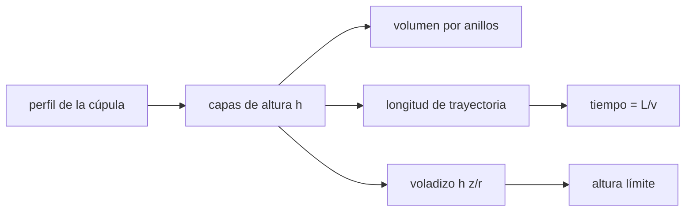

# B59-C13 — Impresión 3D extraterrestre

<!-- nav:top -->
[🏠 Programa](../../../../README.md) · [📚 Bloque B59](../../../tronco-comun/B59-recursos-in-situ-y-sostenibilidad-extraterrestre.md) · [← Anterior: B59-C12 — Sinterización de materiales](../B59-C12-sinterizacion-de-materiales/CLASE.md) · [Siguiente: B59-C14 — Agricultura y sustratos artificiales →](../B59-C14-agricultura-y-sustratos-artificiales/CLASE.md)
<!-- /nav -->

## 1. Ubicación, nivel y alcance

Clase 13 del bloque B59. Nivel N3. Calculas el **volumen, el tiempo y el límite geométrico** de imprimir una cúpula por capas. Es geometría y cuadratura: sumas el volumen de anillos, compruebas la convergencia con el grosor de capa y evalúas el voladizo. Todos los parámetros son **ilustrativos**. Continúa [B59-C12](../B59-C12-sinterizacion-de-materiales/CLASE.md).

## 2. Por qué esta clase existe

Una capa más fina da mejor forma pero más tiempo; y una cúpula tiene una zona alta que no se puede imprimir sin apoyo. La decisión central: **¿qué grosor de capa y qué perfil de cúpula hacen viable la impresión?**

## 3. Lo que podrás hacer al terminar

1. Sumar anillos para obtener el volumen de un casquete.
2. Compararlo con la fórmula analítica y ver su convergencia.
3. Calcular el tiempo de impresión por trayectoria y por caudal volumétrico.
4. Calcular el voladizo máximo por capa y la altura límite.
5. Estimar la fracción que queda por encima del límite.
6. Decidir un perfil alternativo.

La evidencia es la **ficha de la cúpula impresa** del ejercicio 12 (sección 20).

## 4. Con qué llegas y cómo comprobarlo

1. ¿Qué es un casquete esférico?
2. ¿Qué es una cuadratura?
3. ¿Qué es un caudal volumétrico?
4. ¿Qué es un voladizo?
5. ¿Qué es un valor ilustrativo?

<details>
<summary>Ver respuestas</summary>

1. La región entre dos esferas concéntricas, cortada por un plano. 2. Aproximar una integral sumando áreas pequeñas. 3. El volumen depositado por unidad de tiempo. 4. La parte de una capa que sobresale de la inferior. 5. Un valor propuesto para el ejemplo, no medido.
</details>

Con cuatro o cinco aciertos, sigue; si no, repasa los prerrequisitos.

## 5. Un caso de contexto y casos de referencia

Una cúpula hemisférica de **3,0 m** de radio exterior y **0,30 m** de pared, con cordón de 5 cm y velocidad 0,10 m/s (todo **ilustrativo**). Es el **ejemplo conductor**. El volumen analítico es `15,32 m³`; con capas de 2 cm el cálculo por capas da `15,3247 m³` (error `2 × 10⁻⁶`), y la impresión tarda `42,3 h` con una trayectoria de `15,2 km`. El voladizo limita la impresión sin apoyo a `2,34 m` de los 3 m.

## 6. Vocabulario

La **altura de capa** `h` es el grosor de cada pasada. El **cordón** es el material depositado; su ancho es `w`. El **voladizo** radial entre capas es `h z/r`. La **altura límite** es aquella a partir de la cual el voladizo supera `w/2`. Una **catenaria invertida** es un perfil de cúpula que trabaja en compresión pura.

## 7. Modelo mental: apilar anillos de cuerda

Como construir una cúpula apilando anillos de cuerda: cada anillo se apoya en el de abajo y, hacia arriba, cada uno debe ser algo más pequeño. Límite: si es demasiado pequeño, no se apoya y cae.



*Descripción textual:* el perfil se corta en capas; de cada capa salen volumen y longitud de trayectoria (tiempo) y el voladizo, que fija hasta dónde se puede imprimir sin apoyo.

## 8. La explicación, paso a paso

### 8.1 Volumen

Un casquete de radios `R_o = 3,0` y `R_i = 2,70 m` tiene `V = (2π/3)(R_o³ − R_i³) = 15,3247 m³` (masa `23,0 t` con 1 500 kg/m³). Por capas, la capa a altura `z` aporta `π(r_o² − r_i²) h` con `r = √(R² − z²)`.

### 8.2 Convergencia

| `h` [m] | Capas | Error relativo |
|---|---|---|
| 0,08 | 37 | 7,3 × 10⁻⁴ |
| 0,04 | 75 | 2,3 × 10⁻⁴ |
| 0,02 | 150 | 2,0 × 10⁻⁶ |
| 0,01 | 300 | 5,1 × 10⁻⁷ |

El orden entre 0,08 y 0,04 es `1,67` (≈ 2); después el error cae de forma irregular porque la capa que cruza el radio interior cambia de forma.

### 8.3 Tiempo

La trayectoria total es `15,24 km` para `h = 0,02`, y a `0,10 m/s` son `42,3 h`. Por caudal volumétrico, `V/(w h v) = 42,6 h` (diferencia `0,5 %`). El tiempo es proporcional a `1/h`: con `h = 0,04`, `21,2 h`.

### 8.4 Voladizo

El desplazamiento radial entre capas es `h z/r`; con límite `w/2 = 25 mm` resulta `tan φ ≤ 0,5 w/h = 1,25`, o sea `φ ≤ 51,3°` desde la base, es decir hasta `z = 2,34 m`. Por encima queda el `17,9 %` del volumen, que no se imprime sin apoyo o con otro perfil.

### 8.5 Lectura

Una cúpula hemisférica no se puede imprimir entera por capas horizontales; se usa un perfil más apuntado (catenaria invertida) o apoyo temporal. Capas más finas mejoran la forma a costa de tiempo.

## 9. Magnitudes, símbolos y unidades

| Símbolo | Qué es | Unidad | Valor / nota |
|---|---|---|---|
| `R_o, R_i` | radios exterior e interior | m | 3,0; 2,70 |
| `h` | altura de capa | m | 0,02 (variable) |
| `w` | ancho de cordón | m | 0,05 |
| `v` | velocidad de impresión | m/s | 0,10 |
| `V` | volumen | m³ | 15,3247 |
| `t` | tiempo de impresión | h | 42,3 |

## 10. Convenciones y referencias

Capas horizontales; cordón de ancho constante; sin pandeo del material fresco; sin refuerzo; trayectorias en anillos concéntricos; unidades SI.

## 11. De dónde sale lo que afirmamos

| ID | Fuente | Localizador | Respalda | Estado |
|---|---|---|---|---|
| — | No consultado: valores ilustrativos de este laboratorio (se rotulan así en el script y en la clase) | — | dimensiones, ancho de cordón y velocidad | No consultado |

Límites: no se consultó ninguna fuente sobre impresión 3D con regolito; los valores son de ejemplo.

## 12. Cómo ver el volumen y el tiempo según la capa

| `h` [m] | Volumen [m³] | Trayectoria [km] | Tiempo [h] |
|---|---|---|---|
| 0,08 | 15,3135 | 3,80 | 10,6 |
| 0,04 | 15,3282 | 7,63 | 21,2 |
| 0,02 | 15,3247 | 15,24 | 42,3 |
| 0,01 | 15,3247 | 30,48 | 84,7 |

Descripción larga: el tiempo se duplica cada vez que se divide la capa por dos.

## 13. Ejemplo trabajado: altura límite del voladizo

**Paso 1 · Condición.** `h z/r ≤ w/2`.

**Paso 2 · Pendiente.** `tan φ ≤ 0,025/0,02 = 1,25`.

**Paso 3 · Ángulo.** `φ = 51,3°`.

**Paso 4 · Altura.** `z = 3,0 × sen 51,3° = 2,34 m`.

## 14. Distintas formas de resolver el problema

**Suma de anillos** y **fórmula analítica** coinciden a `10⁻⁶`. **Tiempo por trayectoria** y **por caudal** coinciden a `0,5 %`. La condición de voladizo es independiente de ambas.

## 15. Práctica guiada

**Ejercicio 1 · con los pasos indicados.** Radio interior (caso).

<details><summary>Solución comentada</summary>

`3,0 − 0,30 = 2,70 m`.
</details>

**Ejercicio 2 · con una pista.** Volumen analítico (8.1).

<details><summary>Solución comentada</summary>

`(2π/3)(27 − 19,683) = 15,3247 m³`.
</details>

**Ejercicio 3 · casi autónomo.** Masa con 1 500 kg/m³ (8.1).

<details><summary>Solución comentada</summary>

`23,0 t`.
</details>

## 16. Práctica autónoma, transferencia e integrador

**Ejercicio 4.** Número de capas con `h = 0,02` (8.2).

<details><summary>Solución comentada</summary>

`3,0/0,02 = 150`.
</details>

**Ejercicio 5.** Orden de convergencia entre `h = 0,08` y `0,04` (8.2).

<details><summary>Solución comentada</summary>

`log(7,3 × 10⁻⁴/2,3 × 10⁻⁴)/log 2 = 1,67`.
</details>

**Ejercicio 6.** `tan φ` máximo con `h = 0,02` (8.4).

<details><summary>Solución comentada</summary>

`1,25`.
</details>

**Ejercicio 7.** Ángulo y altura límite (8.4).

<details><summary>Solución comentada</summary>

`51,3°`, `2,34 m`.
</details>

**Ejercicio 8.** Tiempo por caudal (8.3).

<details><summary>Solución comentada</summary>

`15,32/(0,05 × 0,02 × 0,1) = 153 200 s = 42,6 h`.
</details>

**Ejercicio 9 · transferencia.** Si se duplica la velocidad, ¿cuánto tarda?

<details><summary>Solución comentada</summary>

La mitad: `21,2 h`.
</details>

**Ejercicio 10 · transferencia.** Con `h = 0,04`, ¿cuál es la altura límite y el tiempo?

<details><summary>Solución comentada</summary>

`tan φ = 0,625`, `φ = 32°`, `z = 1,59 m`; tiempo `21,2 h`.
</details>

**Ejercicio 11 · transferencia.** ¿Qué perfil permite imprimir toda la cúpula sin apoyo?

<details><summary>Solución comentada</summary>

Uno apuntado, como una catenaria invertida, cuyo voladizo por capa se mantiene bajo `w/2`.
</details>

**Ejercicio 12 · integrador.** Elabora tu *ficha de la cúpula impresa*: volumen, convergencia, tiempo, altura límite del voladizo, perfil alternativo y rótulo de lo ilustrativo.

<details><summary>Solución modelo</summary>

Secciones 8.1–8.5.
</details>

## 17. Laboratorio: capas, volumen y voladizo de una cúpula

El script [capas.py](capas.py) suma anillos para cuatro alturas de capa, los compara con el casquete analítico (**comprueba** `2 × 10⁻³` y error decreciente) y calcula tiempo y voladizo.

**Datos:** todos los parámetros **ilustrativos**. **Predice antes de ejecutar:** ¿qué fracción del volumen queda por encima de la altura límite? (≈ 18 %.) **Ejecución del 2026-11-09 (Python 3.12.9):**

```text
Python 3.12.9 (biblioteca estandar)
Volumen analitico del casquete = 15.3247 m^3 (Ro = 3.0 m, Ri = 2.70 m)
h [m]   capas   volumen por capas [m^3]   error relativo   longitud de trayectoria [km]   tiempo [h]
 0.08     37                  15.3135        7.31e-04                        3.802       10.56
 0.04     75                  15.3282        2.30e-04                        7.634       21.21
 0.02    150                  15.3247        2.05e-06                       15.244       42.34
 0.01    300                  15.3247        5.13e-07                       30.476       84.66
Orden de convergencia entre h = 0,08 y 0,04 = 1.67 (esperado ~2); despues el error cae de forma irregular porque la capa que cruza el radio interior cambia de forma
Voladizo maximo por capa w/2 = 25 mm ; tan(phi) maximo = 1.25 -> phi = 51.3 grados desde la base; altura limite = 2.34 m de 3.0 m
Fraccion del volumen que queda por encima de la altura limite = 17.9 %
Tiempo = 42.34 h por trayectoria ; V/(w h v) = 42.57 h ; diferencia relativa 0.53%
Masa de la cupula con 1 500 kg/m^3 = 23.0 t
Pruebas superadas.
```

```bash
python programa/clases/B59/B59-C13-impresion-3d-extraterrestre/capas.py
```

**Límites:** sin deformación del material fresco, sin juntas, sin refuerzo; el tiempo no incluye paradas.

## 18. Errores frecuentes y cómo corregirlos

**Creer que una capa más fina no cuesta tiempo.** Se corrige con 8.3.

**Confundir el espesor de pared con el de capa.** Son magnitudes distintas; sección 6.

**Olvidar el voladizo.** Se corrige con 8.4.

**Tomar los parámetros por medidas.** Son ilustrativos.

## 19. Cómo sabrás que vas bien

Tras la sección 8: ¿qué altura límite esperabas y cuál obtuviste? Si dudas, repasa el ejemplo 13. Tras el laboratorio: ¿qué comprueba? (ver la sección 17).

## 20. Qué entregas y cómo se evalúa

El producto es tu **ficha de la cúpula impresa** (ejercicio 12).

| Criterio | Inicial | En desarrollo | Logrado | Destacado |
|---|---|---|---|---|
| Conceptos | Los confunde | Parciales | Conceptos de la clase | Explica los límites |
| Cálculo | Sin unidades | Con errores | Tablas completas | Calcula casos nuevos |
| Numérico | Sin comprobar | Un caso | Contraste con el análisis | Interpreta las diferencias |
| Fuentes | Sin fuente | Sin fecha | Fuentes con fecha | Declara lo ilustrativo |
| Límites | No los nombra | Uno | Tres | Discute qué falta del modelo |

**Condiciones críticas (no se compensan con promedio):** rotular lo ilustrativo; no presentar una cúpula hemisférica como imprimible sin apoyo; citar solo lo consultado.

## 21. Ética, seguridad y límites

Clase educativa: los modelos son simplificados y no son un procedimiento de operación. Esta clase no certifica estructuras. Accesibilidad: tablas equivalentes a las gráficas, fórmulas en texto, ejercicios sin conexión.

## 22. Para cerrar y seguir

El casquete de `15,32 m³` se imprime en `42 h` con capas de 2 cm, pero solo hasta `2,34 m` sin apoyo. Con esto termina el tramo de construcción. Queda una pregunta: ¿qué se necesita para cultivar alimentos y oxígeno?

**Glosario español–inglés.** altura de capa · *layer height*; cordón · *bead*; voladizo · *overhang*; casquete · *spherical shell*; catenaria · *catenary*.

**Continuidad.** [B59-C14](../B59-C14-agricultura-y-sustratos-artificiales/CLASE.md) trata el cultivo.

**Referencias:** ver sección 11.

<!-- nav:bottom -->
---

[← Anterior: B59-C12 — Sinterización de materiales](../B59-C12-sinterizacion-de-materiales/CLASE.md) · [📚 Bloque B59](../../../tronco-comun/B59-recursos-in-situ-y-sostenibilidad-extraterrestre.md) · [Siguiente: B59-C14 — Agricultura y sustratos artificiales →](../B59-C14-agricultura-y-sustratos-artificiales/CLASE.md)
<!-- /nav -->
