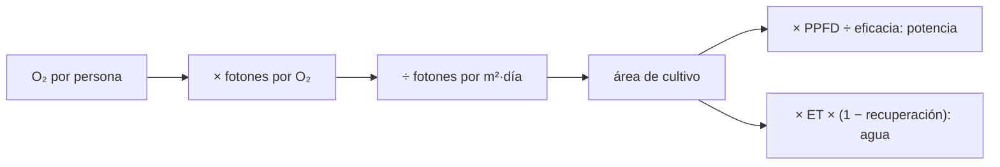

# B59-C14 — Agricultura y sustratos artificiales

<!-- nav:top -->
[🏠 Programa](../../../../README.md) · [📚 Bloque B59](../../../tronco-comun/B59-recursos-in-situ-y-sostenibilidad-extraterrestre.md) · [← Anterior: B59-C13 — Impresión 3D extraterrestre](../B59-C13-impresion-3d-extraterrestre/CLASE.md) · [Siguiente: B59-C15 — Ciclo cerrado de materiales →](../B59-C15-ciclo-cerrado-de-materiales/CLASE.md)
<!-- /nav -->

## 1. Ubicación, nivel y alcance

Clase 14 del bloque B59. Nivel N3. Calculas el **área de cultivo que sostiene el oxígeno de una persona**, la potencia de iluminación y el agua. Es un balance de fotones y de agua, con peso atómico del oxígeno de NIST (S1) y el resto **ilustrativo**. Continúa [B59-C13](../B59-C13-impresion-3d-extraterrestre/CLASE.md).

## 2. Por qué esta clase existe

Cultivar exige luz, y la luz eléctrica cuesta potencia. La decisión central: **¿cuántos metros cuadrados y cuántos kilovatios necesita un cultivo para producir el oxígeno de una persona?**

## 3. Lo que podrás hacer al terminar

1. Convertir el consumo de oxígeno en moles y en fotones necesarios.
2. Calcular el área de cultivo limitada por luz.
3. Calcular la potencia de iluminación con la eficacia de los LED.
4. Calcular la reposición de agua con recuperación.
5. Simular el riego de un sustrato.
6. Escalar a una tripulación.

La evidencia es la **ficha del cultivo** del ejercicio 12 (sección 20).

## 4. Con qué llegas y cómo comprobarlo

1. ¿Qué es un mol de fotones?
2. ¿Qué es el PPFD?
3. ¿Qué es una evapotranspiración?
4. ¿Qué es una eficacia luminosa?
5. ¿Qué es un sustrato?

<details>
<summary>Ver respuestas</summary>

1. 6,022 × 10²³ fotones. 2. El flujo de fotones fotosintéticos por área, en µmol/(m²·s). 3. El agua que pierde un cultivo por evaporación y transpiración. 4. Los µmol de fotones por julio de electricidad. 5. El medio sólido donde crece la raíz.
</details>

Con cuatro o cinco aciertos, sigue; si no, repasa los prerrequisitos.

## 5. Un caso de contexto y casos de referencia

Una persona consume `0,84 kg/día` de O₂ (ilustrativo). Es el **ejemplo conductor**. Con `20` fotones por O₂ producido, `400 µmol/(m²·s)` durante `16 h/día` y LED de `2,5 µmol/J`, el área es `22,79 m²`, la potencia instantánea `3,65 kW` (media `2,43 kW`) y el agua evapotranspirada `68,4 kg/día`, de los que solo se repone `3,42 kg/día` con recuperación del `95 %`.

## 6. Vocabulario

El **PPFD** mide la luz útil para la fotosíntesis. Los **fotones por O₂** resumen la eficiencia del cultivo, incluida la absorción incompleta. La **eficacia** de los LED es µmol por julio. La **evapotranspiración** `ET` es el agua perdida por m² y día. El **sustrato** retiene agua según su profundidad y porosidad.

## 7. Modelo mental: regar un jardín bajo una lámpara

Como cultivar bajo una lámpara: lo que crece depende de la luz recibida y esa luz se paga con electricidad. Límite: aquí la luz es el único factor limitante; en un cultivo real también lo son el CO₂, los nutrientes y la temperatura.



*Descripción textual:* el oxígeno requerido da los fotones; la luz por m² da el área; el área da la potencia y el agua.

## 8. La explicación, paso a paso

### 8.1 Fotones y área

`ṅ_O₂ = 0,84 × 1 000/31,9988 = 26,25 mol/día` (con `O = 15,9994`, S1). Fotones: `26,25 × 20 = 525 mol/día`. Fotones por m²: `400 × 10⁻⁶ × 16 × 3 600 = 23,04 mol/(m²·día)`. Área: `525/23,04 = 22,79 m²`. Una simulación hora a hora reproduce `0,840000 kg/día`.

### 8.2 Potencia

`P = PPFD · A/eficacia = 400 × 22,79/2,5 = 3,646 kW` mientras la luz está encendida; media diaria `3,646 × 16/24 = 2,431 kW`; energía `58,3 kWh/día`.

### 8.3 Agua

`ET · A = 3 × 22,79 = 68,4 kg/día`; con recuperación `95 %`, reposición `3,42 kg/día`.

### 8.4 Sustrato

Un sustrato de 0,20 m y porosidad 0,5 almacena `100 kg/m²`: se seca en `33,3 días` sin riego. Con riego automático de `50 kg/m²` cuando baja del 40 %, en 60 días hacen falta 3 riegos y la humedad final es `70 %`.

### 8.5 Tripulación

Para 4 personas, `91,1 m²` y `14,6 kW` de luz instantánea. El cultivo es la parte más cara en potencia del soporte vital: la comparación con la electrólisis (C10) se hace en C20.

## 9. Magnitudes, símbolos y unidades

| Símbolo | Qué es | Unidad | Valor / nota |
|---|---|---|---|
| `M(O₂)` | masa molar del oxígeno | g/mol | 31,9988 (NIST) |
| `O₂_p` | consumo por persona | kg/día | 0,84 (ilustrativo) |
| `PPFD` | flujo de fotones | µmol/(m²·s) | 400 (ilustrativo) |
| `η_L` | eficacia de LED | µmol/J | 2,5 (ilustrativa) |
| `ET` | evapotranspiración | kg/(m²·día) | 3 (ilustrativa) |
| `A` | área | m² | 22,79 |

## 10. Convenciones y referencias

La luz es el único factor limitante; 16 h de luz diarias; 20 fotones por O₂ efectivos; unidades SI y µmol.

## 11. De dónde sale lo que afirmamos

| ID | Fuente | Localizador | Respalda | Estado |
|---|---|---|---|---|
| S1 | NIST, Atomic Weights and Isotopic Compositions for All Elements | https://physics.nist.gov/cgi-bin/Compositions/stand_alone.pl | Pesos atómicos estándar (H, C, N, O, Mg, Al, Si, Ca, Ti, Fe); se usa el punto medio del intervalo cuando se da un intervalo | Consultada (extracto), consultada el 2026-11-09 |
| — | No consultado: valores ilustrativos de este laboratorio (se rotulan así en el script y en la clase) | — | consumo de O₂, fotones por O₂, PPFD, eficacia, evapotranspiración y recuperación | No consultado |

Límites: solo se consultó el peso atómico del oxígeno; las cifras biológicas no se consultaron.

## 12. Cómo ver el cultivo por tripulación

| Tripulación | Área [m²] | Potencia instantánea [kW] |
|---|---|---|
| 1 | 22,8 | 3,65 |
| 4 | 91,1 | 14,58 |

Descripción larga: el área y la potencia crecen en proporción a la tripulación.

## 13. Ejemplo trabajado: área por persona

**Paso 1 · Moles de O₂.** `840 g/31,9988 = 26,25 mol`.

**Paso 2 · Fotones.** `26,25 × 20 = 525 mol`.

**Paso 3 · Luz por m².** `400 × 10⁻⁶ × 57 600 = 23,04 mol/m²`.

**Paso 4 · Área.** `525/23,04 = 22,79 m²`.

## 14. Distintas formas de resolver el problema

**Fórmula analítica** y **simulación hora a hora** coinciden a `10⁻⁹`. Con el balance de agua, la fórmula (`ET·A`) y el riego automático dan el mismo gasto total.

## 15. Práctica guiada

**Ejercicio 1 · con los pasos indicados.** Moles de O₂ por día (8.1).

<details><summary>Solución comentada</summary>

`840/31,9988 = 26,25 mol`.
</details>

**Ejercicio 2 · con una pista.** Fotones necesarios (8.1).

<details><summary>Solución comentada</summary>

`525 mol/día`.
</details>

**Ejercicio 3 · casi autónomo.** Fotones por m² y día (8.1).

<details><summary>Solución comentada</summary>

`23,04 mol/(m²·día)`.
</details>

## 16. Práctica autónoma, transferencia e integrador

**Ejercicio 4.** Área por persona (8.1).

<details><summary>Solución comentada</summary>

`22,79 m²`.
</details>

**Ejercicio 5.** Potencia instantánea (8.2).

<details><summary>Solución comentada</summary>

`400 × 22,79/2,5 = 3,646 kW`.
</details>

**Ejercicio 6.** Energía diaria (8.2).

<details><summary>Solución comentada</summary>

`3,646 × 16 = 58,3 kWh`.
</details>

**Ejercicio 7.** Reposición de agua (8.3).

<details><summary>Solución comentada</summary>

`0,05 × 68,4 = 3,42 kg/día`.
</details>

**Ejercicio 8.** Área para 4 personas (8.5).

<details><summary>Solución comentada</summary>

`91,1 m²`.
</details>

**Ejercicio 9 · transferencia.** Si el cultivo necesitara 10 fotones por O₂ en vez de 20, ¿qué área?

<details><summary>Solución comentada</summary>

La mitad: `11,4 m²`.
</details>

**Ejercicio 10 · transferencia.** Con LED de 5 µmol/J, ¿qué potencia instantánea?

<details><summary>Solución comentada</summary>

La mitad: `1,82 kW`.
</details>

**Ejercicio 11 · transferencia.** ¿Cuántos días tarda en secarse el sustrato sin riego?

<details><summary>Solución comentada</summary>

`100/3 = 33,3 días`.
</details>

**Ejercicio 12 · integrador.** Elabora tu *ficha del cultivo*: moles y fotones, área, potencia, agua, riego y rótulo de lo ilustrativo.

<details><summary>Solución modelo</summary>

Secciones 8.1–8.5.
</details>

## 17. Laboratorio: área de cultivo y balance de agua

El script [cultivo.py](cultivo.py) calcula el área analítica, la verifica hora a hora (**comprueba** `10⁻⁹`), la potencia y el agua, y simula el riego de un sustrato.

**Datos:** peso atómico de NIST (S1); el resto **ilustrativo**. **Predice antes de ejecutar:** ¿cuánta potencia instantánea para 1 persona? (≈ 3,6 kW.) **Ejecución del 2026-11-09 (Python 3.12.9):**

```text
Python 3.12.9 (biblioteca estandar)
O2 por persona = 26.25 mol/dia ; fotones necesarios = 525.0 mol/dia
Flujo de fotones por m2 = 23.04 mol/(m2 dia) ; area por persona = 22.79 m2
Simulacion hora a hora: O2 producido = 0.840000 kg/dia (demanda 0.84)
Potencia de iluminacion instantanea = 3.646 kW ; media diaria = 2.431 kW ; energia diaria = 58.3 kWh
Para 4 personas: area = 91.1 m2 ; potencia instantanea = 14.58 kW
Agua evapotranspirada = 68.4 kg/dia ; reposicion con 95 % de recuperacion = 3.42 kg/dia
Agua almacenada en el sustrato = 100 kg/m2 ; dias para secarse sin riego (desde saturacion) = 33.3
En 60 dias con riego automatico: 3 riegos de 50 kg/m2 ; agua total repuesta = 150 kg/m2 (ET total 180 kg/m2)
Humedad final = 70.0 % de la capacidad
Pruebas superadas.
```

```bash
python programa/clases/B59/B59-C14-agricultura-y-sustratos-artificiales/cultivo.py
```

**Límites:** luz como único factor limitante; sin CO₂, nutrientes ni plagas; sin calor disipado.

## 18. Errores frecuentes y cómo corregirlos

**Confundir PPFD con iluminancia.** El PPFD mide fotones útiles; sección 6.

**Olvidar las horas de luz.** Se corrige con 8.1.

**Contar el agua evapotranspirada como consumo.** La recuperación la reduce; se corrige con 8.3.

**Presentar las cifras biológicas como medidas.** Son ilustrativas.

## 19. Cómo sabrás que vas bien

Tras la sección 8: ¿qué área esperabas y cuál obtuviste? Si dudas, repasa el ejemplo 13. Tras el laboratorio: ¿qué comprueba? (ver la sección 17).

## 20. Qué entregas y cómo se evalúa

El producto es tu **ficha del cultivo** (ejercicio 12).

| Criterio | Inicial | En desarrollo | Logrado | Destacado |
|---|---|---|---|---|
| Conceptos | Los confunde | Parciales | Conceptos de la clase | Explica los límites |
| Cálculo | Sin unidades | Con errores | Tablas completas | Calcula casos nuevos |
| Numérico | Sin comprobar | Un caso | Contraste con el análisis | Interpreta las diferencias |
| Fuentes | Sin fuente | Sin fecha | Fuentes con fecha | Declara lo ilustrativo |
| Límites | No los nombra | Uno | Tres | Discute qué falta del modelo |

**Condiciones críticas (no se compensan con promedio):** rotular las cifras biológicas como ilustrativas; no afirmar que un cultivo sustituye al sistema químico; citar solo lo consultado.

## 21. Ética, seguridad y límites

Clase educativa: los modelos son simplificados y no son un procedimiento de operación. Esta clase no es un diseño de soporte vital; la seguridad alimentaria real exige datos biológicos que no se tratan aquí. Accesibilidad: tablas equivalentes a las gráficas, fórmulas en texto, ejercicios sin conexión.

## 22. Para cerrar y seguir

Una persona necesita `22,8 m²` de cultivo, `3,65 kW` de luz y una reposición de `3,4 kg/día` de agua con las cifras ilustrativas. Queda una pregunta: ¿qué parte de la materia se puede cerrar en un lazo?

**Glosario español–inglés.** PPFD · *photosynthetic photon flux density*; evapotranspiración · *evapotranspiration*; sustrato · *substrate*; eficacia · *efficacy*; cultivo · *crop*.

**Continuidad.** [B59-C15](../B59-C15-ciclo-cerrado-de-materiales/CLASE.md) estudia el cierre de ciclos.

**Referencias:** ver sección 11.

<!-- nav:bottom -->
---

[← Anterior: B59-C13 — Impresión 3D extraterrestre](../B59-C13-impresion-3d-extraterrestre/CLASE.md) · [📚 Bloque B59](../../../tronco-comun/B59-recursos-in-situ-y-sostenibilidad-extraterrestre.md) · [Siguiente: B59-C15 — Ciclo cerrado de materiales →](../B59-C15-ciclo-cerrado-de-materiales/CLASE.md)
<!-- /nav -->
