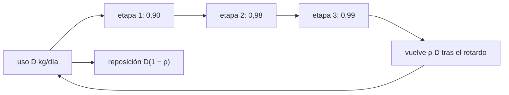

# B59-C15 — Ciclo cerrado de materiales

<!-- nav:top -->
[🏠 Programa](../../../../README.md) · [📚 Bloque B59](../../../tronco-comun/B59-recursos-in-situ-y-sostenibilidad-extraterrestre.md) · [← Anterior: B59-C14 — Agricultura y sustratos artificiales](../B59-C14-agricultura-y-sustratos-artificiales/CLASE.md) · [Siguiente: B59-C16 — Desechos y reciclaje →](../B59-C16-desechos-y-reciclaje/CLASE.md)
<!-- /nav -->

## 1. Ubicación, nivel y alcance

Clase 15 del bloque B59. Nivel N3. Cuantificas **cuánto de un material se cierra en un lazo** y cuánto hay que reponer: la reposición de régimen, el efecto del arranque, la serie geométrica de los ciclos y el papel de cada etapa. Los datos de la tripulación y de las eficiencias son **ilustrativos**. Continúa [B59-C14](../B59-C14-agricultura-y-sustratos-artificiales/CLASE.md).

## 2. Por qué esta clase existe

Cerrar el 87 % de un lazo no deja una reposición del 13 % sino una dependencia permanente del 13 %. La decisión central: **¿qué etapa del lazo conviene mejorar para reducir más la reposición?**

## 3. Lo que podrás hacer al terminar

1. Calcular la recuperación global como producto de las etapas.
2. Obtener la reposición de régimen y la total de una misión.
3. Distinguir el arranque en frío del régimen.
4. Sumar la serie geométrica de los ciclos.
5. Comparar la mejora de cada etapa.
6. Incluir el inventario en tránsito y las fugas.

La evidencia es la **ficha del ciclo cerrado** del ejercicio 12 (sección 20).

## 4. Con qué llegas y cómo comprobarlo

1. ¿Qué es un balance de masa?
2. ¿Qué es una serie geométrica?
3. ¿Qué es un inventario?
4. ¿Qué es un retardo?
5. ¿Qué es un régimen estacionario?

<details>
<summary>Ver respuestas</summary>

1. Lo que entra es igual a lo que sale más lo acumulado. 2. La suma `1 + ρ + ρ² + …` que vale `1/(1 − ρ)` si `ρ < 1`. 3. La cantidad de material presente en el sistema. 4. El tiempo entre que algo se usa y vuelve. 5. El estado en que las magnitudes ya no cambian.
</details>

Con cuatro o cinco aciertos, sigue; si no, repasa los prerrequisitos.

## 5. Un caso de contexto y casos de referencia

Una tripulación hipotética usa `25 kg/día` de agua. El lazo tiene tres etapas en serie, con eficiencias `0,90`, `0,98` y `0,99` (ilustrativas). Es el **ejemplo conductor**. La recuperación global es `0,87318`; la reposición de régimen, `3,17 kg/día`. En 500 días, con arranque en frío y retardo de 3 días, la reposición es `1 650,7 kg` frente a `12 500 kg` sin lazo (ahorro `86,8 %`).

## 6. Vocabulario

La **recuperación global** `ρ` es el producto de las eficiencias de las etapas. La **reposición** (*make-up*) es lo que debe aportarse desde fuera. El **arranque en frío** es el periodo en que aún no vuelve material. El **retardo** es el tiempo de tránsito. Los **ciclos por kg de reposición** son `1/(1 − ρ)`.

## 7. Modelo mental: un cubo con goteras

Como llenar un cubo con tres goteras en serie: cada una pierde una fracción, y la que más pierde manda. Límite: aquí las pérdidas son fracciones constantes; las reales cambian con el estado de los equipos.



*Descripción textual:* el uso diario pasa por tres etapas; vuelve una fracción `ρ` tras el retardo; lo que no vuelve se repone desde fuera.

## 8. La explicación, paso a paso

### 8.1 Recuperación global

`ρ = 0,90 × 0,98 × 0,99 = 0,87318`. La reposición de régimen es `D(1 − ρ) = 25 × 0,12682 = 3,1705 kg/día`; en 500 días, `1 585,25 kg` (simulada y analítica coinciden a `10⁻⁹`).

### 8.2 Arranque en frío

Si la cola de retorno empieza vacía, durante `τ = 3` días no vuelve nada: la reposición total es `D T − ρ D (T − τ) = 1 650,74 kg`, `65,49 kg` más que en régimen (`ρ D τ`).

### 8.3 Ahorro

Sin lazo se necesitan `12 500 kg`; con lazo, `1 651 kg`: ahorro `10 849 kg` (`86,8 %`).

### 8.4 Serie geométrica

El material completa en promedio `1/(1 − ρ) = 7,885` ciclos por kg repuesto; la suma de la serie lo confirma.

### 8.5 Qué etapa mejorar

Subir una etapa a `0,999`: la etapa 1 deja `ρ = 0,96923` y una reposición de `0,769 kg/día`; la etapa 2, `2,747 kg/día`; la etapa 3, `2,972 kg/día`. Conviene atacar la etapa de menor eficiencia.

### 8.6 Inventario y fugas

El inventario en tránsito es `D τ = 75 kg`. Una fuga del `0,5 %/día` de él suma `0,375 kg/día`, un `12 %` más que la reposición de régimen.

## 9. Magnitudes, símbolos y unidades

| Símbolo | Qué es | Unidad | Valor / nota |
|---|---|---|---|
| `D` | demanda | kg/día | 25 (ilustrativa) |
| `ρ` | recuperación global | — | 0,87318 |
| `τ` | retardo | días | 3 |
| `T` | duración | días | 500 |
| `M` | reposición | kg | 1 650,7 |

## 10. Convenciones y referencias

Fracciones constantes; retardo discreto de días; sin acumulación de contaminantes; sin degradación de las etapas.

## 11. De dónde sale lo que afirmamos

| ID | Fuente | Localizador | Respalda | Estado |
|---|---|---|---|---|
| — | No consultado: valores ilustrativos de este laboratorio (se rotulan así en el script y en la clase) | — | demanda, eficiencias, retardo y fugas | No consultado |

Límites: no se consultó ninguna fuente sobre sistemas de soporte vital; los valores son de ejemplo.

## 12. Cómo ver la reposición según la etapa mejorada

| Etapa mejorada a 0,999 | `ρ` | Reposición [kg/día] |
|---|---|---|
| Ninguna | 0,87318 | 3,171 |
| 1 (0,90) | 0,96923 | 0,769 |
| 2 (0,98) | 0,89011 | 2,747 |
| 3 (0,99) | 0,88112 | 2,972 |

Descripción larga: mejorar la etapa más débil reduce la reposición cuatro veces.

## 13. Ejemplo trabajado: reposición de régimen y de arranque

**Paso 1 · `ρ`.** `0,90 × 0,98 × 0,99 = 0,87318`.

**Paso 2 · Régimen.** `25 × (1 − 0,87318) = 3,1705 kg/día`.

**Paso 3 · Total 500 días.** `3,1705 × 500 = 1 585,25 kg`.

**Paso 4 · Arranque.** `+ρ D τ = 0,87318 × 25 × 3 = 65,49 kg`.

## 14. Distintas formas de resolver el problema

**Simulación día a día** y **fórmula cerrada** coinciden. **Serie geométrica** y **suma numérica** también. La simulación permite añadir fugas y retardos variables.

## 15. Práctica guiada

**Ejercicio 1 · con los pasos indicados.** Recuperación global (8.1).

<details><summary>Solución comentada</summary>

`0,87318`.
</details>

**Ejercicio 2 · con una pista.** Reposición de régimen (8.1).

<details><summary>Solución comentada</summary>

`3,1705 kg/día`.
</details>

**Ejercicio 3 · casi autónomo.** Ciclos por kg de reposición (8.4).

<details><summary>Solución comentada</summary>

`1/0,12682 = 7,885`.
</details>

## 16. Práctica autónoma, transferencia e integrador

**Ejercicio 4.** Reposición total en 500 días en régimen (8.1).

<details><summary>Solución comentada</summary>

`3,1705 × 500 = 1 585 kg`.
</details>

**Ejercicio 5.** Extra por arranque en frío (8.2).

<details><summary>Solución comentada</summary>

`65,49 kg`.
</details>

**Ejercicio 6.** Ahorro respecto a no tener lazo (8.3).

<details><summary>Solución comentada</summary>

`12 500 − 1 651 = 10 849 kg`.
</details>

**Ejercicio 7.** Reposición si la etapa 1 sube a 0,999 (8.5).

<details><summary>Solución comentada</summary>

`0,769 kg/día`.
</details>

**Ejercicio 8.** Inventario en tránsito (8.6).

<details><summary>Solución comentada</summary>

`75 kg`.
</details>

**Ejercicio 9 · transferencia.** ¿Qué etapa mejorarías primero y por qué?

<details><summary>Solución comentada</summary>

La de menor eficiencia (0,90): da la mayor reducción de reposición.
</details>

**Ejercicio 10 · transferencia.** La fuga del 0,5 %/día del inventario, ¿cuánto pesa frente a la reposición de régimen?

<details><summary>Solución comentada</summary>

`0,375/3,17 = 12 %` adicional.
</details>

**Ejercicio 11 · transferencia.** Si las etapas fueran en paralelo (cada una trata una fracción), ¿valdría el producto?

<details><summary>Solución comentada</summary>

No: la recuperación global sería el promedio ponderado de las fracciones tratadas.
</details>

**Ejercicio 12 · integrador.** Elabora tu *ficha del ciclo cerrado*: recuperación global, reposición de régimen y de arranque, serie geométrica, mejora por etapa y fugas.

<details><summary>Solución modelo</summary>

Secciones 8.1–8.6.
</details>

## 17. Laboratorio: lazo con retardo

El script [lazo.py](lazo.py) simula el lazo día a día, lo compara con la fórmula cerrada en régimen y en arranque en frío (**comprueba** `10⁻⁹`) y suma la serie geométrica.

**Datos:** todos los parámetros **ilustrativos**. **Predice antes de ejecutar:** ¿qué etapa da más ahorro al mejorarla? (la de menor eficiencia.) **Ejecución del 2026-11-09 (Python 3.12.9):**

```text
Python 3.12.9 (biblioteca estandar)
Recuperacion global = 0.9 x 0.98 x 0.99 = 0.87318
Reposicion de regimen = 3.1705 kg/dia ; total en 500 dias: simulada = 1585.2500 kg ; analitica = 1585.2500 kg
Con arranque en frio (cola vacia): total simulado = 1650.7385 kg ; analitico D T - rho D (T - retardo) = 1650.7385 kg
Sin lazo: 12500 kg ; con lazo: 1651 kg ; ahorro = 10849 kg (86.8 %)
Ciclos por kg de reposicion: 1/(1 - rho) = 7.885 ; suma de la serie = 7.885
Efecto de mejorar una etapa a 0,999:
  etapa 1 (0.9 -> 0,999): rho = 0.96923 ; reposicion = 0.7693 kg/dia
  etapa 2 (0.98 -> 0,999): rho = 0.89011 ; reposicion = 2.7473 kg/dia
  etapa 3 (0.99 -> 0,999): rho = 0.88112 ; reposicion = 2.9721 kg/dia
Inventario en transito (retardo 3 d) = 75 kg ; reposicion de fugas 0,5 %/dia = 0.375 kg/dia
Pruebas superadas.
```

```bash
python programa/clases/B59/B59-C15-ciclo-cerrado-de-materiales/lazo.py
```

**Límites:** fracciones constantes, retardo discreto, un solo material.

## 18. Errores frecuentes y cómo corregirlos

**Creer que 87 % de recuperación basta para ser autónomo.** Se corrige con 8.1.

**Olvidar el arranque en frío.** Se corrige con 8.2.

**Sumar eficiencias en vez de multiplicarlas.** Se corrige con 8.1.

**Ignorar las fugas del inventario.** Se corrige con 8.6.

## 19. Cómo sabrás que vas bien

Tras la sección 8: ¿qué reposición esperabas y cuál obtuviste? Si dudas, repasa el ejemplo 13. Tras el laboratorio: ¿qué comprueba? (ver la sección 17).

## 20. Qué entregas y cómo se evalúa

El producto es tu **ficha del ciclo cerrado** (ejercicio 12).

| Criterio | Inicial | En desarrollo | Logrado | Destacado |
|---|---|---|---|---|
| Conceptos | Los confunde | Parciales | Conceptos de la clase | Explica los límites |
| Cálculo | Sin unidades | Con errores | Tablas completas | Calcula casos nuevos |
| Numérico | Sin comprobar | Un caso | Contraste con el análisis | Interpreta las diferencias |
| Fuentes | Sin fuente | Sin fecha | Fuentes con fecha | Declara lo ilustrativo |
| Límites | No los nombra | Uno | Tres | Discute qué falta del modelo |

**Condiciones críticas (no se compensan con promedio):** rotular lo ilustrativo; multiplicar las etapas; citar solo lo consultado.

## 21. Ética, seguridad y límites

Clase educativa: los modelos son simplificados y no son un procedimiento de operación. Esta clase no es un diseño de soporte vital. Accesibilidad: tablas equivalentes a las gráficas, fórmulas en texto, ejercicios sin conexión.

## 22. Para cerrar y seguir

Un lazo con `ρ = 0,873` deja una reposición de `3,17 kg/día` y un ahorro del `86,8 %` en 500 días; la etapa más débil manda. Queda una pregunta: ¿qué pasa con lo que no se recupera?

**Glosario español–inglés.** ciclo cerrado · *closed loop*; reposición · *make-up*; retardo · *lag / delay*; régimen estacionario · *steady state*; serie geométrica · *geometric series*.

**Continuidad.** [B59-C16](../B59-C16-desechos-y-reciclaje/CLASE.md) trata los residuos.

**Referencias:** ver sección 11.

<!-- nav:bottom -->
---

[← Anterior: B59-C14 — Agricultura y sustratos artificiales](../B59-C14-agricultura-y-sustratos-artificiales/CLASE.md) · [📚 Bloque B59](../../../tronco-comun/B59-recursos-in-situ-y-sostenibilidad-extraterrestre.md) · [Siguiente: B59-C16 — Desechos y reciclaje →](../B59-C16-desechos-y-reciclaje/CLASE.md)
<!-- /nav -->
