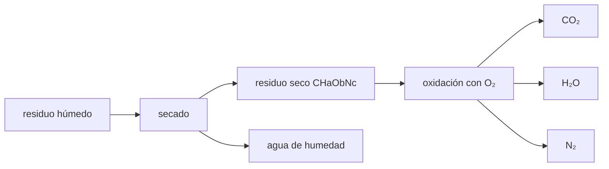

# B59-C16 — Desechos y reciclaje

<!-- nav:top -->
[🏠 Programa](../../../../README.md) · [📚 Bloque B59](../../../tronco-comun/B59-recursos-in-situ-y-sostenibilidad-extraterrestre.md) · [← Anterior: B59-C15 — Ciclo cerrado de materiales](../B59-C15-ciclo-cerrado-de-materiales/CLASE.md) · [Siguiente: B59-C17 — Impacto ambiental extraterrestre →](../B59-C17-impacto-ambiental-extraterrestre/CLASE.md)
<!-- /nav -->

## 1. Ubicación, nivel y alcance

Clase 16 del bloque B59. Nivel N3. Calculas **qué se obtiene y qué oxígeno se gasta al oxidar completamente los residuos** de una tripulación, con balance de elementos. Los pesos atómicos son de NIST (S1); la fórmula del residuo y las cantidades son **sintéticas**. Continúa [B59-C15](../B59-C15-ciclo-cerrado-de-materiales/CLASE.md).

## 2. Por qué esta clase existe

Los residuos son una fuente de agua y de dióxido de carbono, pero también consumen oxígeno. La decisión central: **¿cuánto oxígeno cuesta cerrar el residuo y cuánta agua se recupera?**

## 3. Lo que podrás hacer al terminar

1. Escribir la oxidación completa de un residuo de fórmula empírica `CHₐO_bN_c`.
2. Resolver el balance de elementos con un sistema lineal.
3. Calcular masas por kg de residuo con masas molares.
4. Calcular el flujo de una tripulación y el agua recuperable.
5. Verificar el cierre de masa y de carbono.
6. Identificar el inerte (N₂).

La evidencia es la **ficha del reciclaje de residuos** del ejercicio 12 (sección 20).

## 4. Con qué llegas y cómo comprobarlo

1. ¿Qué es una fórmula empírica?
2. ¿Qué es un balance de elementos?
3. ¿Qué es una masa molar?
4. ¿Qué es una oxidación completa?
5. ¿Qué es un sistema lineal?

<details>
<summary>Ver respuestas</summary>

1. La relación entera más simple entre los átomos de un compuesto. 2. Contar los átomos de cada elemento a ambos lados de la reacción. 3. La masa de un mol, en g/mol. 4. La que convierte el carbono en CO₂ y el hidrógeno en H₂O. 5. Un conjunto de ecuaciones de primer grado.
</details>

Con cuatro o cinco aciertos, sigue; si no, repasa los prerrequisitos.

## 5. Un caso de contexto y casos de referencia

Un residuo seco sintético `CH₁,₈O₀,₆N₀,₁` (`24,8253 g` por átomo de C). Es el **ejemplo conductor**. Por kg de residuo seco se necesitan `1,4823 kg` de O₂ y se obtienen `1,7728 kg` de CO₂, `0,6531 kg` de H₂O y `0,0564 kg` de N₂. Una tripulación de 4 con `0,5 kg` secos por persona genera `2,00 kg/día` secos (`6,67 kg/día` con 70 % de humedad), gasta `2,965 kg/día` de O₂ y recupera `5,97 kg/día` de agua.

## 6. Vocabulario

La **oxidación completa** quema todo el carbono a CO₂. El **residuo seco** es el sólido sin agua. La **humedad** es la fracción de agua del residuo húmedo. Un **inerte** no reacciona (aquí N₂). El **cierre** del balance es que la masa que entra iguale la que sale.

## 7. Modelo mental: quemar un tronco húmedo

Como quemar un tronco húmedo: el agua del tronco y la que produce la combustión salen juntas. Límite: aquí la combustión es ideal y completa; los procesos reales dejan cenizas y monóxido de carbono.



*Descripción textual:* el residuo húmedo se seca; el seco se oxida a CO₂, agua y N₂; el agua de humedad y la de la reacción se recuperan.

## 8. La explicación, paso a paso

### 8.1 Reacción

`CHₐO_bN_c + (1 + a/4 − b/2) O₂ → CO₂ + (a/2) H₂O + (c/2) N₂`. Con `a = 1,8`, `b = 0,6`, `c = 0,1`: `O₂ = 1,15`, `CO₂ = 1`, `H₂O = 0,9`, `N₂ = 0,05` mol por mol de residuo. Un sistema lineal de balance de C, H, O y N da lo mismo a `10⁻¹²`.

### 8.2 Masas por kg de residuo seco

`M = 12,0106 + 1,8 × 1,007975 + 0,6 × 15,9994 + 0,1 × 14,006855 = 24,8253 g/mol` (S1). Por kg: `O₂ = 1,4823`, `CO₂ = 1,7728`, `H₂O = 0,6531`, `N₂ = 0,0564 kg`. La masa que entra, `2,482304 kg`, iguala la que sale.

### 8.3 Tripulación

`4 × 0,5 = 2,00 kg/día` secos; húmedo `2/0,30 = 6,67 kg/día`; agua de humedad `4,67 kg/día`. Oxidar el seco: `O₂ = 2,965`, `CO₂ = 3,546`, `H₂O = 1,306`, `N₂ = 0,113 kg/día`.

### 8.4 Agua recuperable

Humedad más agua de reacción: `5,973 kg/día`, es decir `89,6 %` del residuo húmedo. El carbono (`0,9676 kg/día`) sale íntegro como CO₂.

### 8.5 Lectura

Cerrar el residuo cuesta `2,97 kg/día` de O₂ y produce `3,55 kg/día` de CO₂, que podría alimentar un cultivo (C14) o un reactor de Sabatier (C09). El N₂ es un inerte que se acumula o se ventea.

## 9. Magnitudes, símbolos y unidades

| Símbolo | Qué es | Unidad | Valor / nota |
|---|---|---|---|
| `a, b, c` | H, O y N por C | — | 1,8; 0,6; 0,1 (sintéticos) |
| `M` | masa molar por átomo de C | g/mol | 24,8253 |
| `m_seco` | residuo seco por persona | kg/día | 0,5 (ilustrativo) |
| `h` | humedad | — | 0,70 (ilustrativa) |
| `O₂/res` | oxígeno por kg de residuo seco | kg/kg | 1,4823 |

## 10. Convenciones y referencias

Oxidación completa e ideal; sin cenizas ni CO; pesos atómicos NIST (punto medio); unidades de mol y kg.

## 11. De dónde sale lo que afirmamos

| ID | Fuente | Localizador | Respalda | Estado |
|---|---|---|---|---|
| S1 | NIST, Atomic Weights and Isotopic Compositions for All Elements | https://physics.nist.gov/cgi-bin/Compositions/stand_alone.pl | Pesos atómicos estándar (H, C, N, O, Mg, Al, Si, Ca, Ti, Fe); se usa el punto medio del intervalo cuando se da un intervalo | Consultada (extracto), consultada el 2026-11-09 |
| — | No consultado: valores ilustrativos de este laboratorio (se rotulan así en el script y en la clase) | — | fórmula del residuo, cantidades y humedad | No consultado |

Límites: solo se consultaron los pesos atómicos; la composición del residuo es sintética.

## 12. Cómo ver los flujos del residuo seco

| Flujo | Por kg de residuo seco [kg] | Tripulación de 4 [kg/día] |
|---|---|---|
| O₂ consumido | 1,4823 | 2,965 |
| CO₂ | 1,7728 | 3,546 |
| H₂O | 0,6531 | 1,306 |
| N₂ | 0,0564 | 0,113 |

Descripción larga: la mayor parte de la masa de salida es CO₂.

## 13. Ejemplo trabajado: oxígeno por kg de residuo

**Paso 1 · Masa molar.** `24,8253 g/mol`.

**Paso 2 · Moles por kg.** `1 000/24,8253 = 40,28 mol`.

**Paso 3 · Oxígeno.** `40,28 × 1,15 × 31,9988/1 000 = 1,4823 kg`.

## 14. Distintas formas de resolver el problema

**Fórmula cerrada** y **sistema lineal** coinciden. **Balance de masa** y **de carbono** verifican el cierre de forma independiente.

## 15. Práctica guiada

**Ejercicio 1 · con los pasos indicados.** Coeficiente de O₂ (8.1).

<details><summary>Solución comentada</summary>

`1 + 1,8/4 − 0,6/2 = 1,15`.
</details>

**Ejercicio 2 · con una pista.** Masa molar del residuo (8.2).

<details><summary>Solución comentada</summary>

`24,8253 g/mol`.
</details>

**Ejercicio 3 · casi autónomo.** Coeficiente de H₂O (8.1).

<details><summary>Solución comentada</summary>

`1,8/2 = 0,9`.
</details>

## 16. Práctica autónoma, transferencia e integrador

**Ejercicio 4.** CO₂ por kg de residuo seco (8.2).

<details><summary>Solución comentada</summary>

`44,0094/24,8253 = 1,7728 kg`.
</details>

**Ejercicio 5.** O₂ por kg (8.2).

<details><summary>Solución comentada</summary>

`1,15 × 31,9988/24,8253 = 1,4823 kg`.
</details>

**Ejercicio 6.** Residuo húmedo de la tripulación (8.3).

<details><summary>Solución comentada</summary>

`2/0,30 = 6,67 kg/día`.
</details>

**Ejercicio 7.** Agua de humedad (8.3).

<details><summary>Solución comentada</summary>

`6,67 − 2,00 = 4,67 kg/día`.
</details>

**Ejercicio 8.** O₂ consumido por día (8.3).

<details><summary>Solución comentada</summary>

`2,965 kg/día`.
</details>

**Ejercicio 9 · transferencia.** ¿Qué se hace con los `0,113 kg/día` de N₂?

<details><summary>Solución comentada</summary>

Es inerte: se acumula en la atmósfera o se ventea; puede reponer fugas de gas inerte.
</details>

**Ejercicio 10 · transferencia.** ¿Qué proceso aprovecharía los `3,55 kg/día` de CO₂?

<details><summary>Solución comentada</summary>

Un cultivo (C14) o un reactor de Sabatier (C09).
</details>

**Ejercicio 11 · transferencia.** Si `b = 1,0` (más oxígeno en el residuo), ¿cuál es el coeficiente de O₂?

<details><summary>Solución comentada</summary>

`1 + 0,45 − 0,5 = 0,95`: se necesita menos oxígeno.
</details>

**Ejercicio 12 · integrador.** Elabora tu *ficha del reciclaje de residuos*: reacción, masas por kg, flujo de la tripulación, agua recuperable, cierre y rótulo de lo sintético.

<details><summary>Solución modelo</summary>

Secciones 8.1–8.5.
</details>

## 17. Laboratorio: oxidación de un residuo sintético

El script [oxidacion.py](oxidacion.py) resuelve el balance de elementos con un sistema lineal y con la fórmula (**comprueba** `10⁻¹²`), cierra masa y carbono y calcula el flujo de la tripulación.

**Datos:** pesos atómicos **citados** (S1); fórmula, cantidades y humedad **sintéticas**. **Predice antes de ejecutar:** ¿cuántos kg de CO₂ sale por kg de residuo seco? (≈ 1,8.) **Ejecución del 2026-11-09 (Python 3.12.9):**

```text
Python 3.12.9 (biblioteca estandar)
Residuo seco CH1.8O0.6N0.1: masa molar por 'atomo de C' = 24.8253 g/mol
Por mol de CHaObNc: O2 = 1.1500 mol ; CO2 = 1.0000 ; H2O = 0.9000 ; N2 = 0.0500
Sistema lineal: O2 = 1.1500 ; CO2 = 1.0000 ; H2O = 0.9000 ; N2 = 0.0500
Por kg de residuo seco: O2 = 1.4823 kg ; CO2 = 1.7728 ; H2O = 0.6531 ; N2 = 0.0564
Cierre de masa: entra 2.482304 kg ; sale 2.482304 kg ; diferencia -8.9e-16
Tripulacion de 4: residuo seco = 2.00 kg/dia ; residuo humedo (70 % de agua) = 6.67 kg/dia ; agua de humedad = 4.67 kg/dia
Oxidar el seco consume O2 = 2.965 kg/dia ; produce CO2 = 3.546 ; H2O = 1.306 ; N2 = 0.113 kg/dia
Agua total recuperable (humedad + reaccion) = 5.973 kg/dia
Fraccion del residuo humedo que se recupera como agua = 89.6 %
Carbono: entra 0.9676 kg/dia ; sale en CO2 0.9676 kg/dia
Pruebas superadas.
```

```bash
python programa/clases/B59/B59-C16-desechos-y-reciclaje/oxidacion.py
```

**Límites:** oxidación completa e ideal, un solo tipo de residuo, sin tóxicos ni metales.

## 18. Errores frecuentes y cómo corregirlos

**Olvidar el oxígeno del propio residuo.** Se corrige con 8.1: `− b/2`.

**Contar solo el agua de reacción.** Se corrige con 8.4.

**Suponer combustión completa en un equipo real.** Es un caso ideal.

**Presentar la fórmula como real.** Es sintética.

## 19. Cómo sabrás que vas bien

Tras la sección 8: ¿qué oxígeno esperabas y cuál obtuviste? Si dudas, repasa el ejemplo 13. Tras el laboratorio: ¿qué comprueba? (ver la sección 17).

## 20. Qué entregas y cómo se evalúa

El producto es tu **ficha del reciclaje de residuos** (ejercicio 12).

| Criterio | Inicial | En desarrollo | Logrado | Destacado |
|---|---|---|---|---|
| Conceptos | Los confunde | Parciales | Conceptos de la clase | Explica los límites |
| Cálculo | Sin unidades | Con errores | Tablas completas | Calcula casos nuevos |
| Numérico | Sin comprobar | Un caso | Contraste con el análisis | Interpreta las diferencias |
| Fuentes | Sin fuente | Sin fecha | Fuentes con fecha | Declara lo ilustrativo |
| Límites | No los nombra | Uno | Tres | Discute qué falta del modelo |

**Condiciones críticas (no se compensan con promedio):** rotular la fórmula como sintética; cerrar masa y carbono; citar solo lo consultado.

## 21. Ética, seguridad y límites

Clase educativa: los modelos son simplificados y no son un procedimiento de operación. Quemar residuos orgánicos en un recinto cerrado es peligroso; esta clase no es un procedimiento. Accesibilidad: tablas equivalentes a las gráficas, fórmulas en texto, ejercicios sin conexión.

## 22. Para cerrar y seguir

Oxidar `1 kg` de residuo seco gasta `1,48 kg` de O₂ y deja `1,77 kg` de CO₂ y `0,65 kg` de agua; una tripulación de 4 recupera `5,97 kg/día` de agua. Queda una pregunta: ¿qué efecto tienen estas actividades en el entorno?

**Glosario español–inglés.** oxidación · *oxidation*; fórmula empírica · *empirical formula*; residuo · *waste*; inerte · *inert*; humedad · *moisture*.

**Continuidad.** [B59-C17](../B59-C17-impacto-ambiental-extraterrestre/CLASE.md) trata el impacto ambiental.

**Referencias:** ver sección 11.

<!-- nav:bottom -->
---

[← Anterior: B59-C15 — Ciclo cerrado de materiales](../B59-C15-ciclo-cerrado-de-materiales/CLASE.md) · [📚 Bloque B59](../../../tronco-comun/B59-recursos-in-situ-y-sostenibilidad-extraterrestre.md) · [Siguiente: B59-C17 — Impacto ambiental extraterrestre →](../B59-C17-impacto-ambiental-extraterrestre/CLASE.md)
<!-- /nav -->
