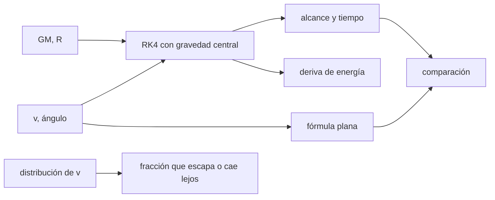

# B59-C17 — Impacto ambiental extraterrestre

<!-- nav:top -->
[🏠 Programa](../../../../README.md) · [📚 Bloque B59](../../../tronco-comun/B59-recursos-in-situ-y-sostenibilidad-extraterrestre.md) · [← Anterior: B59-C16 — Desechos y reciclaje](../B59-C16-desechos-y-reciclaje/CLASE.md) · [Siguiente: B59-C18 — Fiabilidad de equipos mineros →](../B59-C18-fiabilidad-de-equipos-mineros/CLASE.md)
<!-- /nav -->

## 1. Ubicación, nivel y alcance

Clase 17 del bloque B59. Nivel N3. Estimas **hasta dónde llega el material expulsado** por un aterrizaje o una excavación en un cuerpo sin atmósfera, y qué fracción escapa. Integras trayectorias balísticas con gravedad central y las comparas con la fórmula plana. El contexto de política procede de COSPAR (S1); las propiedades de la Luna y de la eyecta son **ilustrativas**. Continúa [B59-C16](../B59-C16-desechos-y-reciclaje/CLASE.md).

## 2. Por qué esta clase existe

Sin atmósfera, la eyecta viaja lejos y sin frenar. La decisión central: **¿a qué distancia de una zona sensible, como una sombra permanente, hay que operar para que la eyecta no la alcance?**

## 3. Lo que podrás hacer al terminar

1. Integrar una trayectoria balística con RK4 en un campo central.
2. Verificar la conservación de la energía.
3. Comparar el alcance con la fórmula plana y ver cuándo falla.
4. Calcular la velocidad de escape.
5. Estimar fracciones de eyecta con una distribución lognormal.
6. Situar el análisis en el contexto de la protección planetaria.

La evidencia es la **ficha del impacto ambiental** del ejercicio 12 (sección 20).

## 4. Con qué llegas y cómo comprobarlo

1. ¿Qué es una trayectoria balística?
2. ¿Qué es una velocidad de escape?
3. ¿Qué es la conservación de la energía?
4. ¿Qué es un método RK4?
5. ¿Qué es una distribución lognormal?

<details>
<summary>Ver respuestas</summary>

1. La de un cuerpo que solo siente la gravedad. 2. `√(2GM/R)`: la velocidad mínima para no volver. 3. La energía por unidad de masa `v²/2 − GM/r` es constante. 4. Un integrador numérico de cuarto orden. 5. Una cuyo logaritmo es normal.
</details>

Con cuatro o cinco aciertos, sigue; si no, repasa los prerrequisitos.

## 5. Un caso de contexto y casos de referencia

Con `GM = 4 902,8 km³/s²` y `R = 1 737,4 km` (valores **ilustrativos**), la gravedad es `1,624 m/s²` y la velocidad de escape `2 375,7 m/s`. Es el **ejemplo conductor**. Una partícula lanzada a 45° con `100 m/s` llega a `6,17 km`; con `800 m/s`, a `442 km` (la fórmula plana da `394 km`, un `10,9 %` menos). Con una distribución lognormal de mediana 150 m/s, `0,55 %` de las partículas escapa y `17,7 %` cae a más de 100 km.

## 6. Vocabulario

La **eyecta** es el material lanzado. El **alcance** es la distancia a lo largo de la superficie. La **fórmula plana** `v² sen 2θ/g` supone gravedad uniforme y superficie plana. La **deriva de energía** mide el error del integrador. La **protección planetaria** son las normas para evitar contaminar otros mundos (COSPAR, S1).

## 7. Modelo mental: una piedra lanzada desde una azotea muy alta

Como lanzar una piedra en un mundo pequeño y sin aire: llega más lejos que en la Tierra y puede dar la vuelta. Límite: la partícula real choca con otras y tiene forma irregular.



*Descripción textual:* la velocidad y el ángulo se integran con gravedad central; el alcance se compara con la fórmula plana; una distribución de velocidades da fracciones.

## 8. La explicación, paso a paso

### 8.1 Gravedad y escape

`g = GM/R² = 1,6242 m/s²`; `v_esc = √(2GM/R) = 2 375,7 m/s`; `v_circ = 1 679,9 m/s`.

### 8.2 Alcance

| `v` [m/s] | RK4 [km] | Plano [km] | Diferencia | Vuelo [s] |
|---|---|---|---|---|
| 100 | 6,168 | 6,157 | −0,18 % | 87,3 |
| 300 | 56,304 | 55,411 | −1,59 % | 268,3 |
| 800 | 442,033 | 394,036 | −10,86 % | 853,2 |
| 1 200 | 1 146,744 | 886,580 | −22,69 % | 1 724,7 |

La deriva de energía es `≤ 2 × 10⁻¹⁵` en todos los casos. La fórmula plana falla cuando el alcance es comparable al radio: la superficie se curva y la gravedad cambia con la altura.

### 8.3 Distribución de velocidades

Con lognormal de mediana `150 m/s` y `GSD = 3` (20 000 partículas): escapan `0,55 %` (analítico `0,596 %`), caen a menos de 1 km el `11,8 %` y a más de 100 km el `17,69 %`.

### 8.4 Lectura

Una distancia de seguridad se fija con las partículas rápidas, no con la mediana. Con `300 m/s` el alcance es `56 km`: un sitio a esa distancia de una zona sensible ya recibe eyecta. Para las regiones polares y las sombras permanentes de la Luna, COSPAR indica que se requiere más documentación (S1); la clase no evalúa ningún sitio.

## 9. Magnitudes, símbolos y unidades

| Símbolo | Qué es | Unidad | Valor / nota |
|---|---|---|---|
| `GM` | parámetro gravitatorio | km³/s² | 4 902,8 (ilustrativo) |
| `R` | radio | km | 1 737,4 (ilustrativo) |
| `g` | gravedad superficial | m/s² | 1,6242 |
| `v_esc` | velocidad de escape | m/s | 2 375,7 |
| `θ` | ángulo de lanzamiento | ° | 45 |

## 10. Convenciones y referencias

Partícula puntual; gravedad central; sin atmósfera, rotación ni colisiones; superficie esférica; unidades SI.

## 11. De dónde sale lo que afirmamos

| ID | Fuente | Localizador | Respalda | Estado |
|---|---|---|---|---|
| S1 | COSPAR, Panel on Planetary Protection (página) | https://cosparhq.cnes.fr/scientific-structure/panel-on-planetary-protection-ppp/ | Política voluntaria; categorías según cuerpo y misión; regiones polares y sombras permanentes de la Luna exigen más documentación | Consultada (página), consultada el 2026-11-09 |
| — | No consultado: valores ilustrativos de este laboratorio (se rotulan así en el script y en la clase) | — | GM, R y la distribución de velocidades de eyecta | No consultado |

Límites: la página de COSPAR no enumera las categorías ni la documentación exigida; no se consultó el texto de la política ni el Tratado del Espacio Ultraterrestre (la página de UNOOSA no abrió).

## 12. Cómo ver el alcance según la velocidad

| `v` [m/s] | RK4 [km] | Plano [km] |
|---|---|---|
| 100 | 6,2 | 6,2 |
| 300 | 56,3 | 55,4 |
| 800 | 442,0 | 394,0 |
| 1 200 | 1 146,7 | 886,6 |

Descripción larga: la fórmula plana subestima el alcance cada vez más al crecer la velocidad.

## 13. Ejemplo trabajado: alcance de 100 m/s

**Paso 1 · Plana.** `100²/1,6242 = 6 157 m`.

**Paso 2 · RK4.** `6,168 km`.

**Paso 3 · Diferencia.** `−0,18 %`.

**Paso 4 · Vuelo.** `2 v sen 45°/g = 87,1 s` (RK4: `87,3 s`).

## 14. Distintas formas de resolver el problema

**Fórmula plana:** sirve para alcances pequeños. **RK4 con gravedad central:** sirve siempre y se valida con la energía. **Órbitas keplerianas** darían el mismo resultado analíticamente.

## 15. Práctica guiada

**Ejercicio 1 · con los pasos indicados.** Gravedad con `GM` y `R` (8.1).

<details><summary>Solución comentada</summary>

`4 902,8 × 10⁹/(1 737,4 × 10³)² = 1,624 m/s²`.
</details>

**Ejercicio 2 · con una pista.** Velocidad de escape (8.1).

<details><summary>Solución comentada</summary>

`√(2 × 4 902,8 × 10⁹/1 737 400) = 2 375,7 m/s`.
</details>

**Ejercicio 3 · casi autónomo.** Alcance plano de 100 m/s a 45° (8.2).

<details><summary>Solución comentada</summary>

`6 157 m`.
</details>

## 16. Práctica autónoma, transferencia e integrador

**Ejercicio 4.** Diferencia entre plano y RK4 a 800 m/s (8.2).

<details><summary>Solución comentada</summary>

`−10,86 %`.
</details>

**Ejercicio 5.** Tiempo de vuelo plano de 100 m/s (8.2).

<details><summary>Solución comentada</summary>

`2 × 100 × 0,7071/1,6242 = 87,1 s`.
</details>

**Ejercicio 6.** Probabilidad analítica de escape (8.3).

<details><summary>Solución comentada</summary>

`0,596 %`.
</details>

**Ejercicio 7.** Fracción que cae a más de 100 km (8.3).

<details><summary>Solución comentada</summary>

`17,69 %`.
</details>

**Ejercicio 8.** Fracción que cae a menos de 1 km (8.3).

<details><summary>Solución comentada</summary>

`11,8 %`.
</details>

**Ejercicio 9 · transferencia.** ¿Por qué falla la fórmula plana a 1 200 m/s?

<details><summary>Solución comentada</summary>

El alcance (1 100 km) es comparable al radio: la superficie se curva y `g` baja con la altura.
</details>

**Ejercicio 10 · transferencia.** Una zona sensible está a 50 km de un sitio de operación. ¿Qué velocidad de eyecta basta para alcanzarla?

<details><summary>Solución comentada</summary>

Cerca de `300 m/s` (alcance `56 km`).
</details>

**Ejercicio 11 · transferencia.** ¿Qué no considera el modelo y podría empeorar el impacto?

<details><summary>Solución comentada</summary>

Las partículas de polvo cargadas, el vapor de los escapes y las colisiones, que cambian la distribución.
</details>

**Ejercicio 12 · integrador.** Elabora tu *ficha del impacto ambiental*: gravedad y escape, alcances, fracciones de la distribución, contexto de COSPAR y límites.

<details><summary>Solución modelo</summary>

Secciones 8.1–8.4.
</details>

## 17. Laboratorio: alcance balístico de eyecta

El script [eyecta.py](eyecta.py) integra con RK4 en un campo central, verifica la energía (**comprueba** `10⁻⁹`), compara con la fórmula plana (1 % a 100 m/s) y estima fracciones por Monte Carlo (`0,003` frente a analítico).

**Datos:** `GM`, `R` y distribución **ilustrativos**; contexto de política de COSPAR (S1). **Predice antes de ejecutar:** ¿cuántas veces mayor es el alcance de 800 m/s que el de 100 m/s? (≈ 72, no 64.) **Ejecución del 2026-11-09 (Python 3.12.9):**

```text
Python 3.12.9 (biblioteca estandar)
g superficial = 1.6242 m/s^2 ; velocidad de escape = 2375.7 m/s ; velocidad circular = 1679.9 m/s
v [m/s]   alcance RK4 [km]   alcance plano [km]   diferencia   t vuelo [s]   deriva de energia
    100              6.168                6.157       -0.18 %         87.3   5.0e-16
    300             56.304               55.411       -1.59 %        268.3   3.4e-16
    800            442.033              394.036      -10.86 %        853.2   1.7e-15
   1200           1146.744              886.580      -22.69 %       1724.7   2.2e-15
Distribucion lognormal (mediana 150 m/s, GSD 3, 20000 particulas): escapan 0.550 % ; caen a menos de 1 km 11.8 % ; caen a mas de 100 km 17.69 %
Probabilidad analitica de escape = 0.596 % (muestral 0.550 %)
Pruebas superadas.
```

```bash
python programa/clases/B59/B59-C17-impacto-ambiental-extraterrestre/eyecta.py
```

**Límites:** sin atmósfera, rotación ni colisiones; partícula puntual; no evalúa ningún sitio.

## 18. Errores frecuentes y cómo corregirlos

**Usar la fórmula plana a alcances grandes.** Se corrige con 8.2.

**Fijar la distancia con la velocidad mediana.** Se corrige con 8.4.

**Creer que no hay normas para la Luna.** COSPAR señala condiciones para regiones polares; sección 11.

**Presentar los valores como medidos.** Son ilustrativos.

## 19. Cómo sabrás que vas bien

Tras la sección 8: ¿qué alcance esperabas y cuál obtuviste? Si dudas, repasa el ejemplo 13. Tras el laboratorio: ¿qué comprueba? (ver la sección 17).

## 20. Qué entregas y cómo se evalúa

El producto es tu **ficha del impacto ambiental** (ejercicio 12).

| Criterio | Inicial | En desarrollo | Logrado | Destacado |
|---|---|---|---|---|
| Conceptos | Los confunde | Parciales | Conceptos de la clase | Explica los límites |
| Cálculo | Sin unidades | Con errores | Tablas completas | Calcula casos nuevos |
| Numérico | Sin comprobar | Un caso | Contraste con el análisis | Interpreta las diferencias |
| Fuentes | Sin fuente | Sin fecha | Fuentes con fecha | Declara lo ilustrativo |
| Límites | No los nombra | Uno | Tres | Discute qué falta del modelo |

**Condiciones críticas (no se compensan con promedio):** rotular lo ilustrativo; no evaluar sitios reales; citar solo lo consultado y decir lo que no se consultó.

## 21. Ética, seguridad y límites

Clase educativa: los modelos son simplificados y no son un procedimiento de operación. La política de COSPAR es voluntaria y no vinculante (S1); esta clase no sustituye a ninguna evaluación ambiental ni al derecho espacial. Accesibilidad: tablas equivalentes a las gráficas, fórmulas en texto, ejercicios sin conexión.

## 22. Para cerrar y seguir

Una partícula de `800 m/s` llega a `442 km`, un `10,9 %` más que la fórmula plana, y `0,55 %` de una distribución realista escapa. Queda una pregunta: ¿cuánto duran las máquinas que hacen todo esto?

**Glosario español–inglés.** eyecta · *ejecta*; alcance · *range*; velocidad de escape · *escape velocity*; protección planetaria · *planetary protection*; deriva · *drift*.

**Continuidad.** [B59-C18](../B59-C18-fiabilidad-de-equipos-mineros/CLASE.md) trata la fiabilidad de los equipos.

**Referencias:** ver sección 11.

<!-- nav:bottom -->
---

[← Anterior: B59-C16 — Desechos y reciclaje](../B59-C16-desechos-y-reciclaje/CLASE.md) · [📚 Bloque B59](../../../tronco-comun/B59-recursos-in-situ-y-sostenibilidad-extraterrestre.md) · [Siguiente: B59-C18 — Fiabilidad de equipos mineros →](../B59-C18-fiabilidad-de-equipos-mineros/CLASE.md)
<!-- /nav -->
