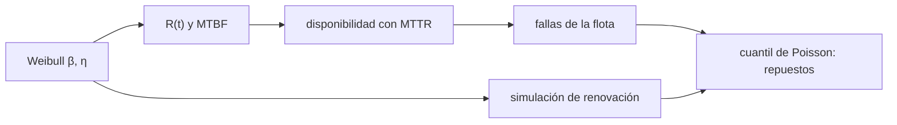

# B59-C18 — Fiabilidad de equipos mineros

<!-- nav:top -->
[🏠 Programa](../../../../README.md) · [📚 Bloque B59](../../../tronco-comun/B59-recursos-in-situ-y-sostenibilidad-extraterrestre.md) · [← Anterior: B59-C17 — Impacto ambiental extraterrestre](../B59-C17-impacto-ambiental-extraterrestre/CLASE.md) · [Siguiente: B59-C19 — Evaluación logística de una instalación →](../B59-C19-evaluacion-logistica-de-una-instalacion/CLASE.md)
<!-- /nav -->

## 1. Ubicación, nivel y alcance

Clase 18 del bloque B59. Nivel N3. Estimas **cuánto duran y cuántos repuestos necesitan** los equipos que excavan y transportan regolito, con la distribución de Weibull, la disponibilidad y una simulación de renovación. Los datos son **sintéticos** ([B12](../../../tronco-comun/B12-probabilidad-estadistica-e-incertidumbre.md)). Continúa [B59-C17](../B59-C17-impacto-ambiental-extraterrestre/CLASE.md).

## 2. Por qué esta clase existe

El regolito es abrasivo y los equipos se desgastan. La decisión central: **¿cuántos repuestos hay que llevar para que una flota cubra una misión de un año con 95 % de confianza?**

## 3. Lo que podrás hacer al terminar

1. Calcular la fiabilidad y el MTBF de una distribución de Weibull.
2. Calcular la disponibilidad con el MTTR.
3. Estimar las fallas de una flota en una misión.
4. Obtener el número de repuestos con el cuantil de Poisson.
5. Contrastar con una simulación de renovación.
6. Interpretar el parámetro de forma (desgaste).

La evidencia es la **ficha de fiabilidad** del ejercicio 12 (sección 20).

## 4. Con qué llegas y cómo comprobarlo

1. ¿Qué es una tasa de falla?
2. ¿Qué es el MTBF?
3. ¿Qué es una distribución de Poisson?
4. ¿Qué es una disponibilidad?
5. ¿Qué es una simulación Monte Carlo?

<details>
<summary>Ver respuestas</summary>

1. La probabilidad de fallar por unidad de tiempo dado que no ha fallado. 2. El tiempo medio entre fallas. 3. La del número de sucesos aleatorios independientes en un intervalo. 4. La fracción del tiempo en que un equipo está operativo. 5. Repetir con números aleatorios de semilla fija.
</details>

Con cuatro o cinco aciertos, sigue; si no, repasa los prerrequisitos.

## 5. Un caso de contexto y casos de referencia

Excavadoras con tiempo hasta la falla de Weibull `β = 1,8`, `η = 800 h` y reparación de `24 h` (todo **sintético**). Es el **ejemplo conductor**. El MTBF es `711,4 h` y la disponibilidad `0,9674`. Una flota de 6 en 8 760 h tiene `71,5` fallas esperadas; el cuantil 95 % de Poisson pide `86` repuestos, mientras que la simulación pide `77`.

## 6. Vocabulario

La **fiabilidad** `R(t)` es la probabilidad de funcionar hasta `t`. Con `β > 1` la tasa de falla crece con el uso (**desgaste**). El **MTTR** es el tiempo medio de reparación. La **disponibilidad** es `MTBF/(MTBF + MTTR)`. Un **proceso de renovación** repone el equipo tras cada reparación.

## 7. Modelo mental: neumáticos que se gastan

Como los neumáticos de un coche: cuanto más km, más probable es que fallen, y se cambian cuando fallan. Límite: aquí el equipo queda «como nuevo» tras la reparación, lo que no siempre ocurre.



*Descripción textual:* los parámetros de Weibull dan fiabilidad y MTBF; con la reparación dan fallas de la flota, de las que salen los repuestos; la simulación lo contrasta.

## 8. La explicación, paso a paso

### 8.1 Weibull

`R(t) = exp[−(t/η)^β]`; `MTBF = η Γ(1 + 1/β) = 800 × 0,8893 = 711,43 h`. El MTBF muestral con 200 000 sorteos es `712,01 h` (+0,08 %). `R(200) = 0,9208`, `R(500) = 0,6511`, `R(800) = 0,3679`, `R(1 500) = 0,0450` (la simulación coincide a `0,001`).

### 8.2 Disponibilidad

`A = 711,43/(711,43 + 24) = 0,9674`.

### 8.3 Fallas en la misión

Por máquina: `8 760/(711,43 + 24) = 11,91`; flota de 6: `71,47`. La simulación de renovación (4 000 misiones) da `69,71` (−2,5 %).

### 8.4 Repuestos

Cuantil 95 % de Poisson con media 71,47: `86` repuestos; el percentil 95 de la simulación: `77`. Con 86, la cobertura real es `100 %`: Poisson es **conservador** porque con `β > 1` las fallas son más regulares que aleatorias.

### 8.5 Efecto de β

Con `β = 1` (fallas aleatorias) y el mismo MTBF, `R(200 h) = 0,7549` frente a `0,9208`: el desgaste concentra las fallas en la vejez y hace aconsejable el mantenimiento preventivo.

## 9. Magnitudes, símbolos y unidades

| Símbolo | Qué es | Unidad | Valor / nota |
|---|---|---|---|
| `β` | forma de Weibull | — | 1,8 (sintética) |
| `η` | escala | h | 800 (sintética) |
| `MTBF` | tiempo medio entre fallas | h | 711,43 |
| `MTTR` | tiempo medio de reparación | h | 24 (sintético) |
| `A` | disponibilidad | — | 0,9674 |
| `N` | equipos | — | 6 |

## 10. Convenciones y referencias

Equipos independientes; reparación perfecta («como nuevo»); sin mantenimiento preventivo ni fallas de causa común; horas de operación.

## 11. De dónde sale lo que afirmamos

| ID | Fuente | Localizador | Respalda | Estado |
|---|---|---|---|---|
| — | No consultado: valores ilustrativos de este laboratorio (se rotulan así en el script y en la clase) | — | parámetros de Weibull, MTTR y tamaño de flota (sintéticos) | No consultado |

Límites: no se consultó ninguna fuente sobre fiabilidad de equipos mineros; los valores son sintéticos.

## 12. Cómo ver la fiabilidad con el tiempo

| `t` [h] | `R(t)` analítica | `R(t)` simulada |
|---|---|---|
| 200 | 0,9208 | 0,9208 |
| 500 | 0,6511 | 0,6520 |
| 800 | 0,3679 | 0,3677 |
| 1 500 | 0,0450 | 0,0452 |

Descripción larga: la fiabilidad cae a 0,37 en `t = η`.

## 13. Ejemplo trabajado: MTBF y disponibilidad

**Paso 1 · Gamma.** `Γ(1 + 1/1,8) = Γ(1,5556) = 0,8893`.

**Paso 2 · MTBF.** `800 × 0,8893 = 711,4 h`.

**Paso 3 · Disponibilidad.** `711,4/735,4 = 0,9674`.

## 14. Distintas formas de resolver el problema

**Poisson:** rápido y conservador. **Simulación de renovación:** más fiel y permite cambiar la política de reparación. Ambos usan los mismos parámetros.

## 15. Práctica guiada

**Ejercicio 1 · con los pasos indicados.** `R(800 h)` (8.1).

<details><summary>Solución comentada</summary>

`e^{−1} = 0,3679`.
</details>

**Ejercicio 2 · con una pista.** MTBF (8.1).

<details><summary>Solución comentada</summary>

`711,4 h`.
</details>

**Ejercicio 3 · casi autónomo.** Disponibilidad (8.2).

<details><summary>Solución comentada</summary>

`0,9674`.
</details>

## 16. Práctica autónoma, transferencia e integrador

**Ejercicio 4.** Fallas por máquina en 8 760 h (8.3).

<details><summary>Solución comentada</summary>

`8 760/735,4 = 11,91`.
</details>

**Ejercicio 5.** Fallas de la flota (8.3).

<details><summary>Solución comentada</summary>

`71,47`.
</details>

**Ejercicio 6.** `R(200 h)` (8.1).

<details><summary>Solución comentada</summary>

`0,9208`.
</details>

**Ejercicio 7.** Repuestos con Poisson al 95 % (8.4).

<details><summary>Solución comentada</summary>

`86`.
</details>

**Ejercicio 8.** `R(200 h)` con `β = 1` y el mismo MTBF (8.5).

<details><summary>Solución comentada</summary>

`0,7549`.
</details>

**Ejercicio 9 · transferencia.** ¿Por qué Poisson da más repuestos que la simulación?

<details><summary>Solución comentada</summary>

Porque con `β > 1` las fallas son más regulares que un proceso de Poisson, así que la varianza real es menor.
</details>

**Ejercicio 10 · transferencia.** Si el MTTR sube a 96 h, ¿cuál es la disponibilidad?

<details><summary>Solución comentada</summary>

`711,43/807,43 = 0,881`.
</details>

**Ejercicio 11 · transferencia.** ¿Qué política cambia si `β > 1`?

<details><summary>Solución comentada</summary>

El mantenimiento preventivo: cambiar piezas antes de que lleguen a la edad de desgaste.
</details>

**Ejercicio 12 · integrador.** Elabora tu *ficha de fiabilidad*: Weibull, MTBF, disponibilidad, fallas de la flota, repuestos por dos métodos y rótulo de lo sintético.

<details><summary>Solución modelo</summary>

Secciones 8.1–8.5.
</details>

## 17. Laboratorio: Weibull, renovación y repuestos

El script [weibull.py](weibull.py) calcula MTBF y fiabilidad (**comprueba** 1 % y `0,005`), simula 4 000 misiones de renovación (3 % de la media) y obtiene los repuestos.

**Datos:** todo **sintético**; semilla `20261109`. **Predice antes de ejecutar:** ¿Poisson sobrestima o subestima los repuestos? (sobrestima.) **Ejecución del 2026-11-09 (Python 3.12.9):**

```text
Python 3.12.9 (biblioteca estandar)
MTBF analitico = eta Gamma(1 + 1/beta) = 711.43 h
MTBF muestral (200 000 sorteos) = 712.01 h ; diferencia = +0.08 %
t [h]   R(t) analitica   R(t) muestral
   200          0.9208         0.9208
   500          0.6511         0.6520
   800          0.3679         0.3677
  1500          0.0450         0.0452
Disponibilidad A = MTBF/(MTBF + MTTR) = 0.9674
Fallas esperadas por maquina en 8760 h = 11.91 ; flota de 6 = 71.47
Simulacion de renovacion (4000 misiones): fallas medias de la flota = 69.71 (Poisson 71.47) ; diferencia -2.46 %
Repuestos para 95 % de confianza: Poisson = 86 ; simulacion (percentil 95) = 77
Cobertura real de 86 repuestos = 100.0 %
Con beta = 1 y la misma MTBF, eta = 711.4 h ; R(200 h) = 0.7549 (frente a 0.9208 con beta = 1,8)
Pruebas superadas.
```

```bash
python programa/clases/B59/B59-C18-fiabilidad-de-equipos-mineros/weibull.py
```

**Límites:** reparación perfecta, equipos independientes, sin mantenimiento preventivo.

## 18. Errores frecuentes y cómo corregirlos

**Usar MTBF como vida útil.** Es un promedio; sección 6.

**Confundir disponibilidad con fiabilidad.** Se corrige con 8.2.

**Aplicar Poisson sin mirar `β`.** Se corrige con 8.4.

**Tomar los parámetros como reales.** Son sintéticos.

## 19. Cómo sabrás que vas bien

Tras la sección 8: ¿qué repuestos esperabas y cuáles obtuviste? Si dudas, repasa el ejemplo 13. Tras el laboratorio: ¿qué comprueba? (ver la sección 17).

## 20. Qué entregas y cómo se evalúa

El producto es tu **ficha de fiabilidad** (ejercicio 12).

| Criterio | Inicial | En desarrollo | Logrado | Destacado |
|---|---|---|---|---|
| Conceptos | Los confunde | Parciales | Conceptos de la clase | Explica los límites |
| Cálculo | Sin unidades | Con errores | Tablas completas | Calcula casos nuevos |
| Numérico | Sin comprobar | Un caso | Contraste con el análisis | Interpreta las diferencias |
| Fuentes | Sin fuente | Sin fecha | Fuentes con fecha | Declara lo ilustrativo |
| Límites | No los nombra | Uno | Tres | Discute qué falta del modelo |

**Condiciones críticas (no se compensan con promedio):** rotular lo sintético; distinguir fiabilidad y disponibilidad; citar solo lo consultado.

## 21. Ética, seguridad y límites

Clase educativa: los modelos son simplificados y no son un procedimiento de operación. Esta clase no certifica ningún equipo. Accesibilidad: tablas equivalentes a las gráficas, fórmulas en texto, ejercicios sin conexión.

## 22. Para cerrar y seguir

Con `β = 1,8` y `η = 800 h`, el MTBF es `711 h`, la disponibilidad `0,967` y una flota de 6 pide entre `77` y `86` repuestos al año. Queda una pregunta: ¿cuánto tarda en amortizarse una planta con estas paradas?

**Glosario español–inglés.** fiabilidad · *reliability*; disponibilidad · *availability*; desgaste · *wear-out*; repuestos · *spares*; proceso de renovación · *renewal process*.

**Continuidad.** [B59-C19](../B59-C19-evaluacion-logistica-de-una-instalacion/CLASE.md) evalúa la logística de una instalación.

**Referencias:** ver sección 11.

<!-- nav:bottom -->
---

[← Anterior: B59-C17 — Impacto ambiental extraterrestre](../B59-C17-impacto-ambiental-extraterrestre/CLASE.md) · [📚 Bloque B59](../../../tronco-comun/B59-recursos-in-situ-y-sostenibilidad-extraterrestre.md) · [Siguiente: B59-C19 — Evaluación logística de una instalación →](../B59-C19-evaluacion-logistica-de-una-instalacion/CLASE.md)
<!-- /nav -->
