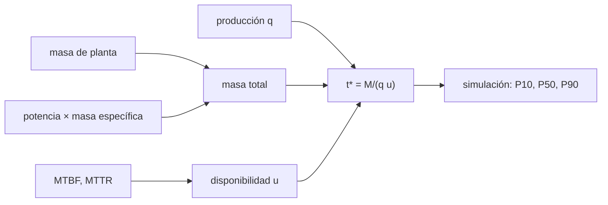

# B59-C19 — Evaluación logística de una instalación

<!-- nav:top -->
[🏠 Programa](../../../../README.md) · [📚 Bloque B59](../../../tronco-comun/B59-recursos-in-situ-y-sostenibilidad-extraterrestre.md) · [← Anterior: B59-C18 — Fiabilidad de equipos mineros](../B59-C18-fiabilidad-de-equipos-mineros/CLASE.md) · [Siguiente: B59-C20 — Diseño conceptual de planta ISRU →](../B59-C20-diseno-conceptual-de-planta-isru/CLASE.md)
<!-- /nav -->

## 1. Ubicación, nivel y alcance

Clase 19 del bloque B59. Nivel N3. Calculas **en cuántos días una planta recupera la masa que costó lanzarla**, incluida la masa de su fuente de potencia y las paradas por fallas. Es un balance logístico con una simulación estocástica. Todos los datos son **ilustrativos**. Continúa [B59-C18](../B59-C18-fiabilidad-de-equipos-mineros/CLASE.md).

## 2. Por qué esta clase existe

Una planta que produce 10 kg/día no se paga sola si está parada. La decisión central: **¿cuántos días de operación hacen falta para que la masa de producto evitada iguale la masa de la planta?**

## 3. Lo que podrás hacer al terminar

1. Sumar la masa de planta y de potencia.
2. Calcular la disponibilidad desde MTBF y MTTR.
3. Obtener el tiempo de amortización analítico.
4. Contrastarlo con una simulación y leer percentiles.
5. Ver que el apalancamiento se cancela cuando es el mismo.
6. Hacer un barrido de sensibilidad.

La evidencia es la **ficha logística** del ejercicio 12 (sección 20).

## 4. Con qué llegas y cómo comprobarlo

1. ¿Qué es una disponibilidad?
2. ¿Qué es una distribución exponencial?
3. ¿Qué es un percentil?
4. ¿Qué es un apalancamiento de masa?
5. ¿Qué es una masa específica?

<details>
<summary>Ver respuestas</summary>

1. La fracción del tiempo operativo. 2. La de un tiempo entre sucesos aleatorios, con tasa constante. 3. El valor bajo el cual cae esa fracción de los datos. 4. Los kg lanzados por kg que llegan a destino. 5. La masa por kW de un equipo.
</details>

Con cuatro o cinco aciertos, sigue; si no, repasa los prerrequisitos.

## 5. Un caso de contexto y casos de referencia

Una planta de `2 000 kg` más `12 kW` de potencia a `30 kg/kW` (total `2 360 kg`) produce `10 kg/día` de producto, con MTBF `600 h` y MTTR `48 h` (todo **ilustrativo**). Es el **ejemplo conductor**. La disponibilidad es `0,9259`, la amortización ideal `236 días` y con paradas `255 días`; la simulación da P10 = `245`, P50 = `254` y P90 = `267` días.

## 6. Vocabulario

La **amortización** (*payback*) es el tiempo en que la masa evitada iguala la masa invertida. La **masa de potencia** es la masa de la fuente que alimenta la planta. El **apalancamiento** `G` convierte masa aterrizada en masa en LEO. Las **paradas** reducen la producción efectiva a `q u`.

## 7. Modelo mental: una máquina que se paga con lo que fabrica

Como una máquina que se paga con lo que fabrica: cada día parada alarga el plazo. Límite: la comparación solo cuenta masa, no energía, riesgo ni coste.



*Descripción textual:* la masa total y la producción efectiva fijan el tiempo de amortización; la simulación da su dispersión por las paradas.

## 8. La explicación, paso a paso

### 8.1 Masa

`M = 2 000 + 12 × 30 = 2 360 kg`. En LEO equivale a `6 × 2 360 = 14 160 kg`.

### 8.2 Disponibilidad y amortización

`u = 600/(600 + 48) = 0,9259`. `t* = M/(q u) = 2 360/(10 × 0,9259) = 255 días` (0,70 años); con `u = 1`, `236 días`. La masa evitada en LEO es `6 × 10 × 0,9259 = 55,6 kg/día`. El apalancamiento `G` se cancela si es el mismo para la planta y el producto.

### 8.3 Simulación

Con 6 000 corridas de un proceso exponencial de marcha/parada: P10 = `245`, P50 = `254`, P90 = `267` días; el P50 coincide con el analítico a `0,4 %`. La disponibilidad simulada es `0,9252`.

### 8.4 Sensibilidad

MTTR × 2 (96 h): `274 días`. Producción −30 %: `364 días`. Masa de potencia +50 %: `274 días`. La producción es el parámetro más sensible.

### 8.5 Lectura

Un plazo de ~255 días con dispersión ±11 días indica una inversión logística pequeña frente a una misión de años, pero no incluye energía de arranque, repuestos ni degradación.

## 9. Magnitudes, símbolos y unidades

| Símbolo | Qué es | Unidad | Valor / nota |
|---|---|---|---|
| `M` | masa total | kg | 2 360 |
| `q` | producción nominal | kg/día | 10 (ilustrativa) |
| `u` | disponibilidad | — | 0,9259 |
| `MTBF, MTTR` | tiempos medios | h | 600; 48 (ilustrativos) |
| `G` | apalancamiento | kg LEO/kg | 6 (ilustrativo) |
| `t*` | amortización | días | 255 |

## 10. Convenciones y referencias

Fallas y reparaciones exponenciales; producción constante en marcha; sin degradación; sin repuestos ni mantenimiento programado.

## 11. De dónde sale lo que afirmamos

| ID | Fuente | Localizador | Respalda | Estado |
|---|---|---|---|---|
| — | No consultado: valores ilustrativos de este laboratorio (se rotulan así en el script y en la clase) | — | todos los parámetros (ilustrativos) | No consultado |

Límites: no se consultó ninguna fuente sobre logística de plantas ISRU; los valores son de ejemplo.

## 12. Cómo ver la dispersión del plazo

| Caso | Días |
|---|---|
| Ideal (u = 1) | 236 |
| Analítico | 255 |
| P10 | 245 |
| P50 | 254 |
| P90 | 267 |

Descripción larga: las paradas añaden unos 19 días y una dispersión de ±11 días.

## 13. Ejemplo trabajado: tiempo de amortización

**Paso 1 · Potencia.** `12 × 30 = 360 kg`.

**Paso 2 · Masa.** `2 000 + 360 = 2 360 kg`.

**Paso 3 · Disponibilidad.** `600/648 = 0,9259`.

**Paso 4 · Plazo.** `2 360/(10 × 0,9259) = 255 días`.

## 14. Distintas formas de resolver el problema

**Analítico:** exacto para la media. **Simulación:** da la dispersión y comprueba la media. El apalancamiento no cambia el plazo si es el mismo.

## 15. Práctica guiada

**Ejercicio 1 · con los pasos indicados.** Masa de potencia (8.1).

<details><summary>Solución comentada</summary>

`12 × 30 = 360 kg`.
</details>

**Ejercicio 2 · con una pista.** Disponibilidad (8.2).

<details><summary>Solución comentada</summary>

`0,9259`.
</details>

**Ejercicio 3 · casi autónomo.** Plazo con `u = 1` (8.2).

<details><summary>Solución comentada</summary>

`2 360/10 = 236 días`.
</details>

## 16. Práctica autónoma, transferencia e integrador

**Ejercicio 4.** Plazo con paradas (8.2).

<details><summary>Solución comentada</summary>

`255 días`.
</details>

**Ejercicio 5.** Masa en LEO equivalente (8.1).

<details><summary>Solución comentada</summary>

`14 160 kg`.
</details>

**Ejercicio 6.** Masa evitada por día en LEO (8.2).

<details><summary>Solución comentada</summary>

`55,6 kg/día`.
</details>

**Ejercicio 7.** Plazo con MTTR = 96 h (8.4).

<details><summary>Solución comentada</summary>

`u = 0,862`; `274 días`.
</details>

**Ejercicio 8.** Plazo con producción −30 % (8.4).

<details><summary>Solución comentada</summary>

`2 360/(7 × 0,9259) = 364 días`.
</details>

**Ejercicio 9 · transferencia.** ¿Qué ancho tiene el intervalo P10–P90?

<details><summary>Solución comentada</summary>

`267 − 245 = 22 días`.
</details>

**Ejercicio 10 · transferencia.** ¿Qué omite el modelo que alargaría el plazo?

<details><summary>Solución comentada</summary>

Repuestos, degradación de la producción, energía de arranque y tiempo de instalación.
</details>

**Ejercicio 11 · transferencia.** Si el apalancamiento de la planta fuera 8 y el del producto 6, ¿cambia el plazo?

<details><summary>Solución comentada</summary>

Sí: sube en `8/6`, a `340 días`.
</details>

**Ejercicio 12 · integrador.** Elabora tu *ficha logística*: masas, disponibilidad, plazo analítico y simulado, percentiles, sensibilidades y rótulo de lo ilustrativo.

<details><summary>Solución modelo</summary>

Secciones 8.1–8.5.
</details>

## 17. Laboratorio: amortización de una planta con paradas

El script [amortizacion.py](amortizacion.py) calcula el plazo analítico, simula 6 000 corridas (**comprueba** 3 % en el P50 y 1 % en la disponibilidad) y barre sensibilidades.

**Datos:** todo **ilustrativo**; semilla `20261109`. **Predice antes de ejecutar:** ¿qué diferencia de plazo hacen las paradas? (≈ 19 días.) **Ejecución del 2026-11-09 (Python 3.12.9):**

```text
Python 3.12.9 (biblioteca estandar)
Masa total = planta 2000 + potencia 360 = 2360 kg ; disponibilidad u = 0.9259
Amortizacion ideal (u = 1) = 236 dias ; con paradas = 255 dias (0.70 anos)
Masa lanzada en LEO equivalente = 14160 kg ; masa en LEO evitada por dia = 55.6 kg
Simulacion (6000 corridas): P10 = 245 ; P50 = 254 ; P90 = 267 dias
Disponibilidad simulada = 0.9252 (analitica 0.9259)
Sensibilidad del tiempo de amortizacion (analitica):
  MTTR x2 (96 h)          :    274 dias
  produccion -30 %        :    364 dias
  masa de potencia +50 %  :    274 dias
Pruebas superadas.
```

```bash
python programa/clases/B59/B59-C19-evaluacion-logistica-de-una-instalacion/amortizacion.py
```

**Límites:** solo masa, exponenciales, producción constante en marcha.

## 18. Errores frecuentes y cómo corregirlos

**Olvidar la masa de la fuente de potencia.** Se corrige con 8.1.

**Usar el plazo ideal sin paradas.** Se corrige con 8.2.

**Dar solo la media sin dispersión.** Se corrige con 8.3.

**Presentar el plazo como una previsión real.** Es ilustrativo.

## 19. Cómo sabrás que vas bien

Tras la sección 8: ¿qué plazo esperabas y cuál obtuviste? Si dudas, repasa el ejemplo 13. Tras el laboratorio: ¿qué comprueba? (ver la sección 17).

## 20. Qué entregas y cómo se evalúa

El producto es tu **ficha logística** (ejercicio 12).

| Criterio | Inicial | En desarrollo | Logrado | Destacado |
|---|---|---|---|---|
| Conceptos | Los confunde | Parciales | Conceptos de la clase | Explica los límites |
| Cálculo | Sin unidades | Con errores | Tablas completas | Calcula casos nuevos |
| Numérico | Sin comprobar | Un caso | Contraste con el análisis | Interpreta las diferencias |
| Fuentes | Sin fuente | Sin fecha | Fuentes con fecha | Declara lo ilustrativo |
| Límites | No los nombra | Uno | Tres | Discute qué falta del modelo |

**Condiciones críticas (no se compensan con promedio):** rotular lo ilustrativo; incluir la potencia; citar solo lo consultado.

## 21. Ética, seguridad y límites

Clase educativa: los modelos son simplificados y no son un procedimiento de operación. Esta clase no valora ninguna instalación real. Accesibilidad: tablas equivalentes a las gráficas, fórmulas en texto, ejercicios sin conexión.

## 22. Para cerrar y seguir

La planta recupera sus `2 360 kg` en `255 días` (P10–P90: `245`–`267`) con las paradas de un MTTR de 48 h. Queda una pregunta: ¿cómo se reúne todo en un diseño?

**Glosario español–inglés.** amortización · *payback*; apalancamiento · *mass leverage*; disponibilidad · *availability*; parada · *downtime*; sensibilidad · *sensitivity*.

**Continuidad.** [B59-C20](../B59-C20-diseno-conceptual-de-planta-isru/CLASE.md) integra el diseño.

**Referencias:** ver sección 11.

<!-- nav:bottom -->
---

[← Anterior: B59-C18 — Fiabilidad de equipos mineros](../B59-C18-fiabilidad-de-equipos-mineros/CLASE.md) · [📚 Bloque B59](../../../tronco-comun/B59-recursos-in-situ-y-sostenibilidad-extraterrestre.md) · [Siguiente: B59-C20 — Diseño conceptual de planta ISRU →](../B59-C20-diseno-conceptual-de-planta-isru/CLASE.md)
<!-- /nav -->
