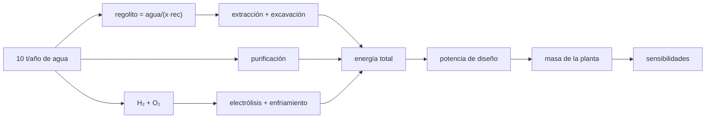

# B59-C20 — Diseño conceptual de planta ISRU

<!-- nav:top -->
[🏠 Programa](../../../../README.md) · [📚 Bloque B59](../../../tronco-comun/B59-recursos-in-situ-y-sostenibilidad-extraterrestre.md) · [← Anterior: B59-C19 — Evaluación logística de una instalación](../B59-C19-evaluacion-logistica-de-una-instalacion/CLASE.md) · [Siguiente: B59-C21 — Almacenamiento criogénico y aislado de volátiles extraídos →](../B59-C21-almacenamiento-criogenico-y-aislado-de-volatiles-extraidos/CLASE.md)
<!-- /nav -->

## 1. Ubicación, nivel y alcance

Clase 20 del bloque B59. Nivel N3. Reúnes lo aprendido en el **diseño conceptual de una planta de agua lunar**: de la abundancia de hielo a la masa de la planta, con un balance de masa que cierra y un libro de energía por partida. Reutiliza los modelos de C02, C06, C07, C10, C19 y C21 con sus supuestos. La abundancia es la observada por LCROSS en un sitio (S1); lo demás es **ilustrativo**. Es el cierre del bloque.

## 2. Por qué esta clase existe

Un diseño conceptual no es un número sino un conjunto coherente. La decisión central: **¿qué potencia y qué masa necesita una planta que produce 10 t de agua al año, y qué parámetro la gobierna?**

## 3. Lo que podrás hacer al terminar

1. Cerrar el balance de masa de agua a hidrógeno y oxígeno.
2. Calcular el regolito a procesar con abundancia y recuperación.
3. Construir un libro de energía por partidas.
4. Obtener la potencia media y de diseño.
5. Calcular la masa de la planta y su amortización.
6. Ordenar los parámetros por sensibilidad.

La evidencia es la **ficha del diseño de planta** del ejercicio 12 (sección 20).

## 4. Con qué llegas y cómo comprobarlo

1. ¿Qué es un balance de masa?
2. ¿Qué es una potencia media?
3. ¿Qué es una disponibilidad?
4. ¿Qué es una sensibilidad?
5. ¿Qué es un valor ilustrativo?

<details>
<summary>Ver respuestas</summary>

1. Lo que entra es igual a lo que sale. 2. La energía anual dividida por las horas del año. 3. La fracción del tiempo operativo. 4. El cambio del resultado por el cambio de un parámetro. 5. Un valor propuesto para el ejemplo, no medido.
</details>

Con cuatro o cinco aciertos, sigue; si no, repasa los prerrequisitos.

## 5. Un caso de contexto y casos de referencia

Meta: `10 000 kg/año` de agua separados en `1 119,0 kg` de H₂ y `8 881,0 kg` de O₂. Es el **ejemplo conductor**. Con abundancia `5,6 %` (S1, observada en un sitio) y recuperación `0,90`, se procesan `198,4 t` de regolito. La energía es `87 101 kWh/año` (extracción `42,7 %`, electrólisis `41,1 %`), la potencia media `9,94 kW` y la de diseño `11,70 kW`; la planta pesa `1 551 kg` y amortiza su masa en `57 días` de producción.

## 6. Vocabulario

El **libro de energía** lista cada partida y su fracción. La **potencia de diseño** es la media dividida por la disponibilidad. La **masa específica** de la potencia convierte kW en kg. Un **diseño conceptual** fija magnitudes y balances, no planos. La **sensibilidad** compara cuánto cambia la masa al variar un parámetro.

## 7. Modelo mental: un presupuesto familiar

Como un presupuesto donde cada partida es un gasto y el total debe cuadrar: se ve qué partida pesa más y qué ahorro importa. Límite: aquí no hay costes monetarios, solo masa y energía.



*Descripción textual:* el objetivo fija el regolito y los productos; cada etapa aporta energía; la suma da la potencia y la masa; un barrido muestra qué parámetro manda.

## 8. La explicación, paso a paso

### 8.1 Balance de masa

`H₂ = 10 000 × 2,01595/18,0153 = 1 119,0 kg`, `O₂ = 8 881,0 kg`; el cierre es exacto (`0`).

### 8.2 Regolito

`10 000/(0,056 × 0,90) = 198,4 t/año`, o `22,6 kg/h`.

### 8.3 Energía

| Partida | kWh/año | Fracción |
|---|---|---|
| Extracción térmica | 37 219 | 42,7 % |
| Purificación | 942 | 1,1 % |
| Electrólisis | 35 831 | 41,1 % |
| Excavación | 9 921 | 11,4 % |
| Enfriamiento de tanques | 3 189 | 3,7 % |
| Total | 87 101 | 100 % |

Energía específica `8,71 kWh/kg` de agua.

### 8.4 Potencia y masa

Potencia media `87 101/8 760 = 9,94 kW`; de diseño con disponibilidad `0,85`, `11,70 kW`. Masa de potencia `351 kg` (30 kg/kW) y equipos `1 200 kg` (ilustrativos, probablemente subestimados): `1 551 kg`. Amortización: `1 551/(10 000/365,25) = 57 días` de producción.

### 8.5 Sensibilidades (masa total)

| Cambio | Regolito [t/año] | Potencia [kW] | Masa [kg] | Δ |
|---|---|---|---|---|
| Producción × 2 | 396,8 | 22,97 | 1 889 | +21,8 % |
| Abundancia 2,7 % | 411,5 | 15,96 | 1 679 | +8,2 % |
| Disponibilidad 0,70 | 198,4 | 14,20 | 1 626 | +4,8 % |
| Recuperación 0,70 | 255,1 | 13,51 | 1 605 | +3,5 % |
| Electrólisis 39,94 kWh/kg | 198,4 | 12,89 | 1 587 | +2,3 % |
| Abundancia 8,5 % | 130,7 | 10,34 | 1 510 | −2,6 % |

### 8.6 Lectura

La extracción térmica y la electrólisis suman el `83,8 %` de la energía. Una abundancia baja pesa más que una alta ayuda: la relación es no lineal (`1/x`). El diseño no incluye operación en la noche lunar, calor para la electrólisis endotérmica, licuefacción, transporte ni repuestos.

## 9. Magnitudes, símbolos y unidades

| Símbolo | Qué es | Unidad | Valor / nota |
|---|---|---|---|
| `x` | abundancia de hielo | — | 0,056 (observada en un sitio, S1) |
| `rec` | recuperación | — | 0,90 (ilustrativa) |
| `W` | agua producida | kg/año | 10 000 (objetivo) |
| `E` | energía total | kWh/año | 87 101 |
| `P_d` | potencia de diseño | kW | 11,70 |
| `M` | masa de la planta | kg | 1 551 |

## 10. Convenciones y referencias

Año de 8 760 h; un solo sitio; separación estequiométrica en H₂ y O₂; sin operación nocturna; valores ilustrativos salvo la abundancia, las constantes y las masas molares.

## 11. De dónde sale lo que afirmamos

| ID | Fuente | Localizador | Respalda | Estado |
|---|---|---|---|---|
| S1 | Colaprete, A. et al., Detection of Water in the LCROSS Ejecta Plume, *Science* 330 (2010) 463–468, DOI 10.1126/science.1186986 | https://experts.arizona.edu/en/publications/detection-of-water-in-the-lcross-ejecta-plume/ | 155 ± 12 kg de agua (vapor + hielo) en el campo de visión; 5,6 ± 2,9 % en masa en el sitio de impacto (Cabeus) | Solo resumen, consultada el 2026-11-09 |
| S2 | NIST, Fundamental Physical Constants, CODATA 2022 (lista ASCII) | https://physics.nist.gov/cuu/Constants/Table/allascii.txt | F = 96 485,332 12… C/mol; R = 8,314 462 618… J/(mol·K); g₀ = 9,806 65 m/s² (exactas) | Consultada (extracto), consultada el 2026-11-09 |
| S3 | NIST, Chemistry WebBook: agua (CAS 7732-18-5), CO₂ (124-38-9), CH₄ (74-82-8) | https://webbook.nist.gov/cgi/cbook.cgi?ID=C7732185 · …C124389 · …C74828 | Entalpías de formación en gas: H₂O −241,826 ± 0,040; CO₂ −393,51 ± 0,13; CH₄ −74,87 kJ/mol; masas molares 18,0153; 44,0095; 16,0425 g/mol | Consultada (extracto), consultada el 2026-11-09 |
| S4 | NIST, Atomic Weights and Isotopic Compositions for All Elements | https://physics.nist.gov/cgi-bin/Compositions/stand_alone.pl | Pesos atómicos estándar (H, C, N, O, Mg, Al, Si, Ca, Ti, Fe); se usa el punto medio del intervalo cuando se da un intervalo | Consultada (extracto), consultada el 2026-11-09 |
| — | No consultado: valores ilustrativos de este laboratorio (se rotulan así en el script y en la clase) | — | objetivo, recuperación, energías de excavación y enfriamiento, disponibilidad y masas de equipos | No consultado |

Límites: solo se leyó el resumen de Colaprete et al.; la abundancia es de un sitio; las masas y las energías de los equipos son de ejemplo.

## 12. Cómo ver el libro de energía

| Partida | kWh/año |
|---|---|
| Extracción térmica | 37 219 |
| Electrólisis | 35 831 |
| Excavación | 9 921 |
| Enfriamiento | 3 189 |
| Purificación | 942 |

Descripción larga: extracción y electrólisis suman el 83,8 % de la energía.

## 13. Ejemplo trabajado: regolito y potencia de diseño

**Paso 1 · Regolito.** `10 000/(0,056 × 0,9) = 198 413 kg`.

**Paso 2 · Energía total.** `87 101 kWh`.

**Paso 3 · Potencia media.** `87 101/8 760 = 9,94 kW`.

**Paso 4 · Diseño.** `9,94/0,85 = 11,70 kW`.

## 14. Distintas formas de resolver el problema

**Balance de masa** y **libro de energía** son verificaciones independientes: uno comprueba la materia y el otro cierra las partidas. La sensibilidad por barrido sustituye a un análisis de incertidumbre completo.

## 15. Práctica guiada

**Ejercicio 1 · con los pasos indicados.** H₂ y O₂ de 10 000 kg de agua (8.1).

<details><summary>Solución comentada</summary>

`1 119,0 kg` y `8 881,0 kg`.
</details>

**Ejercicio 2 · con una pista.** Regolito por año (8.2).

<details><summary>Solución comentada</summary>

`198,4 t`.
</details>

**Ejercicio 3 · casi autónomo.** Regolito por hora (8.2).

<details><summary>Solución comentada</summary>

`198 413/8 760 = 22,6 kg/h`.
</details>

## 16. Práctica autónoma, transferencia e integrador

**Ejercicio 4.** Energía de electrólisis (8.3).

<details><summary>Solución comentada</summary>

`1 119,0 × 32,02 = 35 831 kWh`.
</details>

**Ejercicio 5.** Energía de purificación (8.3).

<details><summary>Solución comentada</summary>

`10 000 × 0,339/3,6 = 942 kWh`.
</details>

**Ejercicio 6.** Energía total (8.3).

<details><summary>Solución comentada</summary>

`87 101 kWh`.
</details>

**Ejercicio 7.** Potencia media (8.4).

<details><summary>Solución comentada</summary>

`9,94 kW`.
</details>

**Ejercicio 8.** Potencia de diseño (8.4).

<details><summary>Solución comentada</summary>

`11,70 kW`.
</details>

**Ejercicio 9 · transferencia.** ¿Qué dos partidas dominan la energía y qué proceso las baja?

<details><summary>Solución comentada</summary>

Extracción térmica y electrólisis (83,8 %); mejores eficiencias de captura de calor y de celda.
</details>

**Ejercicio 10 · transferencia.** Con abundancia 2,7 %, ¿cuánto crece el regolito y la masa?

<details><summary>Solución comentada</summary>

El regolito crece 2,07 veces (`411,5 t`) y la masa `+8,2 %`.
</details>

**Ejercicio 11 · transferencia.** Nombra tres cosas que el diseño omite.

<details><summary>Solución comentada</summary>

Operación en la noche lunar, calor para la electrólisis endotérmica y licuefacción/transporte; también repuestos y fiabilidad.
</details>

**Ejercicio 12 · integrador.** Elabora tu *ficha del diseño de planta*: objetivo, balances de masa y energía, potencia y masa, tres sensibilidades y los límites del diseño.

<details><summary>Solución modelo</summary>

Secciones 8.1–8.6; incluye el rótulo de que todo es ilustrativo salvo la abundancia y las constantes.
</details>

## 17. Laboratorio: dimensionado de extremo a extremo

El script [planta.py](planta.py) calcula regolito, energías, potencia y masa, comprueba el cierre de masa (**`10⁻⁹`**) y de energía (**`10⁻⁹`**) y barre seis sensibilidades.

**Datos:** abundancia **observada** (S1, resumen); constantes y masas molares **citadas** (S2–S4); lo demás **ilustrativo**. **Predice antes de ejecutar:** ¿qué parámetro, al variar un factor 2, pesa más en la masa? (la producción.) **Ejecución del 2026-11-09 (Python 3.12.9):**

```text
Python 3.12.9 (biblioteca estandar)
Agua producida = 10000 kg/año -> H2 = 1119.0 kg ; O2 = 8881.0 kg ; cierre de masa 0.0e+00
Regolito a procesar = 198.4 t/año (22.6 kg/h)
Partida de energia             kWh/año   fraccion
  extraccion termica              37219     42.7 %
  purificacion                      942      1.1 %
  electrolisis                    35831     41.1 %
  excavacion                       9921     11.4 %
  enfriamiento de tanques          3189      3.7 %
Energia total = 87101 kWh/año ; potencia media = 9.94 kW ; de diseno (disponibilidad 0.85) = 11.70 kW
Masa: equipos 1200 kg + potencia 351 kg = 1551 kg
Energia especifica = 8.71 kWh por kg de agua producida
Amortizacion de la masa de la planta en masa de producto (misma G para planta y producto): 57 dias
Sensibilidades (masa total de la planta):
  abundancia 2,7 %          : regolito   411.5 t/año ; potencia diseno  15.96 kW ; masa    1679 kg (  +8.2 %)
  abundancia 8,5 %          : regolito   130.7 t/año ; potencia diseno  10.34 kW ; masa    1510 kg (  -2.6 %)
  recuperacion 0,70         : regolito   255.1 t/año ; potencia diseno  13.51 kW ; masa    1605 kg (  +3.5 %)
  electrolisis 39,94 kWh/kg : regolito   198.4 t/año ; potencia diseno  12.89 kW ; masa    1587 kg (  +2.3 %)
  disponibilidad 0,70       : regolito   198.4 t/año ; potencia diseno  14.20 kW ; masa    1626 kg (  +4.8 %)
  produccion x2             : regolito   396.8 t/año ; potencia diseno  22.97 kW ; masa    1889 kg ( +21.8 %)
Pruebas superadas.
```

```bash
python programa/clases/B59/B59-C20-diseno-conceptual-de-planta-isru/planta.py
```

**Límites:** un solo sitio, régimen estacionario, sin noche lunar, sin transporte, masas de equipos ilustrativas.

## 18. Errores frecuentes y cómo corregirlos

**Presentar el diseño como el de una planta real.** Es conceptual e ilustrativo.

**Olvidar la disponibilidad al calcular la potencia.** Se corrige con 8.4.

**Usar la abundancia de un sitio para toda la Luna.** Se corrige con la sección 10.

**Dar solo el caso central.** Se corrige con 8.5.

## 19. Cómo sabrás que vas bien

Tras la sección 8: ¿qué potencia esperabas y cuál obtuviste? Si dudas, repasa el ejemplo 13. Tras el laboratorio: ¿qué comprueba? (ver la sección 17).

## 20. Qué entregas y cómo se evalúa

El producto es tu **ficha del diseño de planta** (ejercicio 12).

| Criterio | Inicial | En desarrollo | Logrado | Destacado |
|---|---|---|---|---|
| Conceptos | Los confunde | Parciales | Conceptos de la clase | Explica los límites |
| Cálculo | Sin unidades | Con errores | Tablas completas | Calcula casos nuevos |
| Numérico | Sin comprobar | Un caso | Contraste con el análisis | Interpreta las diferencias |
| Fuentes | Sin fuente | Sin fecha | Fuentes con fecha | Declara lo ilustrativo |
| Límites | No los nombra | Uno | Tres | Discute qué falta del modelo |

**Condiciones críticas (no se compensan con promedio):** rotular lo ilustrativo y lo observado; cerrar los balances; presentar sensibilidades; no presentar el diseño como real; citar solo lo consultado.

## 21. Ética, seguridad y límites

Clase educativa: los modelos son simplificados y no son un procedimiento de operación. El diseño no es una oferta ni una evaluación de sitio; el derecho espacial y la protección planetaria (C17) condicionan cualquier uso real. Accesibilidad: tablas equivalentes a las gráficas, fórmulas en texto, ejercicios sin conexión.

## 22. Para cerrar y seguir

Una planta ilustrativa que produce `10 t/año` de agua exige `198 t` de regolito, `87 MWh/año` (`11,7 kW` de diseño) y `1 551 kg`, y se amortiza en `57 días` de producción; la producción y la abundancia son los parámetros que más pesan. Con esto termina el bloque.

**Glosario español–inglés.** diseño conceptual · *conceptual design*; libro de energía · *energy ledger*; potencia de diseño · *design power*; sensibilidad · *sensitivity*; planta · *plant*.

**Continuidad.** El bloque B59 termina aquí; el siguiente es [B60](../../../tronco-comun/B60-cinetica-y-modelado-astroquimico.md).

**Referencias:** ver sección 11.

<!-- nav:bottom -->
---

[← Anterior: B59-C19 — Evaluación logística de una instalación](../B59-C19-evaluacion-logistica-de-una-instalacion/CLASE.md) · [📚 Bloque B59](../../../tronco-comun/B59-recursos-in-situ-y-sostenibilidad-extraterrestre.md) · [Siguiente: B59-C21 — Almacenamiento criogénico y aislado de volátiles extraídos →](../B59-C21-almacenamiento-criogenico-y-aislado-de-volatiles-extraidos/CLASE.md)
<!-- /nav -->
