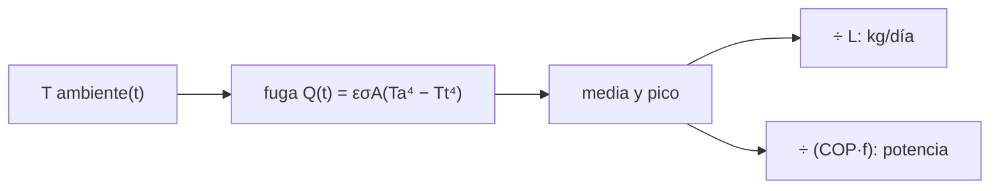

# B59-C21 — Almacenamiento criogénico y aislado de volátiles extraídos

<!-- nav:top -->
[🏠 Programa](../../../../README.md) · [📚 Bloque B59](../../../tronco-comun/B59-recursos-in-situ-y-sostenibilidad-extraterrestre.md) · [← Anterior: B59-C20 — Diseño conceptual de planta ISRU](../../../tronco-comun/B59-recursos-in-situ-y-sostenibilidad-extraterrestre.md#b59-c20) · [Siguiente: B59-C22 — Beneficio y separación granulométrica de regolito →](../B59-C22-beneficio-y-separacion-granulometrica-de-regolito/CLASE.md)
<!-- /nav -->

## 1. Ubicación, nivel y alcance

Clase 21 del bloque B59. Nivel N3. Calculas **cuánto se evapora un tanque criogénico** por la radiación del entorno y cuánta potencia eléctrica exige un refrigerador que lo evite. Usas la ley de Stefan–Boltzmann con `σ` de NIST (S1) y un ambiente sintético que oscila durante un ciclo día–noche. Continúa [B59-C06](../B59-C06-extraccion-y-procesamiento-de-volatiles/CLASE.md).

## 2. Por qué esta clase existe

Lo extraído sirve si se conserva. La decisión central: **¿se acepta la evaporación o se paga la potencia de un refrigerador de cero evaporación?**

## 3. Lo que podrás hacer al terminar

1. Calcular la fuga radiativa hacia un tanque frío.
2. Promediar `T⁴` de un ambiente oscilante y verificarlo con la fórmula.
3. Convertir fuga de calor en masa evaporada con el calor latente.
4. Calcular la potencia de un refrigerador con COP de Carnot y fracción de Carnot.
5. Dimensionar con el pico y no con la media.
6. Estimar el tiempo hasta perder un 10 %.

La evidencia es la **ficha del almacenamiento criogénico** del ejercicio 12 (sección 20).

## 4. Con qué llegas y cómo comprobarlo

1. ¿Qué dice la ley de Stefan–Boltzmann?
2. ¿Qué es un calor latente de evaporación?
3. ¿Qué es un COP?
4. ¿Qué es una media temporal?
5. ¿Qué es un valor ilustrativo?

<details>
<summary>Ver respuestas</summary>

1. La potencia radiada por área es `εσT⁴`. 2. La energía por kg para pasar de líquido a vapor. 3. El calor extraído por unidad de trabajo. 4. El promedio de una magnitud sobre un periodo. 5. Un valor propuesto para el ejemplo, no medido.
</details>

Con cuatro o cinco aciertos, sigue; si no, repasa los prerrequisitos.

## 5. Un caso de contexto y casos de referencia

Un tanque esférico de **1 m de radio** (`4 779 kg` de oxígeno líquido a 90 K) con aislamiento multicapa de emisividad efectiva `0,005`, en un ambiente sintético `250 ± 100 K` con periodo 29,5 días. Es el **ejemplo conductor**. La fuga media es `20,50 W`, la evaporación `8,31 kg/día` (`5,13 %` del líquido por ciclo) y el refrigerador de cero evaporación necesita `182 W` medios, `473 W` para el pico.

## 6. Vocabulario

La **evaporación (*boil-off*)** es el líquido que se vaporiza por el calor que entra. El **aislamiento multicapa** son láminas reflectantes que reducen la radiación. Un **refrigerador de cero evaporación** extrae el calor que entra. El **COP de Carnot** es `T_c/(T_h − T_c)`. La **fracción de Carnot** es el cociente entre el COP real y el ideal.

## 7. Modelo mental: un termo con una fuga lenta

Como un termo que deja pasar un poco de calor y pierde hielo: un refrigerador sería una nevera enchufada que lo repone. Límite: el termo no tiene que rechazar el calor a 250 K.



*Descripción textual:* el ambiente da la fuga radiativa; su media da la evaporación y su pico, la potencia de dimensionado.

## 8. La explicación, paso a paso

### 8.1 Geometría

`A = 4πR² = 12,566 m²`, `V = 4,189 m³`; masa de líquido `ρV = 4 779 kg`.

### 8.2 Fuga

`Q(t) = ε σ A (T_amb⁴ − T_t⁴)` con `σ = 5,670 374 419 × 10⁻⁸ W/(m² K⁴)` (S1). Para `T_amb = T₀ + a sin ωt`, la media de `T⁴` es `T₀⁴ + 3 T₀² a² + 3a⁴/8 = 5,81875 × 10⁹ K⁴`; la integración numérica coincide con error relativo `10⁻¹⁵`. La fuga media es `20,4973 W`.

### 8.3 Evaporación

`Q/L × 86 400 = 8,314 kg/día`; en 29,5 días `245,3 kg` (`5,13 %`). En la noche (150 K) la fuga es `1,57 W` (`0,64 kg/día`) y en el día (350 K), `53,23 W` (`21,59 kg/día`): el día pesa 34 veces más.

### 8.4 Refrigerador

El COP de Carnot es `90/(250 − 90) = 0,5625`; con fracción `0,20`, la potencia eléctrica media es `20,50/(0,5625 × 0,20) = 182,2 W`. Para el pico (`350 K`, `53,23 W`) el dimensionado exige `473 W`.

### 8.5 Sin refrigerador

Perder el 10 % del líquido tarda `0,1 × 4 779/8,314 = 57 días`.

## 9. Magnitudes, símbolos y unidades

| Símbolo | Qué es | Unidad | Valor / nota |
|---|---|---|---|
| `σ` | constante de Stefan–Boltzmann | W/(m²·K⁴) | 5,670 374 419 × 10⁻⁸ (NIST) |
| `ε` | emisividad efectiva | — | 0,005 (ilustrativa) |
| `T_t` | temperatura del tanque | K | 90 |
| `L` | calor de evaporación | kJ/kg | 213 (ilustrativo) |
| `f` | fracción de Carnot | — | 0,20 (ilustrativa) |
| `Q` | fuga media | W | 20,50 |

## 10. Convenciones y referencias

Radiación solamente (sin conducción por soportes); ambiente sintético `250 + 100 sin(2πt/29,5 d)`; rechazo de calor a 250 K; unidades SI.

## 11. De dónde sale lo que afirmamos

| ID | Fuente | Localizador | Respalda | Estado |
|---|---|---|---|---|
| S1 | NIST, Fundamental Physical Constants, CODATA 2022 (lista ASCII) | https://physics.nist.gov/cuu/Constants/Table/allascii.txt | F = 96 485,332 12… C/mol; R = 8,314 462 618… J/(mol·K); g₀ = 9,806 65 m/s² (exactas) | Consultada (extracto), consultada el 2026-11-09 |
| — | No consultado: valores ilustrativos de este laboratorio (se rotulan así en el script y en la clase) | — | geometría, emisividad, densidad, calor latente y ambiente | No consultado |

Límites: solo se consultó `σ`; el calor latente y la emisividad del aislamiento no se consultaron.

## 12. Cómo ver la fuga durante el ciclo

| Situación | Fuga [W] | Evaporación [kg/día] |
|---|---|---|
| Noche (150 K) | 1,57 | 0,64 |
| Media del ciclo | 20,50 | 8,31 |
| Día (350 K) | 53,23 | 21,59 |

Descripción larga: la fuga del día es unas 34 veces la de la noche.

## 13. Ejemplo trabajado: promedio de `T⁴`

**Paso 1 · Términos.** `250⁴ = 3,90625 × 10⁹`; `3 × 250² × 100² = 1,875 × 10⁹`; `3 × 100⁴/8 = 3,75 × 10⁷`.

**Paso 2 · Suma.** `5,81875 × 10⁹ K⁴`.

**Paso 3 · Fuga.** `0,005 × 5,67 × 10⁻⁸ × 12,566 × 5,7582 × 10⁹ = 20,5 W`.

## 14. Distintas formas de resolver el problema

**Integración numérica** (200 000 pasos) y **fórmula analítica** de la media coinciden. Con cero evaporación se paga potencia; sin él se paga masa. Un tanque con más aislamiento reduce ambos.

## 15. Práctica guiada

**Ejercicio 1 · con los pasos indicados.** Área de la esfera de 1 m (8.1).

<details><summary>Solución comentada</summary>

`4π = 12,566 m²`.
</details>

**Ejercicio 2 · con una pista.** Masa de líquido (8.1).

<details><summary>Solución comentada</summary>

`1 141 × 4,189 = 4 779 kg`.
</details>

**Ejercicio 3 · casi autónomo.** Media de `T⁴` (8.2).

<details><summary>Solución comentada</summary>

`5,81875 × 10⁹ K⁴`.
</details>

## 16. Práctica autónoma, transferencia e integrador

**Ejercicio 4.** Evaporación diaria con `Q = 20,50 W` (8.3).

<details><summary>Solución comentada</summary>

`20 497/213 000 × 86 400 = 8,31 kg/día`.
</details>

**Ejercicio 5.** Fracción perdida en un ciclo (8.3).

<details><summary>Solución comentada</summary>

`245,3/4 779 = 5,13 %`.
</details>

**Ejercicio 6.** COP de Carnot (8.4).

<details><summary>Solución comentada</summary>

`90/160 = 0,5625`.
</details>

**Ejercicio 7.** Potencia media del refrigerador (8.4).

<details><summary>Solución comentada</summary>

`20,50/(0,5625 × 0,20) = 182 W`.
</details>

**Ejercicio 8.** Días para perder el 10 % (8.5).

<details><summary>Solución comentada</summary>

`57 días`.
</details>

**Ejercicio 9 · transferencia.** Si la emisividad efectiva se duplica, ¿qué pasa con la evaporación?

<details><summary>Solución comentada</summary>

Se duplica (`≈ 16,6 kg/día`), porque la fuga es proporcional a `ε`.
</details>

**Ejercicio 10 · transferencia.** ¿Por qué se dimensiona con el pico y no con la media?

<details><summary>Solución comentada</summary>

Porque el refrigerador debe extraer el calor en el momento de máxima entrada; con la media el tanque se evaporaría de día.
</details>

**Ejercicio 11 · transferencia.** Si el rechazo de calor se hiciera a 200 K en vez de 250 K, ¿cambia la potencia?

<details><summary>Solución comentada</summary>

Sí: el COP de Carnot sube a `90/110 = 0,818` y la potencia baja un 31 %.
</details>

**Ejercicio 12 · integrador.** Elabora tu *ficha del almacenamiento criogénico*: fuga, evaporación, potencia del refrigerador, pico, tiempo de pérdida y rótulo de lo ilustrativo.

<details><summary>Solución modelo</summary>

Secciones 8.1–8.5.
</details>

## 17. Laboratorio: fuga y refrigerador de un tanque criogénico

El script [criogenia.py](criogenia.py) integra la fuga radiativa en un ciclo, la compara con la fórmula analítica de la media (**comprueba** `10⁻⁶`) y calcula la evaporación y la potencia.

**Datos:** `σ` de NIST (S1); el resto **ilustrativo**; ambiente **sintético**. **Predice antes de ejecutar:** ¿cuántas veces mayor es la fuga de día que la de noche? (≈ 34.) **Ejecución del 2026-11-09 (Python 3.12.9):**

```text
Python 3.12.9 (biblioteca estandar)
Area = 12.566 m^2 ; volumen = 4.189 m^3 ; masa de liquido = 4779 kg
<T^4> numerica = 5.818750e+09 K^4 ; analitica = 5.818750e+09 K^4 ; error relativo = 1.3e-15
Fuga media Q = 20.4973 W (analitica 20.4973 W)
Evaporacion media = 8.3144 kg/dia ; en un ciclo de 29.5 dias = 245.27 kg (5.13 % del liquido)
Fuga en noche 150 K: 1.5699 W (0.6368 kg/dia)
Fuga en dia 350 K: 53.2305 W (21.5921 kg/dia)
COP de Carnot = 0.5625 ; potencia electrica para cero evaporacion = 182.198 W (media)
Fuga maxima (T = 350 K) = 53.2305 W ; potencia de dimensionado = 473.160 W
Tiempo para perder el 10 % sin refrigerador = 57 dias
Pruebas superadas.
```

```bash
python programa/clases/B59/B59-C21-almacenamiento-criogenico-y-aislado-de-volatiles-extraidos/criogenia.py
```

**Límites:** solo radiación, ambiente sinusoidal, sin conducción, sin estratificación del líquido.

## 18. Errores frecuentes y cómo corregirlos

**Promediar `T` y luego elevar a la cuarta.** Se corrige con 8.2: se promedia `T⁴`.

**Dimensionar el refrigerador con la media.** Se corrige con 8.4.

**Olvidar la fracción de Carnot.** Se corrige con 8.4.

**Tomar el ambiente como medido.** Es sintético.

## 19. Cómo sabrás que vas bien

Tras la sección 8: ¿qué fuga esperabas y cuál obtuviste? Si dudas, repasa el ejemplo 13. Tras el laboratorio: ¿qué comprueba? (ver la sección 17).

## 20. Qué entregas y cómo se evalúa

El producto es tu **ficha del almacenamiento criogénico** (ejercicio 12).

| Criterio | Inicial | En desarrollo | Logrado | Destacado |
|---|---|---|---|---|
| Conceptos | Los confunde | Parciales | Conceptos de la clase | Explica los límites |
| Cálculo | Sin unidades | Con errores | Tablas completas | Calcula casos nuevos |
| Numérico | Sin comprobar | Un caso | Contraste con el análisis | Interpreta las diferencias |
| Fuentes | Sin fuente | Sin fecha | Fuentes con fecha | Declara lo ilustrativo |
| Límites | No los nombra | Uno | Tres | Discute qué falta del modelo |

**Condiciones críticas (no se compensan con promedio):** rotular el ambiente como sintético; dimensionar con el pico; citar solo lo consultado.

## 21. Ética, seguridad y límites

Clase educativa: los modelos son simplificados y no son un procedimiento de operación. El oxígeno líquido es un oxidante potente; esta clase no es un procedimiento de manejo. Accesibilidad: tablas equivalentes a las gráficas, fórmulas en texto, ejercicios sin conexión.

## 22. Para cerrar y seguir

La fuga media de `20,5 W` evapora `8,3 kg/día` y evitarlo exige `182 W` medios, `473 W` en el pico. Queda una pregunta: ¿cómo se limpia el agua extraída?

**Glosario español–inglés.** evaporación · *boil-off*; aislamiento multicapa · *multilayer insulation*; refrigerador · *cryocooler*; fracción de Carnot · *fraction of Carnot*; emisividad · *emissivity*.

**Continuidad.** [B59-C07](../B59-C07-purificacion-de-agua/CLASE.md) trata la purificación.

**Referencias:** ver sección 11.

<!-- nav:bottom -->
---

[← Anterior: B59-C20 — Diseño conceptual de planta ISRU](../../../tronco-comun/B59-recursos-in-situ-y-sostenibilidad-extraterrestre.md#b59-c20) · [📚 Bloque B59](../../../tronco-comun/B59-recursos-in-situ-y-sostenibilidad-extraterrestre.md) · [Siguiente: B59-C22 — Beneficio y separación granulométrica de regolito →](../B59-C22-beneficio-y-separacion-granulometrica-de-regolito/CLASE.md)
<!-- /nav -->
