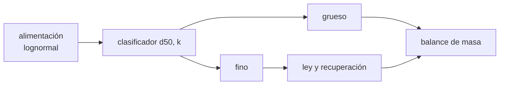

# B59-C22 — Beneficio y separación granulométrica de regolito

<!-- nav:top -->
[🏠 Programa](../../../../README.md) · [📚 Bloque B59](../../../tronco-comun/B59-recursos-in-situ-y-sostenibilidad-extraterrestre.md) · [← Anterior: B59-C21 — Almacenamiento criogénico y aislado de volátiles extraídos](../B59-C21-almacenamiento-criogenico-y-aislado-de-volatiles-extraidos/CLASE.md) · [Siguiente: B59-C23 — Subproductos y flujos residuales de procesos ISRU →](../B59-C23-subproductos-y-flujos-residuales-de-procesos-isru/CLASE.md)
<!-- /nav -->

## 1. Ubicación, nivel y alcance

Clase 22 del bloque B59. Nivel N3. Aprendes a **preparar el regolito antes de procesarlo**: separar por tamaño con una curva de partición, y medir qué recuperas y con qué ley. Parte de la distribución de [B59-C04](../B59-C04-caracterizacion-de-regolito-lunar/CLASE.md). Todo es **sintético o ilustrativo**.

## 2. Por qué esta clase existe

Calentar o reducir todo el regolito es caro; separar la fracción rica antes ahorra energía. La decisión central: **¿qué tamaño de corte equilibra la ley del concentrado y la recuperación del mineral?**

## 3. Lo que podrás hacer al terminar

1. Describir una curva de partición con tamaño de corte y agudeza.
2. Integrar la partición sobre una distribución en masa.
3. Calcular rendimiento, ley y recuperación de cada producto.
4. Cerrar el balance de masa y de mineral.
5. Contrastar la cuadratura con Monte Carlo y con el límite de corte nítido.
6. Leer el compromiso ley–recuperación al variar `d50`.

La evidencia es la **ficha del beneficio** del ejercicio 12 (sección 20).

## 4. Con qué llegas y cómo comprobarlo

1. ¿Qué es una distribución lognormal?
2. ¿Qué es una ley (grado)?
3. ¿Qué es una recuperación?
4. ¿Qué es una cuadratura numérica?
5. ¿Qué es un valor sintético?

<details>
<summary>Ver respuestas</summary>

1. Una cuyo logaritmo es normal. 2. La fracción másica del mineral objetivo en un producto. 3. La fracción del mineral de la alimentación que acaba en el producto. 4. Aproximar una integral sumando áreas pequeñas. 5. Un valor generado por cálculo, no medido.
</details>

Con cuatro o cinco aciertos, sigue; si no, repasa los prerrequisitos.

## 5. Un caso de contexto y casos de referencia

Se alimenta un regolito sintético (mediana en masa 70 µm, GSD 2,6) a un clasificador con **corte `d50 = 75 µm`** y agudeza `k = 4`. Es el **ejemplo conductor**. El `52,61 %` de la masa va al fino, con ley `11,49 %` frente a `7,97 %` de la alimentación: recuperación `75,88 %` y enriquecimiento `1,442`. La ley depende del tamaño por construcción: la ilustración no describe un mineral real.

## 6. Vocabulario

La **curva de partición** (de Tromp) da la probabilidad de que un grano de tamaño `d` vaya a un producto. El **tamaño de corte** `d50` es el tamaño con probabilidad 0,5. La **imperfección** es `I = (d25 − d75)/(2 d50)`. El **rendimiento másico** es la fracción de la alimentación que forma el producto. La **razón de enriquecimiento** es la ley del producto sobre la de la alimentación.

## 7. Modelo mental: un colador con agujeros imperfectos

Como un colador cuyos agujeros no son todos iguales: pasa casi toda la harina fina y algo de la gruesa. Límite: aquí solo cuenta el tamaño; una separación magnética o electrostática usa otras propiedades.



*Descripción textual:* la alimentación se parte en fino y grueso con una probabilidad dependiente del tamaño; cada producto se evalúa y el balance debe cerrar.

## 8. La explicación, paso a paso

### 8.1 Partición

`P_f(d) = 1/(1 + (d/d50)^k)`: probabilidad de ir al fino. Con `d50 = 75 µm` y `k = 4`: `d25 = 98,7 µm` y `d75 = 57,0 µm` (los tamaños con 25 % y 75 % de probabilidad de ir al grueso), de modo que `I = 0,278`.

### 8.2 Rendimiento y leyes

Sobre la distribución en masa (normal en `ln d`): rendimiento fino `52,61 %`, grueso `47,39 %`. Con la ley ilustrativa `g(d) = 0,02 + 0,18/(1 + (d/40)²)`: alimentación `7,97 %`, fino `11,49 %`, grueso `4,05 %`.

### 8.3 Recuperación y cierre

Recuperación en el fino `75,88 %`, enriquecimiento `1,442`. El balance de mineral cierra: `0,5261 × 11,49 + 0,4739 × 4,05 = 7,97 %` (el laboratorio lo cierra a cero).

### 8.4 Comprobaciones

Con `k = 400` (corte nítido) la cuadratura da `0,52878`, igual al valor analítico `Φ((ln d50 − μ_m)/σ) = 0,52878`. Monte Carlo con 300 000 granos da `52,61 %` y `75,89 %`.

### 8.5 Compromiso

`d50 = 50 µm`: fino `37,47 %`, ley `13,06 %`, recuperación `61,41 %`. `d50 = 100 µm`: fino `63,26 %`, ley `10,54 %`, recuperación `83,68 %`. Más corte: más recuperación y menos ley.

## 9. Magnitudes, símbolos y unidades

| Símbolo | Qué es | Unidad | Valor / nota |
|---|---|---|---|
| `d50` | tamaño de corte | µm | 75 (ilustrativo) |
| `k` | agudeza | — | 4 (ilustrativa) |
| `P_f` | probabilidad de ir al fino | — | 0–1 |
| `g` | ley | fracción másica | 7,97 % / 11,49 % / 4,05 % |
| `R` | recuperación | — | 75,88 % |
| `I` | imperfección | — | 0,278 |

## 10. Convenciones y referencias

Distribución en masa; granos esféricos; ley función solo del tamaño; semilla `20261109`; sin arrastre de finos al grueso más allá de la curva.

## 11. De dónde sale lo que afirmamos

| ID | Fuente | Localizador | Respalda | Estado |
|---|---|---|---|---|
| — | No consultado: valores ilustrativos de este laboratorio (se rotulan así en el script y en la clase) | — | distribución, curva de partición y ley (sintéticas) | No consultado |

Límites: no se consultó ninguna fuente sobre tamizado o separación en regolito real.

## 12. Cómo ver el compromiso ley–recuperación

| `d50` [µm] | Fino [%] | Ley fino [%] | Recuperación [%] |
|---|---|---|---|
| 50 | 37,47 | 13,06 | 61,41 |
| 75 | 52,61 | 11,49 | 75,88 |
| 100 | 63,26 | 10,54 | 83,68 |

Descripción larga: al subir el corte, la recuperación crece y la ley baja.

## 13. Ejemplo trabajado: cierre del balance de mineral

**Paso 1 · Mineral en el fino.** `0,5261 × 11,49 = 6,045`.

**Paso 2 · En el grueso.** `0,4739 × 4,05 = 1,919`.

**Paso 3 · Suma.** `7,964 ≈ 7,97 %` (redondeo).

**Paso 4 · Recuperación.** `6,045/7,97 = 75,9 %`.

## 14. Distintas formas de resolver el problema

**Cuadratura:** exacta y rápida. **Monte Carlo:** coincide a `0,01` pp con 300 000 granos. **Corte nítido analítico:** valida el código en el límite `k → ∞`.

## 15. Práctica guiada

**Ejercicio 1 · con los pasos indicados.** Rendimiento del grueso (8.2).

<details><summary>Solución comentada</summary>

`100 − 52,61 = 47,39 %`.
</details>

**Ejercicio 2 · con una pista.** Razón de enriquecimiento (8.3).

<details><summary>Solución comentada</summary>

`11,49/7,97 = 1,442`.
</details>

**Ejercicio 3 · casi autónomo.** Cierra el balance de mineral (8.3).

<details><summary>Solución comentada</summary>

`0,5261 × 11,49 + 0,4739 × 4,05 = 7,96 ≈ 7,97 %`.
</details>

## 16. Práctica autónoma, transferencia e integrador

**Ejercicio 4.** Calcula `d25` (8.1).

<details><summary>Solución comentada</summary>

`75 × 3^{1/4} = 98,7 µm`.
</details>

**Ejercicio 5.** Calcula `d75` (8.1).

<details><summary>Solución comentada</summary>

`75/3^{1/4} = 57,0 µm`.
</details>

**Ejercicio 6.** Calcula la imperfección (8.1).

<details><summary>Solución comentada</summary>

`(98,7 − 57,0)/150 = 0,278`.
</details>

**Ejercicio 7.** Con `1 000 kg` de alimentación, ¿cuánto fino sale? (8.2)

<details><summary>Solución comentada</summary>

`526 kg`.
</details>

**Ejercicio 8.** ¿Cuánto mineral hay en ese fino? (8.3)

<details><summary>Solución comentada</summary>

`1 000 × 0,0797 × 0,7588 = 60,5 kg`.
</details>

**Ejercicio 9 · transferencia.** Se exige una ley de fino de `12 %`. ¿Hacia qué `d50` hay que mover el corte?

<details><summary>Solución comentada</summary>

Hacia menor tamaño, cerca de `67 µm` por interpolación lineal entre 50 y 75 µm (orientativo); la recuperación baja a ≈ 70 %.
</details>

**Ejercicio 10 · transferencia.** ¿Por qué el límite nítido es una buena prueba del código?

<details><summary>Solución comentada</summary>

Tiene solución analítica independiente (`Φ`), así que detecta errores de cuadratura.
</details>

**Ejercicio 11 · transferencia.** ¿Qué cambia si el mineral objetivo estuviera en el grueso?

<details><summary>Solución comentada</summary>

La ley y la recuperación se invierten; el mismo corte serviría para el producto grueso.
</details>

**Ejercicio 12 · integrador.** Elabora tu *ficha del beneficio*: curva de partición, leyes, recuperación, balance cerrado y compromiso al variar `d50`.

<details><summary>Solución modelo</summary>

Secciones 8.1–8.5.
</details>

## 17. Laboratorio: partición granulométrica sintética

El script [beneficio.py](beneficio.py) integra la curva de partición sobre una distribución lognormal, la contrasta con el corte nítido analítico y con Monte Carlo (**comprueba** `10⁻³`, cierre `10⁻¹²` y `5 × 10⁻³`).

**Datos:** todo **sintético / ilustrativo**; semilla `20261109`. **Predice antes de ejecutar:** ¿sube o baja la ley del fino al aumentar `d50`? (baja.) **Ejecución del 2026-11-09 (Python 3.12.9):**

```text
Python 3.12.9 (biblioteca estandar)
Fraccion en masa al producto fino con corte nitido: cuadratura = 0.52878 ; analitica Phi = 0.52878
Tamano de corte d50 = 75 µm ; agudeza k = 4
Rendimiento masico: fino = 52.61 % ; grueso = 47.39 % (suma 100.00 %)
Ley de alimentacion = 7.97 % ; ley del fino = 11.49 % ; ley del grueso = 4.05 %
Recuperacion del mineral objetivo en el fino = 75.88 % ; razon de enriquecimiento = 1.442
Cierre del balance de mineral (alim - productos) = 0.00e+00
Monte Carlo (300000 granos): rendimiento fino = 52.61 % ; recuperacion = 75.89 %
d25 = 98.7 µm ; d75 = 57.0 µm ; imperfeccion I = (d25 - d75)/(2 d50) = 0.278
d50 =    50 µm: fino = 37.47 % ; ley del fino = 13.06 % ; recuperacion = 61.41 %
d50 =    75 µm: fino = 52.61 % ; ley del fino = 11.49 % ; recuperacion = 75.88 %
d50 =   100 µm: fino = 63.26 % ; ley del fino = 10.54 % ; recuperacion = 83.68 %
Pruebas superadas.
```

```bash
python programa/clases/B59/B59-C22-beneficio-y-separacion-granulometrica-de-regolito/beneficio.py
```

**Límites:** ley dependiente solo del tamaño, partición logística, sin humedad ni cohesión.

## 18. Errores frecuentes y cómo corregirlos

**Medir solo la ley y olvidar la recuperación.** Se corrige con 8.5.

**Confundir `d50` con la mediana de la alimentación.** Es el tamaño con 50 % de probabilidad de ir al fino.

**No cerrar el balance.** Se corrige con 8.3.

**Presentar la ley como la de un mineral real.** Es sintética.

## 19. Cómo sabrás que vas bien

Tras la sección 8: ¿qué compromiso esperabas y cuál obtuviste? Si dudas, repasa el ejemplo 13. Tras el laboratorio: ¿qué comprueba? (ver la sección 17).

## 20. Qué entregas y cómo se evalúa

El producto es tu **ficha del beneficio** (ejercicio 12).

| Criterio | Inicial | En desarrollo | Logrado | Destacado |
|---|---|---|---|---|
| Conceptos | Los confunde | Parciales | Conceptos de la clase | Explica los límites |
| Cálculo | Sin unidades | Con errores | Tablas completas | Calcula casos nuevos |
| Numérico | Sin comprobar | Un caso | Contraste con el análisis | Interpreta las diferencias |
| Fuentes | Sin fuente | Sin fecha | Fuentes con fecha | Declara lo ilustrativo |
| Límites | No los nombra | Uno | Tres | Discute qué falta del modelo |

**Condiciones críticas (no se compensan con promedio):** rotular lo sintético; cerrar siempre el balance; citar solo lo consultado.

## 21. Ética, seguridad y límites

Clase educativa: los modelos son simplificados y no son un procedimiento de operación. El polvo de regolito es abrasivo y fino; el manejo real exige controles que esta clase no desarrolla. Accesibilidad: tablas equivalentes a las gráficas, fórmulas en texto, ejercicios sin conexión.

## 22. Para cerrar y seguir

Un corte de `75 µm` da `52,61 %` de fino con ley `11,49 %` y recuperación `75,88 %`; subir el corte sube la recuperación y baja la ley. Queda una pregunta: ¿cuánta energía cuesta extraer el agua del material preparado?

**Glosario español–inglés.** beneficio · *beneficiation*; curva de partición · *partition curve*; ley · *grade*; recuperación · *recovery*; tamaño de corte · *cut size*.

**Continuidad.** [B59-C06](../B59-C06-extraccion-y-procesamiento-de-volatiles/CLASE.md) calcula la energía de extraer volátiles.

**Referencias:** ver sección 11.

<!-- nav:bottom -->
---

[← Anterior: B59-C21 — Almacenamiento criogénico y aislado de volátiles extraídos](../B59-C21-almacenamiento-criogenico-y-aislado-de-volatiles-extraidos/CLASE.md) · [📚 Bloque B59](../../../tronco-comun/B59-recursos-in-situ-y-sostenibilidad-extraterrestre.md) · [Siguiente: B59-C23 — Subproductos y flujos residuales de procesos ISRU →](../B59-C23-subproductos-y-flujos-residuales-de-procesos-isru/CLASE.md)
<!-- /nav -->
