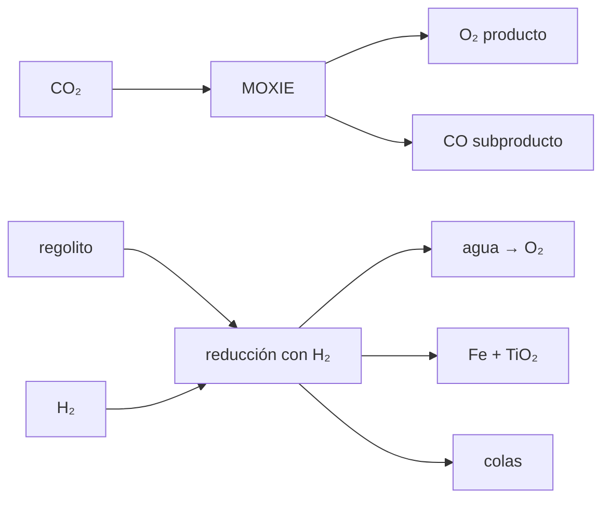

# B59-C23 — Subproductos y flujos residuales de procesos ISRU

<!-- nav:top -->
[🏠 Programa](../../../../README.md) · [📚 Bloque B59](../../../tronco-comun/B59-recursos-in-situ-y-sostenibilidad-extraterrestre.md) · [← Anterior: B59-C22 — Beneficio y separación granulométrica de regolito](../B59-C22-beneficio-y-separacion-granulometrica-de-regolito/CLASE.md) · [Siguiente: B60-C01 — Colisiones moleculares y secciones eficaces en gas interestelar →](../../../tronco-comun/B60-cinetica-y-modelado-astroquimico.md#b60-c01)
<!-- /nav -->

## 1. Ubicación, nivel y alcance

Clase 23 del bloque B59. Nivel N3. Cuentas los **subproductos** de dos procesos de oxígeno: el CO de MOXIE (S3) y, como ejemplo **ilustrativo**, la reducción de ilmenita con hidrógeno. El balance de elementos se cierra con pesos atómicos de NIST (S1). Continúa [B59-C10](../B59-C10-electrolisis-y-balances-energeticos/CLASE.md).

## 2. Por qué esta clase existe

Producir un kilogramo de oxígeno genera toneladas de otras cosas. La decisión central: **¿qué masa de residuo o de subproducto aparece por cada kilogramo de producto?**

## 3. Lo que podrás hacer al terminar

1. Balancear reacciones por elementos con un programa.
2. Calcular subproductos por kg de O₂.
3. Cerrar el balance de masa de la reducción de ilmenita.
4. Estimar el regolito procesado y las colas por kg de oxígeno.
5. Distinguir el subproducto útil del residuo.
6. Declarar qué es ilustrativo.

La evidencia es la **ficha de subproductos** del ejercicio 12 (sección 20).

## 4. Con qué llegas y cómo comprobarlo

1. ¿Qué es un balance de masa?
2. ¿Qué es una estequiometría?
3. ¿Qué es una masa molar?
4. ¿Qué es una ley de mineral?
5. ¿Qué son las colas?

<details>
<summary>Ver respuestas</summary>

1. Lo que entra es igual a lo que sale. 2. Las proporciones en que reaccionan las sustancias. 3. La masa de un mol de sustancia. 4. La fracción másica del mineral en la roca. 5. El material que sobra tras extraer lo valioso.
</details>

Con cuatro o cinco aciertos, sigue; si no, repasa los prerrequisitos.

## 5. Un caso de contexto y casos de referencia

Por **kg de O₂** MOXIE consume `2,7507 kg` de CO₂ y produce `1,7507 kg` de CO. Es el **ejemplo conductor**. Con la reducción de ilmenita con H₂ (ejemplo ilustrativo), cada **kg de oxígeno (como O del agua)** exige `9,482 kg` de ilmenita y `0,126 kg` de H₂, y deja `3,490 kg` de hierro, `4,992 kg` de TiO₂ y `1,126 kg` de agua; con `10 %` de ilmenita en el regolito (sintético) se procesan `94,8 kg` de regolito y quedan `85,3 kg` de colas.

## 6. Vocabulario

Un **subproducto** es un material que sale junto al producto. Un **flujo residual** es el que no se aprovecha. La **ilmenita** (FeTiO₃) es un óxido de hierro y titanio. Las **colas** son el regolito tratado. La **reducción con hidrógeno** quita el oxígeno del óxido y lo saca como agua.

## 7. Modelo mental: cortar una pieza de un bloque grande

Como tallar una pieza pequeña de un bloque grande: lo que queda es mucho más que la pieza. Límite: la ilmenita es un recurso modesto; la ley real depende del sitio y no se conoce aquí.



*Descripción textual:* cada proceso produce oxígeno y flujos adicionales; el balance de elementos fija cuánto de cada uno por kilogramo de producto.

## 8. La explicación, paso a paso

### 8.1 MOXIE

`2 CO₂ → 2 CO + O₂` balancea (C: 2 = 2; O: 4 = 2 + 2). Con pesos atómicos de NIST (S1): `M(CO₂) = 44,0094`, `M(CO) = 28,0100`, `M(O₂) = 31,9988 g/mol`. Por kg de O₂: `CO₂ = 2 × 44,0094/31,9988 = 2,7507 kg`; `CO = 2 × 28,0100/31,9988 = 1,7507 kg`. El cierre `2,7507 − 1,7507 − 1 = 0`. A `10,56 g/h` de O₂ el CO es `18,49 g/h`.

### 8.2 Ilmenita (ejemplo ilustrativo)

`FeTiO₃ + H₂ → Fe + TiO₂ + H₂O`. Masas molares: `151,7102; 55,8450; 79,8658; 2,0160; 18,0153 g/mol`. Cada mol libera 1 mol de O como agua; para 1 kg de O (`62,5 mol`):

- ilmenita `9,482 kg`; H₂ `0,1260 kg`.
- Fe `3,490 kg`; TiO₂ `4,992 kg`; agua `1,126 kg`.

La masa entrante `9,608 kg` es igual a la saliente (diferencia `0`).

### 8.3 Regolito y colas

Con `10 %` de ilmenita en masa (sintética) hay que procesar `9,482/0,10 = 94,8 kg` de regolito y quedan `85,3 kg` de colas por kg de O. La suma de residuos sólidos (Fe + TiO₂ + colas) es `93,8 kg`.

### 8.4 Lectura

El producto es una fracción minúscula del flujo: por cada kg de O salen unos `94 kg` de sólidos. El hierro y el TiO₂ pueden ser materia prima (C12–C13); las colas se gestionan (C11, C17). El CO de MOXIE puede ser reactivo o un residuo según lo que haya a mano. El agua se electroliza (C10) y cierra el lazo de O.

## 9. Magnitudes, símbolos y unidades

| Símbolo | Qué es | Unidad | Valor / nota |
|---|---|---|---|
| `M(X)` | masa molar | g/mol | ver 8.1–8.2 (NIST) |
| `CO/O₂` | CO por O₂ | kg/kg | 1,7507 |
| `CO₂/O₂` | CO₂ por O₂ | kg/kg | 2,7507 |
| `f_ilm` | ilmenita en regolito | — | 0,10 (sintética) |
| `ilm/O` | ilmenita por kg de O | kg/kg | 9,482 |

## 10. Convenciones y referencias

Balance por kg de oxígeno (O₂ en MOXIE; átomos de O del agua en la ilmenita); pesos atómicos NIST (punto medio del intervalo); reacciones completas; sin reciclaje del hierro ni del TiO₂.

## 11. De dónde sale lo que afirmamos

| ID | Fuente | Localizador | Respalda | Estado |
|---|---|---|---|---|
| S1 | NIST, Atomic Weights and Isotopic Compositions for All Elements | https://physics.nist.gov/cgi-bin/Compositions/stand_alone.pl | Pesos atómicos estándar (H, C, N, O, Mg, Al, Si, Ca, Ti, Fe); se usa el punto medio del intervalo cuando se da un intervalo | Consultada (extracto), consultada el 2026-11-09 |
| S2 | NIST, Chemistry WebBook: agua (CAS 7732-18-5), CO₂ (124-38-9), CH₄ (74-82-8) | https://webbook.nist.gov/cgi/cbook.cgi?ID=C7732185 · …C124389 · …C74828 | Entalpías de formación en gas: H₂O −241,826 ± 0,040; CO₂ −393,51 ± 0,13; CH₄ −74,87 kJ/mol; masas molares 18,0153; 44,0095; 16,0425 g/mol | Consultada (extracto), consultada el 2026-11-09 |
| S3 | NASA, MOXIE sets consecutive personal bests and Mars records for oxygen production (22 dic. 2022) | https://science.nasa.gov/missions/mars-2020-perseverance/moxie-sets-consecutive-personal-bests-and-mars-records-for-oxygen-production | Electrólisis de óxido sólido de CO₂; 10,44 g/h (sol 534) y casi 10,56 g/h (sol 630) de pico; meta de diseño 6 g/h | Consultada (nota), consultada el 2026-11-09 |
| — | No consultado: valores ilustrativos de este laboratorio (se rotulan así en el script y en la clase) | — | reducción de ilmenita como proceso de ejemplo y su ley en el regolito | No consultado |

Límites: la nota de NASA indica que un segundo puerto vierte CO y CO₂; no da cifras de CO; la ley de ilmenita y el proceso de reducción no se consultaron.

## 12. Cómo ver subproductos por kg de oxígeno

| Proceso | Flujo | Masa [kg por kg de O₂ o de O] |
|---|---|---|
| MOXIE | CO₂ consumido | 2,7507 |
| MOXIE | CO producido | 1,7507 |
| Ilmenita | ilmenita | 9,482 |
| Ilmenita | Fe | 3,490 |
| Ilmenita | TiO₂ | 4,992 |
| Ilmenita | colas (10 %) | 85,3 |

Descripción larga: el producto es una fracción minúscula de lo que sale.

## 13. Ejemplo trabajado: ilmenita por kg de oxígeno

**Paso 1 · Moles de O.** `1 000 g/15,9994 = 62,50 mol`.

**Paso 2 · Ilmenita.** `62,50 × 151,7102/1 000 = 9,482 kg`.

**Paso 3 · Hierro.** `62,50 × 55,845/1 000 = 3,490 kg`.

**Paso 4 · Regolito.** `9,482/0,10 = 94,8 kg`.

## 14. Distintas formas de resolver el problema

**Balance por elementos** (programa) y **por masas molares** (mano) coinciden a `10⁻¹²`. El balance dice cuánto; no dice si el subproducto tiene uso.

## 15. Práctica guiada

**Ejercicio 1 · con los pasos indicados.** CO por kg de O₂ en MOXIE (8.1).

<details><summary>Solución comentada</summary>

`1,7507 kg`.
</details>

**Ejercicio 2 · con una pista.** CO₂ por kg de O₂ (8.1).

<details><summary>Solución comentada</summary>

`2,7507 kg`.
</details>

**Ejercicio 3 · casi autónomo.** Comprueba el cierre de masa (8.1).

<details><summary>Solución comentada</summary>

`2,7507 − 1,7507 − 1 = 0`.
</details>

## 16. Práctica autónoma, transferencia e integrador

**Ejercicio 4.** CO a 10,56 g/h de O₂ (8.1).

<details><summary>Solución comentada</summary>

`18,49 g/h`.
</details>

**Ejercicio 5.** Ilmenita por kg de O (8.2).

<details><summary>Solución comentada</summary>

`9,482 kg`.
</details>

**Ejercicio 6.** Hierro por kg de O (8.2).

<details><summary>Solución comentada</summary>

`3,490 kg`.
</details>

**Ejercicio 7.** TiO₂ por kg de O (8.2).

<details><summary>Solución comentada</summary>

`4,992 kg`.
</details>

**Ejercicio 8.** Regolito a procesar con `10 %` de ilmenita (8.3).

<details><summary>Solución comentada</summary>

`94,8 kg`.
</details>

**Ejercicio 9 · transferencia.** Suma Fe, TiO₂ y colas por kg de O. ¿Qué magnitud obtienes y qué indica?

<details><summary>Solución comentada</summary>

`3,490 + 4,992 + 85,3 = 93,8 kg`: casi todo el regolito termina como sólido residual.
</details>

**Ejercicio 10 · transferencia.** ¿Qué volumen ocupan las colas a `1 500 kg/m³`?

<details><summary>Solución comentada</summary>

`85,3/1 500 = 0,057 m³` por kg de O.
</details>

**Ejercicio 11 · transferencia.** Con `5 %` de ilmenita, ¿cuánto regolito por kg de O?

<details><summary>Solución comentada</summary>

`9,482/0,05 = 189,6 kg`: se duplica.
</details>

**Ejercicio 12 · integrador.** Elabora tu *ficha de subproductos*: reacciones balanceadas, flujos por kg de producto, regolito y colas, usos posibles y rótulo de lo ilustrativo.

<details><summary>Solución modelo</summary>

Secciones 8.1–8.4.
</details>

## 17. Laboratorio: balance de subproductos por kg de oxígeno

El script [subproductos.py](subproductos.py) balancea las reacciones por elementos y calcula los flujos (**comprueba** `10⁻¹²` en la conservación de elementos y masa).

**Datos:** pesos atómicos y masa molar del CO₂ **citados** (S1–S2); reacción de ilmenita y ley **ilustrativas**. **Predice antes de ejecutar:** ¿qué masa de sólidos sale por kg de O con 10 % de ilmenita? (≈ 94 kg.) **Ejecución del 2026-11-09 (Python 3.12.9):**

```text
Python 3.12.9 (biblioteca estandar)
MOXIE por kg de O2: CO2 consumido = 2.7507 kg ; CO producido = 1.7507 kg ; cierre 0.0e+00
A 10,56 g/h de O2 el CO coproducido es 18.49 g/h

Reduccion de ilmenita con H2 (ejemplo ilustrativo): FeTiO3 + H2 -> Fe + TiO2 + H2O
  M(FeTiO3) = 151.7102 g/mol
  M(Fe) = 55.8450 g/mol
  M(TiO2) = 79.8658 g/mol
  M(H2) = 2.0160 g/mol
  M(H2O) = 18.0153 g/mol
Por kg de O (como agua, luego electrolizada a O2): ilmenita = 9.482 kg ; Fe = 3.490 kg ; TiO2 = 4.992 kg ; H2 = 0.1260 kg ; agua = 1.126 kg
Cierre de masa: entra 9.608245 kg ; sale 9.608245 kg ; diferencia 0.0e+00
Con 10 % de ilmenita en el regolito (sintetico): regolito procesado = 94.8 kg ; colas (sin ilmenita) = 85.3 kg por kg de O
Razon masica metal + oxido / oxigeno = 8.482 kg por kg de O ; colas/O = 85.3
Electrolisis del agua: O2 = 1.0000 kg (1 kg de O del agua) ; H2 reciclable = 0.1260 kg
Pruebas superadas.
```

```bash
python programa/clases/B59/B59-C23-subproductos-y-flujos-residuales-de-procesos-isru/subproductos.py
```

**Límites:** reacciones completas, sin hierro metálico reciclado ni energía; no es un proceso optimizado.

## 18. Errores frecuentes y cómo corregirlos

**Contar solo el producto y olvidar las colas.** Se corrige con 8.3.

**Confundir kg de O con kg de O₂.** Se corrige con la sección 10.

**Dar la ley de ilmenita como real.** Es sintética.

**Pensar que el balance garantiza un uso.** Se corrige con 8.4.

## 19. Cómo sabrás que vas bien

Tras la sección 8: ¿qué masa de sólidos esperabas y cuál obtuviste? Si dudas, repasa el ejemplo 13. Tras el laboratorio: ¿qué comprueba? (ver la sección 17).

## 20. Qué entregas y cómo se evalúa

El producto es tu **ficha de subproductos** (ejercicio 12).

| Criterio | Inicial | En desarrollo | Logrado | Destacado |
|---|---|---|---|---|
| Conceptos | Los confunde | Parciales | Conceptos de la clase | Explica los límites |
| Cálculo | Sin unidades | Con errores | Tablas completas | Calcula casos nuevos |
| Numérico | Sin comprobar | Un caso | Contraste con el análisis | Interpreta las diferencias |
| Fuentes | Sin fuente | Sin fecha | Fuentes con fecha | Declara lo ilustrativo |
| Límites | No los nombra | Uno | Tres | Discute qué falta del modelo |

**Condiciones críticas (no se compensan con promedio):** rotular el proceso de ilmenita como ilustrativo; cerrar los balances; citar solo lo consultado.

## 21. Ética, seguridad y límites

Clase educativa: los modelos son simplificados y no son un procedimiento de operación. El polvo de regolito y el CO son peligrosos; esta clase no es un procedimiento de operación. Accesibilidad: tablas equivalentes a las gráficas, fórmulas en texto, ejercicios sin conexión.

## 22. Para cerrar y seguir

Por kg de O₂ MOXIE produce `1,75 kg` de CO, y el ejemplo de ilmenita deja `94 kg` de sólidos por kg de O. Con esto termina el tramo de oxígeno. Queda una pregunta: ¿cómo se construye con el regolito?

**Glosario español–inglés.** subproducto · *by-product*; colas · *tailings*; ilmenita · *ilmenite*; reducción · *reduction*; flujo residual · *waste stream*.

**Continuidad.** [B59-C11](../B59-C11-construccion-con-regolito/CLASE.md) pasa a construir con regolito.

**Referencias:** ver sección 11.

<!-- nav:bottom -->
---

[← Anterior: B59-C22 — Beneficio y separación granulométrica de regolito](../B59-C22-beneficio-y-separacion-granulometrica-de-regolito/CLASE.md) · [📚 Bloque B59](../../../tronco-comun/B59-recursos-in-situ-y-sostenibilidad-extraterrestre.md) · [Siguiente: B60-C01 — Colisiones moleculares y secciones eficaces en gas interestelar →](../../../tronco-comun/B60-cinetica-y-modelado-astroquimico.md#b60-c01)
<!-- /nav -->
