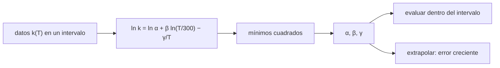

# B60-C02 — Coeficientes de velocidad dependientes de la temperatura y bases cinéticas

<!-- nav:top -->
[🏠 Programa](../../../../README.md) · [📚 Bloque B60](../../../tronco-comun/B60-cinetica-y-modelado-astroquimico.md) · [← Anterior: B60-C01 — Colisiones moleculares y secciones eficaces en gas interestelar](../B60-C01-colisiones-moleculares-y-secciones-eficaces-en-gas-interestelar/CLASE.md) · [Siguiente: B60-C03 — Integración numérica de redes químicas rígidas →](../B60-C03-integracion-numerica-de-redes-quimicas-rigidas/CLASE.md)
<!-- /nav -->

## 1. Ubicación, nivel y alcance

Clase 2 del bloque B60. Nivel N3. En C01 viste que `k(T)` es un promedio térmico y que una barrera produce un factor `exp(−E₀/kT)`. Las bases de datos astroquímicas no guardan secciones eficaces: guardan **coeficientes** de una fórmula de tipo Arrhenius modificada, `k(T) = α (T/300)^β exp(−γ/T)`, con un intervalo de temperatura de validez. Aquí evalúas esa fórmula, ajustas sus tres parámetros por mínimos cuadrados en `ln k` y mides qué pasa al extrapolar. La clase se apoya en el resumen de dos artículos de bases de datos (UMIST y KIDA), pero **los parámetros del laboratorio son ilustrativos**: no se tomaron de ninguna tabla.

## 2. Por qué esta clase existe

Un modelo de nube a 10 K usa coeficientes que se midieron o calcularon a otras temperaturas. La decisión central: **¿hasta dónde se puede confiar en un ajuste de `k(T)` fuera del intervalo donde se ajustó?**

## 3. Lo que podrás hacer al terminar

1. Evaluar `α (T/300)^β exp(−γ/T)` con unidades de cm³ s⁻¹.
2. Interpretar `β` y `γ`: dependencia con la temperatura y barrera efectiva.
3. Ajustar los tres parámetros con una regresión lineal en `ln k`.
4. Medir el error del ajuste dentro y fuera del intervalo de datos.
5. Reconocer cuándo omitir el término `γ` produce un error de órdenes de magnitud.
6. Describir qué son KIDA y UMIST y qué no puedes afirmar sin consultar sus tablas.

La evidencia es la **ficha del coeficiente de velocidad** del ejercicio 12 (sección 20).

## 4. Con qué llegas y cómo comprobarlo

1. ¿Qué es un logaritmo natural?
2. ¿Qué es una regresión lineal por mínimos cuadrados?
3. ¿Qué unidades tiene `k` bimolecular?
4. ¿Qué es un valor sintético?
5. ¿Qué es un intervalo de validez?

<details>
<summary>Ver respuestas</summary>

1. El logaritmo en base `e`. 2. El ajuste de una recta que minimiza la suma de cuadrados de los residuos. 3. cm³ s⁻¹. 4. Un dato generado por el autor, no medido. 5. El rango en que el ajuste se contrastó con datos.
</details>

Con cuatro o cinco aciertos, sigue; si no, repasa los prerrequisitos.

## 5. Un caso de contexto y casos de referencia

Una reacción **sintética** con `α = 5 × 10⁻¹¹ cm³ s⁻¹`, `β = 1,2` y `γ = 200 K` vale `1,811 × 10⁻¹² cm³ s⁻¹` a 100 K y `2,567 × 10⁻¹¹` a 300 K. Es el **ejemplo conductor**. Todo es **ilustrativo**.

## 6. Vocabulario

La **forma de Arrhenius modificada** (tipo Kooij) es `k = α (T/300)^β exp(−γ/T)`. `α` es el valor a 300 K sin barrera; `β` es el exponente de temperatura; `γ` es la barrera efectiva en kelvin. Una **base cinética** reúne reacciones con sus parámetros, incertidumbres e intervalos de validez. El **intervalo de validez** es el rango de temperatura en que se contrastó el ajuste.

## 7. Modelo mental: una receta con tres perillas

Como una receta con tres perillas: `α` pone el nivel, `β` la pendiente suave con la temperatura y `γ` la caída brusca a baja temperatura. Girarlas fuera del rango donde se calibraron es adivinar.



*Descripción textual:* de los datos se pasa a una ecuación lineal en `ln k`, se ajustan los tres parámetros y se evalúan dentro o fuera del intervalo.

Analogía: perillas de receta. Límite: tres parámetros describen curvaturas suaves; no capturan cambios de mecanismo.

## 8. La explicación, paso a paso

### 8.1 Tres reacciones sintéticas

Parámetros **ilustrativos**: A (`α = 2 × 10⁻⁹`, `β = −0,5`, `γ = 0`), B (`α = 10⁻¹⁰`, `β = 0`, `γ = 800 K`) y C (`α = 5 × 10⁻¹¹`, `β = 1,2`, `γ = 200 K`).

| reacción | 10 K | 100 K | 300 K |
|---|---|---|---|
| A (sin barrera, `β < 0`) | 1,095 × 10⁻⁸ | 3,464 × 10⁻⁹ | 2,000 × 10⁻⁹ |
| B (con barrera) | 1,805 × 10⁻⁴⁵ | 3,355 × 10⁻¹⁴ | 6,948 × 10⁻¹² |
| C (mixta) | 1,740 × 10⁻²¹ | 1,811 × 10⁻¹² | 2,567 × 10⁻¹¹ |

En cm³ s⁻¹. A crece al enfriarse; B se hunde; C cae 10 órdenes de magnitud entre 100 K y 10 K.

### 8.2 El ajuste lineal

Como `ln k = ln α + β ln(T/300) − γ/T`, las incógnitas entran linealmente. Con once temperaturas de 100 a 300 K (paso de 20 K) y sin ruido, el ajuste recupera los parámetros con error relativo máximo de `7,8 × 10⁻¹³`.

### 8.3 Con ruido

Con ruido lognormal de 5 % (**sintético**, semilla `60002`) sobre la reacción C:

| | `α` | `β` | `γ` |
|---|---|---|---|
| verdadero | 5,000 × 10⁻¹¹ | 1,200 | 200,0 K |
| ajustado | 5,105 × 10⁻¹¹ | 1,271 | 199,4 K |

El error medio de `k` dentro del intervalo es `1,98 %`. Los parámetros individuales se desvían más que `k`, porque están correlacionados.

### 8.4 Extrapolación

| `T` (K) | `k` verdadero | `k` ajustado | cociente |
|---|---|---|---|
| 10 | 1,740 × 10⁻²¹ | 1,480 × 10⁻²¹ | 0,851 |
| 30 | 4,015 × 10⁻¹⁵ | 3,550 × 10⁻¹⁵ | 0,884 |
| 60 | 2,586 × 10⁻¹³ | 2,378 × 10⁻¹³ | 0,920 |
| 400 | 4,283 × 10⁻¹¹ | 4,470 × 10⁻¹¹ | 1,044 |

El error crece al alejarse del intervalo: 15 % a 10 K y 4 % a 400 K. Aquí la forma del modelo es la correcta; con un mecanismo distinto sería peor.

### 8.5 Modelo equivocado

Si se ajusta la reacción B (con barrera) sin el término `γ`, dentro de 100–300 K el error es modesto (cociente de 1,41 a 300 K y de 1,66 a 100 K), pero a 30 K el modelo da `7,4 × 10⁵` veces el valor verdadero. Un buen ajuste en el intervalo no valida el modelo fuera de él.

### 8.6 Qué son KIDA y UMIST

Según el resumen del artículo consultado, UMIST Database for Astrochemistry 2012 (McElroy et al.) contiene 6173 reacciones en fase gaseosa y 467 especies; KIDA (Wakelam et al. 2012) es una base de reacciones con coeficientes e incertidumbres, abierta a datos nuevos, con una versión anual como red para nubes densas de 10 a 300 K. **No se consultaron sus tablas ni el formato de sus archivos**: esta clase no afirma nada sobre los valores ni los formatos de las bases.

## 9. Magnitudes, símbolos y unidades

| Símbolo | Qué es | Unidad | Valor / nota |
|---|---|---|---|
| `k` | coeficiente de velocidad bimolecular | cm³ s⁻¹ | 1,811 × 10⁻¹² (C, 100 K) |
| `α` | coeficiente a 300 K | cm³ s⁻¹ | 5 × 10⁻¹¹ (C) |
| `β` | exponente de temperatura | adimensional | 1,2 (C) |
| `γ` | barrera efectiva | K | 200 (C) |
| `T` | temperatura | K | 10–400 |

## 10. Convenciones y referencias

`T` en kelvin, `300 K` como temperatura de referencia, `ln` natural. Los ajustes usan datos entre 100 y 300 K; tolerancias: sin ruido, error relativo < `10⁻⁹`; con ruido de 5 %, error medio de `k` < 6 %.

## 11. De dónde sale lo que afirmamos

| ID | Fuente | Localizador | Respalda | Estado |
|---|---|---|---|---|
| UMIST12 | McElroy et al., *The UMIST database for astrochemistry 2012* | arXiv:1212.6362 (resumen) | 6173 reacciones y 467 especies | Consultada el 2026-11-09 (solo el resumen; no describe las fórmulas) |
| KIDA12 | Wakelam et al., *A KInetic Database for Astrochemistry (KIDA)* | arXiv:1201.5887 (resumen) | descripción de la base y la red anual | Consultada el 2026-11-09 (solo el resumen) |
| — | La forma `α (T/300)^β exp(−γ/T)` | — | relación estándar que verifica el laboratorio | No se consultó una fuente para la forma; los parámetros son ilustrativos |

Límites: el sitio de KIDA no se pudo consultar (no resolvió); ningún parámetro de una reacción real se usó.

## 12. Cómo ver el coeficiente

| Magnitud | Valor |
|---|---|
| error máximo del ajuste sin ruido | 7,8 × 10⁻¹³ |
| error medio con ruido de 5 % | 1,98 % |
| cociente ajustado/verdadero a 10 K | 0,851 |

Descripción larga: la curva `k(T)` se ve recta en `ln k` frente a `1/T` cuando solo importa `γ`, y se curva por `β`.

## 13. Ejemplo trabajado: la reacción C a 100 K

**Paso 1 · Cociente de temperaturas.** `T/300 = 0,3333`.

**Paso 2 · Potencia.** `0,3333^1,2 = 0,2676`.

**Paso 3 · Exponencial.** `exp(−200/100) = 0,1353`.

**Paso 4 · Producto.** `k = 5 × 10⁻¹¹ × 0,2676 × 0,1353 = 1,81 × 10⁻¹² cm³/s`.

## 14. Distintas formas de describir un coeficiente

**Por fórmula:** tres parámetros. **Por tabla:** `k` en una malla de `T`. **Por recta:** `ln k` frente a `1/T`. **Por incertidumbre:** factor multiplicativo.

## 15. Práctica guiada

**Ejercicio 1 · con los pasos indicados.** Calcula `k` de la reacción A a 100 K. *Pasos:* `(100/300)^(−0,5) = 1,732`; multiplica por `2 × 10⁻⁹`.

<details><summary>Solución comentada</summary>

`3,464 × 10⁻⁹ cm³/s`.
</details>

**Ejercicio 2 · con una pista.** Calcula `k` de la reacción B a 300 K. *Pista:* `exp(−800/300)`.

<details><summary>Solución comentada</summary>

`exp(−2,667) = 0,06948`; `k = 6,948 × 10⁻¹² cm³/s`.
</details>

**Ejercicio 3 · casi autónomo.** Escribe las tres columnas de la matriz del ajuste lineal.

<details><summary>Solución comentada</summary>

`[1, ln(T/300), −1/T]`, con incógnitas `[ln α, β, γ]`.
</details>

## 16. Práctica autónoma, transferencia e integrador

**Ejercicio 4.** Calcula `k` de B a 100 K.

<details><summary>Solución comentada</summary>

`10⁻¹⁰ × exp(−8) = 3,355 × 10⁻¹⁴ cm³/s`.
</details>

**Ejercicio 5.** Calcula `k` de C a 100 K y compáralo con el del laboratorio.

<details><summary>Solución comentada</summary>

`1,811 × 10⁻¹²` (sección 13).
</details>

**Ejercicio 6.** ¿Cuántos kelvin de `γ` hacen caer `k` un factor 100 al pasar de 300 K a 100 K, a igual `β = 0`?

<details><summary>Solución comentada</summary>

`exp(−γ/100 + γ/300) = 0,01` ⇒ `γ (1/100 − 1/300) = 4,605` ⇒ `γ = 691 K`.
</details>

**Ejercicio 7.** Con tres puntos y tres parámetros, ¿qué pasa con la incertidumbre del ajuste?

<details><summary>Solución comentada</summary>

El ajuste es exacto, sin redundancia: no hay estimación del ruido ni forma de detectar un modelo equivocado.
</details>

**Ejercicio 8.** Interpreta el cociente `7,4 × 10⁵` a 30 K de la sección 8.5.

<details><summary>Solución comentada</summary>

Sin `γ`, el modelo no ve la caída exponencial a baja temperatura y sobreestima 5,9 órdenes de magnitud.
</details>

**Ejercicio 9 · transferencia.** **Transferencia.** Una tabla da un ajuste válido de 50 a 300 K y tu nube está a 10 K. ¿Qué haces?

<details><summary>Solución comentada</summary>

Declaras que es una extrapolación, estimas el error con un caso como el de 8.4 y buscas datos que cubran 10 K; no presentas el resultado como medido.
</details>

**Ejercicio 10 · transferencia.** **Transferencia.** Un colega entrega `α` en m³ s⁻¹. ¿Qué factor aplicas?

<details><summary>Solución comentada</summary>

`× 10⁶` para pasar a cm³ s⁻¹.
</details>

**Ejercicio 11 · transferencia.** **Transferencia.** ¿Por qué el valor `1,8 × 10⁻⁴⁵` de B a 10 K no debe citarse como medido?

<details><summary>Solución comentada</summary>

Porque es el resultado de una fórmula evaluada muy fuera de cualquier medición y con parámetros ilustrativos.
</details>

**Ejercicio 12.** **Integrador.** Elabora tu *ficha del coeficiente de velocidad*: tabla `k(T)` de una reacción sintética, ajuste con ruido, error dentro y fuera del intervalo, y una nota sobre KIDA y UMIST con lo realmente consultado.

<details><summary>Solución modelo</summary>

Secciones 8.1–8.6, con unidades en cm³ s⁻¹, el intervalo de ajuste y el rótulo «ilustrativo».
</details>

## 17. Laboratorio: ajustar y extrapolar un coeficiente

El script [coeficientes.py](coeficientes.py) evalúa tres reacciones sintéticas, ajusta `α`, `β` y `γ` por mínimos cuadrados y mide la extrapolación (**comprueba** error < `10⁻⁹` sin ruido y < 6 % con ruido).

**Datos:** sintéticos, con parámetros ilustrativos. **Predice antes de ejecutar:** ¿el ajuste extrapolado a 10 K quedará por encima o por debajo del verdadero? (por debajo: 0,851.) **Ejecución del 2026-11-09 (Python 3.12.9):**

```text
Python 3.12.9 (biblioteca estandar)
Parametros ILUSTRATIVOS (no son de KIDA ni de UMIST)

Evaluacion k(T) [cm3/s]:
  reaccion                    T=10 K        T=100 K       T=300 K
  A (sin barrera, beta<0)    1.095e-08    3.464e-09    2.000e-09
  B (con barrera)           1.805e-45    3.355e-14    6.948e-12
  C (mixta)                 1.740e-21    1.811e-12    2.567e-11

Ajuste sin ruido (100-300 K): maximo error relativo en los parametros = 7.8e-13

Reaccion C con ruido lognormal de 5 % (SINTETICO):
  verdadero   alpha = 5.000e-11  beta = 1.200  gamma = 200.0 K
  ajustado    alpha = 5.105e-11  beta = 1.271  gamma = 199.4 K
  error medio dentro del intervalo = 1.98%
  extrapolacion fuera del intervalo ajustado:
    T [K]   k_verdadero      k_ajustado      cociente
       10      1.740e-21      1.480e-21      0.851
       30      4.015e-15      3.550e-15      0.884
       60      2.586e-13      2.378e-13      0.920
      400      4.283e-11      4.470e-11      1.044

Sin termino de barrera ajustado a la reaccion B (modelo equivocado, 100-300 K):
  T =    30 K: cociente ajustado/verdadero = 7.4e+05
  T =   100 K: cociente ajustado/verdadero = 1.66
  T =   300 K: cociente ajustado/verdadero = 1.41
Pruebas superadas.
```

```bash
python programa/clases/B60/B60-C02-coeficientes-de-velocidad-dependientes-de-la-temperatura-y-bases-cineticas/coeficientes.py
```

**Límites:** datos sintéticos, ruido lognormal simple, una sola temperatura de referencia, sin incertidumbres de la base.

## 18. Errores frecuentes y cómo corregirlos

**Evaluar fuera del intervalo de validez sin decirlo.** Se corrige con 8.4.

**Creer que un buen ajuste valida el modelo.** Se corrige con 8.5.

**Mezclar m³ y cm³.** Se corrige con el ejercicio 10.

**Citar parámetros de KIDA o UMIST sin haberlos consultado.** Se corrige con la sección 11.

## 19. Cómo sabrás que vas bien

Tras la sección 8: ¿qué resultado esperabas y cuál obtuviste? Si dudas, repasa el ejemplo 13. Tras el laboratorio: ¿qué comprueba? (ver la sección 17).

## 20. Qué entregas y cómo se evalúa

El producto es tu **ficha del coeficiente de velocidad** (ejercicio 12).

| Criterio | Inicial | En desarrollo | Logrado | Destacado |
|---|---|---|---|---|
| Conceptos | Los confunde | Parciales | conceptos de la clase | Explica los límites |
| Cálculo | Sin unidades | Con errores | Tablas completas | Calcula casos nuevos |
| Numérico | Sin comprobar | Un caso | Contraste con el análisis | Interpreta las diferencias |
| Fuentes | Sin fuente | Sin fecha | fuentes con fecha | Declara lo ilustrativo |
| Límites | No los nombra | Uno | Tres | Discute qué falta del modelo |

**Condiciones críticas (no se compensan con promedio):** rotular los parámetros como ilustrativos; no presentar valores de las bases sin haberlos consultado; citar solo lo consultado.

## 21. Ética, seguridad y límites

Clase educativa: los modelos son simplificados. Accesibilidad: tablas equivalentes a las gráficas, fórmulas en texto, ejercicios sin conexión.

## 22. Para cerrar y seguir

Un coeficiente `α (T/300)^β exp(−γ/T)` se ajusta bien dentro de su intervalo (error medio 2 %) y se degrada fuera (15 % a 10 K en el caso correcto; órdenes de magnitud si el modelo es otro). Queda una pregunta: una vez que se tienen cientos de coeficientes, ¿cómo se integra la red completa en el tiempo?

**Glosario español–inglés.** coeficiente de velocidad · *rate coefficient*; base de datos cinética · *kinetic database*; intervalo de validez · *validity range*; extrapolación · *extrapolation*; mínimos cuadrados · *least squares*.

**Continuidad.** [B60-C03](../B60-C03-integracion-numerica-de-redes-quimicas-rigidas/CLASE.md) estudia la integración numérica de redes rígidas.

**Referencias:** ver sección 11.

<!-- nav:bottom -->
---

[← Anterior: B60-C01 — Colisiones moleculares y secciones eficaces en gas interestelar](../B60-C01-colisiones-moleculares-y-secciones-eficaces-en-gas-interestelar/CLASE.md) · [📚 Bloque B60](../../../tronco-comun/B60-cinetica-y-modelado-astroquimico.md) · [Siguiente: B60-C03 — Integración numérica de redes químicas rígidas →](../B60-C03-integracion-numerica-de-redes-quimicas-rigidas/CLASE.md)
<!-- /nav -->
