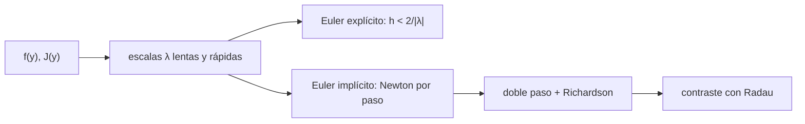

# B60-C03 — Integración numérica de redes químicas rígidas

<!-- nav:top -->
[🏠 Programa](../../../../README.md) · [📚 Bloque B60](../../../tronco-comun/B60-cinetica-y-modelado-astroquimico.md) · [← Anterior: B60-C02 — Coeficientes de velocidad dependientes de la temperatura y bases cinéticas](../B60-C02-coeficientes-de-velocidad-dependientes-de-la-temperatura-y-bases-cineticas/CLASE.md) · [Siguiente: B60-C04 — Balance químico gas-grano: modelos de tres fases →](../B60-C04-balance-quimico-gas-grano-modelos-de-tres-fases/CLASE.md)
<!-- /nav -->

## 1. Ubicación, nivel y alcance

Clase 3 del bloque B60. Nivel N3. En [B11-C09](../../../tronco-comun/B11-ecuaciones-diferenciales-y-simulacion-numerica.md) viste la estabilidad numérica general. Una red química tiene reacciones de escalas de tiempo muy distintas: eso la hace **rígida**, y un integrador explícito debe dar pasos diminutos por estabilidad, no por precisión. Aquí mides esa rigidez, comparas Euler explícito con Euler implícito de paso adaptativo (Newton con Jacobiano analítico, doble paso y extrapolación de Richardson) y contrastas con el método Radau de SciPy. La red es un **problema de prueba sintético**, no una red astroquímica.

## 2. Por qué esta clase existe

Si usas un integrador explícito en una red real, o no termina nunca, o explota. La decisión central: **¿qué integrador usar y con qué tolerancias, para que el resultado sea correcto y el coste razonable?**

## 3. Lo que podrás hacer al terminar

1. Definir la rigidez como el cociente de escalas de tiempo.
2. Calcular el límite de estabilidad `h < 2/|λ|` de Euler explícito.
3. Resolver un paso de Euler implícito con Newton y un Jacobiano.
4. Controlar el paso con doble paso y extrapolación de Richardson.
5. Contrastar con una referencia independiente con tolerancias declaradas.
6. Verificar la conservación de la suma de abundancias.

La evidencia es la **ficha de la integración rígida** del ejercicio 12 (sección 20).

## 4. Con qué llegas y cómo comprobarlo

1. ¿Qué es una ecuación diferencial ordinaria?
2. ¿Qué es un autovalor de una matriz?
3. ¿Qué es el método de Newton?
4. ¿Qué es una tolerancia relativa y una absoluta?
5. ¿Qué es un valor sintético?

<details>
<summary>Ver respuestas</summary>

1. Una ecuación para `dy/dt` en función de `y` y `t`. 2. Un `λ` con `Av = λv`. 3. Una iteración que linealiza el problema con la derivada. 4. Errores permitidos proporcional al valor y mínimo absoluto. 5. Un dato generado por el autor.
</details>

Con cuatro o cinco aciertos, sigue; si no, repasa los prerrequisitos.

## 5. Un caso de contexto y casos de referencia

Un sistema **sintético** de tres especies `y₁, y₂, y₃` con suma 1 y tres reacciones de constantes `0,04`, `10⁴` y `3 × 10⁷` (unidades arbitrarias, de memoria, **no consultadas**): `y₁ → y₂` lento, `y₂ + y₃ → y₁ + y₃` y `2 y₂ → y₂ + y₃` rápidos. Hasta `t = 40` da `y₁ = 0,715827`, `y₂ = 9,1855 × 10⁻⁶`, `y₃ = 0,284164` con la referencia Radau. Es el **ejemplo conductor**.

## 6. Vocabulario

Un sistema es **rígido** si tiene componentes que evolucionan en escalas de tiempo muy distintas. El **método explícito** calcula el paso nuevo solo con el estado actual; el **implícito** resuelve una ecuación en el estado nuevo. El **Jacobiano** `J = ∂f/∂y` linealiza las reacciones. La **extrapolación de Richardson** combina un paso completo y dos medios para ganar un orden. `rtol` y `atol` controlan el error local, `atol + rtol·|y|`.

## 7. Modelo mental: caminar al paso del más rápido

Como un grupo que debe caminar a la velocidad del más nervioso aunque el destino esté lejos: el integrador explícito se ve obligado a seguir la escala más rápida aunque ya no haya nada que observar en ella.



*Descripción textual:* de la función y su Jacobiano salen las escalas; el explícito está limitado por estabilidad y el implícito resuelve Newton por paso con control de error.

Analogía: seguir al más rápido. Límite: Euler implícito es de primer orden y se mejora aquí con Richardson; los códigos reales usan métodos de orden mayor.

## 8. La explicación, paso a paso

### 8.1 Rigidez

En el estado `y(40)` el elemento diagonal del Jacobiano de `y₂` es `−3,39 × 10³`: tiempo rápido `2,95 × 10⁻⁴`, frente a un tiempo lento de `1/0,04 = 25`. El cociente es `8,5 × 10⁴`.

### 8.2 Euler explícito

El límite de estabilidad estimado es `h < 2/|λ| = 5,9 × 10⁻⁴`.

| `h` | resultado hasta `t = 0,1` |
|---|---|
| `10⁻⁴` | estable |
| `10⁻³` | estable (aunque supera la estimación) |
| `4 × 10⁻³` | diverge |
| `10⁻²` | diverge |

La estimación usa el estado final y un elemento diagonal; el límite real depende del estado y de los autovalores, por eso `10⁻³` aún no diverge. No es una garantía.

### 8.3 Euler implícito adaptativo

Con `rtol = 10⁻⁴` y `atol = 10⁻⁹` por paso, llega a `t = 40` en 311 pasos aceptados y 3 rechazados. Un Euler explícito estable necesitaría `6,8 × 10⁴` pasos (con `h = 6 × 10⁻⁴`). La suma de las abundancias se conserva a `−1,4 × 10⁻¹⁵`.

### 8.4 Contraste con Radau

SciPy 1.17.1, `solve_ivp` con `method="Radau"`, Jacobiano analítico, `rtol = 10⁻¹⁰` y `atol = 10⁻¹²`, da `y₁ = 0,715827`, `y₂ = 9,1855 × 10⁻⁶`, `y₃ = 0,284164` en 510 pasos. El error relativo del Euler implícito es `1,6 × 10⁻⁵` en `y₁` y `4,1 × 10⁻⁵` en `y₃`: dentro de la tolerancia `10⁻³` declarada.

### 8.5 Lo que dice la documentación de SciPy

Según la documentación consultada, Radau y BDF son los métodos implícitos para problemas rígidos, LSODA conmuta automáticamente, el error local se mantiene bajo `atol + rtol·|y|` (por defecto `10⁻³` y `10⁻⁶`) y se recomienda dar el Jacobiano en lugar de aproximarlo por diferencias finitas. Si un explícito como RK45 necesita demasiadas iteraciones, el problema probablemente es rígido.

## 9. Magnitudes, símbolos y unidades

| Símbolo | Qué es | Unidad | Valor / nota |
|---|---|---|---|
| `y₁, y₂, y₃` | abundancias normalizadas | adimensional | suma 1 |
| `t` | tiempo | unidades arbitrarias | 0–40 |
| `λ` | autovalor / pendiente diagonal | 1/tiempo | −3,39 × 10³ |
| `h` | paso | tiempo | 5,9 × 10⁻⁴ (límite) |
| `rtol`, `atol` | tolerancias | adimensional / abundancia | 10⁻⁴, 10⁻⁹ |

## 10. Convenciones y referencias

Tiempo y constantes en unidades arbitrarias consistentes; un sistema autónomo. SciPy 1.17.1, Python 3.12.9. Tolerancias de la clase: error relativo < `10⁻³` frente a la referencia y conservación < `10⁻⁹`.

## 11. De dónde sale lo que afirmamos

| ID | Fuente | Localizador | Respalda | Estado |
|---|---|---|---|---|
| SciPy | `scipy.integrate.solve_ivp` (documentación de SciPy) | docs.scipy.org, página de la función | métodos, rigidez, `rtol`/`atol`, Jacobiano | Consultada el 2026-11-09 |
| — | Constantes `0,04`, `10⁴`, `3 × 10⁷` del problema de prueba | — | red sintética | No consultada: escritas de memoria; el laboratorio las trata como definición |

Límites: no se consultó un texto de métodos numéricos; el orden de Richardson y la estabilidad de Euler se verifican con el laboratorio.

## 12. Cómo ver la integración

| Magnitud | Valor |
|---|---|
| cociente de escalas | 8,5 × 10⁴ |
| pasos Euler implícito | 311 |
| pasos explícito estable (estimado) | 6,8 × 10⁴ |
| error frente a Radau (`y₃`) | 4,1 × 10⁻⁵ |

Descripción larga: el implícito da pasos largos donde la solución es lenta; el explícito tiene que mantener el paso corto en todo el recorrido.

## 13. Ejemplo trabajado: un paso de Euler implícito

**Paso 1 · Ecuación.** `z = y + h f(z)`.

**Paso 2 · Residuo.** `F(z) = z − y − h f(z)`.

**Paso 3 · Newton.** `(I − h J) Δz = −F`, `z ← z + Δz`.

**Paso 4 · Convergencia.** Se detiene cuando `max|Δz| < 10⁻¹⁴ + 10⁻¹² max|z|`.

## 14. Distintas formas de describir la rigidez

**Por cociente de tiempos:** rápido/lento. **Por autovalores:** razón de los `|λ|`. **Por coste:** pasos del explícito frente al implícito. **Por estabilidad:** `h < 2/|λ|`.

## 15. Práctica guiada

**Ejercicio 1 · con los pasos indicados.** Calcula el tiempo lento y el cociente de escalas. *Pasos:* `1/0,04`; `3,39 × 10³ / 0,04`.

<details><summary>Solución comentada</summary>

`25`; `8,5 × 10⁴`.
</details>

**Ejercicio 2 · con una pista.** Calcula `2/|λ|` con `|λ| = 3,39 × 10³`. *Pista:* divide.

<details><summary>Solución comentada</summary>

`5,9 × 10⁻⁴`.
</details>

**Ejercicio 3 · casi autónomo.** ¿Por qué el implícito no necesita `h < 2/|λ|`?

<details><summary>Solución comentada</summary>

Porque `1/(1 − hλ)` tiene módulo menor que 1 para todo `h > 0` si `λ < 0`: es estable para pasos largos.
</details>

## 16. Práctica autónoma, transferencia e integrador

**Ejercicio 4.** Compara los pasos del implícito (311) con los del explícito (`6,8 × 10⁴`).

<details><summary>Solución comentada</summary>

`6,8 × 10⁴ / 311 ≈ 220`; además cada paso implícito cuesta un Newton.
</details>

**Ejercicio 5.** ¿Por qué la suma de abundancias se conserva a `10⁻¹⁵`?

<details><summary>Solución comentada</summary>

Porque la suma de las derivadas es cero (`f₁ + f₂ + f₃ = 0`) y el método lineal la conserva.
</details>

**Ejercicio 6.** Con `y_completo = 0,90` y `y_medio = 0,95`, ¿cuánto vale el resultado extrapolado?

<details><summary>Solución comentada</summary>

`2·0,95 − 0,90 = 1,00`.
</details>

**Ejercicio 7.** Compara los pasos de Radau (510) y de Euler implícito (311).

<details><summary>Solución comentada</summary>

Radau usa una tolerancia mucho más estricta (`10⁻¹⁰` frente a `10⁻⁴`), por eso da más pasos; no es una comparación de eficiencia.
</details>

**Ejercicio 8.** ¿Se cumple la tolerancia `10⁻³` frente a Radau?

<details><summary>Solución comentada</summary>

Sí: `1,6 × 10⁻⁵` y `4,1 × 10⁻⁵`.
</details>

**Ejercicio 9 · transferencia.** **Transferencia.** Una red real tiene abundancias de `10⁻¹²`. ¿Cómo eliges `atol`?

<details><summary>Solución comentada</summary>

`atol` debe ser menor que la abundancia más pequeña que te interesa, o el error local permitido (`atol + rtol|y|`) la hace irrelevante.
</details>

**Ejercicio 10 · transferencia.** **Transferencia.** ¿Conviene dar el Jacobiano analítico o aproximarlo?

<details><summary>Solución comentada</summary>

La documentación de SciPy recomienda proporcionarlo; con redes grandes, la matriz suele ser dispersa y se explota esa estructura.
</details>

**Ejercicio 11 · transferencia.** **Transferencia.** `h = 10⁻³` no divergió aunque supera `5,9 × 10⁻⁴`. ¿Se concluye que es seguro?

<details><summary>Solución comentada</summary>

No: la estimación depende del estado y de un elemento diagonal; `4 × 10⁻³` sí diverge. La estabilidad se comprueba, no se supone.
</details>

**Ejercicio 12.** **Integrador.** Elabora tu *ficha de la integración rígida*: escalas, límite de estabilidad, pasos, contraste con la referencia y conservación.

<details><summary>Solución modelo</summary>

Secciones 8.1–8.5, con tolerancias declaradas y el rótulo «red sintética».
</details>

## 17. Laboratorio: integrar una red rígida

El script [rigidez.py](rigidez.py) integra la red con Euler explícito y con Euler implícito adaptativo y la contrasta con Radau (**comprueba** error < `10⁻³`, conservación < `10⁻⁹` y divergencia explícita con `h = 10⁻²`).

**Datos:** red sintética. Requiere SciPy para la referencia; sin él, lo declara y omite el contraste. **Predice antes de ejecutar:** ¿cuántos pasos necesita el implícito frente al explícito? (cientos frente a decenas de miles.) **Ejecución del 2026-11-09 (Python 3.12.9, SciPy 1.17.1):**

```text
Python 3.12.9
Red SINTETICA de tres especies (problema de prueba, no astroquimico); suma de abundancias = 1
Escalas en el estado y(40) (pendiente diagonal de y2): tiempo lento ~ 1/0.04 = 25 ; tiempo rapido ~ 1/3.39e+03 = 2.95e-04 ; cociente ~ 8.5e+04
Limite de estabilidad de Euler explicito: h < 2/|lambda| = 5.9e-04

Euler explicito hasta t = 0.1 (h por debajo y por encima del limite):
  h = 1e-04: estable ; y = 0.99608, 0.00004, 0.00389
  h = 1e-03: estable ; y = 0.99607, 0.00002, 0.00391
  h = 4e-03: DIVERGE ; y = fuera de rango
  h = 1e-02: DIVERGE ; y = fuera de rango

Euler implicito adaptativo hasta t = 40: 311 pasos aceptados, 3 rechazados
  y1 = 0.715839  y2 = 9.1860e-06  y3 = 0.284152  suma - 1 = -1.4e-15
  pasos que necesitaria un Euler explicito estable: 6.8e+04 (h = 6e-04)

Referencia SciPy 1.17.1 Radau (rtol 1e-10, atol 1e-12): y1 = 0.715827  y2 = 9.1855e-06  y3 = 0.284164 ; 510 pasos
  error relativo del Euler implicito: y1 1.6e-05 ; y3 4.1e-05
Pruebas superadas.
```

```bash
python programa/clases/B60/B60-C03-integracion-numerica-de-redes-quimicas-rigidas/rigidez.py
```

**Límites:** tres especies, un solo problema de prueba, Euler implícito de primer orden con Richardson, sin dependencia de la temperatura.

## 18. Errores frecuentes y cómo corregirlos

**Usar un integrador explícito en una red rígida.** Se corrige con 8.2.

**Poner `atol` por encima de la abundancia que interesa.** Se corrige con el ejercicio 9.

**Creer que un paso estable es un paso preciso.** Se corrige con 8.3: se controla el error local.

**No verificar la conservación.** Se corrige con el ejercicio 5.

## 19. Cómo sabrás que vas bien

Tras la sección 8: ¿qué resultado esperabas y cuál obtuviste? Si dudas, repasa el ejemplo 13. Tras el laboratorio: ¿qué comprueba? (ver la sección 17).

## 20. Qué entregas y cómo se evalúa

El producto es tu **ficha de la integración rígida** (ejercicio 12).

| Criterio | Inicial | En desarrollo | Logrado | Destacado |
|---|---|---|---|---|
| Conceptos | Los confunde | Parciales | conceptos de la clase | Explica los límites |
| Cálculo | Sin unidades | Con errores | Tablas completas | Calcula casos nuevos |
| Numérico | Sin comprobar | Un caso | Contraste con el análisis | Interpreta las diferencias |
| Fuentes | Sin fuente | Sin fecha | fuentes con fecha | Declara lo ilustrativo |
| Límites | No los nombra | Uno | Tres | Discute qué falta del modelo |

**Condiciones críticas (no se compensan con promedio):** rotular la red como sintética; declarar las tolerancias; citar solo lo consultado.

## 21. Ética, seguridad y límites

Clase educativa: los modelos son simplificados. Accesibilidad: tablas equivalentes a las gráficas, fórmulas en texto, ejercicios sin conexión.

## 22. Para cerrar y seguir

Una red con escalas de `25` y `3 × 10⁻⁴` obliga al explícito a unos `6,8 × 10⁴` pasos; el implícito la resuelve en 311, con error de `4 × 10⁻⁵` frente a Radau. Queda una pregunta: ¿cómo se añaden a la red los granos de polvo, donde las moléculas se congelan y se liberan?

**Glosario español–inglés.** red rígida · *stiff network*; Euler implícito · *backward Euler*; Jacobiano · *Jacobian*; paso adaptativo · *adaptive step*; tolerancia · *tolerance*.

**Continuidad.** [B60-C04](../B60-C04-balance-quimico-gas-grano-modelos-de-tres-fases/CLASE.md) estudia el balance gas-grano de tres fases.

**Referencias:** ver sección 11.

<!-- nav:bottom -->
---

[← Anterior: B60-C02 — Coeficientes de velocidad dependientes de la temperatura y bases cinéticas](../B60-C02-coeficientes-de-velocidad-dependientes-de-la-temperatura-y-bases-cineticas/CLASE.md) · [📚 Bloque B60](../../../tronco-comun/B60-cinetica-y-modelado-astroquimico.md) · [Siguiente: B60-C04 — Balance químico gas-grano: modelos de tres fases →](../B60-C04-balance-quimico-gas-grano-modelos-de-tres-fases/CLASE.md)
<!-- /nav -->
