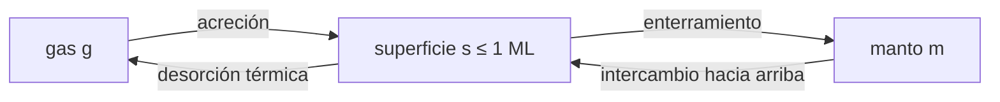

# B60-C04 — Balance químico gas-grano: modelos de tres fases

<!-- nav:top -->
[🏠 Programa](../../../../README.md) · [📚 Bloque B60](../../../tronco-comun/B60-cinetica-y-modelado-astroquimico.md) · [← Anterior: B60-C03 — Integración numérica de redes químicas rígidas](../B60-C03-integracion-numerica-de-redes-quimicas-rigidas/CLASE.md) · [Siguiente: B61-C01 — Dinámica de eyección y escalado de cráteres →](../../../tronco-comun/B61-crateres-de-impacto-y-geologia-de-impactos.md#b61-c01)
<!-- /nav -->

## 1. Ubicación, nivel y alcance

Clase 4 del bloque B60. Nivel N3. Hasta aquí la red era solo de fase gaseosa. En una nube fría las moléculas se **congelan sobre granos de polvo** y se liberan al calentarse. En [B55-C20](../../../tronco-comun/B55-astroquimica-y-geoquimica-extraterrestre.md) viste un modelo simplificado; aquí lo amplías a **tres reservorios**: gas, superficie activa y manto. Planteas los flujos de acreción, desorción térmica, enterramiento e intercambio, los integras con el método implícito de C03 y comparas un modelo de dos fases con uno de tres fases. El modelo es un **juguete sintético de una sola especie**: no reproduce ningún código ni observación.

## 2. Por qué esta clase existe

Un modelo de dos fases trata todo el hielo como si estuviera expuesto en la superficie; en la realidad la mayor parte queda enterrada bajo capas posteriores. La decisión central: **¿qué cambia en la predicción de cuánto hielo se libera al calentar si se distingue la superficie del manto?**

## 3. Lo que podrás hacer al terminar

1. Calcular la velocidad de acreción sobre granos con `n_d π a² v_th`.
2. Calcular una constante de desorción térmica `ν exp(−E_D/T)`.
3. Plantear un balance de tres reservorios que conserve la masa.
4. Integrarlo con un método implícito con tolerancias declaradas.
5. Comparar un calentamiento en dos y en tres fases.
6. Rotular qué es un parámetro ilustrativo y qué haría falta para contrastar con datos reales.

La evidencia es la **ficha del balance de tres fases** del ejercicio 12 (sección 20).

## 4. Con qué llegas y cómo comprobarlo

1. ¿Qué es una monocapa de un grano?
2. ¿Qué es una velocidad térmica `v_th`?
3. ¿Qué es una energía de desorción?
4. ¿Qué es un método implícito?
5. ¿Qué es un valor sintético?

<details>
<summary>Ver respuestas</summary>

1. La capa de moléculas que cubre la superficie del grano (un sitio por molécula). 2. `√(8kT/πm)`. 3. La energía (en K) para que una molécula salga de la superficie. 4. Un método que resuelve una ecuación en el paso nuevo (C03). 5. Un dato generado por el autor.
</details>

Con cuatro o cinco aciertos, sigue; si no, repasa los prerrequisitos.

## 5. Un caso de contexto y casos de referencia

Una nube **sintética** con `n_H = 10⁵ cm⁻³`, granos de 0,1 µm con `n_d/n_H = 10⁻¹²` y una especie X con abundancia de `10⁻⁵` (1 cm⁻³, unas 79 monocapas). A 10 K la acreción tarda `1,16 × 10⁵ años`; la desorción es nula a 10 K (`1,1 × 10⁻³⁸ s⁻¹`) y de `1,1 × 10⁻¹³ s⁻¹` a 20 K. Es el **ejemplo conductor**. Todo es **ilustrativo**; X no es ninguna especie real.

## 6. Vocabulario

La **acreción** es la captura de una molécula del gas por un grano. La **desorción térmica** es la salida por agitación térmica. La **superficie** es la capa química activa en contacto con el gas (aquí, una monocapa); el **manto** es el hielo enterrado bajo ella. El **modelo de tres fases** trata gas, superficie y manto como reservorios distintos; el de **dos fases**, solo gas y superficie. El **enterramiento** convierte superficie en manto. La **monocapa** (ML) es la capacidad de la superficie en cm⁻³ de gas.

## 7. Modelo mental: un edificio con una sola terraza

Como un edificio cuyo único piso expuesto es la terraza: lo que llega se queda en la terraza o baja a los pisos interiores; solo la terraza se ve afectada por el viento (la desorción). Para liberar lo de abajo, algo tiene que subirlo.



*Descripción textual:* el gas se acrece sobre la superficie; la superficie se desorbe de vuelta al gas o se entierra en el manto; el manto solo vuelve al gas pasando por la superficie.

Analogía: terraza e interiores. Límite: una sola especie, sin reacciones químicas, sin difusión explícita.

## 8. La explicación, paso a paso

### 8.1 Los flujos

Con `v_th = √(8kT/(π m))` y masa de 28 u, la acreción es `F_acc = n_d π a² v_th g` (pegado 1). La desorción es `F_des = ν exp(−E_D/T) s`, con `ν = 10¹² s⁻¹` y `E_D = 1150 K`. El enterramiento es `F_ent = F_acc (s/ML)⁴`, de modo que la superficie se llena hasta 1 ML y el exceso se entierra. El intercambio ascendente es `F_up = k_sw m max(0, 1 − s/ML)` con `k_sw = 3 × 10⁻¹³ s⁻¹`. Las derivadas son `dg/dt = −F_acc + F_des`, `ds/dt = F_acc − F_des − F_ent + F_up`, `dm/dt = F_ent − F_up`: la suma `g + s + m` es constante por construcción.

### 8.2 Acreción a 10 K

La monocapa vale `ML = 1,26 × 10⁻² cm⁻³`. El gas se agota igual en ambos modelos (`exp(−t/1,16 × 10⁵ años)`: a `10⁵` años queda el `42,2 %`). La diferencia está en dónde queda el hielo:

| `t` (años) | gas/total | superficie dos fases (ML) | superficie tres fases (ML) | manto/total (tres fases) |
|---|---|---|---|---|
| 10³ | 0,9914 | 0,68 | 0,65 | 0,0003 |
| 10⁴ | 0,9174 | 6,56 | 1,00 | 0,0700 |
| 10⁵ | 0,4223 | 45,85 | 1,00 | 0,5651 |
| 3 × 10⁵ | 0,0753 | 73,39 | 1,00 | 0,9121 |
| 10⁶ | 0,0002 | 79,35 | 1,00 | 0,9872 |

Un modelo de dos fases mantiene 79 monocapas como «superficie activa»; el de tres fases, una.

### 8.3 Calentamiento

Desde el estado a `10⁶` años, la temperatura sube linealmente de 10 a 50 K en `10⁵` años. Fracción de X que sigue como hielo (`(s + m)/total`):

| `T` (K) | dos fases | tres fases | manto/total (tres fases) |
|---|---|---|---|
| 15 | 0,9998 | 0,9998 | 0,9872 |
| 20 | 0,9971 | 0,9998 | 0,9872 |
| 22 | 0,5343 | 0,9932 | 0,9843 |
| 25 | 0,0000 | 0,9267 | 0,9267 |
| 30 | 0,0000 | 0,8233 | 0,8233 |
| 40 | 0,0000 | 0,6498 | 0,6498 |
| 50 | 0,0000 | 0,5128 | 0,5128 |

El de dos fases libera todo entre 20 y 25 K; el de tres fases libera la superficie y deja el manto, que sale con la lentitud del intercambio. A 50 K aún retiene el 51 %. Este valor depende del parámetro ilustrativo `k_sw`, por lo que es una demostración del mecanismo, no una predicción.

### 8.4 Conservación y tolerancias

El error relativo de conservación de la masa es `1,3 × 10⁻¹⁴`, con integración implícita adaptativa (`rtol = 10⁻⁴`, `atol = 10⁻¹⁰`).

### 8.5 Qué dice el artículo de referencia

Según el resumen consultado de Ruaud, Wakelam y Hersant (2016), su modelo Nautilus de tres fases trata superficie y manto como químicamente activos con reacción, difusión y evaporación, y reporta efectos sobre las abundancias de superficie y gas frente al de dos fases. **Este laboratorio no reproduce esos resultados**: no tiene química de superficie, ni difusión, ni la nube que ellos modelan.

## 9. Magnitudes, símbolos y unidades

| Símbolo | Qué es | Unidad | Valor / nota |
|---|---|---|---|
| `g, s, m` | gas, superficie, manto | cm⁻³ | total 1,00 |
| `ML` | capacidad de la monocapa | cm⁻³ | 1,26 × 10⁻² |
| `n_d` | densidad de granos | cm⁻³ | 10⁻⁷ |
| `a` | radio del grano | cm | 10⁻⁵ |
| `k_acc` | tasa de acreción | s⁻¹ | 2,732 × 10⁻¹³ (10 K) |
| `E_D` | energía de desorción | K | 1150 (ilustrativa) |
| `k_sw` | intercambio manto → superficie | s⁻¹ | 3 × 10⁻¹³ (ilustrativo) |

## 10. Convenciones y referencias

CGS (cm⁻³, cm), tiempo en años julianos de `3,15576 × 10⁷ s`, temperatura de gas y grano iguales. Constantes `k_B` y `u` de CODATA 2022. Tolerancia de conservación < `10⁻⁹`.

## 11. De dónde sale lo que afirmamos

| ID | Fuente | Localizador | Respalda | Estado |
|---|---|---|---|---|
| Ruaud16 | Ruaud, Wakelam, Hersant, *Gas and grain chemical composition in cold cores as predicted by the Nautilus 3-phase model* | arXiv:1604.05216 (resumen) | que existe un modelo de tres fases con superficie y manto activos | Consultada el 2026-11-09 (solo el resumen) |
| NIST-CODATA | NIST, constantes CODATA 2022: `k_B`, `u` | physics.nist.gov/cgi-bin/cuu/Value | constantes | Consultadas el 2026-11-09 |
| SciPy | `scipy.integrate.solve_ivp` | docs.scipy.org | motivo de usar un método implícito | Consultada el 2026-11-09 |
| — | Todos los parámetros del grano, la nube y la especie X | — | ejemplo | No consultados: ilustrativos |

Límites: no se consultó el texto completo del artículo ni los de dos fases; las ecuaciones de enterramiento e intercambio son del autor de la clase.

## 12. Cómo ver el balance

| Magnitud | Valor |
|---|---|
| superficie a 10⁶ años (dos fases) | 79,35 ML |
| superficie a 10⁶ años (tres fases) | 1,00 ML |
| hielo a 25 K: dos fases / tres fases | 0,0000 / 0,9267 |

Descripción larga: en dos fases, el hielo desaparece en una ventana de 5 K; en tres fases, la superficie sale primero y el resto lo hace con un cuello de botella.

## 13. Ejemplo trabajado: la desorción a 20 K

**Paso 1 · Cociente.** `E_D/T = 1150/20 = 57,5`.

**Paso 2 · Exponencial.** `exp(−57,5) = 1,07 × 10⁻²⁵`.

**Paso 3 · Frecuencia.** `k_des = 10¹² × 1,07 × 10⁻²⁵ = 1,07 × 10⁻¹³ s⁻¹`.

**Paso 4 · Escala.** `1/k_des = 9,3 × 10¹² s = 3 × 10⁵ años`.

## 14. Distintas formas de describir el balance

**Por flujos:** acreción, desorción, enterramiento, intercambio. **Por reservorios:** `g`, `s`, `m`. **Por escalas:** `1/k_acc`, `1/k_des`, `1/k_sw`. **Por conservación:** `g + s + m = const.`

## 15. Práctica guiada

**Ejercicio 1 · con los pasos indicados.** Calcula `ML = n_d × sitios por grano`. *Pasos:* `10⁻⁷ × 1,26 × 10⁵`.

<details><summary>Solución comentada</summary>

`1,26 × 10⁻² cm⁻³`.
</details>

**Ejercicio 2 · con una pista.** ¿Cuántas monocapas son 1 cm⁻³? *Pista:* divide entre `ML`.

<details><summary>Solución comentada</summary>

`1/1,26 × 10⁻² = 79`.
</details>

**Ejercicio 3 · casi autónomo.** Calcula `k_des(20 K)`.

<details><summary>Solución comentada</summary>

`1,07 × 10⁻¹³ s⁻¹` (sección 13).
</details>

## 16. Práctica autónoma, transferencia e integrador

**Ejercicio 4.** Calcula `1/k_acc` a 10 K en años.

<details><summary>Solución comentada</summary>

`1/(2,732 × 10⁻¹³) = 3,66 × 10¹² s = 1,16 × 10⁵ años`.
</details>

**Ejercicio 5.** Compara `exp(−t/t_acc)` a `10⁵` años con la tabla.

<details><summary>Solución comentada</summary>

`exp(−0,862) = 0,422`, igual al `0,4223` de la tabla: el gas se agota igual en ambos modelos.
</details>

**Ejercicio 6.** ¿Qué es irreal en las 79 monocapas «activas» de dos fases?

<details><summary>Solución comentada</summary>

Que la capa interior no está en contacto con el gas ni con los reactivos de la superficie; el modelo le da desorción libre.
</details>

**Ejercicio 7.** Compara el hielo restante a 25 K en ambos modelos.

<details><summary>Solución comentada</summary>

Dos fases: 0,0000; tres fases: 0,9267.
</details>

**Ejercicio 8.** ¿Cuánto vale el error de conservación y qué prueba?

<details><summary>Solución comentada</summary>

`1,3 × 10⁻¹⁴`: la suma de las derivadas es cero y el integrador la respeta.
</details>

**Ejercicio 9 · transferencia.** **Transferencia.** Duplicas `k_sw`. ¿Qué esperas del hielo a 50 K en tres fases?

<details><summary>Solución comentada</summary>

Que el manto salga más deprisa y quede menos hielo a 50 K que `0,5128`; el valor exacto se obtiene ejecutando el laboratorio, no por intuición.
</details>

**Ejercicio 10 · transferencia.** **Transferencia.** Un colega compara tu curva con una abundancia observada. ¿Qué respondes?

<details><summary>Solución comentada</summary>

Que la curva es sintética, de una especie sin química y con parámetros ilustrativos; no se puede comparar con datos reales sin un modelo y parámetros con fuente.
</details>

**Ejercicio 11 · transferencia.** **Transferencia.** ¿Qué parámetros reales tendrías que buscar, con fuente, para hacerlo más realista?

<details><summary>Solución comentada</summary>

Energías de desorción y de difusión, densidad y tamaño de los granos, sitios por grano y probabilidad de pegado, con la fuente y la fecha de cada valor.
</details>

**Ejercicio 12.** **Integrador.** Elabora tu *ficha del balance de tres fases*: flujos, escalas de tiempo, tabla de acreción, tabla de calentamiento y los límites del juguete.

<details><summary>Solución modelo</summary>

Secciones 8.1–8.5, con unidades, tolerancias y el rótulo «sintético».
</details>

## 17. Laboratorio: gas, superficie y manto

El script [tres_fases.py](tres_fases.py) integra con Euler implícito adaptativo los modelos de dos y de tres fases (**comprueba** conservación < `10⁻⁹`).

**Datos:** CODATA 2022 de NIST, consultadas el 2026-11-09; todo lo demás sintético e ilustrativo. **Predice antes de ejecutar:** ¿qué modelo libera más hielo a 25 K? (el de dos fases, todo.) **Ejecución del 2026-11-09 (Python 3.12.9):**

```text
Python 3.12.9 (biblioteca estandar)
Parametros ILUSTRATIVOS y SINTETICOS (ver la cabecera); unidades: cm^-3, s, K
n_d = 1.00e-07 cm^-3 ; monocapa ML = 1.260e-02 cm^-3 ; X total = 1.00 cm^-3 = 79 ML
k_acc(10 K) = 2.732e-13 s^-1 (t_acc = 1.160e+05 anos) ; k_des(10 K) = 1.14e-38 s^-1 ; k_des(20 K) = 1.07e-13 s^-1

Acrecion isoterma a 10 K, 2 fases:
  t [anos]     gas/total   superficie [ML]   manto/total
     1e+03      0.9914              0.68       0.0000
     1e+04      0.9174              6.56       0.0000
     1e+05      0.4223             45.85       0.0000
     3e+05      0.0753             73.39       0.0000
     1e+06      0.0002             79.35       0.0000

Acrecion isoterma a 10 K, 3 fases:
  t [anos]     gas/total   superficie [ML]   manto/total
     1e+03      0.9914              0.65       0.0003
     1e+04      0.9174              1.00       0.0700
     1e+05      0.4223              1.00       0.5651
     3e+05      0.0753              1.00       0.9121
     1e+06      0.0002              1.00       0.9872

Calentamiento lineal 10 -> 50 K en 1e5 anos desde el estado a 1e6 anos (fraccion de X en hielo = (s + m)/total):
  T [K]   hielo 2 fases   hielo 3 fases   manto 3 fases/total
     15          0.9998          0.9998              0.9872
     18          0.9998          0.9999              0.9873
     20          0.9971          0.9998              0.9872
     22          0.5343          0.9932              0.9843
     25          0.0000          0.9267              0.9267
     30          0.0000          0.8233              0.8233
     40          0.0000          0.6498              0.6498
     50          0.0000          0.5128              0.5128

Maximo error relativo de conservacion de la masa = 1.3e-14
Pruebas superadas.
```

```bash
python programa/clases/B60/B60-C04-balance-quimico-gas-grano-modelos-de-tres-fases/tres_fases.py
```

**Límites:** una especie, sin química de superficie ni difusión, sin fotodesorción ni rayos cósmicos, temperatura de gas y grano iguales, parámetros ilustrativos.

## 18. Errores frecuentes y cómo corregirlos

**Tratar todo el hielo como superficie.** Se corrige con 8.2.

**Presentar la curva de calentamiento como una predicción.** Se corrige con 8.3 y 8.5.

**Olvidar que `k_sw` es un parámetro ilustrativo.** Se corrige con la sección 9.

**Atribuir al artículo de referencia resultados que el laboratorio no reproduce.** Se corrige con la sección 11.

## 19. Cómo sabrás que vas bien

Tras la sección 8: ¿qué resultado esperabas y cuál obtuviste? Si dudas, repasa el ejemplo 13. Tras el laboratorio: ¿qué comprueba? (ver la sección 17).

## 20. Qué entregas y cómo se evalúa

El producto es tu **ficha del balance de tres fases** (ejercicio 12).

| Criterio | Inicial | En desarrollo | Logrado | Destacado |
|---|---|---|---|---|
| Conceptos | Los confunde | Parciales | conceptos de la clase | Explica los límites |
| Cálculo | Sin unidades | Con errores | Tablas completas | Calcula casos nuevos |
| Numérico | Sin comprobar | Un caso | Contraste con el análisis | Interpreta las diferencias |
| Fuentes | Sin fuente | Sin fecha | fuentes con fecha | Declara lo ilustrativo |
| Límites | No los nombra | Uno | Tres | Discute qué falta del modelo |

**Condiciones críticas (no se compensan con promedio):** rotular el modelo como sintético; no presentar lo simulado como observado; citar solo lo consultado.

## 21. Ética, seguridad y límites

Clase educativa: los modelos son simplificados. Accesibilidad: tablas equivalentes a las gráficas, fórmulas en texto, ejercicios sin conexión.

## 22. Para cerrar y seguir

Separar la superficie del manto cambia la predicción de calentamiento: a 25 K el modelo de dos fases libera todo y el de tres fases conserva el 93 %, con una conservación de masa de `10⁻¹⁴`. Con esto termina el bloque; queda abierto cómo contrastar un modelo así con datos reales y con una red completa de KIDA o UMIST, que esta clase no consultó.

**Glosario español–inglés.** acreción · *accretion*; desorción térmica · *thermal desorption*; manto de hielo · *ice mantle*; modelo de tres fases · *three-phase model*; monocapa · *monolayer*.

**Continuidad.** Fin del bloque B60; consulta la [guía del bloque](../../../tronco-comun/B60-cinetica-y-modelado-astroquimico.md).

**Referencias:** ver sección 11.

<!-- nav:bottom -->
---

[← Anterior: B60-C03 — Integración numérica de redes químicas rígidas](../B60-C03-integracion-numerica-de-redes-quimicas-rigidas/CLASE.md) · [📚 Bloque B60](../../../tronco-comun/B60-cinetica-y-modelado-astroquimico.md) · [Siguiente: B61-C01 — Dinámica de eyección y escalado de cráteres →](../../../tronco-comun/B61-crateres-de-impacto-y-geologia-de-impactos.md#b61-c01)
<!-- /nav -->
