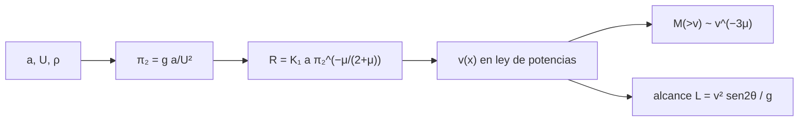

# B61-C01 — Dinámica de eyección y escalado de cráteres

<!-- nav:top -->
[🏠 Programa](../../../../README.md) · [📚 Bloque B61](../../../tronco-comun/B61-crateres-de-impacto-y-geologia-de-impactos.md) · [← Anterior: B60-C04 — Balance químico gas-grano: modelos de tres fases](../../B60/B60-C04-balance-quimico-gas-grano-modelos-de-tres-fases/CLASE.md) · [Siguiente: B61-C02 — Cráteres simples: morfología y formación →](../B61-C02-crateres-simples-morfologia-y-formacion/CLASE.md)
<!-- /nav -->

## 1. Ubicación, nivel y alcance

Clase 1 del bloque B61 (área A05). Nivel N3. Los bloques [B53](../../../tronco-comun/B53-astrogeologia-y-geodesia-planetaria.md) y B58 dan una visión general de los impactos; aquí entras en la **mecánica**: cómo se relacionan el tamaño del proyectil, la velocidad, la gravedad y el radio del cráter transitorio (régimen de gravedad, grupos π), y cómo se reparte la masa eyectada por velocidad. Todo en un cuerpo plano, sin atmósfera. Los números son **sintéticos** e ilustrativos; no se modela ningún cráter real.

## 2. Por qué esta clase existe

Para leer un cráter hay que invertir la pregunta: del tamaño observado al proyectil. Sin las leyes de escalado no hay estimación de energía ni de la cantidad de material que sale despedido. La decisión central: **¿cómo cambia el radio del cráter si cambian la gravedad, la velocidad o el tamaño del proyectil, y qué fracción del material sale rápido?**

## 3. Lo que podrás hacer al terminar

1. Plantear el radio transitorio como `R = K₁ a π₂^(−μ/(2+μ))` con `π₂ = g a/U²`.
2. Deducir los exponentes de `a`, `g` y `U` y comprobar su consistencia dimensional.
3. Explicar los límites de μ (1/3 momento, 2/3 energía) y qué cambia entre ellos.
4. Relacionar una ley de potencias de velocidad de eyección con la fracción de masa que supera `v`.
5. Calcular el alcance balístico de un fragmento y verificarlo con una integración numérica.
6. Declarar qué es ilustrativo y qué proviene de una fuente consultada.

La evidencia es la **ficha del escalado de un cráter** del ejercicio 12 (sección 20).

## 4. Con qué llegas y cómo comprobarlo

1. ¿Qué es un análisis dimensional?
2. ¿Qué es una ley de potencias?
3. ¿Qué es la energía cinética de un proyectil?
4. ¿Qué es un ajuste log-log?
5. ¿Qué es un valor ilustrativo?

<details>
<summary>Ver respuestas</summary>

1. Verificar que ambos lados de una fórmula tengan las mismas dimensiones. 2. Una relación `y ∝ x^k`. 3. `½ m U²`. 4. Una recta en el plano de logaritmos cuya pendiente es el exponente. 5. Un valor propuesto para el ejemplo, no medido.
</details>

Con cuatro o cinco aciertos, sigue; si no, repasa los prerrequisitos.

## 5. Un caso de contexto y casos de referencia

Con un proyectil ilustrativo de `a` = 500 m a `U` = 17 km/s y μ = 0,55, el modelo da un radio transitorio de **7,88 km en la Luna** (diámetro 15,76 km) y **6,59 km en Marte**. La gravedad más alta reduce el cráter, pero poco: `g^(−0,216)`. Es el **ejemplo conductor** y no corresponde a ningún cráter real.

## 6. Vocabulario

El **cráter transitorio** es la cavidad máxima antes del colapso. El **régimen de gravedad** es aquel en que el peso del material limita el crecimiento; el de **resistencia**, aquel en que lo limita la cohesión. `π₂ = g a/U²` es el **grupo adimensional de gravedad**. μ es el **exponente de acoplamiento** entre energía y momento. La **eyecta** es el material expulsado; su velocidad `v` decrece con la distancia `x` al punto de impacto.

## 7. Modelo mental

Un esquema del flujo de cálculo de la clase; el texto equivalente está debajo.



*Descripción textual:* el tamaño, la velocidad y la gravedad del impacto definen el grupo `π₂`; de él sale el radio transitorio; la velocidad de eyección, en ley de potencias, determina la fracción de masa rápida y el alcance de cada fragmento.

Analogía: una lámpara que ilumina un círculo: más potencia (energía) agranda el círculo, pero la «atracción» de la gravedad lo achica. Límite: es un modelo sin atmósfera, sin curvatura y de un solo material.

## 8. La explicación, paso a paso

### 8.1 Exponentes

Con `b = μ/(2+μ)`, `R = K₁ a (g a/U²)^(−b)` da `R ∝ a^(1−b) g^(−b) U^(2b)`. Con μ = 0,55 los exponentes son `p` = 0,7843, `q` = −0,2157 y `r` = 0,4314. Comprobación dimensional: `p+q+r = 1` (longitud) y `−2q − r = 0` (tiempo). Si la fuente de terceros da otro exponente para el volumen (aquí apareció −3μ/(3+μ)), el cálculo del radio y su consistencia dimensional son el árbitro (sección 11).

### 8.2 Luna y Marte

| cuerpo | `g` [m/s²] | `R` [km] | `D = 2R` [km] |
|---|---|---|---|
| Luna | 1,62 | 7,88 | 15,76 |
| Marte | 3,71 | 6,59 | 13,18 |

El cociente `R(Luna)/R(Marte)` es 1,1957. Datos **ilustrativos**.

### 8.3 Eyección

Si `v ∝ x^(−1/μ)` y la masa dentro de `x` crece como `x³`, la masa que supera `v` es `M(>v) ∝ v^(−3μ)`. El Monte Carlo (200 000 puntos, semilla 20261109) da pendiente −1,658 frente a −1,650. La forma de la ley de `v(x)` proviene de la literatura citada solo en resumen (sección 11).

### 8.4 Alcance

Un fragmento a 300 m/s a 45° en la Luna llega a 55 555,56 m; la integración RK4 coincide a 5×10⁻¹³.

## 9. Magnitudes, símbolos y unidades

| Símbolo | Qué es | Unidad | Valor / nota |
|---|---|---|---|
| `a` | radio del proyectil | m | 500 (ilustrativo) |
| `U` | velocidad de impacto | m/s | 17 000 (ilustrativo) |
| `g` | gravedad superficial | m/s² | 1,62; 3,71 (redondeados) |
| μ | exponente de acoplamiento | — | 0,55 (ilustrativo) |
| `K₁` | constante de ajuste | — | 1,0 (ilustrativo) |
| `R` | radio transitorio | m | calculado |

## 10. Convenciones y referencias

SI; cuerpo plano sin atmósfera; ejes con el origen en el punto de impacto; `x` es la distancia radial en la superficie inicial; ángulos medidos desde la horizontal.

## 11. De dónde sale lo que afirmamos

| ID | Fuente | Localizador | Respalda | Estado |
|---|---|---|---|---|
| S3 | Resultado de búsqueda web sobre Holsapple (1993), Annu. Rev. Earth Planet. Sci. 21, 333–373, y trabajos que lo citan | consultada 2026-11-09 | límites μ = 1/3 (momento) y 2/3 (energía); μ = 0,55 para roca blanda; dos regímenes (resistencia y gravedad) | Resumen de terceros; el artículo original no se consultó. El resumen escribía el exponente del volumen como −3μ/(3+μ), que no pude reconciliar con −3μ/(2+μ); se usa esta última por el cálculo del radio y se marca para verificar |
| S4 | Kurosawa y Takada (2018), *Impact cratering mechanics: a forward approach to predicting ejecta velocity distribution and transient crater radii*, arXiv:1806.07665, https://arxiv.org/abs/1806.07665 | consultada 2026-11-09 | el modelo Z de Maxwell reproduce una distribución de velocidad de eyección en ley de potencias | Solo el resumen; sin ecuaciones |
| — | Sin fuente externa | — | los cálculos de la sección 17 y los parámetros marcados como ilustrativos | No consultado |

Límites: el escalado de Holsapple se consultó solo mediante un resumen de terceros; la ley `v(x)` no se leyó en un original; todos los valores de entrada son ilustrativos.

## 12. Cómo ver el resultado

| Magnitud | Valor |
|---|---|
| `p`, `q`, `r` | 0,7843; −0,2157; 0,4314 |
| `R` Luna | 7,88 km |
| `R` Marte | 6,59 km |
| pendiente `M(>v)` | −1,658 (teoría −1,650) |
| alcance | 55 555,56 m |

Descripción larga: la gravedad achica el cráter con un exponente pequeño; la masa rápida cae como `v^(−1,65)`.

## 13. Ejemplo trabajado

**Ejemplo: ¿cuánto cambia el cráter si la gravedad se duplica?**

**Paso 1 · Exponente.** `q = −μ/(2+μ) = −0,2157`.

**Paso 2 · Factor.** `2^(−0,2157) = 0,861`.

**Paso 3 · Resultado.** El radio baja a ≈ 86 % del valor previo, un −14 %. Es una estimación ilustrativa, no una medida.

## 14. Distintas formas de describir lo mismo

**Por fórmula:** `R(a, g, U)`. **Por tabla:** Luna y Marte. **Por pendiente:** recta log-log de `R` frente a `g` con pendiente −0,2157. **Por simulación:** Monte Carlo de `M(>v)`.

## 15. Práctica guiada

**Ejercicio 1 · con los pasos indicados.** Con `a` = 500 m y `U` = 17 km/s, calcula `π₂` en la Luna. *Pasos:* `g a/U²`.

<details><summary>Solución comentada</summary>

`1,62×500/(1,7×10⁴)² = 2,80×10⁻⁶`.
</details>

**Ejercicio 2 · con una pista.** Con una pista: ¿cuánto vale `b = μ/(2+μ)` para μ = 1/3?

<details><summary>Solución comentada</summary>

`(1/3)/(7/3) = 1/7 = 0,1429`.
</details>

**Ejercicio 3 · casi autónomo.** Casi autónomo: ¿a qué exponente de `a` se llega con μ = 0,55?

<details><summary>Solución comentada</summary>

`1−b = 0,7843`.
</details>

## 16. Práctica autónoma, transferencia e integrador

**Ejercicio 4.** Calcula `q` para μ = 2/3.

<details><summary>Solución comentada</summary>

`b = (2/3)/(8/3) = 0,25`; `q = −0,25`.
</details>

**Ejercicio 5.** ¿Qué pendiente espera `M(>v)` con μ = 0,41?

<details><summary>Solución comentada</summary>

`−3μ = −1,23`.
</details>

**Ejercicio 6.** Calcula el alcance de un fragmento a 200 m/s y 45° en Marte.

<details><summary>Solución comentada</summary>

`200²/3,71 = 10 781,7 m`.
</details>

**Ejercicio 7.** ¿Qué factor cambia `R` si `U` se duplica?

<details><summary>Solución comentada</summary>

`2^(0,4314) = 1,349`.
</details>

**Ejercicio 8.** ¿Cuánto vale `R(Luna)/R(Marte)` y qué exponente lo explica?

<details><summary>Solución comentada</summary>

1,1957; `(3,71/1,62)^0,2157`.
</details>

**Ejercicio 9 · transferencia.** **Transferencia.** Un colega usa μ = 1/3 en vez de 0,55. ¿Qué cambia en la pendiente de `M(>v)` y en el radio?

<details><summary>Solución comentada</summary>

La pendiente pasa de −1,65 a −1,00 y `b` de 0,215 a 0,143; el cráter resulta más sensible a `U` que a `g`. Hay que declarar el μ elegido.
</details>

**Ejercicio 10 · transferencia.** **Transferencia.** Quieres aplicar el modelo a un asteroide de `g` = 0,01 m/s². ¿Qué hipótesis puede fallar?

<details><summary>Solución comentada</summary>

El régimen de gravedad: a tan baja `g` domina la resistencia del material, y el modelo no es válido.
</details>

**Ejercicio 11 · transferencia.** **Transferencia.** Un artículo da un exponente del volumen distinto del que deduces. ¿Cómo procedes?

<details><summary>Solución comentada</summary>

Compruebas la consistencia dimensional, reconstruyes la derivación, citas ambas versiones y declaras la discrepancia sin resolver si no puedes consultar el original.
</details>

**Ejercicio 12 · integrador.** Elabora tu *ficha del escalado de un cráter*: parámetros, exponentes, radio transitorio en la Luna y en Marte, pendiente de la masa eyectada y alcance balístico, con unidades y rótulos de lo ilustrativo.

<details><summary>Solución modelo</summary>

Secciones 8.1–8.4: exponentes `p`, `q`, `r`; R(Luna) = 7,88 km y R(Marte) = 6,59 km para `a` = 500 m y `U` = 17 km/s (ilustrativo); pendiente −1,66 frente a −1,65; alcance 55 555,56 m con diferencia 5×10⁻¹³.
</details>

## 17. Laboratorio: exponentes de escalado, eyección y alcance

El script [escalado.py](escalado.py) verifica los exponentes dimensionales, el ajuste log-log de `R(g)`, la pendiente de la masa eyectada por Monte Carlo y el alcance RK4 (**comprueba** 1e-12, 1e-9, 0,03 y 1e-6).

**Datos:** `a`, `U`, μ y `K₁` **ilustrativos**; `g` de Luna y Marte redondeados; semilla `20261109`. **Predice antes de ejecutar:** ¿Será el cráter marciano mayor o menor que el lunar? (menor, con `g^(−0,216)`.) **Ejecución del 2026-11-09 (Python 3.12.9):**

```text
Python 3.12.9 (biblioteca estandar)
Exponentes R ~ a^p g^q U^r: p=0.784314 q=-0.215686 r=0.431373
Luna: a=500 m, U=17 km/s -> R_transitorio=7.88 km (D=15.76 km) [ilustrativo]
Marte: a=500 m, U=17 km/s -> R_transitorio=6.59 km (D=13.18 km) [ilustrativo]
Pendiente log-log de R frente a g = -0.215686275 ; teorica = -0.215686275
Cociente R(Luna)/R(Marte) = 1.1957
Pendiente de M(>v) en Monte Carlo = -1.6576 ; teorica -3*mu = -1.6500
Alcance a v=300 m/s, 45 grados, Luna: RK4=55555.5556 m ; analitico=55555.5556 m ; dif. relativa=5.41e-13
Pruebas superadas.
```

```bash
python programa/clases/B61/B61-C01-dinamica-de-eyeccion-y-escalado-de-crateres/escalado.py
```

**Límites:** sin atmósfera ni curvatura; un solo material; la ley `v(x)` y μ son ilustrativos; no se modela el cráter de ningún cuerpo real.

## 18. Errores frecuentes y cómo corregirlos

**Usar μ sin declararlo.** Se corrige con la sección 9.

**Confundir régimen de gravedad con régimen de resistencia.** Se corrige con la sección 6.

**Presentar `R` ilustrativo como medido.** Se corrige con la sección 5.

**Aplicar la fórmula a un cuerpo diminuto.** Se corrige con el ejercicio 10.

## 19. Cómo sabrás que vas bien

Tras la sección 8: ¿qué resultado esperabas y cuál obtuviste? Si dudas, repasa el ejemplo de la sección 13. Tras el laboratorio: ¿qué comprueba cada aserción? (ver la sección 17).

## 20. Qué entregas y cómo se evalúa

El producto es tu **ficha del escalado de un cráter** (ejercicio 12).

| Criterio | Inicial | En desarrollo | Logrado | Destacado |
|---|---|---|---|---|
| Conceptos | Los confunde | Parciales | Explica los conceptos de la clase | Explica los límites |
| Cálculo | Sin unidades | Con errores | Tablas completas con unidades | Calcula casos nuevos |
| Numérico | Sin comprobar | Un caso | Contraste con una vía independiente | Interpreta las diferencias |
| Fuentes | Sin fuente | Sin fecha | Fuentes con fecha y estado | Declara lo no consultado |
| Límites | No los nombra | Uno | Tres | Discute qué falta del modelo |

**Condiciones críticas (no se compensan con promedio):** rotular los datos sintéticos e ilustrativos; no presentar lo simulado como observado; citar solo lo consultado.

## 21. Ética, seguridad y límites

Clase educativa: los modelos son simplificados y no sustituyen un código de impactos (hidrocódigo) ni el análisis de datos reales. No se estima el riesgo de ningún objeto real. Accesibilidad: tablas equivalentes a las gráficas, fórmulas en texto, ejercicios sin conexión.

## 22. Para cerrar y seguir

El radio de un cráter sale de un grupo adimensional y de un exponente de acoplamiento, y la masa rápida de la eyecta sigue una ley de potencias. Queda una pregunta: ¿cómo luce la cavidad final de un cráter pequeño?

**Glosario español–inglés.** cráter transitorio · *transient crater*; régimen de gravedad · *gravity regime*; eyecta · *ejecta*; acoplamiento · *coupling*; ley de escalado · *scaling law*.

**Continuidad.** [B61-C02](../B61-C02-crateres-simples-morfologia-y-formacion/CLASE.md) estudia la morfología de los cráteres simples.

**Referencias:** ver sección 11.

<!-- nav:bottom -->
---

[← Anterior: B60-C04 — Balance químico gas-grano: modelos de tres fases](../../B60/B60-C04-balance-quimico-gas-grano-modelos-de-tres-fases/CLASE.md) · [📚 Bloque B61](../../../tronco-comun/B61-crateres-de-impacto-y-geologia-de-impactos.md) · [Siguiente: B61-C02 — Cráteres simples: morfología y formación →](../B61-C02-crateres-simples-morfologia-y-formacion/CLASE.md)
<!-- /nav -->
