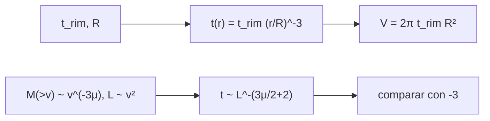

# B61-C04 — Mantos de ejecta y depósitos de impacto

<!-- nav:top -->
[🏠 Programa](../../../../README.md) · [📚 Bloque B61](../../../tronco-comun/B61-crateres-de-impacto-y-geologia-de-impactos.md) · [← Anterior: B61-C03 — Cráteres complejos: colapso, picos centrales y terrazas](../B61-C03-crateres-complejos-colapso-picos-centrales-y-terrazas/CLASE.md) · [Siguiente: B61-C05 — Fusión por impacto y metamorfismo de choque →](../B61-C05-fusion-por-impacto-y-metamorfismo-de-choque/CLASE.md)
<!-- /nav -->

## 1. Ubicación, nivel y alcance

Clase 4 del bloque B61. Nivel N3. El **manto de ejecta** es el depósito de material expulsado alrededor del cráter: grueso en el borde y cada vez más delgado. Aquí usas la ley empírica `t = t_rim (r/R)^−3`, calculas el volumen del manto, lo comparas con el bol y **deduces por balística** el exponente esperado, que resulta ser −3 solo para μ = 2/3. Usa la [C01](../B61-C01-dinamica-de-eyeccion-y-escalado-de-crateres/CLASE.md) y la [C02](../B61-C02-crateres-simples-morfologia-y-formacion/CLASE.md). Los datos son sintéticos; la ley empírica proviene de un resumen de terceros.

## 2. Por qué esta clase existe

El manto de ejecta es un marcador estratigráfico: cubre lo anterior y es cubierto por lo posterior. La decisión central: **¿cómo decae el espesor con la distancia y cuánto volumen contiene el manto?**

## 3. Lo que podrás hacer al terminar

1. Aplicar `t(r) = t_rim (r/R)^−3` y calcular el espesor a 1, 2, 3 y 5 R.
2. Integrar el volumen del manto y compararlo con el bol.
3. Deducir un exponente balístico `−(3μ/2+2)` y compararlo con el empírico.
4. Usar un Monte Carlo para verificar la deducción.
5. Explicar el valor de la ejecta como marcador estratigráfico.
6. Declarar el rango de validez de la ley (2–3 R).

La evidencia es la **ficha del manto de ejecta** del ejercicio 12 (sección 20).

## 4. Con qué llegas y cómo comprobarlo

1. ¿Qué es una integral en coordenadas polares?
2. ¿Qué es el espesor de un depósito?
3. ¿Qué es una ley de potencias (C01)?
4. ¿Qué es el alcance balístico?
5. ¿Qué es un marcador estratigráfico?

<details>
<summary>Ver respuestas</summary>

1. `∫ 2π r f(r) dr` para una función radial. 2. La altura de la capa depositada. 3. `y ∝ x^k`. 4. La distancia que recorre un fragmento (`v² sen2θ / g`). 5. Un nivel reconocible que ordena eventos en el tiempo.
</details>

Con cuatro o cinco aciertos, sigue; si no, repasa los prerrequisitos.

## 5. Un caso de contexto y casos de referencia

Con `t_rim` = 0,04 R, el espesor cae de 0,0400 R en el borde a 0,0050 R en 2 R y 0,0015 R en 3 R. El manto contiene 0,2513 R³, el **38 %** del volumen del bol de `d/D` = 0,2. Todo **sintético** salvo la forma de la ley, que proviene de un resumen de terceros.

## 6. Vocabulario

El **manto de ejecta** es el depósito continuo; la **ejecta distal** es la que llega más lejos. El **espesor en el borde** `t_rim` es la referencia. La **estratigrafía invertida** es el orden volcado de las capas en el borde. La **ley de −3** es la relación empírica de caída del espesor.

## 7. Modelo mental

Un esquema del flujo de cálculo de la clase; el texto equivalente está debajo.



*Descripción textual:* la ley empírica da el espesor y el volumen; una deducción balística da otro exponente que se contrasta con la ley.

Analogía: la nieve que cae de una máquina de nieve: mucha cerca, poca lejos. Límite: la ley es empírica y válida solo cerca del cráter.

## 8. La explicación, paso a paso

### 8.1 Espesor y volumen

| `r` | `t(r)` [R] |
|---|---|
| 1 R | 0,040000 |
| 2 R | 0,005000 |
| 3 R | 0,001481 |
| 5 R | 0,000320 |

`V_manto/R³` = 0,251327 (analítico) y 0,251325 (numérico, dif. 1,0×10⁻⁵). El volumen del bol con `d/D` = 0,2 es 0,661829 R³ y la razón vale 0,380. Dentro de 2 R queda el 50 % del volumen; dentro de 3 R, el 66,7 %.

### 8.2 Exponente derivado

Con `M(>v) ∝ v^(−3μ)` y `L ∝ v²`, el espesor sigue `t ∝ L^(−(3μ/2+2))`. Con μ = 0,55 la deducción da −2,825; el Monte Carlo (400 000 puntos, semilla 20261109) da −2,850. Con μ = 2/3 la deducción da exactamente −3,000.

### 8.3 Lectura

La ley empírica de −3 coincide con la balística solo en el límite de escalado de energía. La diferencia es un recordatorio de que ambos son modelos; en Marte, según un resumen consultado, se midieron exponentes muy distintos para algunos cráteres lobulados.

## 9. Magnitudes, símbolos y unidades

| Símbolo | Qué es | Unidad | Valor / nota |
|---|---|---|---|
| `t` | espesor | R | calculado |
| `t_rim` | espesor en el borde | R | 0,04 (ilustrativo, de resumen) |
| `r` | distancia radial | R | ≥ 1 |
| `V` | volumen del manto | R³ | 0,2513 |
| μ | acoplamiento | — | 0,55; 2/3 |

## 10. Convenciones y referencias

Unidades relativas al radio del cráter `R`; la ley es válida de ≈ 1 a 3 R; el cuerpo es plano y sin atmósfera.

## 11. De dónde sale lo que afirmamos

| ID | Fuente | Localizador | Respalda | Estado |
|---|---|---|---|---|
| S6 | Resultados de búsqueda web que citan a McGetchin et al. (1973), Earth Planet. Sci. Lett. 20, 226–236 (registro NTRS 19740032200), y a un artículo de arXiv de 2019 (probablemente arXiv:1902.07746; no verificado) | consultada 2026-11-09 | ley de espesor t = t_rim (r/R)^−3 en 2–3 R y t_rim ≈ 0,04 R en cráteres pequeños; advertencias de Pike (1974) y exponentes distintos en Marte | Resumen de terceros; originales no leídos |
| S4 | Kurosawa y Takada (2018), *Impact cratering mechanics: a forward approach to predicting ejecta velocity distribution and transient crater radii*, arXiv:1806.07665, https://arxiv.org/abs/1806.07665 | consultada 2026-11-09 | el modelo Z de Maxwell reproduce una distribución de velocidad de eyección en ley de potencias | Solo el resumen; sin ecuaciones |
| — | Sin fuente externa | — | los cálculos de la sección 17 y los parámetros marcados como ilustrativos | No consultado |

Límites: la ley de −3 y `t_rim` ≈ 0,04 R se conocen solo por resúmenes de búsqueda; el original de McGetchin et al. (1973) no se leyó; los resultados de Marte se citan de un resumen.

## 12. Cómo ver el resultado

| Magnitud | Valor |
|---|---|
| `V_manto` | 0,2513 R³ |
| `V_manto/V_bol` | 0,380 |
| pendiente MC | −2,850 |
| derivada (μ = 0,55) | −2,825 |

Descripción larga: el espesor cae cerca de 8 veces entre 1 R y 2 R; la deducción balística se acerca a −3 al subir μ.

## 13. Ejemplo trabajado

**Ejemplo: espesor a 3 R.**

**Paso 1.** `(3)^−3 = 0,03704`.

**Paso 2.** `t = 0,04 × 0,03704 = 0,001481 R`.

**Paso 3.** Para un cráter de R = 500 m, son 0,74 m (ilustrativo).

## 14. Distintas formas de describir lo mismo

**Por fórmula:** ley de −3. **Por integral:** `2π t_rim R²`. **Por balística:** `−(3μ/2+2)`. **Por simulación:** densidad por anillos.

## 15. Práctica guiada

**Ejercicio 1 · con los pasos indicados.** Calcula `t(2 R)` con `t_rim` = 0,04 R. *Pasos:* `0,04/8`.

<details><summary>Solución comentada</summary>

`0,005 R`.
</details>

**Ejercicio 2 · con una pista.** Con una pista: ¿cuánto vale `2π t_rim R²` con `t_rim` = 0,04 R?

<details><summary>Solución comentada</summary>

`0,2513 R³`.
</details>

**Ejercicio 3 · casi autónomo.** Casi autónomo: ¿qué fracción del volumen está fuera de 3 R?

<details><summary>Solución comentada</summary>

`1/3`.
</details>

## 16. Práctica autónoma, transferencia e integrador

**Ejercicio 4.** Calcula `t(5 R)`.

<details><summary>Solución comentada</summary>

`0,04/125 = 0,00032 R`.
</details>

**Ejercicio 5.** Calcula el exponente derivado para μ = 0,41.

<details><summary>Solución comentada</summary>

`−(0,615+2) = −2,615`.
</details>

**Ejercicio 6.** ¿Qué μ da exactamente −3?

<details><summary>Solución comentada</summary>

`μ = 2/3`.
</details>

**Ejercicio 7.** ¿Qué razón volumen manto/bol obtienes?

<details><summary>Solución comentada</summary>

0,380.
</details>

**Ejercicio 8.** Para R = 1 km, ¿cuánto vale `t` a 2 R en metros?

<details><summary>Solución comentada</summary>

`5 m` (ilustrativo).
</details>

**Ejercicio 9 · transferencia.** **Transferencia.** Un artículo da −2,6 en un cráter. ¿Qué μ implicaría la balística?

<details><summary>Solución comentada</summary>

`3μ/2+2 = 2,6` → μ = 0,4.
</details>

**Ejercicio 10 · transferencia.** **Transferencia.** ¿Por qué el espesor de un manto real no sigue −3 a 10 R?

<details><summary>Solución comentada</summary>

La ley es empírica y válida cerca; hay otros procesos (rayos, secundarios) y el terreno no es plano.
</details>

**Ejercicio 11 · transferencia.** **Transferencia.** ¿Cómo usarías el manto para ordenar dos eventos?

<details><summary>Solución comentada</summary>

Por superposición: el que cubre es posterior; se requiere cartografía real, no sintética.
</details>

**Ejercicio 12 · integrador.** Elabora tu *ficha del manto de ejecta*: ley de espesor, volumen del manto, razón con el bol, exponente derivado de la balística y su comparación con −3, con rótulos.

<details><summary>Solución modelo</summary>

Secciones 8.1–8.3: `V_manto = 2π t_rim R²` = 0,2513 R³; razón con el bol 0,380; 50 % del volumen dentro de 2 R; pendiente Monte Carlo −2,850 frente a −2,825 derivada y −3 empírica.
</details>

## 17. Laboratorio: espesor, volumen y exponente del manto de ejecta

El script [ejecta.py](ejecta.py) integra el volumen del manto, lo compara con el bol y verifica por Monte Carlo el exponente derivado de la balística (**comprueba** 1e-4 y 0,05).

**Datos:** razones geométricas **sintéticas**; la ley de −3 y `t_rim` de **resúmenes de terceros**; semilla `20261109`. **Predice antes de ejecutar:** ¿Será el exponente derivado con μ = 0,55 mayor o menor en valor absoluto que 3? (menor, 2,825.) **Ejecución del 2026-11-09 (Python 3.12.9):**

```text
Python 3.12.9 (biblioteca estandar)
V_manto/R^3 : analitico 0.251327 ; numerico 0.251325 ; dif. relativa 1.00e-05
Volumen del bol (casquete, d/D=0.2) = 0.661829 R^3 ; razon V_manto/V_bol = 0.380
Fraccion del volumen del manto dentro de 2 R = 0.500
Fraccion del volumen del manto dentro de 3 R = 0.667
t(1 R) = 0.040000 R
t(2 R) = 0.005000 R
t(3 R) = 0.001481 R
t(5 R) = 0.000320 R
Pendiente de t(L) en Monte Carlo = -2.850 ; derivada = -(3mu/2+2) = -2.825 ; ley empirica = -3
Con mu = 2/3 (escalado de energia) la derivada da -3.000
Pruebas superadas.
```

```bash
python programa/clases/B61/B61-C04-mantos-de-ejecta-y-depositos-de-impacto/ejecta.py
```

**Límites:** cuerpo plano, sin atmósfera, sin curvatura ni interacción del flujo con el terreno.

## 18. Errores frecuentes y cómo corregirlos

**Aplicar −3 a cualquier distancia.** Se corrige con la sección 10.

**Olvidar que el borde es el espesor máximo.** Se corrige con 8.1.

**Confundir la ley empírica con la deducción.** Se corrige con 8.3.

**Presentar espesores sintéticos como medidos.** Se corrige con la sección 5.

## 19. Cómo sabrás que vas bien

Tras la sección 8: ¿qué resultado esperabas y cuál obtuviste? Si dudas, repasa el ejemplo de la sección 13. Tras el laboratorio: ¿qué comprueba cada aserción? (ver la sección 17).

## 20. Qué entregas y cómo se evalúa

El producto es tu **ficha del manto de ejecta** (ejercicio 12).

| Criterio | Inicial | En desarrollo | Logrado | Destacado |
|---|---|---|---|---|
| Conceptos | Los confunde | Parciales | Explica los conceptos de la clase | Explica los límites |
| Cálculo | Sin unidades | Con errores | Tablas completas con unidades | Calcula casos nuevos |
| Numérico | Sin comprobar | Un caso | Contraste con una vía independiente | Interpreta las diferencias |
| Fuentes | Sin fuente | Sin fecha | Fuentes con fecha y estado | Declara lo no consultado |
| Límites | No los nombra | Uno | Tres | Discute qué falta del modelo |

**Condiciones críticas (no se compensan con promedio):** rotular los datos sintéticos e ilustrativos; no presentar lo simulado como observado; citar solo lo consultado.

## 21. Ética, seguridad y límites

Clase educativa: los modelos son simplificados y no sustituyen un código de impactos (hidrocódigo) ni el análisis de datos reales. No se cartografía ningún depósito real. Accesibilidad: tablas equivalentes a las gráficas, fórmulas en texto, ejercicios sin conexión.

## 22. Para cerrar y seguir

El espesor de la ejecta cae como una ley de potencias y su volumen es una fracción del bol; la balística da un exponente cercano. Queda una pregunta: ¿qué le pasa a la roca que sufrió el choque?

**Glosario español–inglés.** manto de ejecta · *ejecta blanket*; espesor · *thickness*; estratigrafía invertida · *inverted stratigraphy*; ejecta distal · *distal ejecta*; marcador · *marker horizon*.

**Continuidad.** [B61-C05](../B61-C05-fusion-por-impacto-y-metamorfismo-de-choque/CLASE.md) estudia la fusión y el metamorfismo de choque.

**Referencias:** ver sección 11.

<!-- nav:bottom -->
---

[← Anterior: B61-C03 — Cráteres complejos: colapso, picos centrales y terrazas](../B61-C03-crateres-complejos-colapso-picos-centrales-y-terrazas/CLASE.md) · [📚 Bloque B61](../../../tronco-comun/B61-crateres-de-impacto-y-geologia-de-impactos.md) · [Siguiente: B61-C05 — Fusión por impacto y metamorfismo de choque →](../B61-C05-fusion-por-impacto-y-metamorfismo-de-choque/CLASE.md)
<!-- /nav -->
