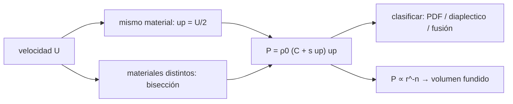

# B61-C05 — Fusión por impacto y metamorfismo de choque

<!-- nav:top -->
[🏠 Programa](../../../../README.md) · [📚 Bloque B61](../../../tronco-comun/B61-crateres-de-impacto-y-geologia-de-impactos.md) · [← Anterior: B61-C04 — Mantos de ejecta y depósitos de impacto](../B61-C04-mantos-de-ejecta-y-depositos-de-impacto/CLASE.md) · [Siguiente: B61-C06 — Datación por conteo de cráteres: funciones de producción y edades de modelo →](../B61-C06-datacion-por-conteo-de-crateres-funciones-de-produccion-y-edades-de-modelo/CLASE.md)
<!-- /nav -->

## 1. Ubicación, nivel y alcance

Clase 5 del bloque B61. Nivel N3. Cuando el impacto pasa por la roca, una onda de choque la comprime y la calienta; según la presión aparecen deformación de choque, vidrios diaplécticos o fusión. Aquí calculas la **presión de choque** por **acoplamiento de impedancias** (dos vías independientes) y estimas el volumen fundido con una ley de atenuación. Usa la [C01](../B61-C01-dinamica-de-eyeccion-y-escalado-de-crateres/CLASE.md). La Hugoniot, el proyectil y el exponente de atenuación son **ilustrativos**; los umbrales de presión provienen de resúmenes de terceros.

## 2. Por qué esta clase existe

Las rocas con rasgos de choque son la evidencia de un impacto. La decisión central: **¿qué presión produce cada efecto y cuánta roca se funde?**

## 3. Lo que podrás hacer al terminar

1. Usar la Hugoniot lineal `Us = C + s up` y la presión `P = ρ₀ (C + s up) up`.
2. Resolver el acoplamiento de impedancias en forma cerrada y por bisección.
3. Clasificar una presión en intervalos de metamorfismo de choque.
4. Estimar el radio y el volumen fundidos con una atenuación `P ∝ r^−n`.
5. Comprobar la continuidad de presión entre proyectil y blanco.
6. Declarar que los umbrales son órdenes de magnitud variables con la fuente.

La evidencia es la **ficha de la presión de choque** del ejercicio 12 (sección 20).

## 4. Con qué llegas y cómo comprobarlo

1. ¿Qué es una onda de choque?
2. ¿Qué es una presión en GPa?
3. ¿Qué es la velocidad de partícula?
4. ¿Qué es la bisección (C02)?
5. ¿Qué es un valor ilustrativo?

<details>
<summary>Ver respuestas</summary>

1. Una perturbación que avanza más rápido que el sonido en el medio. 2. 10⁹ Pa. 3. La velocidad con que se mueve el material tras el paso del choque. 4. Un método de raíces por mitades. 5. Un valor de ejemplo, no medido.
</details>

Con cuatro o cinco aciertos, sigue; si no, repasa los prerrequisitos.

## 5. Un caso de contexto y casos de referencia

Con una roca ilustrativa (ρ₀ = 2860 kg/m³, C = 2600 m/s, s = 1,6), un impacto a 5 km/s contra el mismo material da **47,19 GPa**, en el rango del vidrio diaplectico, y uno a 8 km/s da **102,96 GPa**, en el de fusión. A 17 km/s con un proyectil denso (también ilustrativo) la presión sube a **661,6 GPa**.

## 6. Vocabulario

La **Hugoniot** relaciona la velocidad del choque con la de partícula. La **impedancia** es `ρ₀(C + s up)`. El **metamorfismo de choque** es el cambio mineral por presión. Los **PDF** son láminas de deformación planares en el cuarzo. El **vidrio diaplectico** (p. ej. maskelynita) se forma sin fusión. La **atenuación** es la caída de la presión con la distancia.

## 7. Modelo mental

Un esquema del flujo de cálculo de la clase; el texto equivalente está debajo.



*Descripción textual:* la velocidad de impacto fija la presión por dos vías; la presión se clasifica en efectos de choque y, con una atenuación, da el radio y el volumen fundidos.

Analogía: dos autos que chocan: la presión de contacto la comparten según su «dureza»; si son iguales, cada uno absorbe la mitad de la velocidad. Límite: modelo plano, un solo material, sin calor latente.

## 8. La explicación, paso a paso

### 8.1 Presión

| `U` [km/s] | `P` cerrada [GPa] | `P` bisección [GPa] | efecto |
|---|---|---|---|
| 3,0 | 21,450 | 21,450 | PDF / deformación |
| 5,0 | 47,190 | 47,190 | vidrio diaplectico |
| 8,0 | 102,960 | 102,960 | fusión de roca |
| 12,0 | 209,352 | 209,352 | fusión |
| 17,0 | 393,822 | 393,822 | fusión |
| 20,0 | 531,960 | 531,960 | fusión |

Las dos vías coinciden con diferencia 0 a la precisión impresa. Umbrales (de resúmenes de terceros): PDF desde ≈ 10 GPa, vidrio diaplectico ≈ 30–40 GPa, fusión > ≈ 60 GPa; dependen de la temperatura previa.

### 8.2 Materiales distintos

Un proyectil denso (ρ = 7850, C = 3570, s = 1,92; ilustrativos) a 17 km/s contra la roca da 661,6 GPa, con velocidad de partícula en el blanco de 11 239 m/s. La continuidad de presión entre proyectil y blanco es de 661,621029 GPa en ambos.

### 8.3 Volumen fundido

Con `P₀` = 393,8 GPa (mismo material, 17 km/s) y `r_m = a (P₀/60)^(1/n)`: n = 1,5 → 3,51 a y 43,1 volúmenes de proyectil; n = 2 → 2,56 a y 16,8; n = 3 → 1,87 a y 6,6. Son **cotas superiores ilustrativas**; el exponente de atenuación real no se consultó.

## 9. Magnitudes, símbolos y unidades

| Símbolo | Qué es | Unidad | Valor / nota |
|---|---|---|---|
| ρ₀ | densidad | kg/m³ | 2860 (ilustrativo) |
| `C`, `s` | parámetros de la Hugoniot | m/s, — | 2600; 1,6 (ilustrativos) |
| `up` | velocidad de partícula | m/s | calculada |
| `P` | presión de choque | GPa | calculada |
| `n` | exponente de atenuación | — | 1,5–3 (ilustrativo) |

## 10. Convenciones y referencias

SI; presión en GPa en las tablas; choque plano de dos cuerpos semiinfinitos; sin calor latente ni porosidad.

## 11. De dónde sale lo que afirmamos

| ID | Fuente | Localizador | Respalda | Estado |
|---|---|---|---|---|
| S7 | Resultados de búsqueda web que citan a Stöffler et al. (1991), Geochim. Cosmochim. Acta 55, 3845–3867, y a Stöffler y Langenhorst (1994) | consultada 2026-11-09 | PDF en cuarzo desde ≈ 10 GPa; vidrio diaplectico ≈ 30–40 GPa; fusión de roca > ≈ 60 GPa; dependencia de la temperatura previa | Resumen de terceros; originales no leídos; los umbrales varían con la fuente |
| — | Sin fuente externa | — | los cálculos de la sección 17 y los parámetros marcados como ilustrativos | No consultado |

Límites: los umbrales de presión se conocen solo por resúmenes de búsqueda (Stöffler et al. 1991; Stöffler y Langenhorst 1994 no se leyeron); la Hugoniot, el proyectil y la atenuación son ilustrativos.

## 12. Cómo ver el resultado

| Magnitud | Valor |
|---|---|
| `P` a 5 km/s | 47,19 GPa |
| `P` a 8 km/s | 102,96 GPa |
| proyectil denso a 17 km/s | 661,6 GPa |
| volumen fundido (n = 2) | 16,8 × volumen del proyectil |

Descripción larga: la presión crece más rápido que `U` y supera pronto el umbral de fusión.

## 13. Ejemplo trabajado

**Ejemplo: presión a 5 km/s en el mismo material.**

**Paso 1.** `up = U/2 = 2500 m/s`.

**Paso 2.** `Us = 2600 + 1,6×2500 = 6600 m/s`.

**Paso 3.** `P = 2860×6600×2500 = 4,719×10¹⁰ Pa = 47,19 GPa`.

## 14. Distintas formas de describir lo mismo

**Por fórmula:** `ρ₀ Us up`. **Por bisección:** continuidad de `P` y `up`. **Por tabla:** velocidad, presión y efecto. **Por volumen:** `(P₀/60)^(3/n)`.

## 15. Práctica guiada

**Ejercicio 1 · con los pasos indicados.** Calcula `up` y `Us` para `U` = 3 km/s. *Pasos:* `up = U/2`.

<details><summary>Solución comentada</summary>

`up` = 1500 m/s; `Us = 2600+2400 = 5000 m/s`.
</details>

**Ejercicio 2 · con una pista.** Con una pista: calcula `P` con `up` = 1500 m/s.

<details><summary>Solución comentada</summary>

`2860×5000×1500 = 2,145×10¹⁰ Pa = 21,45 GPa`.
</details>

**Ejercicio 3 · casi autónomo.** Casi autónomo: ¿en qué rango cae 21,45 GPa?

<details><summary>Solución comentada</summary>

Entre ≈ 10 y 30 GPa: PDF / deformación de choque.
</details>

## 16. Práctica autónoma, transferencia e integrador

**Ejercicio 4.** Calcula `P` a 12 km/s en el mismo material.

<details><summary>Solución comentada</summary>

209,35 GPa.
</details>

**Ejercicio 5.** ¿Qué velocidad de impacto da 60 GPa en el mismo material? (aprox.)

<details><summary>Solución comentada</summary>

≈ 5,79 km/s (cuadrática en `up`: `up` ≈ 2893 m/s).
</details>

**Ejercicio 6.** ¿Qué efecto de choque predice 35 GPa?

<details><summary>Solución comentada</summary>

Vidrio diaplectico (según los resúmenes consultados).
</details>

**Ejercicio 7.** Calcula `r_m/a` para `P₀` = 200 GPa y n = 2.

<details><summary>Solución comentada</summary>

`(200/60)^0,5 = 1,826`.
</details>

**Ejercicio 8.** ¿Qué volumen relativo da n = 3 con `P₀` = 393,8 GPa?

<details><summary>Solución comentada</summary>

6,56.
</details>

**Ejercicio 9 · transferencia.** **Transferencia.** Un colega afirma que un cuarzo con PDF prueba una presión de 40 GPa. ¿Qué respondes?

<details><summary>Solución comentada</summary>

Los PDF aparecen desde ≈ 10 GPa en un rango amplio y dependen de la temperatura previa; no fijan un valor único.
</details>

**Ejercicio 10 · transferencia.** **Transferencia.** ¿Qué cambia si la roca es porosa?

<details><summary>Solución comentada</summary>

La porosidad aumenta el calentamiento y reduce la presión para una misma velocidad; el modelo no lo incluye.
</details>

**Ejercicio 11 · transferencia.** **Transferencia.** ¿Cómo estimarías el volumen fundido de un cráter real?

<details><summary>Solución comentada</summary>

Con un hidrocódigo y datos de muestras; este laboratorio solo da una cota superior ilustrativa.
</details>

**Ejercicio 12 · integrador.** Elabora tu *ficha de la presión de choque*: el acoplamiento de impedancias en dos materiales, la clasificación por presión y el volumen fundido para tres exponentes de atenuación, con rótulos.

<details><summary>Solución modelo</summary>

Secciones 8.1–8.3: P = 21,45; 47,19; 102,96 GPa a 3, 5 y 8 km/s (mismo material); proyectil denso a 17 km/s: 661,6 GPa; volumen fundido/proyectil 43,1; 16,8; 6,6 (n = 1,5; 2; 3).
</details>

## 17. Laboratorio: presión de choque y volumen fundido

El script [choque.py](choque.py) calcula la presión de choque en forma cerrada y por bisección, comprueba la continuidad de presión entre materiales distintos y estima el volumen fundido (**comprueba** 1e-9 relativo).

**Datos:** Hugoniot, proyectil y atenuación **ilustrativos**; umbrales de **resúmenes de terceros**. **Predice antes de ejecutar:** ¿Superará 60 GPa el impacto de 5 km/s? (no, 47,19 GPa; el de 8 km/s sí.) **Ejecución del 2026-11-09 (Python 3.12.9):**

```text
Python 3.12.9 (biblioteca estandar)
Material de ejemplo (ILUSTRATIVO): rho0=2860 kg/m3, C=2600 m/s, s=1.6
 U [km/s]  P cerrada [GPa]  P biseccion [GPa]    dif rel  clase
      3.0           21.450             21.450   0.00e+00  PDF en cuarzo / deformacion de choque
      5.0           47.190             47.190   0.00e+00  vidrio diaplectico / maskelynita
      8.0          102.960            102.960   0.00e+00  fusion de roca
     12.0          209.352            209.352   0.00e+00  fusion de roca
     17.0          393.822            393.822   0.00e+00  fusion de roca
     20.0          531.960            531.960   0.00e+00  fusion de roca
Proyectil denso (rho 7850, C 3570, s 1.92 ILUSTRATIVOS) a 17 km/s: P=661.6 GPa, up_blanco=11239 m/s
Continuidad de presion: blanco 661.621029 GPa ; proyectil 661.621029 GPa
n=1.5: radio de fusion = 3.506 a ; volumen fundido/proyectil = 43.08 (cota superior ilustrativa)
n=2.0: radio de fusion = 2.562 a ; volumen fundido/proyectil = 16.82 (cota superior ilustrativa)
n=3.0: radio de fusion = 1.872 a ; volumen fundido/proyectil = 6.56 (cota superior ilustrativa)
Pruebas superadas.
```

```bash
python programa/clases/B61/B61-C05-fusion-por-impacto-y-metamorfismo-de-choque/choque.py
```

**Límites:** choque plano, sin porosidad, sin calor latente; la atenuación es una ley supuesta.

## 18. Errores frecuentes y cómo corregirlos

**Tomar un umbral como valor exacto.** Se corrige con 8.1.

**Olvidar la mitad de la velocidad en el mismo material.** Se corrige con 13.

**Confundir el volumen fundido con el cráter.** Se corrige con 8.3.

**Presentar la Hugoniot ilustrativa como medida.** Se corrige con la sección 9.

## 19. Cómo sabrás que vas bien

Tras la sección 8: ¿qué resultado esperabas y cuál obtuviste? Si dudas, repasa el ejemplo de la sección 13. Tras el laboratorio: ¿qué comprueba cada aserción? (ver la sección 17).

## 20. Qué entregas y cómo se evalúa

El producto es tu **ficha de la presión de choque** (ejercicio 12).

| Criterio | Inicial | En desarrollo | Logrado | Destacado |
|---|---|---|---|---|
| Conceptos | Los confunde | Parciales | Explica los conceptos de la clase | Explica los límites |
| Cálculo | Sin unidades | Con errores | Tablas completas con unidades | Calcula casos nuevos |
| Numérico | Sin comprobar | Un caso | Contraste con una vía independiente | Interpreta las diferencias |
| Fuentes | Sin fuente | Sin fecha | Fuentes con fecha y estado | Declara lo no consultado |
| Límites | No los nombra | Uno | Tres | Discute qué falta del modelo |

**Condiciones críticas (no se compensan con promedio):** rotular los datos sintéticos e ilustrativos; no presentar lo simulado como observado; citar solo lo consultado.

## 21. Ética, seguridad y límites

Clase educativa: los modelos son simplificados y no sustituyen un código de impactos (hidrocódigo) ni el análisis de datos reales. No se evalúa ningún material real ni ningún sitio de impacto. Accesibilidad: tablas equivalentes a las gráficas, fórmulas en texto, ejercicios sin conexión.

## 22. Para cerrar y seguir

La presión de choque se obtiene de la impedancia de ambos materiales y gobierna qué se deforma, qué se vitrifica y qué se funde. Queda una pregunta: ¿cómo se usa el conteo de cráteres para datar una superficie?

**Glosario español–inglés.** metamorfismo de choque · *shock metamorphism*; Hugoniot · *Hugoniot*; impedancia · *impedance*; vidrio diaplectico · *diaplectic glass*; fusión por impacto · *impact melting*.

**Continuidad.** [B61-C06](../B61-C06-datacion-por-conteo-de-crateres-funciones-de-produccion-y-edades-de-modelo/CLASE.md) estudia la datación por conteo de cráteres.

**Referencias:** ver sección 11.

<!-- nav:bottom -->
---

[← Anterior: B61-C04 — Mantos de ejecta y depósitos de impacto](../B61-C04-mantos-de-ejecta-y-depositos-de-impacto/CLASE.md) · [📚 Bloque B61](../../../tronco-comun/B61-crateres-de-impacto-y-geologia-de-impactos.md) · [Siguiente: B61-C06 — Datación por conteo de cráteres: funciones de producción y edades de modelo →](../B61-C06-datacion-por-conteo-de-crateres-funciones-de-produccion-y-edades-de-modelo/CLASE.md)
<!-- /nav -->
