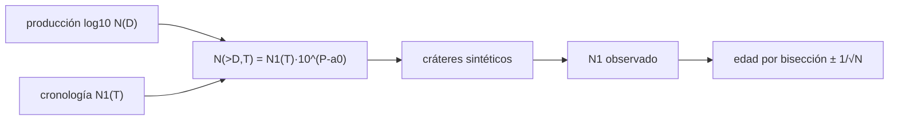

# B61-C06 — Datación por conteo de cráteres: funciones de producción y edades de modelo

<!-- nav:top -->
[🏠 Programa](../../../../README.md) · [📚 Bloque B61](../../../tronco-comun/B61-crateres-de-impacto-y-geologia-de-impactos.md) · [← Anterior: B61-C05 — Fusión por impacto y metamorfismo de choque](../B61-C05-fusion-por-impacto-y-metamorfismo-de-choque/CLASE.md) · [Siguiente: B61-C07 — Cuencas multianillo y grandes impactos →](../B61-C07-cuencas-multianillo-y-grandes-impactos/CLASE.md)
<!-- /nav -->

## 1. Ubicación, nivel y alcance

Clase 6 del bloque B61. Nivel N3. Contar cráteres sobre una superficie da una **edad de modelo**: se compara la densidad de cráteres con una **función de producción** (la distribución esperada por tamaño) y una **función de cronología** (cuántos cráteres de 1 km se acumulan por unidad de tiempo). Aquí usas la forma funcional lunar de Neukum et al. a través de la implementación de un paquete (fuente secundaria), generas **cráteres sintéticos** de edad conocida y recuperas la edad con una incertidumbre de Poisson. Complementa B53-C09 (estratigrafía relativa). **No se cuenta ninguna superficie real.**

## 2. Por qué esta clase existe

Una edad absoluta de una superficie planetaria sale del conteo de cráteres calibrado con muestras. La decisión central: **¿qué edad implica un conteo y con qué incertidumbre?**

## 3. Lo que podrás hacer al terminar

1. Evaluar la función de producción `log₁₀ N = Σ aⱼ (log₁₀ D)ʲ` y la cronología `N1(T)`.
2. Normalizar la acumulada para que `N(>1 km)` = `N1`.
3. Generar cráteres sintéticos de una edad conocida por inversión de la acumulada.
4. Invertir la cronología por bisección para obtener la edad de modelo.
5. Calcular la incertidumbre de Poisson y verificar su cobertura por simulación.
6. Explicar por qué el área y el diámetro mínimo controlan la precisión.

La evidencia es la **ficha de la edad de modelo por conteo** del ejercicio 12 (sección 20).

## 4. Con qué llegas y cómo comprobarlo

1. ¿Qué es una distribución acumulada?
2. ¿Qué es una distribución de Poisson?
3. ¿Qué es una edad relativa y una absoluta?
4. ¿Qué es un polinomio en `log D`?
5. ¿Qué es la cobertura de un intervalo?

<details>
<summary>Ver respuestas</summary>

1. El número de objetos mayores que `D`. 2. Cuentas independientes con media `λ` y desviación `√λ`. 3. Relativa: antes o después; absoluta: años. 4. Una función `Σ aⱼ xʲ` con `x = log₁₀ D`. 5. La fracción de simulaciones en que el intervalo contiene el valor verdadero.
</details>

Con cuatro o cinco aciertos, sigue; si no, repasa los prerrequisitos.

## 5. Un caso de contexto y casos de referencia

Con una superficie sintética de 3,2 Ga y 5000 km² se esperan 185 cráteres de más de 0,5 km; en el ensayo se obtienen 209 y la edad de modelo es **3,313 ± 0,051 Ga**. Esto no es una observación: el valor verdadero se conoce porque los cráteres los generó el laboratorio.

## 6. Vocabulario

La **función de producción** da el número de cráteres por tamaño; la **función de cronología** da el número acumulado de cráteres de 1 km en el tiempo. Una **edad de modelo** es la edad que hace coincidir la densidad contada con la cronología. La **densidad acumulada** `N(>D)` es el número por km² de cráteres mayores que `D`. La **saturación** es el estado en que nuevos cráteres borran los anteriores.

## 7. Modelo mental

Un esquema del flujo de cálculo de la clase; el texto equivalente está debajo.



*Descripción textual:* la producción y la cronología definen la acumulada; con ella se generan cráteres sintéticos, y la densidad contada se invierte a una edad con incertidumbre de Poisson.

Analogía: medir la edad de un parabrisas por las picaduras: más picaduras, más tiempo expuesto. Límite: aquí las picaduras las pone el programa y la tasa es la de la fórmula.

## 8. La explicación, paso a paso

### 8.1 Función de producción y cronología

Coeficientes (fuente secundaria S1): `a₀`…`a₁₁` = −3,0876; −3,557528; 0,781027; 1,021521; −0,156012; −0,444058; 0,019977; 0,086850; −0,005874; −0,006809; 8,25×10⁻⁴; 5,54×10⁻⁵ (D en km). Cronología `N1(T) = Cexp (e^(T/τ) − 1) + Clin T`, con `Cexp` = 5,44×10⁻¹⁴, τ = 1/6,93 Ga, `Clin` = 8,17×10⁻⁴ (el código anota que el artículo imprime 8,38×10⁻⁴ por errata). Normalización propia: `N(>D,T) = N1(T)·10^(P(log D) − a₀)`.

| `T` [Ga] | `N1` [km⁻²] | `N(>0,5 km)` | `N(>10 km)` |
|---|---|---|---|
| 0,5 | 4,0867×10⁻⁴ | 5,3090×10⁻³ | 2,2457×10⁻⁶ |
| 1,0 | 8,1733×10⁻⁴ | 1,0618×10⁻² | 4,4913×10⁻⁶ |
| 2,0 | 1,6347×10⁻³ | 2,1237×10⁻² | 8,9830×10⁻⁶ |
| 3,0 | 2,5102×10⁻³ | 3,2610×10⁻² | 1,3794×10⁻⁵ |
| 3,5 | 4,7202×10⁻³ | 6,1321×10⁻² | 2,5938×10⁻⁵ |
| 3,9 | 3,2923×10⁻² | 4,2771×10⁻¹ | 1,8092×10⁻⁴ |

La función es monótona en 0,1–80 km. La razón `N1(3,5)/N1(1,0)` = 5,78: la tasa no es constante.

### 8.2 Ensayo sintético

Con T = 3,2 Ga, A = 5000 km², D ≥ 0,5 km: se esperan 185,0 y se obtienen 209 cráteres (D máximo 2,0 km). La edad de modelo es 3,313 ± 0,051 Ga (+0,113 Ga, ≈ 2,2σ en este ensayo).

### 8.3 Cobertura

En 400 ensayos sintéticos el intervalo de 1σ contiene la edad verdadera en el 67,2 % de los casos (esperado ≈ 68 %); sesgo medio −0,0134 Ga.

### 8.4 Área

La incertidumbre relativa `1/√N` es 0,232 con 500 km² (N = 18,5), 0,074 con 5000 km² (N = 185) y 0,023 con 50 000 km² (N = 1850).

## 9. Magnitudes, símbolos y unidades

| Símbolo | Qué es | Unidad | Valor / nota |
|---|---|---|---|
| `D` | diámetro | km | 0,1–100 |
| `N(>D)` | acumulada | km⁻² | calculada |
| `T` | edad | Ga | 0–4,5 |
| `N1` | cráteres > 1 km | km⁻² | calculada |
| `A` | área contada | km² | 500–50 000 (sintética) |
| τ, `Cexp`, `Clin` | constantes de la cronología | Ga, km⁻², km⁻² Ga⁻¹ | S1 |

## 10. Convenciones y referencias

Función de producción lunar; `D` en km, `T` en Ga; los cráteres son sintéticos; la normalización de la acumulada es un supuesto del laboratorio.

## 11. De dónde sale lo que afirmamos

| ID | Fuente | Localizador | Respalda | Estado |
|---|---|---|---|---|
| S1 | cratermaker, documentación en línea, módulo `production.neukum` (código fuente), https://cratermaker.readthedocs.io/en/latest/_modules/cratermaker/components/production/neukum.html | consultada 2026-11-09 | coeficientes del polinomio y de la cronología lunar; nota de errata en el término lineal | Fuente secundaria; el artículo original no se leyó |
| S2 | Registro bibliográfico de Neukum, Ivanov y Hartmann (2001), *Cratering records in the inner solar system in relation to the lunar reference system*, Space Science Reviews 96, 55–86, DLR elib, https://elib.dlr.de/18259/ | consultada 2026-11-09 | existencia y referencia completa del artículo | Solo el registro; sin resumen ni texto |
| — | Sin fuente externa | — | los cálculos de la sección 17 y los parámetros marcados como ilustrativos | No consultado |

Límites: el artículo de Neukum et al. (2001) solo se consultó como registro bibliográfico; los coeficientes provienen del código de un paquete (fuente secundaria, con una errata señalada); no se leyó cómo normaliza la acumulada; la calibración con muestras lunares no se estudia.

## 12. Cómo ver el resultado

| Magnitud | Valor |
|---|---|
| edad verdadera (sintética) | 3,2 Ga |
| edad de modelo | 3,313 ± 0,051 Ga |
| cobertura 1σ | 0,672 |
| `1/√N` (500 km²) | 0,232 |

Descripción larga: la edad se recupera dentro de dos sigmas; más área, menos incertidumbre.

## 13. Ejemplo trabajado

**Ejemplo: `N1` a 1 Ga.**

**Paso 1.** Término exponencial: `5,44×10⁻¹⁴ (e^6,93 − 1) = 5,44×10⁻¹⁴ × 1,02×10³ ≈ 5,5×10⁻¹¹`, despreciable.

**Paso 2.** Término lineal: `8,17×10⁻⁴ × 1 = 8,17×10⁻⁴`.

**Paso 3.** `N1(1 Ga)` = 8,17×10⁻⁴ km⁻², igual a la tabla.

## 14. Distintas formas de describir lo mismo

**Por fórmula:** polinomio y cronología. **Por tabla:** `N1(T)`. **Por simulación:** Poisson. **Por incertidumbre:** `1/√N`.

## 15. Práctica guiada

**Ejercicio 1 · con los pasos indicados.** Calcula el término lineal de `N1` a 2 Ga. *Pasos:* `Clin T`.

<details><summary>Solución comentada</summary>

`8,17×10⁻⁴×2 = 1,634×10⁻³ km⁻²`.
</details>

**Ejercicio 2 · con una pista.** Con una pista: ¿cuántos cráteres de D > 1 km se esperan en 1000 km² a 1 Ga?

<details><summary>Solución comentada</summary>

`8,17×10⁻⁴×1000 = 0,82`.
</details>

**Ejercicio 3 · casi autónomo.** Casi autónomo: ¿qué `1/√N` corresponde a 100 cráteres?

<details><summary>Solución comentada</summary>

`0,10`.
</details>

## 16. Práctica autónoma, transferencia e integrador

**Ejercicio 4.** Calcula `N(>0,5 km)` a 3 Ga.

<details><summary>Solución comentada</summary>

3,2610×10⁻² km⁻².
</details>

**Ejercicio 5.** ¿Cuántos cráteres se esperan en 5000 km² a 3,2 Ga con D ≥ 0,5 km?

<details><summary>Solución comentada</summary>

185,0.
</details>

**Ejercicio 6.** ¿Qué área hace falta para 1 % de incertidumbre con 3,2 Ga y D ≥ 0,5 km?

<details><summary>Solución comentada</summary>

`N` = 10⁴ → ≈ 2,7×10⁵ km².
</details>

**Ejercicio 7.** ¿Cuánto vale `N1(3,5)/N1(1,0)` y qué indica?

<details><summary>Solución comentada</summary>

5,78; la tasa de antes era mayor que la reciente.
</details>

**Ejercicio 8.** ¿Por qué la cobertura 0,672 se acerca a 0,68?

<details><summary>Solución comentada</summary>

Porque con `N` grande la distribución de Poisson se aproxima a la normal.
</details>

**Ejercicio 9 · transferencia.** **Transferencia.** Cuentas cráteres sobre una superficie real y la edad sale con 5 % de incertidumbre. ¿Qué otras fuentes de error debes declarar?

<details><summary>Solución comentada</summary>

Saturación, resurfacing, secundarios, elección del área, calibración de la cronología y la función de producción.
</details>

**Ejercicio 10 · transferencia.** **Transferencia.** ¿Por qué no basta un solo diámetro mínimo para cualquier superficie?

<details><summary>Solución comentada</summary>

Porque por debajo de cierto `D` la saturación y los secundarios sesgan; hay que elegir el rango con criterio.
</details>

**Ejercicio 11 · transferencia.** **Transferencia.** Un colega usa esta función para Marte. ¿Qué falta?

<details><summary>Solución comentada</summary>

Un factor de escala del flujo para Marte y su cronología propia; el laboratorio es solo lunar y de forma.
</details>

**Ejercicio 12 · integrador.** Elabora tu *ficha de la edad de modelo por conteo*: la función de producción y la cronología usadas con su fuente, el ensayo sintético, la cobertura del intervalo y el efecto del área, con rótulos de lo sintético.

<details><summary>Solución modelo</summary>

Secciones 8.1–8.4: N1(3,5 Ga) = 4,72×10⁻³ km⁻²; ensayo sintético de 3,2 Ga → 3,313 ± 0,051 Ga con 209 cráteres; cobertura 0,672 en 400 ensayos; incertidumbre 1/√N de 0,232; 0,074 y 0,023 para 500, 5000 y 50 000 km².
</details>

## 17. Laboratorio: edad de modelo con cráteres sintéticos

El script [conteo.py](conteo.py) evalúa la producción y la cronología, genera cráteres sintéticos de una edad conocida, recupera la edad por bisección y comprueba la cobertura del intervalo (**comprueba** monotonía, 1e-12 y cobertura 0,55–0,80).

**Datos:** coeficientes de una fuente **secundaria**; cráteres **sintéticos**; normalización propia; semilla `20261109`. **Predice antes de ejecutar:** ¿Quedará la edad recuperada dentro de 1σ de 3,2 Ga? (no necesariamente: cae a ≈ 2,2σ.) **Ejecución del 2026-11-09 (Python 3.12.9):**

```text
Python 3.12.9 (biblioteca estandar)
Funcion de produccion (coeficientes de fuente SECUNDARIA; craters de los ensayos SINTETICOS)
log10 N(>D) decrece de 0.452 (D=0.10 km) a -6.991 (D=80.8 km): monotona
Cronologia N1(T) [km^-2, D>1 km]:
  T=0.5 Ga  N1=4.0867e-04  N(>0.5 km)=5.3090e-03  N(>10 km)=2.2457e-06
  T=1.0 Ga  N1=8.1733e-04  N(>0.5 km)=1.0618e-02  N(>10 km)=4.4913e-06
  T=2.0 Ga  N1=1.6347e-03  N(>0.5 km)=2.1237e-02  N(>10 km)=8.9830e-06
  T=3.0 Ga  N1=2.5102e-03  N(>0.5 km)=3.2610e-02  N(>10 km)=1.3794e-05
  T=3.5 Ga  N1=4.7202e-03  N(>0.5 km)=6.1321e-02  N(>10 km)=2.5938e-05
  T=3.9 Ga  N1=3.2923e-02  N(>0.5 km)=4.2771e-01  N(>10 km)=1.8092e-04
Razon N1(3.5)/N1(1.0) = 5.78  (la tasa NO es constante; decae hacia el presente)
Ensayo unico (SINTETICO): T_verdadera=3.2 Ga, area=5000 km2, D>=0.5 km, esperados=185.0, observados=209
  Edad de modelo = 3.313 +- 0.051 Ga (1 sigma Poisson) ; dif. con la verdadera = +0.113 Ga
  D maximo del ensayo = 2.0 km
Cobertura del intervalo 1-sigma en 400 ensayos sinteticos = 0.672 (esperado ~0.68) ; sesgo medio = -0.0134 Ga
Incertidumbre relativa de la edad frente al area (T=3.2 Ga, D>=0.5 km):
  A=     500 km2  N esperado=    18.5  1/sqrt(N)=0.232
  A=    5000 km2  N esperado=   185.0  1/sqrt(N)=0.074
  A=   50000 km2  N esperado=  1849.9  1/sqrt(N)=0.023
Pruebas superadas.
```

```bash
python programa/clases/B61/B61-C06-datacion-por-conteo-de-crateres-funciones-de-produccion-y-edades-de-modelo/conteo.py
```

**Límites:** sin saturación ni resurfacing; solo función lunar; la normalización de la acumulada es un supuesto; ninguna superficie real.

## 18. Errores frecuentes y cómo corregirlos

**Presentar la edad de un conteo sintético como edad de una superficie.** Se corrige con la sección 5.

**Ignorar la incertidumbre de Poisson.** Se corrige con 8.4.

**Usar una cronología sin su fuente.** Se corrige con la sección 11.

**Olvidar que la tasa no es constante.** Se corrige con 8.1.

## 19. Cómo sabrás que vas bien

Tras la sección 8: ¿qué resultado esperabas y cuál obtuviste? Si dudas, repasa el ejemplo de la sección 13. Tras el laboratorio: ¿qué comprueba cada aserción? (ver la sección 17).

## 20. Qué entregas y cómo se evalúa

El producto es tu **ficha de la edad de modelo por conteo** (ejercicio 12).

| Criterio | Inicial | En desarrollo | Logrado | Destacado |
|---|---|---|---|---|
| Conceptos | Los confunde | Parciales | Explica los conceptos de la clase | Explica los límites |
| Cálculo | Sin unidades | Con errores | Tablas completas con unidades | Calcula casos nuevos |
| Numérico | Sin comprobar | Un caso | Contraste con una vía independiente | Interpreta las diferencias |
| Fuentes | Sin fuente | Sin fecha | Fuentes con fecha y estado | Declara lo no consultado |
| Límites | No los nombra | Uno | Tres | Discute qué falta del modelo |

**Condiciones críticas (no se compensan con promedio):** rotular los datos sintéticos e ilustrativos; no presentar lo simulado como observado; citar solo lo consultado.

## 21. Ética, seguridad y límites

Clase educativa: los modelos son simplificados y no sustituyen un código de impactos (hidrocódigo) ni el análisis de datos reales. No se data ningún sitio real ni se usan muestras. Accesibilidad: tablas equivalentes a las gráficas, fórmulas en texto, ejercicios sin conexión.

## 22. Para cerrar y seguir

La edad de modelo sale de invertir una cronología con la densidad contada, y su incertidumbre depende sobre todo del número de cráteres. Queda una pregunta: ¿qué ocurre con los impactos tan grandes que forman cuencas con varios anillos?

**Glosario español–inglés.** función de producción · *production function*; cronología · *chronology function*; edad de modelo · *model age*; saturación · *saturation*; acumulada · *cumulative*.

**Continuidad.** [B61-C07](../B61-C07-cuencas-multianillo-y-grandes-impactos/CLASE.md) estudia las cuencas multianillo.

**Referencias:** ver sección 11.

<!-- nav:bottom -->
---

[← Anterior: B61-C05 — Fusión por impacto y metamorfismo de choque](../B61-C05-fusion-por-impacto-y-metamorfismo-de-choque/CLASE.md) · [📚 Bloque B61](../../../tronco-comun/B61-crateres-de-impacto-y-geologia-de-impactos.md) · [Siguiente: B61-C07 — Cuencas multianillo y grandes impactos →](../B61-C07-cuencas-multianillo-y-grandes-impactos/CLASE.md)
<!-- /nav -->
