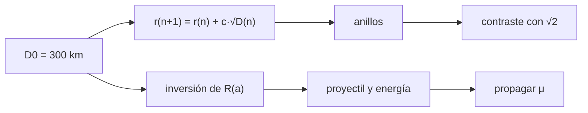

# B61-C07 — Cuencas multianillo y grandes impactos

<!-- nav:top -->
[🏠 Programa](../../../../README.md) · [📚 Bloque B61](../../../tronco-comun/B61-crateres-de-impacto-y-geologia-de-impactos.md) · [← Anterior: B61-C06 — Datación por conteo de cráteres: funciones de producción y edades de modelo](../B61-C06-datacion-por-conteo-de-crateres-funciones-de-produccion-y-edades-de-modelo/CLASE.md) · [Siguiente: B62-C01 — Espectros rotacionales de moléculas: niveles y reglas de selección →](../../B62/B62-C01-espectros-rotacionales-de-moleculas-niveles-y-reglas-de-seleccion/CLASE.md)
<!-- /nav -->

## 1. Ubicación, nivel y alcance

Clase 7 del bloque B61. Nivel N3. Los impactos más grandes forman **cuencas multianillo**: varios escarpes concéntricos alrededor de una cavidad central. Aquí generas anillos **sintéticos** con la relación de espaciado (2,0 ± 0,3) D^0,5 que resumió un estudio de Pike y Spudis (1987), la contrastas con una progresión √2, estimas el coeficiente por mínimos cuadrados e **inviertes el escalado de la C01** para inferir el proyectil y la energía. Usa la [C01](../B61-C01-dinamica-de-eyeccion-y-escalado-de-crateres/CLASE.md) y la [C06](../B61-C06-datacion-por-conteo-de-crateres-funciones-de-produccion-y-edades-de-modelo/CLASE.md). **No se compara con ninguna cuenca real.**

## 2. Por qué esta clase existe

Las cuencas dejan huella en la corteza entera. La decisión central: **¿cómo se espacian los anillos, qué proyectil implica una cuenca y cuándo excava hasta el manto?**

## 3. Lo que podrás hacer al terminar

1. Generar anillos por la recurrencia `r_(n+1) = r_n + c √D_n`.
2. Contrastarla con una progresión geométrica √2 y reportar la diferencia.
3. Estimar `c` por mínimos cuadrados con ruido.
4. Invertir el escalado de gravedad para obtener el proyectil y su energía.
5. Propagar la incertidumbre de μ a la energía.
6. Comparar una profundidad de excavación ilustrativa con el espesor de la corteza.

La evidencia es la **ficha de la cuenca multianillo** del ejercicio 12 (sección 20).

## 4. Con qué llegas y cómo comprobarlo

1. ¿Qué es un anillo de cuenca?
2. ¿Qué es una recurrencia?
3. ¿Qué es un ajuste por mínimos cuadrados?
4. ¿Qué es el escalado de la C01?
5. ¿Qué es una propagación Monte Carlo?

<details>
<summary>Ver respuestas</summary>

1. Un escarpe concéntrico alrededor del centro de la cuenca. 2. Una fórmula que da un término a partir del anterior. 3. Elegir el parámetro que minimiza la suma de cuadrados de los residuos. 4. `R = K₁ a π₂^(−μ/(2+μ))`. 5. Repetir con valores aleatorios para ver la dispersión.
</details>

Con cuatro o cinco aciertos, sigue; si no, repasa los prerrequisitos.

## 5. Un caso de contexto y casos de referencia

Con la regla de espaciado, anillos a partir de 300 km caen en 369,3, 446,1 y 530,6 km, con razones sucesivas de 1,23 a 1,19, **no** √2 = 1,414. Invertir el escalado para un diámetro principal de 300 km da un proyectil de 21 km de radio y una energía de 1,66×10²⁵ J. Todo **sintético** e ilustrativo.

## 6. Vocabulario

Una **cuenca multianillo** tiene varios anillos concéntricos. El **espaciado radial** es la diferencia entre radios de anillos consecutivos. Una **protocuenca** tiene un pico más un anillo interno y otro intervalo. La **profundidad de excavación** es la que alcanza la cavidad transitoria. La **corteza** es la capa superior de un cuerpo diferenciado.

## 7. Modelo mental

Un esquema del flujo de cálculo de la clase; el texto equivalente está debajo.



*Descripción textual:* un diámetro inicial genera los anillos por recurrencia, que se contrastan con √2; el mismo diámetro, invertido en el escalado, da el proyectil y su energía con la incertidumbre de μ.

Analogía: las ondas de una piedra en un estanque: anillos cada vez más espaciados. Límite: aquí el espaciado sale de una fórmula supuesta, no de una onda simulada.

## 8. La explicación, paso a paso

### 8.1 Anillos sintéticos

Con `c` = 2,0 desde 300 km: 300,0; 369,3; 446,1; 530,6 km (razones 1,231; 1,208; 1,189). La progresión √2 daría 300,0; 424,3; 600,0; 848,5 km. **Los dos modelos difieren**: o el espaciado de la fuente se interpreta de otra manera (radios frente a diámetros, factor de múltiplo), o la regla √2 es solo un resumen empírico. En esta sesión no pude resolverlo, y el artículo no se leyó.

### 8.2 Estimación de `c`

Con 40 espaciados sintéticos y σ = 0,3, el ajuste da `c` = 1,981 (verdadero 2,0).

### 8.3 Energía

| `D_p` [km] | `a` [km] | `E` [J] | `E` [Mt TNT] |
|---|---|---|---|
| 300 | 21,4 | 1,661×10²⁵ | 3,969×10⁹ |
| 600 | 51,8 | 2,353×10²⁶ | 5,625×10¹⁰ |
| 1000 | 99,3 | 1,661×10²⁷ | 3,969×10¹¹ |

Se supone `D_t = D_p`. Con μ ~ U(0,45; 0,65) y `D_p` = 300 km, `log₁₀ E` tiene mediana 25,23 y el rango 5–95 % es 24,81–25,63.

### 8.4 Excavación y corteza

Con profundidad de excavación ilustrativa 0,1 D y corteza de 40 km: 300 km → 30 km (corteza); 600 km → 60 km (manto); 1000 km → 100 km (manto).

## 9. Magnitudes, símbolos y unidades

| Símbolo | Qué es | Unidad | Valor / nota |
|---|---|---|---|
| `D_n` | diámetro del anillo `n` | km | 300–530 (sintético) |
| `c` | coeficiente de espaciado | km^0,5 | 2,0 ± 0,3 (S8) |
| `a` | radio del proyectil | km | inferido |
| `E` | energía cinética | J | inferida |
| `U` | velocidad | m/s | 17 000 (ilustrativo) |
| μ | acoplamiento | — | 0,45–0,65 |

## 10. Convenciones y referencias

Radios en km; el espaciado radial es la diferencia entre radios (supuesto del laboratorio); proyectil esférico de 2800 kg/m³; `g` = 1,62 m/s².

## 11. De dónde sale lo que afirmamos

| ID | Fuente | Localizador | Respalda | Estado |
|---|---|---|---|---|
| S8 | Pike y Spudis (1987), *Basin-ring spacing on the Moon, Mercury, and Mars*, Earth, Moon, and Planets, DOI 10.1007/BF00054060 (a través de las páginas de USGS y Springer que muestra la búsqueda) | consultada 2026-11-09 | espaciado radial dominante (2,0 ± 0,3) D^0,5 o un múltiplo; protocuencas con otro intervalo (3,3 ± 0,6) D^0,5 | Solo resumen/ficha; el artículo no se leyó |
| S3 | Resultado de búsqueda web sobre Holsapple (1993), Annu. Rev. Earth Planet. Sci. 21, 333–373, y trabajos que lo citan | consultada 2026-11-09 | límites μ = 1/3 (momento) y 2/3 (energía); μ = 0,55 para roca blanda; dos regímenes (resistencia y gravedad) | Resumen de terceros; el artículo original no se consultó. El resumen escribía el exponente del volumen como −3μ/(3+μ), que no pude reconciliar con −3μ/(2+μ); se usa esta última por el cálculo del radio y se marca para verificar |
| — | Sin fuente externa | — | los cálculos de la sección 17 y los parámetros marcados como ilustrativos | No consultado |

Límites: la relación de espaciado solo se conoce por el resumen de la ficha (artículo no leído); la interpretación radio/diámetro es un supuesto; μ, `U`, densidad y `D_t = D_p` son ilustrativos; el escalado de gravedad se consultó solo en resumen.

## 12. Cómo ver el resultado

| Magnitud | Valor |
|---|---|
| anillos | 300,0; 369,3; 446,1; 530,6 km |
| `c` estimado | 1,981 |
| `E` (300 km) | 1,66×10²⁵ J |
| `log₁₀ E` (5–95 %) | 24,81–25,63 |

Descripción larga: los anillos sintéticos se espacian menos que √2; la energía inferida varía un factor ≈ 6,6 por μ.

## 13. Ejemplo trabajado

**Ejemplo: segundo anillo.**

**Paso 1.** `r₀` = 150 km, `D₀` = 300 km, `√D₀` = 17,32.

**Paso 2.** `Δr = 2,0×17,32 = 34,64 km`.

**Paso 3.** `r₁` = 184,64 km, `D₁` = 369,3 km.

## 14. Distintas formas de describir lo mismo

**Por recurrencia:** `r_(n+1)`. **Por tabla:** anillos y razones. **Por inversión:** `E(D_p)`. **Por simulación:** Monte Carlo de μ.

## 15. Práctica guiada

**Ejercicio 1 · con los pasos indicados.** Calcula `Δr` con `D` = 369,3 km y `c` = 2. *Pasos:* `c√D`.

<details><summary>Solución comentada</summary>

`2×19,22 = 38,4 km`.
</details>

**Ejercicio 2 · con una pista.** Con una pista: ¿cuánto vale `D₂` si `r₁` = 184,64 y `Δr` = 38,4?

<details><summary>Solución comentada</summary>

`r₂` = 223,05 km; `D₂` = 446,1 km.
</details>

**Ejercicio 3 · casi autónomo.** Casi autónomo: ¿cuánto vale la razón `D₂/D₁`?

<details><summary>Solución comentada</summary>

`446,1/369,3 = 1,208`.
</details>

## 16. Práctica autónoma, transferencia e integrador

**Ejercicio 4.** Calcula el cuarto anillo desde 300 km.

<details><summary>Solución comentada</summary>

530,6 km.
</details>

**Ejercicio 5.** ¿Qué razón √2 daría desde 424,3 km?

<details><summary>Solución comentada</summary>

600,0 km.
</details>

**Ejercicio 6.** ¿Qué energía infiere el laboratorio para 600 km?

<details><summary>Solución comentada</summary>

`2,353×10²⁶ J`.
</details>

**Ejercicio 7.** ¿Excava el manto una cuenca de 300 km con corteza de 40 km y 0,1 D?

<details><summary>Solución comentada</summary>

No: 30 km queda en la corteza.
</details>

**Ejercicio 8.** ¿Por qué la energía aumenta más rápido que `D`?

<details><summary>Solución comentada</summary>

Porque `E ∝ a³` y `a` crece casi como `D^(1/0,78)`.
</details>

**Ejercicio 9 · transferencia.** **Transferencia.** Los anillos de una cuenca real no siguen tu recurrencia. ¿Qué concluyes?

<details><summary>Solución comentada</summary>

Que la regla es estadística y de resumen; hay que medir la cuenca y declarar la dispersión.
</details>

**Ejercicio 10 · transferencia.** **Transferencia.** Un colega afirma que esta energía es la de un impacto real. ¿Qué respondes?

<details><summary>Solución comentada</summary>

Es una inferencia ilustrativa con μ, `U`, densidad y `D_t = D_p` supuestos; no es una medida.
</details>

**Ejercicio 11 · transferencia.** **Transferencia.** ¿Qué dato necesitas para decidir si una cuenca real excavó el manto?

<details><summary>Solución comentada</summary>

El espesor de la corteza y la profundidad de excavación de un modelo validado; aquí son ilustrativos.
</details>

**Ejercicio 12 · integrador.** Elabora tu *ficha de la cuenca multianillo*: la recurrencia de anillos, su contraste con √2, la estimación de `c`, la energía inferida y su incertidumbre, con rótulos de lo sintético.

<details><summary>Solución modelo</summary>

Secciones 8.1–8.4: anillos 300,0; 369,3; 446,1; 530,6 km (razones 1,23–1,19, no √2); `c` estimado 1,981; energía 1,66×10²⁵ J para 300 km (rango 5–95 % de log₁₀ E: 24,81–25,63).
</details>

## 17. Laboratorio: anillos de cuenca y energía de un gran impacto

El script [cuencas.py](cuencas.py) genera anillos por recurrencia, estima `c`, invierte el escalado por bisección y propaga la incertidumbre de μ (**comprueba** `c` a 0,05 y la inversión a 1e-9).

**Datos:** espaciado de un **resumen de terceros**; todo lo demás **ilustrativo/sintético**; semilla `20261109`. **Predice antes de ejecutar:** ¿Serán las razones sucesivas de los anillos iguales a √2? (no, ≈ 1,2.) **Ejecución del 2026-11-09 (Python 3.12.9):**

```text
Python 3.12.9 (biblioteca estandar)
Anillos SINTETICOS (c=2.0, desde 300 km): 300.0, 369.3, 446.1, 530.6 km
Razones sucesivas: 1.231, 1.208, 1.189  (sqrt(2)=1.414)
Progresion geometrica sqrt(2):  300.0, 424.3, 600.0, 848.5 km
c estimado por minimos cuadrados (40 espaciados sinteticos, sigma 0.3) = 1.981 ; verdadero 2.0
Inversion del escalado (cuenca principal de diametro D_p, supuesto D_t = D_p):
 D_p [km]    a [km]       E [J]   E [Mt TNT]
      300      21.4   1.661e+25    3.969e+09
      600      51.8   2.353e+26    5.625e+10
     1000      99.3   1.661e+27    3.969e+11
Propagacion de mu en U(0.45,0.65) para D_p=300 km: log10 E [J] mediana 25.23 ; percentiles 5-95 % = 24.81-25.63
D_p=300 km: profundidad de excavacion ILUSTRATIVA (0.1 D) = 30 km ; corteza ilustrativa 40 km -> queda en la corteza
D_p=600 km: profundidad de excavacion ILUSTRATIVA (0.1 D) = 60 km ; corteza ilustrativa 40 km -> excava el manto
D_p=1000 km: profundidad de excavacion ILUSTRATIVA (0.1 D) = 100 km ; corteza ilustrativa 40 km -> excava el manto
Pruebas superadas.
```

```bash
python programa/clases/B61/B61-C07-cuencas-multianillo-y-grandes-impactos/cuencas.py
```

**Límites:** sin relajación viscosa; la interpretación del espaciado es un supuesto; la corteza y la excavación son ilustrativas; ninguna cuenca real.

## 18. Errores frecuentes y cómo corregirlos

**Aplicar el espaciado como si fuera exacto.** Se corrige con 8.1.

**Usar √2 y la recurrencia a la vez sin contrastarlas.** Se corrige con 8.1.

**Presentar la energía inferida como medida.** Se corrige con la sección 5.

**Olvidar la incertidumbre de μ.** Se corrige con 8.3.

## 19. Cómo sabrás que vas bien

Tras la sección 8: ¿qué resultado esperabas y cuál obtuviste? Si dudas, repasa el ejemplo de la sección 13. Tras el laboratorio: ¿qué comprueba cada aserción? (ver la sección 17).

## 20. Qué entregas y cómo se evalúa

El producto es tu **ficha de la cuenca multianillo** (ejercicio 12).

| Criterio | Inicial | En desarrollo | Logrado | Destacado |
|---|---|---|---|---|
| Conceptos | Los confunde | Parciales | Explica los conceptos de la clase | Explica los límites |
| Cálculo | Sin unidades | Con errores | Tablas completas con unidades | Calcula casos nuevos |
| Numérico | Sin comprobar | Un caso | Contraste con una vía independiente | Interpreta las diferencias |
| Fuentes | Sin fuente | Sin fecha | Fuentes con fecha y estado | Declara lo no consultado |
| Límites | No los nombra | Uno | Tres | Discute qué falta del modelo |

**Condiciones críticas (no se compensan con promedio):** rotular los datos sintéticos e ilustrativos; no presentar lo simulado como observado; citar solo lo consultado.

## 21. Ética, seguridad y límites

Clase educativa: los modelos son simplificados y no sustituyen un código de impactos (hidrocódigo) ni el análisis de datos reales. No se infiere el riesgo ni la energía de ningún impacto real. Accesibilidad: tablas equivalentes a las gráficas, fórmulas en texto, ejercicios sin conexión.

## 22. Para cerrar y seguir

Una cuenca multianillo condensa geometría, escalado y estructura de la corteza; el laboratorio muestra que la regla de espaciado y la energía dependen de supuestos que hay que declarar. Con esto el bloque queda cerrado: del escalado a la cuenca.

**Glosario español–inglés.** cuenca multianillo · *multi-ring basin*; espaciado de anillos · *ring spacing*; corteza · *crust*; protocuenca · *protobasin*; excavación · *excavation*.

**Continuidad.** Fin del bloque B61; vuelve a la [guía del bloque](../../../tronco-comun/B61-crateres-de-impacto-y-geologia-de-impactos.md).

**Referencias:** ver sección 11.

<!-- nav:bottom -->
---

[← Anterior: B61-C06 — Datación por conteo de cráteres: funciones de producción y edades de modelo](../B61-C06-datacion-por-conteo-de-crateres-funciones-de-produccion-y-edades-de-modelo/CLASE.md) · [📚 Bloque B61](../../../tronco-comun/B61-crateres-de-impacto-y-geologia-de-impactos.md) · [Siguiente: B62-C01 — Espectros rotacionales de moléculas: niveles y reglas de selección →](../../B62/B62-C01-espectros-rotacionales-de-moleculas-niveles-y-reglas-de-seleccion/CLASE.md)
<!-- /nav -->
