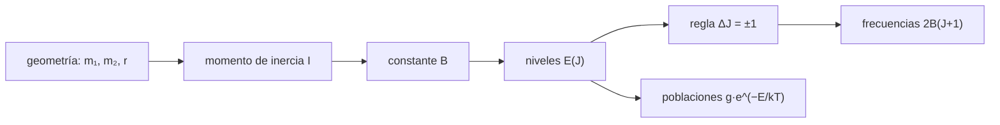

# B62-C01 — Espectros rotacionales de moléculas: niveles y reglas de selección

<!-- nav:top -->
[🏠 Programa](../../../../README.md) · [📚 Bloque B62](../../../tronco-comun/B62-espectroscopia-molecular-para-astroquimica.md) · [← Anterior: B61-C07 — Cuencas multianillo y grandes impactos](../../B61/B61-C07-cuencas-multianillo-y-grandes-impactos/CLASE.md) · [Siguiente: B62-C02 — Espectros vibracionales de moléculas →](../B62-C02-espectros-vibracionales-de-moleculas/CLASE.md)
<!-- /nav -->

## 1. Ubicación, nivel y alcance

Clase 1 del bloque B62. Nivel N3. B06-C17 y B46-C12 dieron una visión general de las líneas moleculares; aquí construyes el espectro rotacional de una molécula lineal desde cero: el rotor rígido, sus niveles `E(J) = B·J(J+1)`, la regla de selección `ΔJ = ±1`, la corrección por distorsión centrífuga y la población de los niveles. Usas aritmética, logaritmos y las constantes de [B05](../../../tronco-comun/B05-fisica-fundamental-para-el-espacio.md). La molécula conductora es el monóxido de carbono (¹²C¹⁶O) y sus líneas de catálogo sirven para comprobar tu cálculo.

## 2. Por qué esta clase existe

Una línea de CO a 115,27 GHz no es un dato aislado: es la consecuencia de un momento de inercia. Si entiendes de dónde sale, puedes predecir líneas que nadie ha medido y reconocer cuándo una línea observada no es del CO. La decisión central: **¿cuándo basta el rotor rígido y cuándo hace falta la distorsión centrífuga?**

## 3. Lo que podrás hacer al terminar

1. Calcular la constante rotacional `B` desde la masa reducida y la longitud de enlace.
2. Obtener los niveles `E(J)` y las frecuencias `ν(J+1←J)` en cm⁻¹, MHz y GHz.
3. Aplicar la regla de selección `ΔJ = ±1` y explicar por qué una molécula sin dipolo permanente no tiene espectro rotacional puro.
4. Incluir la distorsión centrífuga `D` y medir cuánto mejora el acuerdo con el catálogo.
5. Calcular la función de partición y el `J` más poblado a una temperatura dada.
6. Rotular qué proviene de una fuente consultada y qué es cálculo propio.

La evidencia es la **ficha del espectro rotacional** del ejercicio 12 (sección 20).

## 4. Con qué llegas y cómo comprobarlo

1. ¿Cuántos MHz tiene 1 GHz?
2. ¿Qué es la masa reducida de dos cuerpos de masas `m₁` y `m₂`?
3. ¿Cómo se pasa de longitud de onda a frecuencia?
4. ¿Qué dice la distribución de Boltzmann?
5. ¿Qué es un error relativo?

<details>
<summary>Ver respuestas</summary>

1. 1000 MHz. 2. `m₁m₂/(m₁+m₂)`. 3. `ν = c/λ`. 4. La población de un nivel de energía `E` es proporcional a `g·e^(−E/kT)`. 5. La diferencia dividida por el valor de referencia.
</details>

Con cuatro o cinco aciertos, sigue; si no, repasa los prerrequisitos.

## 5. Un caso de contexto y casos de referencia

El catálogo JPL lista para el CO la línea `J = 1→0` en `115271,2018 MHz` y la `2→1` en `230538,0000 MHz` (error declarado `0,0005 MHz`). El WebBook del NIST da `Be = 1,93128087 cm⁻¹`, `αe = 0,01750441 cm⁻¹`, `De = 6,12147×10⁻⁶ cm⁻¹` y `re = 1,128323 Å`. Es el **ejemplo conductor**: ¿puedes reproducir esas frecuencias con cuatro números?

## 6. Vocabulario

Un **rotor rígido** es una molécula cuyos núcleos giran a distancia fija. El **número cuántico rotacional** `J` (0, 1, 2…) mide el giro. La **constante rotacional** `B` es la energía por unidad de `J(J+1)` expresada en cm⁻¹. La **regla de selección** dice qué transiciones dipolares son posibles: `ΔJ = ±1`. La **distorsión centrífuga** `D` corrige el alargamiento del enlace al girar. La **degeneración** `2J+1` es el número de orientaciones del nivel. El **momento dipolar permanente** es lo que permite emitir o absorber en rotación pura.

## 7. Modelo mental: una mancuerna que gira

Imagina dos esferas unidas por una varilla que gira: solo ciertas velocidades de giro están permitidas. Límite de la analogía: la varilla clásica admite cualquier velocidad; aquí el giro está cuantizado y la varilla se estira un poco al girar rápido.



*Descripción textual:* la geometría fija `I`, de `I` sale `B`, de `B` los niveles; la regla de selección convierte niveles en frecuencias y la temperatura reparte las poblaciones.

## 8. La explicación, paso a paso

### 8.1 De la geometría a B

La masa reducida es `μ = m₁m₂/(m₁+m₂)`, el momento de inercia `I = μr²` y `B = h/(8π²cI)`, con `c` en cm/s para que `B` salga en cm⁻¹. Con `re = 1,128323 Å` y masas de 12 u y 16 u (números de masa enteros, aproximación declarada: no se consultó una tabla de masas atómicas) el laboratorio obtiene `B = 1,93102 cm⁻¹` frente a `Be = 1,93128 cm⁻¹` del WebBook: diferencia relativa `1,4×10⁻⁴`.

### 8.2 Niveles y regla de selección

En el rotor rígido `E(J) = B·J(J+1)`. Una transición dipolar eléctrica exige `ΔJ = ±1`, así que la frecuencia de `J+1←J` es `ν = 2B(J+1)`: líneas igualmente espaciadas `2B`. Si no hay dipolo permanente (H₂, N₂, CO₂ simétrico) no hay espectro rotacional puro.

### 8.3 Qué B usar y la distorsión centrífuga

El estado fundamental vibracional tiene `B₀ = Be − αe/2 = 1,922529 cm⁻¹` (relación estándar; cálculo propio con los valores del WebBook). Con distorsión, `E(J) = B₀J(J+1) − D J²(J+1)²` y `ν = 2B₀(J+1) − 4D(J+1)³`.

| Transición | JPL (MHz) | rígido (MHz) | dif. rel. | con `D` (MHz) | dif. rel. |
|---|---|---|---|---|---|
| 1→0 | 115271,2018 | 115271,9188 | 6,2×10⁻⁶ | 115271,1847 | 1,5×10⁻⁷ |
| 2→1 | 230538,0000 | 230543,8376 | 2,5×10⁻⁵ | 230537,9651 | 1,5×10⁻⁷ |
| 3→2 | 345795,9899 | 345815,7564 | 5,7×10⁻⁵ | 345795,9366 | 1,5×10⁻⁷ |
| 6→5 | 691473,0763 | 691631,5129 | 2,3×10⁻⁴ | 691472,9541 | 1,8×10⁻⁷ |

Sin `D`, el error crece con `J` (de `6×10⁻⁶` a `2×10⁻⁴`); con `D` baja a `~1,5×10⁻⁷`. Los niveles calculados (`3,845033`, `11,534952` cm⁻¹ para J = 1, 2) coinciden con los de LAMDA (`3,845033`, `11,534920`) hasta la quinta cifra.

### 8.4 Poblaciones

La población relativa del nivel `J` es `(2J+1)e^(−E/kT)/Z`. La función de partición vale `Z ≈ kT/(hcB) + 1/3`: `7,57` a 20 K y `108,79` a 300 K. El nivel más poblado es `J = 1` a 20 K y `J = 7` a 300 K, aproximado por `√(kT/2hcB) − 1/2`.

## 9. Magnitudes, símbolos y unidades

| Símbolo | Qué es | Unidad | Valor / nota |
|---|---|---|---|
| `B₀` | constante rotacional del estado fundamental | cm⁻¹ | 1,922529 |
| `D` | distorsión centrífuga | cm⁻¹ | 6,12147×10⁻⁶ (`De`) |
| `ν` | frecuencia | MHz (1 cm⁻¹ = 29979,2458 MHz) | 115271,2 (J=1→0) |
| `μ` | masa reducida | kg (u = 1,66053906892×10⁻²⁷ kg) | ~6,86 u |
| `Z` | función de partición | adimensional | 7,57 (20 K) |

## 10. Convenciones y referencias

Molécula lineal ¹²C¹⁶O, estado electrónico `X ¹Σ⁺`, `v = 0`, sin estructura hiperfina; marco de laboratorio en reposo (sin corrección Doppler). Frecuencias en el vacío. Constantes CODATA 2022.

## 11. De dónde sale lo que afirmamos

| ID | Fuente | Localizador | Respalda | Consulta | Estado |
|---|---|---|---|---|---|
| S1 | NIST, CODATA 2022 | physics.nist.gov/cuu/Constants/Table/allascii.txt | `h`, `c`, `k`, `u` | 2026-11-09 | Consultada |
| S2 | NIST Chemistry WebBook, CO | webbook.nist.gov/cgi/cbook.cgi?ID=C630080&Mask=1000 | `Be`, `αe`, `De`, `re` | 2026-11-09 | Consultada |
| S4 | Catálogo JPL, `c028001.cat` | spec.jpl.nasa.gov/ftp/pub/catalog/c028001.cat | seis frecuencias de CO | 2026-11-09 | Consultada (6 líneas) |
| S5 | LAMDA, `co.dat` | home.strw.leidenuniv.nl/~moldata/datafiles/co.dat | cinco primeros niveles | 2026-11-09 | Consultada (cabecera) |

Límites: `B₀ = Be − αe/2` es cálculo propio; las masas son números enteros; no se consultó ningún texto de espectroscopía.

## 12. Cómo ver el espectro

| Magnitud | Valor |
|---|---|
| espaciado entre líneas (`2B₀`) | 115271,9 MHz |
| error relativo sin `D`, J=6→5 | 2,3×10⁻⁴ |
| error relativo con `D` | 1,8×10⁻⁷ |

Descripción larga: un «peine» de líneas casi equidistantes, cada una ligeramente por debajo de la rígida; la desviación crece como `(J+1)³`.

## 13. Ejemplo trabajado: la línea 3→2

**Paso 1 · Constante.** `B₀ = 1,93128087 − 0,01750441/2 = 1,922529 cm⁻¹`.

**Paso 2 · Rígido.** `ν = 2·1,922529·3 = 11,535174 cm⁻¹ = 345815,76 MHz`.

**Paso 3 · Distorsión.** `4D·3³ = 4·6,12147×10⁻⁶·27 = 6,61×10⁻⁴ cm⁻¹ = 19,82 MHz`.

**Paso 4 · Resultado.** `345815,76 − 19,82 = 345795,94 MHz`; el catálogo da `345795,9899 MHz` (diferencia `0,05 MHz`).

## 14. Distintas formas de describir un espectro rotacional

**Por niveles:** diagrama de `E(J)`. **Por líneas:** peine de frecuencias `2B(J+1)`. **Por poblaciones:** intensidades relativas con `g e^(−E/kT)`. **Por catálogo:** lista de FREQ, ERR e intensidad.

## 15. Práctica guiada

**Ejercicio 1 · con los pasos indicados.** Calcula `2B₀` en MHz. *Pasos:* `B₀ = 1,922529 cm⁻¹`; multiplica por 2 y por 29979,2458.

<details><summary>Solución comentada</summary>

`2·1,922529·29979,2458 = 115271,9 MHz`: es la frecuencia rígida de 1→0 (sección 8.3).
</details>

**Ejercicio 2 · con una pista.** ¿Qué energía tiene el nivel `J = 2` sin distorsión? *Pista:* `E = B₀·J(J+1)`.

<details><summary>Solución comentada</summary>

`1,922529·6 = 11,53517 cm⁻¹`; con distorsión `11,534952` (8.2–8.3).
</details>

**Ejercicio 3 · casi autónomo.** ¿Por qué el N₂ no tiene línea rotacional pura?

<details><summary>Solución comentada</summary>

No tiene momento dipolar permanente; la regla de selección dipolar exige uno (8.2).
</details>

## 16. Práctica autónoma, transferencia e integrador

**Ejercicio 4.** Frecuencia rígida de 2→1 en GHz.

<details><summary>Solución comentada</summary>

`2·B₀·2 = 230,5439 GHz`; el catálogo da `230,5380` (8.3).
</details>

**Ejercicio 5.** ¿Cuántos MHz restan los efectos de `D` a la línea 1→0?

<details><summary>Solución comentada</summary>

`4D·1³ = 2,45×10⁻⁵ cm⁻¹ = 0,734 MHz`; `115271,919 − 0,734 = 115271,185` (tabla 8.3).
</details>

**Ejercicio 6.** Degeneración del nivel `J = 4`.

<details><summary>Solución comentada</summary>

`2J+1 = 9` (sección 6).
</details>

**Ejercicio 7.** Estima el `J` más poblado a 100 K.

<details><summary>Solución comentada</summary>

`√(kT/2hcB₀) − 1/2`: `kT/hc = 69,50 cm⁻¹`, `/(2·1,9225) = 18,08`, raíz `4,25`, menos 0,5 ≈ `3,7`: J = 4 (8.4).
</details>

**Ejercicio 8.** ¿Cuánto cambia `B` si el CO fuera ¹³C¹⁶O (masa 13 en vez de 12)? Usa masas enteras.

<details><summary>Solución comentada</summary>

`μ(12,16) = 192/28 = 6,857` y `μ(13,16) = 208/29 = 7,172`; `B ∝ 1/μ`, cociente `0,956`: `B ≈ 1,838 cm⁻¹`, línea 1→0 cerca de `110,2 GHz`.
</details>

**Ejercicio 9 · transferencia.** **Transferencia.** Observas una línea a 115,271 GHz en una fuente que se acerca a 30 km/s. ¿A qué frecuencia en reposo corresponde?

<details><summary>Solución comentada</summary>

Frecuencia observada mayor: `ν_reposo ≈ ν_obs/(1 + v/c) ≈ 115,271·(1 − 1,0×10⁻⁴)` si `v` es de acercamiento; la identificación exige conocer la velocidad (límite: la sección 10 supone reposo).
</details>

**Ejercicio 10 · transferencia.** **Transferencia.** Una molécula tiene un solo núcleo en el eje y átomos iguales simétricos (CO₂). ¿Espectro rotacional puro?

<details><summary>Solución comentada</summary>

No: dipolo permanente nulo (8.2).
</details>

**Ejercicio 11 · transferencia.** **Transferencia.** ¿Por qué el rotor rígido se equivoca más para `J` alto?

<details><summary>Solución comentada</summary>

La distorsión escala como `(J+1)³` (tabla 8.3).
</details>

**Ejercicio 12 · integrador.** **Integrador.** Elabora tu *ficha del espectro rotacional* del CO: `B₀`, tabla de seis líneas frente al catálogo con y sin `D`, `Z` y `J` más poblado a dos temperaturas.

<details><summary>Solución modelo</summary>

Secciones 8.1–8.4 con los resultados de la sección 17; rotula qué es consultado y qué es cálculo propio.
</details>

## 17. Laboratorio: espectro rotacional del CO

El script [rotor.py](rotor.py) calcula `B` desde la geometría, las frecuencias con y sin `D`, los niveles y las poblaciones, y **comprueba** `B` contra el WebBook (5×10⁻³), las frecuencias con `D` contra el catálogo (2×10⁻⁶) y `Z` contra la fórmula analítica.

**Datos:** CODATA 2022, WebBook y seis líneas de JPL (consultados); **sin datos sintéticos**. **Predice antes de ejecutar:** ¿qué línea del catálogo se aleja más del rotor rígido? (la de mayor `J`, 6→5.) **Ejecución del 2026-11-09 (Python 3.12.9):**

```text
Python 3.12.9 (biblioteca estandar)
Datos: CODATA 2022 (h, c, k, u), NIST WebBook (CO) y 6 lineas del catalogo JPL, consultados el 2026-11-09
B rigido (re = 1.128323 A, masas 12 y 16 u) = 1.93102 cm^-1 ; Be (WebBook) = 1.93128 ; dif. relativa = 1.36e-04
B0 = Be - alpha_e/2 = 1.922529 cm^-1 = 57635.96 MHz ; 2*B0 = 115271.92 MHz
 J_sup   JPL [MHz]       rigido [MHz]   dif. rel.    con D [MHz]    dif. rel.
  1->0    115271.2018    115271.9188   6.22e-06    115271.1847   1.48e-07
  2->1    230538.0000    230543.8376   2.53e-05    230537.9651   1.51e-07
  3->2    345795.9899    345815.7564   5.72e-05    345795.9366   1.54e-07
  4->3    461040.7682    461087.6752   1.02e-04    461040.6949   1.59e-07
  5->4    576267.9305    576359.5941   1.59e-04    576267.8355   1.65e-07
  6->5    691473.0763    691631.5129   2.29e-04    691472.9541   1.77e-07
Peor diferencia relativa con distorsion = 1.77e-07
Niveles E(J) = B0 J(J+1) - D J^2(J+1)^2 [cm^-1]: J=0: 0.000000, J=1: 3.845033, J=2: 11.534952, J=3: 23.069462, J=4: 38.448125
T =  20.0 K: Z =    7.573 (kT/hcB0 + 1/3 =    7.564) ; J del pico = 1 (formula 1.40)
T = 300.0 K: Z =  108.790 (kT/hcB0 + 1/3 =  108.790) ; J del pico = 7 (formula 6.86)
Pruebas superadas.
```

```bash
python programa/clases/B62/B62-C01-espectros-rotacionales-de-moleculas-niveles-y-reglas-de-seleccion/rotor.py
```

**Límites:** sin estructura hiperfina, sin desdoblamiento isotópico real y con masas enteras.

## 18. Errores frecuentes y cómo corregirlos

**Mezclar cm⁻¹ con MHz sin el factor 29979,2458.** Se corrige con la sección 9.

**Usar `Be` donde corresponde `B₀`.** Se corrige con 8.3: la diferencia es `αe/2`.

**Olvidar `D` a `J` alto.** Se corrige con la tabla 8.3.

**Creer que toda molécula tiene espectro rotacional.** Se corrige con 8.2.

## 19. Cómo sabrás que vas bien

Tras la sección 8: ¿qué error esperabas para 6→5 sin `D` y cuál obtuviste? Si dudas, repasa el ejemplo 13. Tras el laboratorio: ¿qué comprueba? (ver la sección 17).

## 20. Qué entregas y cómo se evalúa

El producto es tu **ficha del espectro rotacional** (ejercicio 12).

| Criterio | Inicial | En desarrollo | Logrado | Destacado |
|---|---|---|---|---|
| Conceptos | Los confunde | Parciales | `B`, `J`, regla y `D` | Explica los límites |
| Cálculo | Sin unidades | Con errores | Tabla completa en MHz | Calcula casos nuevos (isótopo) |
| Numérico | Sin comprobar | Un caso | Contraste con el catálogo | Interpreta la deriva con `J` |
| Fuentes | Sin fuente | Sin fecha | Fuentes con fecha | Declara lo no consultado |
| Límites | No los nombra | Uno | Tres | Discute qué falta del modelo |

**Condiciones críticas (no se compensan con promedio):** rotular las masas como aproximación; no presentar el cálculo como medida; citar solo lo consultado.

## 21. Ética, seguridad y límites

Clase educativa: el rotor rígido es un modelo simplificado y el catálogo se cita con un número mínimo de líneas. Accesibilidad: tablas equivalentes a las gráficas, fórmulas en texto, ejercicios sin conexión.

## 22. Para cerrar y seguir

Con `B₀`, `D` y la regla `ΔJ = ±1` reproduces las seis primeras líneas del CO con error relativo de `1,8×10⁻⁷`. Queda una pregunta: ¿qué pasa cuando la molécula también vibra?

**Glosario español–inglés.** rotor rígido · *rigid rotor*; constante rotacional · *rotational constant*; regla de selección · *selection rule*; distorsión centrífuga · *centrifugal distortion*; función de partición · *partition function*; momento dipolar · *dipole moment*.

**Continuidad.** [B62-C02](../B62-C02-espectros-vibracionales-de-moleculas/CLASE.md) estudia los espectros vibracionales.

**Referencias:** ver sección 11.

<!-- nav:bottom -->
---

[← Anterior: B61-C07 — Cuencas multianillo y grandes impactos](../../B61/B61-C07-cuencas-multianillo-y-grandes-impactos/CLASE.md) · [📚 Bloque B62](../../../tronco-comun/B62-espectroscopia-molecular-para-astroquimica.md) · [Siguiente: B62-C02 — Espectros vibracionales de moléculas →](../B62-C02-espectros-vibracionales-de-moleculas/CLASE.md)
<!-- /nav -->
