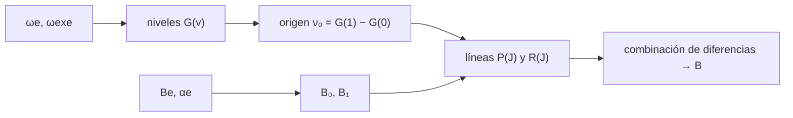

# B62-C02 — Espectros vibracionales de moléculas

<!-- nav:top -->
[🏠 Programa](../../../../README.md) · [📚 Bloque B62](../../../tronco-comun/B62-espectroscopia-molecular-para-astroquimica.md) · [← Anterior: B62-C01 — Espectros rotacionales de moléculas: niveles y reglas de selección](../B62-C01-espectros-rotacionales-de-moleculas-niveles-y-reglas-de-seleccion/CLASE.md) · [Siguiente: B62-C03 — Transiciones electrónicas moleculares →](../B62-C03-transiciones-electronicas-moleculares/CLASE.md)
<!-- /nav -->

## 1. Ubicación, nivel y alcance

Clase 2 del bloque B62. Nivel N3. Tras el rotor de [B62-C01](../B62-C01-espectros-rotacionales-de-moleculas-niveles-y-reglas-de-seleccion/CLASE.md), la molécula también vibra: aquí construyes los niveles vibracionales con anarmonicidad, el origen de la banda fundamental y las **ramas P y R** de una banda ro-vibracional, y usas la **combinación de diferencias** para recuperar `B`. Usas álgebra y las constantes de [B05](../../../tronco-comun/B05-fisica-fundamental-para-el-espacio.md). Molécula conductora: ¹²C¹⁶O, con las constantes del WebBook del NIST. Todo lo calculado es **modelo**, no espectro observado.

## 2. Por qué esta clase existe

Las bandas del CO a 4,67 µm se observan en el infrarrojo, no en milimétricas. Para interpretarlas necesitas saber de dónde sale el origen de banda, por qué las ramas P y R se separan en dos grupos y qué cambia al pasar a un isotopólogo. La decisión central: **¿qué parte del espectro vibracional viene del oscilador y qué parte de la rotación que lo acompaña?**

## 3. Lo que podrás hacer al terminar

1. Calcular niveles `G(v)` con anarmonicidad y las separaciones entre niveles consecutivos.
2. Obtener el origen de la banda fundamental y del primer sobretono, y explicar por qué no es el doble.
3. Construir las líneas P(J) y R(J) con `B₀` y `B₁` distintos.
4. Usar la combinación de diferencias para recuperar `B₀` sin conocer el origen de banda.
5. Estimar la constante de fuerza y el efecto de cambiar de isótopo.
6. Distinguir lo consultado (constantes) de lo calculado (líneas).

La evidencia es la **ficha de la banda ro-vibracional** del ejercicio 12.

## 4. Con qué llegas y cómo comprobarlo

1. ¿Qué es un oscilador armónico y de qué depende su frecuencia?
2. ¿Qué significa `B` en cm⁻¹ (B62-C01)?
3. ¿Cómo se pasa de cm⁻¹ a µm?
4. ¿Qué es un sobretono?
5. ¿Qué es un número de masa?

<details>
<summary>Ver respuestas</summary>

1. Un sistema con fuerza restauradora proporcional al desplazamiento; `ω = √(k/μ)`. 2. La constante rotacional del nivel de energía. 3. `λ[µm] = 10⁴/ν̃[cm⁻¹]`. 4. Una transición vibracional con `Δv ≥ 2`. 5. El número de protones más neutrones.
</details>

Con cuatro o cinco aciertos, sigue; si no, repasa los prerrequisitos.

## 5. Un caso de contexto y casos de referencia

El WebBook del NIST da para el ¹²C¹⁶O: `ωe = 2169,81358 cm⁻¹`, `ωexe = 13,28831 cm⁻¹`, `Be = 1,93128087 cm⁻¹` y `αe = 0,01750441 cm⁻¹`. Con solo estos cuatro números puedes dibujar la banda fundamental completa. Es el **ejemplo conductor**.

## 6. Vocabulario

La **energía vibracional** anarmónica es `G(v) = ωe(v+½) − ωexe(v+½)²`. `ωe` es la frecuencia armónica y `ωexe` la corrección de anarmonicidad. El **origen de banda** `ν₀` es la frecuencia pura vibracional sin rotación. La **constante rotacional del nivel** `B_v = Be − αe(v+½)` decrece al vibrar. La **rama R** reúne las transiciones con `ΔJ = +1`; la **rama P**, con `ΔJ = −1`. La **combinación de diferencias** resta líneas que comparten un nivel para eliminar `ν₀`.

## 7. Modelo mental: un resorte que se alarga

Un resorte con una masa en cada extremo: cuanto más se estira, más se ablanda (anarmonicidad). Límite: un resorte real se rompe o cambia de régimen; el modelo de `G(v)` vale lejos de la disociación.



*Descripción textual:* de `ωe` y `ωexe` salen los niveles y el origen; de `Be` y `αe`, los `B_v`; juntos generan las ramas P y R, y las diferencias de líneas devuelven `B`.

## 8. La explicación, paso a paso

### 8.1 Niveles anarmónicos

El salto entre niveles es `G(v+1) − G(v) = ωe − 2ωexe(v+1)`. Valores calculados para el CO:

| `v` | `G(v)` (cm⁻¹) | salto a `v+1` (cm⁻¹) |
|---|---|---|
| 0 | 1081,585 | 2143,237 |
| 1 | 3224,822 | 2116,660 |
| 2 | 5341,482 | 2090,084 |
| 3 | 7431,566 | 2063,507 |
| 4 | 9495,073 | 2036,930 |

Los saltos decrecen en `2ωexe = 26,577 cm⁻¹` por nivel. El origen de la banda fundamental es `ν₀ = 2143,237 cm⁻¹` (4,6658 µm) y el primer sobretono, `4259,897 cm⁻¹`, queda `26,577 cm⁻¹` por debajo de `2ν₀`.

### 8.2 Ramas P y R

Con `B_v = Be − αe(v+½)`: `B₀ = 1,922529` y `B₁ = 1,905024 cm⁻¹`. Si `J` es el nivel inferior:
`R(J) = ν₀ + (B₁+B₀)(J+1) + (B₁−B₀)(J+1)²` y `P(J) = ν₀ − (B₁+B₀)J + (B₁−B₀)J²`.
Como `B₁ < B₀`, las líneas R se acercan entre sí y las P se separan. No hay línea `Q` (`ΔJ = 0`) en una molécula `¹Σ⁺`. La línea `J = 0` solo existe en R.

| `J` | P(J) (cm⁻¹) | R(J) (cm⁻¹) |
|---|---|---|
| 0 | — | 2147,0470 |
| 1 | 2139,3919 | 2150,8220 |
| 2 | 2135,5118 | 2154,5621 |
| 3 | 2131,5968 | 2158,2671 |
| 4 | 2127,6467 | 2161,9371 |
| 5 | 2123,6616 | 2165,5721 |

### 8.3 Combinación de diferencias

`R(J−1) − P(J+1) = 4B₀(J+½)` no depende de `ν₀` ni de `B₁`; análogamente `R(J) − P(J) = 4B₁(J+½)`. El laboratorio comprueba ambas con error máximo `6×10⁻¹³ cm⁻¹`.

### 8.4 Fuerza e isótopo

La constante de fuerza armónica `k = μ(2πcωe)²` vale `1902,1 N/m` (masas enteras 12 y 16). En ¹³C¹⁶O, con masas enteras 13 y 16, `ωe` se escala por `√(μ/μ') = 0,97778`: `ωe ≈ 2121,6 cm⁻¹` y el origen de la banda baja a `≈ 2096,2 cm⁻¹`. La aproximación de Morse `ωe²/(4ωexe) = 88576 cm⁻¹` es solo un orden de magnitud; no se comparó con ningún valor consultado.

## 9. Magnitudes, símbolos y unidades

| Símbolo | Qué es | Unidad | Valor / nota |
|---|---|---|---|
| `ωe` | frecuencia armónica | cm⁻¹ | 2169,81358 |
| `ωexe` | anarmonicidad | cm⁻¹ | 13,28831 |
| `ν₀` | origen de banda 1–0 | cm⁻¹ | 2143,237 |
| `B_v` | constante rotacional del nivel | cm⁻¹ | 1,922529 (v=0) |
| `k` | constante de fuerza | N m⁻¹ | 1902,1 |

## 10. Convenciones y referencias

Frecuencias en número de onda (cm⁻¹) en el vacío; `J` es el nivel inferior; sin distorsión centrífuga; molécula `X ¹Σ⁺` sin línea Q; masas por números enteros (aproximación). Constantes CODATA 2022.

## 11. De dónde sale lo que afirmamos

| ID | Fuente | Localizador | Respalda | Consulta | Estado |
|---|---|---|---|---|---|
| S1 | NIST, CODATA 2022 | physics.nist.gov/cuu/Constants/Table/allascii.txt | `c`, `u` | 2026-11-09 | Consultada |
| S2 | NIST Chemistry WebBook, CO | webbook.nist.gov/cgi/cbook.cgi?ID=C630080&Mask=1000 | `ωe`, `ωexe`, `Be`, `αe` | 2026-11-09 | Consultada |

Límites: no se consultó ninguna banda observada; las líneas P y R son un cálculo; no hay distorsión centrífuga; no se consultó un texto de espectroscopía.

## 12. Cómo ver la banda

| Magnitud | Valor |
|---|---|
| origen 1–0 | 2143,237 cm⁻¹ (4,6658 µm) |
| hueco entre P(1) y R(0) | 7,655 cm⁻¹ |
| `R(J−1)−P(J+1)` frente a `4B₀(J+½)` | 5×10⁻¹³ cm⁻¹ |

Descripción larga: dos «peines» a ambos lados de `ν₀`; el de la derecha (R) se comprime y el de la izquierda (P) se abre, y entre `P(1)` y `R(0)` queda un hueco de unos `4B`.

## 13. Ejemplo trabajado: la línea R(2)

**Paso 1 · Datos.** `ν₀ = 2143,2370`; `B₀ = 1,922529`; `B₁ = 1,905024`.

**Paso 2 · Términos.** `B₁+B₀ = 3,827553`; `B₁−B₀ = −0,017505`.

**Paso 3 · Evaluación.** `R(2) = 2143,2370 + 3,827553·3 − 0,017505·9 = 2154,5621 cm⁻¹`.

**Paso 4 · Lectura.** Frecuencia `64,59 THz` (`ν̃·c`); longitud de onda `4,6416 µm`.

## 14. Distintas formas de describir una banda

**Por niveles:** `G(v)` y `B_v`. **Por líneas:** tabla P/R. **Por diferencias:** `4B(J+½)`. **Por isótopo:** escala `ρ = √(μ/μ')`.

## 15. Práctica guiada

**Ejercicio 1 · con los pasos indicados.** Calcula `G(1) − G(0)`. *Pasos:* `ωe − 2ωexe`.

<details><summary>Solución comentada</summary>

`2169,81358 − 26,57662 = 2143,2370 cm⁻¹` (8.1).
</details>

**Ejercicio 2 · con una pista.** Calcula `B₁`. *Pista:* `Be − αe·1,5`.

<details><summary>Solución comentada</summary>

`1,93128087 − 0,02625662 = 1,905024` (8.2).
</details>

**Ejercicio 3 · casi autónomo.** ¿Por qué el primer sobretono no cae en `2ν₀`?

<details><summary>Solución comentada</summary>

La anarmonicidad acorta cada salto en `2ωexe`: queda `26,577 cm⁻¹` por debajo (8.1).
</details>

## 16. Práctica autónoma, transferencia e integrador

**Ejercicio 4.** Calcula P(2).

<details><summary>Solución comentada</summary>

`2143,2370 − 3,827553·2 + (−0,017505)·4 = 2135,5118 cm⁻¹` (8.2).
</details>

**Ejercicio 5.** Con `R(1) = 2150,8220` y `P(3) = 2131,5968`, ¿cuánto vale `B₀`?

<details><summary>Solución comentada</summary>

`R(J−1) − P(J+1)` con `J = 2`: `R(1) − P(3) = 19,2252 = 4B₀·2,5` → `B₀ = 1,92252` (8.3).
</details>

**Ejercicio 6.** Longitud de onda de la banda 1–0 en µm.

<details><summary>Solución comentada</summary>

`10⁴/2143,237 = 4,6658 µm`.
</details>

**Ejercicio 7.** Salto `G(3) − G(2)`.

<details><summary>Solución comentada</summary>

`ωe − 2ωexe·3 = 2063,507 cm⁻¹` (tabla 8.1).
</details>

**Ejercicio 8.** ¿Qué rama se «acumula» si `B₁ > B₀`?

<details><summary>Solución comentada</summary>

Si `B₁ > B₀` el término cuadrático de R es positivo y R se abre; P se comprime (hace «cabeza de banda»). En CO ocurre lo contrario (8.2).
</details>

**Ejercicio 9 · transferencia.** **Transferencia.** Un colega afirma que una molécula homonuclear (N₂) tiene banda fundamental infrarroja. ¿Qué respondes?

<details><summary>Solución comentada</summary>

El dipolo permanente es nulo y su derivada con la distancia también: no hay absorción dipolar fundamental (límite: sin cuadrupolo ni colisiones).
</details>

**Ejercicio 10 · transferencia.** **Transferencia.** ¿Qué cambia en el espectro al pasar de ¹²CO a ¹³CO?

<details><summary>Solución comentada</summary>

Toda la banda se desplaza a menor frecuencia: `ρ = 0,97778` (8.4).
</details>

**Ejercicio 11 · transferencia.** **Transferencia.** ¿Por qué `Be` y `B₀` no pueden mezclarse al identificar una línea?

<details><summary>Solución comentada</summary>

Difieren en `αe/2 = 0,0088 cm⁻¹`, que a `J` alto da cientos de MHz.
</details>

**Ejercicio 12 · integrador.** **Integrador.** Elabora tu *ficha de la banda ro-vibracional*: niveles, origen, ramas P/R hasta J = 5, combinación de diferencias y efecto isotópico.

<details><summary>Solución modelo</summary>

Secciones 8.1–8.4 y resultados de la sección 17.
</details>

## 17. Laboratorio: la banda 1–0 del CO

El script [vibracion.py](vibracion.py) calcula `G(v)`, el origen, las ramas, la constante de fuerza y el isotopólogo, y **comprueba** que las combinaciones de diferencias valen `4B(J+½)` con error < 10⁻⁹ cm⁻¹ y que `k` está dentro de 1 % del orden esperado.

**Datos:** constantes consultadas (WebBook, CODATA); líneas **calculadas**, no observadas. **Predice antes de ejecutar:** ¿qué rama se comprime? (R, porque `B₁ < B₀`.) **Ejecución del 2026-11-09 (Python 3.12.9):**

```text
Python 3.12.9 (biblioteca estandar)
Constantes del WebBook (NIST) y CODATA 2022 consultadas el 2026-11-09; el resultado es un calculo, no un espectro observado
Niveles G(v) [cm^-1] y separaciones G(v+1)-G(v):
  v = 0: G =   1081.585 ; salto a v+1 =  2143.237 (we - 2 wexe (v+1) =  2143.237)
  v = 1: G =   3224.822 ; salto a v+1 =  2116.660 (we - 2 wexe (v+1) =  2116.660)
  v = 2: G =   5341.482 ; salto a v+1 =  2090.084 (we - 2 wexe (v+1) =  2090.084)
  v = 3: G =   7431.566 ; salto a v+1 =  2063.507 (we - 2 wexe (v+1) =  2063.507)
  v = 4: G =   9495.073 ; salto a v+1 =  2036.930 (we - 2 wexe (v+1) =  2036.930)
Origen de la banda fundamental 1-0 = 2143.2370 cm^-1 = 4.6658 um
Primer sobretono 2-0 = 4259.8973 cm^-1 (el doble de 1-0 serian 4286.4739; la anarmonicidad lo baja 26.577 cm^-1)
B0 = 1.922529 cm^-1 ; B1 = 1.905024 cm^-1
  J   P(J) [cm^-1]   R(J) [cm^-1]
  0           nan     2147.0470
  1     2139.3919     2150.8220
  2     2135.5118     2154.5621
  3     2131.5968     2158.2671
  4     2127.6467     2161.9371
  5     2123.6616     2165.5721
Combinacion de diferencias: max |R(J-1)-P(J+1) - 4 B0 (J+1/2)| = 4.83e-13 cm^-1
Combinacion R(J)-P(J) = 4 B1 (J+1/2): max error = 6.11e-13 cm^-1
Constante de fuerza armonica k = mu (2 pi c we)^2 = 1902.1 N/m (masas enteras)
13C16O (masas enteras): rho = 0.97778 ; we = 2121.589 cm^-1 ; B_e = 1.84639 cm^-1 ; origen 1-0 aprox 2096.181 cm^-1
Estimacion de Morse De = we^2/(4 wexe) = 88576 cm^-1 (sin comparar con ningun valor consultado)
Pruebas superadas.
```

```bash
python programa/clases/B62/B62-C02-espectros-vibracionales-de-moleculas/vibracion.py
```

**Límites:** la prueba de `k` compara con un orden de magnitud propio, no con una fuente; no hay distorsión centrífuga.

## 18. Errores frecuentes y cómo corregirlos

**Usar `ωe` como origen de banda.** Se corrige con 8.1: `ν₀ = ωe − 2ωexe`.

**Usar el mismo `B` en ambos niveles.** Se corrige con 8.2.

**Buscar una línea Q en CO.** Se corrige con 8.2.

**Etiquetar `J` con el nivel superior.** Se corrige con la sección 10.

## 19. Cómo sabrás que vas bien

Tras la sección 8: ¿qué hueco esperabas entre P(1) y R(0)? (`≈ 4B`.) Si dudas, repasa el ejemplo 13. Tras el laboratorio: ¿qué comprueba? (ver la sección 17).

## 20. Qué entregas y cómo se evalúa

El producto es tu **ficha de la banda ro-vibracional** (ejercicio 12).

| Criterio | Inicial | En desarrollo | Logrado | Destacado |
|---|---|---|---|---|
| Conceptos | Los confunde | Parciales | `G(v)`, `B_v`, P y R | Explica la combinación de diferencias |
| Cálculo | Sin unidades | Con errores | Tabla completa en cm⁻¹ | Calcula el isótopo |
| Numérico | Sin comprobar | Un caso | Identidad exacta comprobada | Interpreta el error |
| Fuentes | Sin fuente | Sin fecha | Fuentes con fecha | Declara lo no consultado |
| Límites | No los nombra | Uno | Tres | Discute la ausencia de distorsión |

**Condiciones críticas (no se compensan con promedio):** rotular las líneas como calculadas; no presentarlas como observadas; citar solo lo consultado.

## 21. Ética, seguridad y límites

Clase educativa: el modelo anarmónico sencillo no sustituye a un ajuste de datos de laboratorio. Accesibilidad: tablas equivalentes a las gráficas, fórmulas en texto, ejercicios sin conexión.

## 22. Para cerrar y seguir

La banda 1–0 del CO nace en `2143,237 cm⁻¹` y sus ramas P y R devuelven `B₀` con error de `5×10⁻¹³ cm⁻¹` en el modelo. Queda una pregunta: ¿qué ocurre cuando cambia el estado electrónico?

**Glosario español–inglés.** origen de banda · *band origin*; anarmonicidad · *anharmonicity*; rama P · *P branch*; rama R · *R branch*; combinación de diferencias · *combination difference*; sobretono · *overtone*.

**Continuidad.** [B62-C03](../B62-C03-transiciones-electronicas-moleculares/CLASE.md) estudia las transiciones electrónicas.

**Referencias:** ver sección 11.

<!-- nav:bottom -->
---

[← Anterior: B62-C01 — Espectros rotacionales de moléculas: niveles y reglas de selección](../B62-C01-espectros-rotacionales-de-moleculas-niveles-y-reglas-de-seleccion/CLASE.md) · [📚 Bloque B62](../../../tronco-comun/B62-espectroscopia-molecular-para-astroquimica.md) · [Siguiente: B62-C03 — Transiciones electrónicas moleculares →](../B62-C03-transiciones-electronicas-moleculares/CLASE.md)
<!-- /nav -->
