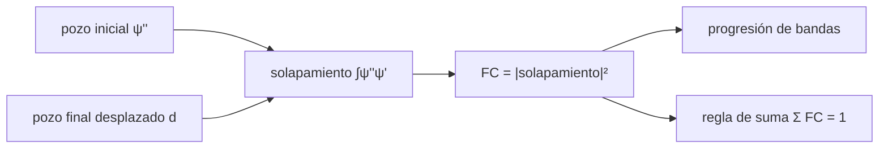

# B62-C03 — Transiciones electrónicas moleculares

<!-- nav:top -->
[🏠 Programa](../../../../README.md) · [📚 Bloque B62](../../../tronco-comun/B62-espectroscopia-molecular-para-astroquimica.md) · [← Anterior: B62-C02 — Espectros vibracionales de moléculas](../B62-C02-espectros-vibracionales-de-moleculas/CLASE.md) · [Siguiente: B62-C04 — Momentos dipolares y fuerza de línea →](../B62-C04-momentos-dipolares-y-fuerza-de-linea/CLASE.md)
<!-- /nav -->

## 1. Ubicación, nivel y alcance

Clase 3 del bloque B62. Nivel N3. Tras la rotación ([B62-C01](../B62-C01-espectros-rotacionales-de-moleculas-niveles-y-reglas-de-seleccion/CLASE.md)) y la vibración ([B62-C02](../B62-C02-espectros-vibracionales-de-moleculas/CLASE.md)), una molécula puede cambiar de **estado electrónico**: la transición es rápida y deja la huella de la vibración en el espectro. Aquí aprendes el principio de Franck-Condon con un modelo mínimo de dos osciladores armónicos desplazados, calculas los factores de Franck-Condon (FC) por integral numérica y por fórmula cerrada, y lees una progresión vibracional. Usas [B09](../../../tronco-comun/B09-calculo-diferencial-e-integral.md) (integrales, normalización). La molécula del laboratorio es **sintética**.

## 2. Por qué esta clase existe

Las bandas electrónicas aparecen en el ultravioleta y el visible; su forma, una serie de picos, revela cuánto cambia la geometría de la molécula. La decisión central: **¿qué picos de la progresión serán intensos?**

## 3. Lo que podrás hacer al terminar

1. Enunciar el principio de Franck-Condon y la aproximación de Condon.
2. Calcular el solapamiento entre funciones vibracionales de dos pozos desplazados.
3. Obtener FC(0, v') con la fórmula `e^(−S)S^(v')/v'!` y reconocer el factor de Huang-Rhys `S`.
4. Predecir el pico más intenso (v' ≈ S) y comprobar la regla de suma.
5. Comparar el caso de igual frecuencia con el de frecuencias distintas.
6. Rotular el modelo como sintético y sus límites.

La evidencia es la **ficha de Franck-Condon** del ejercicio 12.

## 4. Con qué llegas y cómo comprobarlo

1. ¿Qué es la función de onda del estado fundamental del oscilador armónico?
2. ¿Qué significa «normalizada»?
3. ¿Qué es una integral de solapamiento?
4. ¿Qué es un factor de Poisson `e^(−S)S^n/n!`?
5. ¿Qué diferencia hay entre dato sintético y observado?

<details>
<summary>Ver respuestas</summary>

1. Una gaussiana centrada en el equilibrio. 2. Que la integral de su cuadrado vale 1. 3. La integral del producto de dos funciones. 4. Probabilidad de `n` sucesos con media `S`. 5. El sintético se genera con un modelo; el observado procede de una medida.
</details>

Con cuatro o cinco aciertos, sigue; si no, repasa los prerrequisitos.

## 5. Un caso de contexto y casos de referencia

Imagina una molécula **sintética** (masa reducida 6,857 u, escala tipo CO) cuyo enlace se alarga `0,10 Å` al excitarse; el oscilador inicial vibra a 2000 cm⁻¹. ¿En qué nivel vibracional del estado excitado es más probable terminar? Es el **ejemplo conductor**; todo es **ilustrativo**: ningún valor describe una transición real.

## 6. Vocabulario

El **principio de Franck-Condon** dice que, como los núcleos son mucho más lentos que los electrones, la transición electrónica ocurre a geometría fija («vertical»). El **factor de Franck-Condon** `FC(v'', v') = |∫ψ''_{v''}ψ'_{v'} dx|²` es la probabilidad relativa de cada banda vibracional. La **aproximación de Condon** supone que el momento de transición electrónico es constante. El **factor de Huang-Rhys** `S = μωd²/(2ħ)` mide el desplazamiento en unidades de oscilador. Una **progresión** es la serie de bandas con `v'` creciente.

## 7. Modelo mental: dos hamacas desplazadas

Dos hamacas con el mismo balanceo pero colgadas a distancia `d`: lo que sale del solapamiento depende de cuánto se mira de una a otra. Límite: las hamacas reales son anarmónicas y pueden tener distinta forma.



*Descripción textual:* dos funciones de onda en pozos desplazados dan un solapamiento; su cuadrado es el FC, la progresión es la lista de FC y todos suman 1.

## 8. La explicación, paso a paso

### 8.1 Aproximación de Condon y solapamiento

La intensidad relativa de la banda `v''→v'` es proporcional al FC, porque el momento de transición electrónico se toma constante (Condon). El FC se calcula integrando el producto de las funciones de Hermite, normalizadas, de ambos pozos, uno de ellos desplazado `d`.

### 8.2 Igual frecuencia: fórmula cerrada

Si ambos pozos tienen la misma frecuencia, `FC(0, v') = e^(−S)S^(v')/v'!`, con `S = μωd²/(2ħ)`. Con `μ = 6,857 u`, `ν̃ = 2000 cm⁻¹` y `d = 0,10 Å`, `S = 2,03380`. Es una distribución de Poisson: el valor medio de `v'` es `S`, y el pico está en `v' = 2`.

| `v'` | FC numérico | FC analítico | diferencia |
|---|---|---|---|
| 0 | 0,13083775 | 0,13083775 | 8,5×10⁻¹⁴ |
| 1 | 0,26609746 | 0,26609746 | 1,7×10⁻¹³ |
| 2 | 0,27059414 | 0,27059414 | 1,8×10⁻¹³ |
| 3 | 0,18344454 | 0,18344454 | 1,2×10⁻¹³ |
| 4 | 0,09327225 | 0,09327225 | 6,1×10⁻¹⁴ |
| 5 | 0,03793937 | 0,03793937 | 2,5×10⁻¹⁴ |

La suma hasta `v' = 40` es `1,00000000`.

### 8.3 Frecuencias distintas

Con estado final a 1500 cm⁻¹ no hay fórmula sencilla en esta clase; la integral numérica da `FC(0,v')`: 0,1732; 0,3450; 0,2961; 0,1406; 0,0389; 0,0059 (v' = 0…5). El pico pasa a `v' = 1` y la suma también vale 1. Un cambio de frecuencia reordena las intensidades aunque `d` no cambie.

### 8.4 Lectura de una progresión

Sin desplazamiento y con la misma frecuencia, `FC(0,0) = 1`: solo aparece la banda 0–0. Cuanto mayor `d`, más a la derecha el pico. Las intensidades relativas de la progresión del caso A (v' = 0…5) son 0,484; 0,983; 1,000; 0,678; 0,345; 0,140. Las posiciones de las bandas, que dependen de la energía de cada nivel, no se tratan aquí.

## 9. Magnitudes, símbolos y unidades

| Símbolo | Qué es | Unidad | Valor / nota |
|---|---|---|---|
| `μ` | masa reducida | u (1,66053906892×10⁻²⁷ kg) | 6,857 (sintético) |
| `ν̃` | frecuencia del oscilador | cm⁻¹ | 2000 y 1500 (sintéticos) |
| `d` | desplazamiento de equilibrio | Å | 0,10 (sintético) |
| `S` | factor de Huang-Rhys | adimensional | 2,03380 |
| `FC` | factor de Franck-Condon | adimensional | 0 a 1 |

## 10. Convenciones y referencias

Osciladores armónicos 1D con la misma masa reducida; solo `v'' = 0` como estado inicial; aproximación de Condon; sin rotación ni anarmonicidad; constantes CODATA 2022 (`h`, `c`, `u`).

## 11. De dónde sale lo que afirmamos

| ID | Fuente | Localizador | Respalda | Consulta | Estado |
|---|---|---|---|---|---|
| S1 | NIST, CODATA 2022 | physics.nist.gov/cuu/Constants/Table/allascii.txt | `h`, `c`, `u` | 2026-11-09 | Consultada |

Límites: la fórmula de Poisson y el principio de Franck-Condon son relaciones estándar que el laboratorio verifica contra la integral numérica; no se consultó ningún texto ni artículo sobre ellos, y la molécula es sintética.

## 12. Cómo ver la progresión

| Magnitud | Valor |
|---|---|
| `S` (caso A) | 2,03380 |
| FC máximo (caso A) | 0,2706 en `v' = 2` |
| FC máximo (caso B) | 0,3450 en `v' = 1` |
| suma de FC | 1,00000000 |

Descripción larga: un perfil de campana asimétrico (Poisson) en el caso A; en el B se desplaza hacia `v'` menores y se estrecha.

## 13. Ejemplo trabajado: FC(0,1) del caso A

**Paso 1 · `S`.** `S = 2,03380`.

**Paso 2 · Exponencial.** `e^(−S) = 0,13084`.

**Paso 3 · Poisson.** `FC(0,1) = e^(−S)·S¹/1! = 0,13084·2,03380 = 0,26610`.

**Paso 4 · Comparación.** El valor numérico es `0,26609746`.

## 14. Distintas formas de describir una transición electrónica

**Por integral:** solapamiento entre pozos. **Por fórmula:** Poisson con `S`. **Por progresión:** serie de intensidades. **Por regla de suma:** `Σ FC = 1`.

## 15. Práctica guiada

**Ejercicio 1 · con los pasos indicados.** Con `S = 1`, calcula `FC(0,0)`. *Pasos:* `e^(−S)`.

<details><summary>Solución comentada</summary>

`e^(−1) = 0,3679` (8.2).
</details>

**Ejercicio 2 · con una pista.** Con `S = 1`, calcula `FC(0,2)`. *Pista:* `S²/2!`.

<details><summary>Solución comentada</summary>

`0,3679·1/2 = 0,1839`.
</details>

**Ejercicio 3 · casi autónomo.** ¿Cuánto vale la suma de FC desde `v'=0` a infinito?

<details><summary>Solución comentada</summary>

1: las funciones del pozo final forman un conjunto completo (8.3).
</details>

## 16. Práctica autónoma, transferencia e integrador

**Ejercicio 4.** ¿En qué `v'` está el pico si `S = 4,3`?

<details><summary>Solución comentada</summary>

Cerca de `v' ≈ S`, es decir 4 (el máximo de Poisson está en `⌊S⌋`).
</details>

**Ejercicio 5.** ¿Qué FC(0,0) esperas con `d` doble (S × 4)?

<details><summary>Solución comentada</summary>

`S` pasa a `8,135`: `e^(−8,135) = 2,9×10⁻⁴`. La banda 0–0 casi desaparece (8.2).
</details>

**Ejercicio 6.** Calcula `FC(0,3)` del caso A.

<details><summary>Solución comentada</summary>

`0,13084·2,0338³/6 = 0,18344` (tabla 8.2).
</details>

**Ejercicio 7.** ¿Cuál es el valor medio de `v'` en el caso A?

<details><summary>Solución comentada</summary>

La media de Poisson es `S = 2,03` (8.2).
</details>

**Ejercicio 8.** ¿Por qué cambia el pico en el caso B si `d` es el mismo?

<details><summary>Solución comentada</summary>

Cambia la forma del pozo final y con ella el solapamiento (8.3).
</details>

**Ejercicio 9 · transferencia.** **Transferencia.** Un espectro muestra una sola banda estrecha y ninguna progresión. ¿Qué sugiere sobre la geometría?

<details><summary>Solución comentada</summary>

Poco cambio de geometría (`S` pequeño): la banda 0–0 domina (8.4).
</details>

**Ejercicio 10 · transferencia.** **Transferencia.** ¿Qué debes verificar antes de usar la aproximación de Condon?

<details><summary>Solución comentada</summary>

Que el momento de transición electrónico varíe poco con la distancia en el rango de solapamiento (8.1).
</details>

**Ejercicio 11 · transferencia.** **Transferencia.** ¿Por qué la prueba numérica es útil aunque exista fórmula cerrada?

<details><summary>Solución comentada</summary>

Valida el código con un caso analítico y permite ir al caso sin fórmula (8.3).
</details>

**Ejercicio 12 · integrador.** **Integrador.** Elabora tu *ficha de Franck-Condon*: `S`, tabla de FC (analítico y numérico), pico, suma y comparación entre frecuencias iguales y distintas.

<details><summary>Solución modelo</summary>

Secciones 8.2–8.4 con los resultados de la sección 17, rotulando el modelo como sintético.
</details>

## 17. Laboratorio: factores de Franck-Condon

El script [franck_condon.py](franck_condon.py) calcula el solapamiento por integración de funciones de Hermite y lo **comprueba** contra la fórmula de Poisson (tolerancia 10⁻⁸), la regla de suma (10⁻⁶) y el caso `d = 0`.

**Datos:** molécula **sintética**; constantes de CODATA 2022 consultadas. **Predice antes de ejecutar:** ¿en qué `v'` está el pico del caso A? (`v' = 2`.) **Ejecución del 2026-11-09 (Python 3.12.9, numpy 2.4.4):**

```text
Python 3.12.9, numpy 2.4.4
Molecula SINTETICA (mu = 6.857 u, d = 0.10 A): ningun valor describe una transicion real; constantes h, c, u de CODATA 2022 (consultado 2026-11-09)
Caso A: misma frecuencia 2000 cm^-1, desplazamiento 0.1 A -> factor de Huang-Rhys S = 2.03380
 v'   FC numerico (0->v')   FC analitico   dif.
 0   0.13083775        0.13083775   8.5e-14
 1   0.26609746        0.26609746   1.7e-13
 2   0.27059414        0.27059414   1.8e-13
 3   0.18344454        0.18344454   1.2e-13
 4   0.09327225        0.09327225   6.1e-14
 5   0.03793937        0.03793937   2.5e-14
 6   0.01286016        0.01286016   8.3e-15
Diferencia maxima = 1.76e-13 ; suma FC(0,v') hasta 40 = 1.00000000 ; v' mas intenso = 2
Caso B: frecuencia inicial 2000 cm^-1, final 1500 cm^-1, d = 0.10 A (solo numerico)
 v'   FC(0,v')
 0   0.173156
 1   0.344976
 2   0.296131
 3   0.140591
 4   0.038926
 5   0.005872
Suma hasta v' = 40: 1.00000000 ; sin desplazamiento (d = 0) y misma frecuencia: FC(0,0) = 1.00000000
Intensidades relativas de la progresion (caso A, v' = 0..5): 0.484, 0.983, 1.000, 0.678, 0.345, 0.140
Pruebas superadas.
```

```bash
python programa/clases/B62/B62-C03-transiciones-electronicas-moleculares/franck_condon.py
```

**Límites:** modelo 1D, armónico, sintético; no se calculan posiciones ni la influencia del momento de transición.

## 18. Errores frecuentes y cómo corregirlos

**Confundir FC con intensidad absoluta.** Se corrige con 8.1: es una intensidad relativa dentro de la progresión.

**Creer que la banda 0–0 siempre domina.** Se corrige con 8.2 y 8.4.

**Olvidar que la suma debe ser 1.** Se corrige con 8.3.

**Tratar el modelo sintético como una molécula real.** Se corrige con la sección 5.

## 19. Cómo sabrás que vas bien

Tras la sección 8: ¿qué `S` esperabas y qué pico resultó? Si dudas, repasa el ejemplo 13. Tras el laboratorio: ¿qué comprueba? (ver la sección 17).

## 20. Qué entregas y cómo se evalúa

El producto es tu **ficha de Franck-Condon** (ejercicio 12).

| Criterio | Inicial | En desarrollo | Logrado | Destacado |
|---|---|---|---|---|
| Conceptos | Los confunde | Parciales | Condon, FC, `S` | Explica los límites del modelo |
| Cálculo | Sin unidades | Con errores | Tabla completa | Calcula casos nuevos |
| Numérico | Sin comprobar | Un caso | Contraste con la fórmula cerrada | Interpreta la regla de suma |
| Fuentes | Sin fuente | Sin fecha | Constantes con fecha | Declara lo no consultado |
| Límites | No los nombra | Uno | Tres | Discute qué falta del modelo |

**Condiciones críticas (no se compensan con promedio):** rotular la molécula como sintética; no presentar el resultado como observación; citar solo lo consultado.

## 21. Ética, seguridad y límites

Clase educativa: ninguna transición real se calcula. Accesibilidad: tablas equivalentes a las gráficas, fórmulas en texto, ejercicios sin conexión.

## 22. Para cerrar y seguir

Un desplazamiento de `0,10 Å` produce `S = 2,03` y un pico en `v' = 2`; las frecuencias distintas lo mueven a `v' = 1`. Queda una pregunta: ¿qué fija la intensidad absoluta de una línea?

**Glosario español–inglés.** principio de Franck-Condon · *Franck-Condon principle*; factor de Huang-Rhys · *Huang-Rhys factor*; progresión vibracional · *vibrational progression*; solapamiento · *overlap*; transición vertical · *vertical transition*.

**Continuidad.** [B62-C04](../B62-C04-momentos-dipolares-y-fuerza-de-linea/CLASE.md) estudia el momento dipolar y la fuerza de línea.

**Referencias:** ver sección 11.

<!-- nav:bottom -->
---

[← Anterior: B62-C02 — Espectros vibracionales de moléculas](../B62-C02-espectros-vibracionales-de-moleculas/CLASE.md) · [📚 Bloque B62](../../../tronco-comun/B62-espectroscopia-molecular-para-astroquimica.md) · [Siguiente: B62-C04 — Momentos dipolares y fuerza de línea →](../B62-C04-momentos-dipolares-y-fuerza-de-linea/CLASE.md)
<!-- /nav -->
