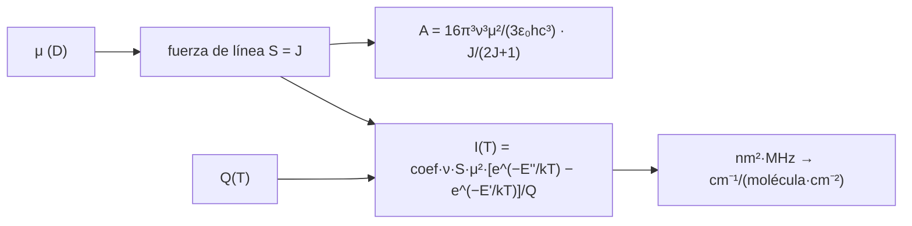

# B62-C04 — Momentos dipolares y fuerza de línea

<!-- nav:top -->
[🏠 Programa](../../../../README.md) · [📚 Bloque B62](../../../tronco-comun/B62-espectroscopia-molecular-para-astroquimica.md) · [← Anterior: B62-C03 — Transiciones electrónicas moleculares](../B62-C03-transiciones-electronicas-moleculares/CLASE.md) · [Siguiente: B62-C05 — Constantes espectroscópicas y ajuste de espectros →](../B62-C05-constantes-espectroscopicas-y-ajuste-de-espectros/CLASE.md)
<!-- /nav -->

## 1. Ubicación, nivel y alcance

Clase 4 del bloque B62. Nivel N3. Las clases anteriores dieron **dónde** están las líneas; esta da **cuán intensas** son. Relacionas el momento dipolar `μ` con la **fuerza de línea** `S`, el coeficiente de Einstein `A` y la **intensidad de catálogo**, y aprendes a leer el resultado en tres unidades distintas (nm²·MHz, cm⁻¹/(molécula·cm⁻²) y s⁻¹). Usas [B05](../../../tronco-comun/B05-fisica-fundamental-para-el-espacio.md) y las constantes de [B62-C01](../B62-C01-espectros-rotacionales-de-moleculas-niveles-y-reglas-de-seleccion/CLASE.md). El ejemplo conductor son las líneas `J = 1→0, 2→1, 3→2` del ¹²C¹⁶O, de las que tienes dos fuentes independientes.

## 2. Por qué esta clase existe

Una frecuencia identifica la especie, pero solo la intensidad dice cuánta hay. Y la intensidad contiene `μ²`: un error del 10 % en el dipolo es un 20 % en la cantidad de moléculas. La decisión central: **¿qué dipolo implica cada dato y coinciden dos fuentes independientes?**

## 3. Lo que podrás hacer al terminar

1. Calcular `A` de una transición rotacional de molécula lineal desde `μ`, la frecuencia y `J`.
2. Aplicar la fuerza de línea `S = J` y la ecuación de intensidad del catálogo JPL.
3. Convertir entre nm²·MHz y cm⁻¹/(molécula·cm⁻²).
4. Obtener el momento dipolar implícito en un coeficiente `A` y en una intensidad.
5. Escalar una intensidad a otra temperatura con la función de partición.
6. Distinguir lo consultado (datos de catálogo) de lo calculado (dipolo implícito).

La evidencia es la **ficha de la intensidad de línea** del ejercicio 12.

## 4. Con qué llegas y cómo comprobarlo

1. ¿Qué es un Debye?
2. ¿Cómo depende `A` de la frecuencia?
3. ¿Qué es la función de partición `Z` (B62-C01)?
4. ¿Qué es la degeneración `2J+1`?
5. ¿Qué es una integral de una línea de absorción?

<details>
<summary>Ver respuestas</summary>

1. Una unidad de momento dipolar: `10⁻²¹/c` C·m ≈ `3,33564×10⁻³⁰ C·m`. 2. Como `ν³` a igual dipolo. 3. La suma de `g e^(−E/kT)` sobre todos los niveles. 4. Las orientaciones del nivel. 5. El área bajo la curva de absorción frente a la frecuencia.
</details>

Con cuatro o cinco aciertos, sigue; si no, repasa los prerrequisitos.

## 5. Un caso de contexto y casos de referencia

Dos fuentes dan datos del mismo CO: el catálogo JPL lista `log₁₀ I = −5,0105` (`J = 1→0`), `−4,1197` (`2→1`) y `−3,6118` (`3→2`) en nm²·MHz a 300 K; LAMDA da `A = 7,203×10⁻⁸`, `6,910×10⁻⁷` y `2,497×10⁻⁶ s⁻¹`. ¿Implican el mismo momento dipolar? Es el **ejemplo conductor**.

## 6. Vocabulario

El **momento dipolar permanente** `μ` mide la separación de carga de la molécula (en Debye). La **fuerza de línea** `S` es el factor de geometría (suma sobre orientaciones); para una transición `J→J−1` de molécula lineal, `S = J` (con `J` el nivel superior). El **coeficiente de Einstein A** es la tasa de emisión espontánea (s⁻¹). La **intensidad integrada** `I` es el área de la sección eficaz sobre la línea, a una temperatura dada. La **vida radiativa** es `1/A`.

## 7. Modelo mental: una antena que irradia

Una molécula con dipolo oscilante es una antena microscópica: irradia más cuanto mayor es la amplitud (`μ²`) y la frecuencia (`ν³`). Límite: la antena clásica no distingue orientaciones; en el modelo cuántico, `S` y la degeneración las cuentan.



*Descripción textual:* `μ` y la geometría dan `S`; con `S` se calculan `A` (emisión) e `I` (absorción integrada a `T`), que depende de `Q(T)`.

## 8. La explicación, paso a paso

### 8.1 Coeficiente A

Para `J→J−1` en una molécula lineal:
`A = 16π³ν³μ²/(3ε₀hc³) · J/(2J+1)` (SI: `ν` en Hz, `μ` en C·m). Con `μ = 1 D` el laboratorio da `A = 5,9427×10⁻⁶ s⁻¹` en 1→0, `5,7046×10⁻⁵` en 2→1 y `2,0626×10⁻⁴` en 3→2. Invirtiendo con los `A` de LAMDA, el dipolo implícito es:

| Transición | `ν` (GHz) | `A` LAMDA (s⁻¹) | `μ` implícito (D) |
|---|---|---|---|
| 1→0 | 115,2712 | 7,203×10⁻⁸ | 0,11009 |
| 2→1 | 230,5380 | 6,910×10⁻⁷ | 0,11006 |
| 3→2 | 345,7960 | 2,497×10⁻⁶ | 0,11003 |

Las tres coinciden a `3×10⁻⁴`, lo que confirma la dependencia `ν³·J/(2J+1)`. Vida radiativa de 1→0: `1/A = 1,39×10⁷ s` (unos 161 días).

### 8.2 Intensidad de catálogo

El documento del catálogo JPL (Pickett et al.) define `I(T) = 4,16231×10⁻⁵ · ν · S · μ² · [e^(−E''/kT) − e^(−E'/kT)] / Q`, con `ν` en MHz, `μ` en Debye e `I` en nm²·MHz. El laboratorio recalcula el coeficiente desde las constantes: `4,16238×10⁻⁵` (diferencia `1,7×10⁻⁵`, compatible con constantes de 2003). Para convertir a cm⁻¹/(molécula·cm⁻²) se divide por `2,99792458×10¹⁸`.

### 8.3 Dipolo implícito en la intensidad

Con `S = J`, `Q(300 K) = 108,865` (calculada con `B₀`, `D`; no se consultó el valor del catálogo) y las energías del rotor:

| Transición | `log I` | `I` (nm²·MHz) | `I` (cm⁻¹/(mol·cm⁻²)) | `μ` implícito (D) |
|---|---|---|---|---|
| 1→0 | −5,0105 | 9,7611×10⁻⁶ | 3,2560×10⁻²⁴ | 0,11010 |
| 2→1 | −4,1197 | 7,5910×10⁻⁵ | 2,5321×10⁻²³ | 0,11006 |
| 3→2 | −3,6118 | 2,4446×10⁻⁴ | 8,1542×10⁻²³ | 0,11001 |

El dipolo medio implícito por LAMDA (`0,11006 D`) y por JPL (`0,11006 D`) difiere en `2,7×10⁻⁵`: dos bancos independientes se apoyan en el mismo número. No se consultó un valor de laboratorio del dipolo, de modo que es una **coherencia entre bancos**, no una verificación absoluta.

### 8.4 Temperatura

Con la Ec. (3) del documento, la intensidad de 1→0 a 20 K es `1,8557×10⁻³ nm²·MHz`, `190` veces la de 300 K; en 3→2 el factor es `69`. Enfriar aumenta las líneas bajas y debilita las altas.

## 9. Magnitudes, símbolos y unidades

| Símbolo | Qué es | Unidad | Valor / nota |
|---|---|---|---|
| `μ` | momento dipolar | D (1 D = `10⁻²¹/c` C·m) | ≈ 0,1101 (implícito) |
| `S` | fuerza de línea | adimensional | `S = J` (superior) |
| `A` | coeficiente de Einstein | s⁻¹ | 7,203×10⁻⁸ (1→0) |
| `I` | intensidad integrada | nm²·MHz | 9,7611×10⁻⁶ (1→0, 300 K) |
| `Q` | función de partición | adimensional | 108,865 (300 K, calculada) |

## 10. Convenciones y referencias

`J` es el nivel superior; frecuencias en el vacío; intensidades por molécula de la especie en el estado vibroelectrónico fundamental (sin partición vibracional, como en el documento del catálogo); `ε₀ = 1/(μ₀c²)` con `μ₀ = 4π×10⁻⁷` H/m (aproximación del orden de `10⁻¹⁰`).

## 11. De dónde sale lo que afirmamos

| ID | Fuente | Localizador | Respalda | Consulta | Estado |
|---|---|---|---|---|---|
| S1 | NIST, CODATA 2022 | physics.nist.gov/cuu/Constants/Table/allascii.txt | `h`, `c`, `k` | 2026-11-09 | Consultada |
| S3 | Pickett, Cohen, Drouin, Pearson, *Submillimeter, Millimeter, and Microwave Spectral Line Catalog* (informe del 2 de mayo de 2003) | spec.jpl.nasa.gov/ftp/pub/catalog/doc/catintro.pdf | Ec. (2)–(4), unidades, conversión | 2026-11-09 | Consultada (PDF completo leído con PyMuPDF) |
| S4 | Catálogo JPL, `c028001.cat` | spec.jpl.nasa.gov/ftp/pub/catalog/c028001.cat | `log I` de tres líneas | 2026-11-09 | Consultada (primeras líneas) |
| S5 | LAMDA, `co.dat` | home.strw.leidenuniv.nl/~moldata/datafiles/co.dat | `A` de tres líneas | 2026-11-09 | Consultada (primeros 100 000 caracteres) |

Límites: no se consultó el momento dipolar medido en laboratorio ni el valor tabulado de `Q`; la fórmula de `A` es una relación estándar que el laboratorio contrasta con los datos, no con un texto.

## 12. Cómo ver la intensidad

| Magnitud | Valor |
|---|---|
| `A(2→1)/A(1→0)` LAMDA | 9,593 |
| `A(2→1)/A(1→0)` modelo | 9,600 |
| `I(20 K)/I(300 K)`, 1→0 | 190 |

Descripción larga: `A` crece rápidamente con `J` (más `ν³`); la población a 300 K se reparte hasta `J ≈ 7` (C01), y a 20 K se concentra en 1→0 y 2→1.

## 13. Ejemplo trabajado: el dipolo de 1→0 desde `A`

**Paso 1 · Referencia.** Con `μ = 1 D`, `A₁ = 5,9427×10⁻⁶ s⁻¹`.

**Paso 2 · Cociente.** `A/A₁ = 7,203×10⁻⁸/5,9427×10⁻⁶ = 1,2121×10⁻²`.

**Paso 3 · Raíz.** `μ = √(1,2121×10⁻²) = 0,11009 D`.

**Paso 4 · Lectura.** El `A` crece con `μ²`; un 1 % en `A` es 0,5 % en `μ`.

## 14. Distintas formas de describir la intensidad

**Por emisión:** `A` (s⁻¹). **Por absorción:** `I` en nm²·MHz o cm⁻¹/(molécula·cm⁻²). **Por geometría:** `S`. **Por dipolo:** `μ`.

## 15. Práctica guiada

**Ejercicio 1 · con los pasos indicados.** Convierte `log I = −5,0105` a nm²·MHz. *Pasos:* `10^x`.

<details><summary>Solución comentada</summary>

`10^(−5,0105) = 9,761×10⁻⁶ nm²·MHz` (8.3).
</details>

**Ejercicio 2 · con una pista.** Conviértelo a cm⁻¹/(molécula·cm⁻²). *Pista:* divide por `2,99792458×10¹⁸`.

<details><summary>Solución comentada</summary>

`3,256×10⁻²⁴` (8.2).
</details>

**Ejercicio 3 · casi autónomo.** Predice `A(2→1)/A(1→0)`.

<details><summary>Solución comentada</summary>

`(ν₂/ν₁)³ · (2/5)/(1/3) = 8 · 1,2 = 9,6` (8.1); LAMDA da 9,593.
</details>

## 16. Práctica autónoma, transferencia e integrador

**Ejercicio 4.** Vida radiativa de 1→0 en días.

<details><summary>Solución comentada</summary>

`1/7,203×10⁻⁸ = 1,388×10⁷ s = 160,7 días`.
</details>

**Ejercicio 5.** Si `μ` fuera 0,15 D, ¿cuánto valdría `A(1→0)`?

<details><summary>Solución comentada</summary>

`5,9427×10⁻⁶·0,15² = 1,337×10⁻⁷ s⁻¹` (escala con `μ²`).
</details>

**Ejercicio 6.** Fuerza de línea de 3→2.

<details><summary>Solución comentada</summary>

`S = J = 3` (sección 6).
</details>

**Ejercicio 7.** ¿Cuántas veces más intensa es 1→0 a 20 K que a 300 K?

<details><summary>Solución comentada</summary>

190 veces (8.4).
</details>

**Ejercicio 8.** ¿Qué dipolo implicaría `A(3→2) = 2,497×10⁻⁶` si el modelo usara `S = J+1` en vez de `J`?

<details><summary>Solución comentada</summary>

`J/(2J+1)` pasaría de 3/7 a 4/7: `μ` bajaría por `√(3/4) = 0,866`: `0,0953 D`. Es un error de convención, no un dato nuevo (sección 6).
</details>

**Ejercicio 9 · transferencia.** **Transferencia.** Dos catálogos dan para una línea intensidades que difieren en un factor 2,5. ¿Qué compruebas primero?

<details><summary>Solución comentada</summary>

Unidades (nm²·MHz o cm⁻¹/(molécula·cm⁻²)), temperatura de referencia, inclusión de abundancia isotópica y partición vibracional (8.2, 8.4).
</details>

**Ejercicio 10 · transferencia.** **Transferencia.** ¿Por qué el N₂ no tiene `A` rotacional dipolar?

<details><summary>Solución comentada</summary>

`μ = 0`: `A ∝ μ²` es cero (8.1).
</details>

**Ejercicio 11 · transferencia.** **Transferencia.** ¿Qué limita la afirmación «dos bancos confirman el dipolo»?

<details><summary>Solución comentada</summary>

Pueden haber partido del mismo valor de laboratorio, por lo que no son independientes en el origen (8.3).
</details>

**Ejercicio 12 · integrador.** **Integrador.** Elabora tu *ficha de la intensidad de línea*: `A` con `μ = 1 D`, dipolo implícito por `A` y por `I`, conversión de unidades y escalado a 20 K.

<details><summary>Solución modelo</summary>

Secciones 8.1–8.4 con los resultados de la sección 17.
</details>

## 17. Laboratorio: intensidad del CO

El script [intensidad.py](intensidad.py) recalcula el coeficiente de la Ec. (2), el dipolo implícito en `A` y en `log I`, y el escalado a 20 K, y **comprueba** el coeficiente (1×10⁻⁴), la coincidencia de las tres líneas (10⁻³) y la coincidencia entre bancos (3 %).

**Datos:** `log I` de JPL y `A` de LAMDA, consultados; `Q` calculada. **Predice antes de ejecutar:** ¿qué `μ` saldrá? (cerca de 0,11 D.) **Ejecución del 2026-11-09 (Python 3.12.9):**

```text
Python 3.12.9 (biblioteca estandar)
Datos: CODATA 2022, LGINT de JPL (c028001.cat), A de LAMDA (co.dat) y Ec. (2) del documento JPL, consultados el 2026-11-09
Coeficiente de la Ec. (2) recalculado = 4.16238e-05 (documento JPL: 4.16231e-05) ; dif. rel. = 1.7e-05
Momento dipolar implicito por los A de LAMDA (A es proporcional a mu^2):
  J = 1->0: nu =  115.2712 GHz ; A(mu=1 D) = 5.9427e-06 s^-1 ; mu implicito = 0.11009 D
  J = 2->1: nu =  230.5380 GHz ; A(mu=1 D) = 5.7046e-05 s^-1 ; mu implicito = 0.11006 D
  J = 3->2: nu =  345.7960 GHz ; A(mu=1 D) = 2.0626e-04 s^-1 ; mu implicito = 0.11003 D
Q rotacional a 300 K (calculada) = 108.865
  J = 1->0: LGINT = -5.0105 -> 9.7611e-06 nm^2 MHz = 3.2560e-24 cm^-1/(molecula cm^-2) ; mu implicito = 0.11010 D
  J = 2->1: LGINT = -4.1197 -> 7.5910e-05 nm^2 MHz = 2.5321e-23 cm^-1/(molecula cm^-2) ; mu implicito = 0.11006 D
  J = 3->2: LGINT = -3.6118 -> 2.4446e-04 nm^2 MHz = 8.1542e-23 cm^-1/(molecula cm^-2) ; mu implicito = 0.11001 D
mu medio implicito: LAMDA = 0.11006 D ; JPL = 0.11006 D ; dif. rel. = 2.72e-05
  J = 1->0: I(20 K) por Ec. (3) = 1.8557e-03 nm^2 MHz ; cociente I(20 K)/I(300 K) = 190.107
  J = 2->1: I(20 K) por Ec. (3) = 9.8910e-03 nm^2 MHz ; cociente I(20 K)/I(300 K) = 130.299
  J = 3->2: I(20 K) por Ec. (3) = 1.6970e-02 nm^2 MHz ; cociente I(20 K)/I(300 K) = 69.419
Pruebas superadas.
```

```bash
python programa/clases/B62/B62-C04-momentos-dipolares-y-fuerza-de-linea/intensidad.py
```

**Límites:** `Q` es aproximada (rotor con `D`); las energías superiores se estiman con el rotor rígido; no se consultó el dipolo de laboratorio.

## 18. Errores frecuentes y cómo corregirlos

**Confundir las unidades de `I`.** Se corrige con 8.2.

**Usar `S = J+1` o `J` del nivel inferior.** Se corrige con la sección 6 y el ejercicio 8.

**Comparar intensidades a temperaturas distintas.** Se corrige con 8.4.

**Presentar el dipolo implícito como medida.** Se corrige con 8.3.

## 19. Cómo sabrás que vas bien

Tras la sección 8: ¿qué cociente `A₂/A₁` esperabas y cuál obtuviste? Si dudas, repasa el ejemplo 13. Tras el laboratorio: ¿qué comprueba? (ver la sección 17).

## 20. Qué entregas y cómo se evalúa

El producto es tu **ficha de la intensidad de línea** (ejercicio 12).

| Criterio | Inicial | En desarrollo | Logrado | Destacado |
|---|---|---|---|---|
| Conceptos | Los confunde | Parciales | `μ`, `S`, `A`, `I` | Explica el escalado con `T` |
| Cálculo | Sin unidades | Con errores | Tabla completa con unidades | Convierte entre todas |
| Numérico | Sin comprobar | Un caso | Dos bancos contrastados | Discute la independencia |
| Fuentes | Sin fuente | Sin fecha | Fuentes con fecha | Declara lo no consultado |
| Límites | No los nombra | Uno | Tres | Discute qué falta del modelo |

**Condiciones críticas (no se compensan con promedio):** rotular el dipolo como implícito; no presentarlo como medida; citar solo lo consultado.

## 21. Ética, seguridad y límites

Clase educativa: el modelo es el de una molécula lineal rotacional. Accesibilidad: tablas equivalentes a las gráficas, fórmulas en texto, ejercicios sin conexión.

## 22. Para cerrar y seguir

Dos bancos independientes de formato distinto implican el mismo dipolo de `0,1101 D` para el CO. Queda una pregunta: ¿cómo se obtienen las constantes de una molécula a partir de frecuencias medidas?

**Glosario español–inglés.** momento dipolar · *dipole moment*; fuerza de línea · *line strength*; coeficiente de Einstein · *Einstein coefficient*; intensidad integrada · *integrated intensity*; función de partición · *partition function*; vida radiativa · *radiative lifetime*.

**Continuidad.** [B62-C05](../B62-C05-constantes-espectroscopicas-y-ajuste-de-espectros/CLASE.md) estudia el ajuste de constantes espectroscópicas.

**Referencias:** ver sección 11.

<!-- nav:bottom -->
---

[← Anterior: B62-C03 — Transiciones electrónicas moleculares](../B62-C03-transiciones-electronicas-moleculares/CLASE.md) · [📚 Bloque B62](../../../tronco-comun/B62-espectroscopia-molecular-para-astroquimica.md) · [Siguiente: B62-C05 — Constantes espectroscópicas y ajuste de espectros →](../B62-C05-constantes-espectroscopicas-y-ajuste-de-espectros/CLASE.md)
<!-- /nav -->
