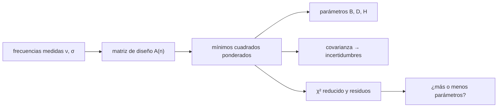

# B62-C05 — Constantes espectroscópicas y ajuste de espectros

<!-- nav:top -->
[🏠 Programa](../../../../README.md) · [📚 Bloque B62](../../../tronco-comun/B62-espectroscopia-molecular-para-astroquimica.md) · [← Anterior: B62-C04 — Momentos dipolares y fuerza de línea](../B62-C04-momentos-dipolares-y-fuerza-de-linea/CLASE.md) · [Siguiente: B62-C06 — Ensanchamiento de líneas moleculares: natural, Doppler y por presión →](../B62-C06-ensanchamiento-de-lineas-moleculares-natural-doppler-y-por-presion/CLASE.md)
<!-- /nav -->

## 1. Ubicación, nivel y alcance

Clase 5 del bloque B62. Nivel N3. Hasta aquí usaste constantes (`B`, `D`) publicadas para predecir líneas; esta clase hace el camino inverso: a partir de **frecuencias medidas** estimas las constantes con su incertidumbre. Aprendes el ajuste por mínimos cuadrados ponderados, la matriz de covarianza, el χ² reducido y cómo decidir cuántos parámetros usar. Usas álgebra lineal ([B10](../../../tronco-comun/B10-algebra-lineal-y-matematicas-geometricas.md)) y estadística básica. Hay dos conjuntos de datos: seis frecuencias **reales** del CO (catálogo JPL) y espectros **sintéticos** con ruido de semilla fija.

## 2. Por qué esta clase existe

Una constante sin incertidumbre no se puede usar para predecir una línea en otro rango, ni para decidir si una línea observada es de esa molécula. La decisión central: **¿cuántos parámetros justifica el conjunto de datos?**

## 3. Lo que podrás hacer al terminar

1. Escribir el modelo `ν(n) = E(n) − E(n−1)` con `B`, `D` y `H` y su matriz de diseño.
2. Ajustar por mínimos cuadrados ponderados y obtener la covarianza.
3. Interpretar el χ² reducido y los residuos.
4. Decidir entre un modelo de 2 y uno de 3 parámetros.
5. Comprobar un ajuste con datos sintéticos de valores conocidos y con Monte Carlo.
6. Reportar la constante con unidades, incertidumbre y procedencia.

La evidencia es la **ficha del ajuste espectroscópico** del ejercicio 12.

## 4. Con qué llegas y cómo comprobarlo

1. ¿Qué es un residuo?
2. ¿Qué es una desviación estándar?
3. ¿Qué es un peso estadístico `1/σ²`?
4. ¿Cuál es el modelo `ν = 2B(J+1)` (B62-C01)?
5. ¿Qué es una semilla en una simulación?

<details>
<summary>Ver respuestas</summary>

1. Dato menos modelo. 2. La dispersión típica de los datos respecto a su media. 3. Más peso a los datos más precisos. 4. El rotor rígido. 5. Un número que fija la secuencia pseudoaleatoria para repetir el resultado.
</details>

Con cuatro o cinco aciertos, sigue; si no, repasa los prerrequisitos.

## 5. Un caso de contexto y casos de referencia

El catálogo JPL del ¹²C¹⁶O lista seis frecuencias (J = 1→0 a 6→5) con etiqueta de especie **negativa**, que el documento del catálogo define como «frecuencia medida en laboratorio», con error `0,0005 MHz`. ¿Qué `B` y `D` salen de ellas y se parecen a los del WebBook? Es el **ejemplo conductor**.

## 6. Vocabulario

Una **constante espectroscópica** es un parámetro del Hamiltoniano efectivo (`B`, `D`, `H`…). La **matriz de diseño** relaciona los parámetros con los datos: `ν = A·p`. El **χ²** es la suma de residuos al cuadrado divididos por `σ²`; el **χ² reducido** lo divide por los grados de libertad `N − p`. La **covarianza** `(AᵀWA)⁻¹` da las incertidumbres y correlaciones. La **cobertura** es la fracción de repeticiones en que el intervalo ±1σ contiene el valor verdadero (nominal: 68,3 %).

## 7. Modelo mental: una balanza de precisión

Cada dato es una pesada con su error; los mínimos cuadrados buscan los valores que mejor equilibran todas las pesadas. Límite: supone errores independientes y gaussianos; si hay un error sistemático, la balanza se desplaza sin avisar.



*Descripción textual:* las frecuencias y sus errores forman el sistema; el ajuste entrega parámetros, covarianza y χ²; el χ² decide si el modelo es adecuado.

## 8. La explicación, paso a paso

### 8.1 Modelo y matriz de diseño

Con `E(J) = BJ(J+1) − D[J(J+1)]² + H[J(J+1)]³` y `n` el `J` superior, `ν(n) = E(n) − E(n−1)`. Cada columna de la matriz de diseño es el coeficiente de un parámetro; el laboratorio escala las columnas para que el sistema esté bien condicionado y deshace el escalado al final. Las frecuencias se manejan en MHz.

### 8.2 Seis frecuencias reales

| Modelo | χ² | gl | χ² reducido | `B` (MHz) | `D` (MHz) |
|---|---|---|---|---|---|
| `B`, `D` | 7,54 | 4 | 1,89 | 57635,96781 ± 0,00007 | 0,183493 ± 0,000001 |
| `B`, `D`, `H` | 1,32 | 3 | 0,44 | 57635,96806 ± 0,00012 | 0,183508 ± 0,000006 |

Con `H` el χ² reducido pasa de 1,89 a 0,44 y `H = (2,2 ± 0,9)×10⁻⁷ MHz`, solo 2,5σ: el dato apenas lo pide. Los residuos del modelo de 2 parámetros llegan a `−0,0011 MHz` (2,2σ en la línea 5→4). Los valores en cm⁻¹ son `B = 1,92252895` y `D = 6,12×10⁻⁶`.

Comparación con el WebBook: `B₀ = Be − αe/2 = 57635,95941 MHz` (cálculo propio) y `De = 0,183517 MHz`; el `B` ajustado difiere en `0,0087 MHz` (1,5×10⁻⁷ relativo) y `D` en menos de `0,02 %`. Coinciden más allá de la precisión del WebBook.

### 8.3 Sintéticos: ¿recuperamos lo que pusimos?

**Datos sintéticos** con `B = 57635,96 MHz`, `D = 0,1835 MHz`, `σ = 0,01 MHz`. Sin ruido el ajuste devuelve exactamente `B` y `D`, con χ² de `7×10⁻¹⁶`. Con una realización de ruido (semilla 20261109): `B = 57635,95923 ± 0,00134` (0,58σ) y `D = 0,18348 ± 0,00002` (0,75σ); χ² reducido 1,09.

### 8.4 Monte Carlo y cobertura

En 2000 repeticiones, el intervalo ±1σ de `B` contiene el valor verdadero en el `67,8 %` de los casos (nominal `68,3 %`) y el χ² reducido medio es `0,990` (esperado 1). Es la prueba de que las incertidumbres de la covarianza están bien calibradas **cuando el modelo es correcto**.

## 9. Magnitudes, símbolos y unidades

| Símbolo | Qué es | Unidad | Valor / nota |
|---|---|---|---|
| `B` | constante rotacional | MHz (1 cm⁻¹ = 29979,2458 MHz) | 57635,968 |
| `D` | distorsión centrífuga | MHz | 0,18349 |
| `H` | distorsión de sexto orden | MHz | 2×10⁻⁷ (marginal) |
| `σ` | error de cada frecuencia | MHz | 0,0005 (JPL); 0,01 (sintético) |
| `χ²/gl` | χ² reducido | adimensional | 1,89 y 0,44 |

## 10. Convenciones y referencias

`n` es el `J` superior; las frecuencias son de laboratorio en el vacío; errores independientes; los datos reales son seis líneas del catálogo y no se pretende reproducir su ajuste global (el catálogo usa más datos y más parámetros).

## 11. De dónde sale lo que afirmamos

| ID | Fuente | Localizador | Respalda | Consulta | Estado |
|---|---|---|---|---|---|
| S1 | NIST, CODATA 2022 | physics.nist.gov/cuu/Constants/Table/allascii.txt | `c` | 2026-11-09 | Consultada |
| S2 | NIST Chemistry WebBook, CO | webbook.nist.gov/cgi/cbook.cgi?ID=C630080&Mask=1000 | `Be`, `αe`, `De` | 2026-11-09 | Consultada |
| S3 | Pickett et al., documento del catálogo JPL (ed. 2 mayo 2003) | spec.jpl.nasa.gov/ftp/pub/catalog/doc/catintro.pdf | significado de TAG negativo y ERR | 2026-11-09 | Consultada |
| S4 | Catálogo JPL, `c028001.cat` | spec.jpl.nasa.gov/ftp/pub/catalog/c028001.cat | seis frecuencias | 2026-11-09 | Consultada (primeras seis líneas) |

Límites: el método de mínimos cuadrados ponderados es estándar y se verifica con el caso sintético, no con un texto consultado; no se consultaron los datos originales de laboratorio.

## 12. Cómo ver el ajuste

| Magnitud | Valor |
|---|---|
| χ² reducido (2 parámetros) | 1,89 |
| χ² reducido (3 parámetros) | 0,44 |
| cobertura Monte Carlo | 0,678 |

Descripción larga: los residuos del modelo con 2 parámetros se reparten alrededor de cero con una tendencia pequeña con `J`; con tres parámetros desaparece y quedan por debajo de `0,0003 MHz`.

## 13. Ejemplo trabajado: el residuo de 5→4

**Paso 1 · Dato.** `ν = 576267,9305 MHz`, `σ = 0,0005`.

**Paso 2 · Modelo (2 parámetros).** `ν_mod = 576267,9316 MHz`.

**Paso 3 · Residuo.** `−0,0011 MHz` (dato − modelo), es decir `−2,2σ`.

**Paso 4 · Lectura.** Un residuo de 2σ entre seis no es alarmante; la tendencia que se ve al cambiar de modelo sí es informativa (χ² baja de 7,54 a 1,32 con un parámetro más).

## 14. Distintas formas de describir un ajuste

**Por parámetros:** valores ± error. **Por residuos:** dato − modelo en unidades de σ. **Por χ²:** una cifra global. **Por simulación:** cobertura Monte Carlo.

## 15. Práctica guiada

**Ejercicio 1 · con los pasos indicados.** Convierte `B = 1,92252895 cm⁻¹` a MHz. *Pasos:* multiplica por `29979,2458`.

<details><summary>Solución comentada</summary>

`57635,97 MHz` (8.2).
</details>

**Ejercicio 2 · con una pista.** ¿Cuántos grados de libertad tiene el ajuste con 6 datos y 3 parámetros?

<details><summary>Solución comentada</summary>

`6 − 3 = 3` (tabla 8.2).
</details>

**Ejercicio 3 · casi autónomo.** Un residuo de `+0,0006 MHz` con `σ = 0,0005`. ¿Cuántas sigmas?

<details><summary>Solución comentada</summary>

`0,0006/0,0005 = 1,2σ`.
</details>

## 16. Práctica autónoma, transferencia e integrador

**Ejercicio 4.** ¿Qué χ² reducido esperas si el modelo es correcto y los errores están bien estimados?

<details><summary>Solución comentada</summary>

Cerca de 1 (8.4).
</details>

**Ejercicio 5.** ¿Por qué el χ² reducido 0,44 con tres parámetros no prueba que `H` exista?

<details><summary>Solución comentada</summary>

`H` es solo 2,5σ y con 3 grados de libertad un χ² de 1,32 es compatible con 1 dentro de la dispersión esperada; se necesitan más datos (8.2).
</details>

**Ejercicio 6.** Si `σ` se duplica, ¿cómo cambia la incertidumbre de `B`?

<details><summary>Solución comentada</summary>

Se duplica (la covarianza escala con `σ²`).
</details>

**Ejercicio 7.** Con 6 datos, ¿se podrían ajustar 6 parámetros?

<details><summary>Solución comentada</summary>

Sí, pero con χ² = 0 y sin grados de libertad: no se puede validar el modelo (sección 6).
</details>

**Ejercicio 8.** Convierte `D = 0,183508 MHz` a cm⁻¹.

<details><summary>Solución comentada</summary>

`0,183508/29979,2458 = 6,1212×10⁻⁶ cm⁻¹` (tabla 8.2).
</details>

**Ejercicio 9 · transferencia.** **Transferencia.** Una línea nueva a 806651,8 MHz aparece 0,03 MHz fuera de la predicción de un ajuste con error de predicción 0,001 MHz. ¿Qué sospechas?

<details><summary>Solución comentada</summary>

30σ: o es otra especie, o hay efecto de velocidad (Doppler) o el modelo no extrapola (8.2).
</details>

**Ejercicio 10 · transferencia.** **Transferencia.** ¿Por qué se simulan datos sintéticos de valor conocido antes de ajustar datos reales?

<details><summary>Solución comentada</summary>

Para probar el código y la calibración de errores (8.3–8.4).
</details>

**Ejercicio 11 · transferencia.** **Transferencia.** Tus residuos muestran una pendiente clara con `J`. ¿Qué haces?

<details><summary>Solución comentada</summary>

Añades un parámetro (`D` o `H`) si los datos lo justifican (8.2).
</details>

**Ejercicio 12 · integrador.** **Integrador.** Elabora tu *ficha del ajuste espectroscópico*: tabla de parámetros con errores, χ² reducido, residuos y cobertura Monte Carlo, rotulando real y sintético.

<details><summary>Solución modelo</summary>

Secciones 8.2–8.4 con los resultados de la sección 17.
</details>

## 17. Laboratorio: ajuste de constantes del CO

El script [ajuste.py](ajuste.py) ajusta las seis líneas reales y espectros sintéticos, calcula covarianzas y repite el ajuste 2000 veces. **Comprueba** que el sintético sin ruido recupera `B` y `D`, que el `B` real coincide con el WebBook (10⁻⁶) y que la cobertura queda entre 0,64 y 0,72.

**Datos:** (A) seis frecuencias **reales** del catálogo JPL; (B) datos **sintéticos**. **Predice antes de ejecutar:** ¿qué χ² reducido tendrá el sintético? (cerca de 1.) **Ejecución del 2026-11-09 (Python 3.12.9, numpy 2.4.4):**

```text
Python 3.12.9, numpy 2.4.4
(A) Datos REALES: 6 frecuencias de 12C16O del catalogo JPL (consultadas 2026-11-09), sigma = 0.0005 MHz
 Ajuste con B, D: chi2 = 7.54 ; grados de libertad = 4 ; chi2 reducido = 1.89
   B = 57635.96781 +- 0.00007 MHz (1.92252895 cm^-1) ; D = 0.183493 +- 0.000001 MHz (6.1207e-06 cm^-1)
   residuos [MHz]: +0.0002, +0.0005, +0.0003, -0.0001, -0.0011, +0.0006
 Ajuste con B, D, H: chi2 = 1.32 ; grados de libertad = 3 ; chi2 reducido = 0.44
   B = 57635.96806 +- 0.00012 MHz (1.92252895 cm^-1) ; D = 0.183508 +- 0.000006 MHz (6.1212e-06 cm^-1) ; H = 2.181e-07 +- 8.7e-08 MHz
   residuos [MHz]: -0.0003, -0.0000, +0.0000, +0.0003, -0.0003, +0.0001
 Referencia WebBook: B0 = Be - alpha_e/2 = 57635.95941 MHz ; De = 0.183517 MHz (diferencia de B: 0.0087 MHz)
(B) SINTETICOS (B = 57635.96 MHz, D = 0.1835 MHz, sigma = 0.01 MHz, semilla 20261109)
 Sin ruido: B = 57635.96000000 ; D = 0.18350000 ; chi2 = 7.28e-16
 Con ruido (una realizacion): B = 57635.95923 +- 0.00134 ; D = 0.18348 +- 0.00002 ; chi2 reducido = 1.09
   desvio en sigmas: B 0.58 ; D 0.75
 Monte Carlo (2000 repeticiones): cobertura de 1 sigma para B = 0.678 (nominal 0.683) ; media de chi2 reducido = 0.990 (esperado 1)
Pruebas superadas.
```

```bash
python programa/clases/B62/B62-C05-constantes-espectroscopicas-y-ajuste-de-espectros/ajuste.py
```

**Límites:** seis datos; errores independientes; el ajuste no reproduce el del catálogo.

## 18. Errores frecuentes y cómo corregirlos

**Reportar la constante sin incertidumbre.** Se corrige con 8.2.

**Añadir parámetros hasta χ² = 0.** Se corrige con el ejercicio 7.

**Ignorar el cambio de unidades (cm⁻¹ y MHz).** Se corrige con la sección 9.

**Presentar datos sintéticos como medidos.** Se corrige con 8.3.

## 19. Cómo sabrás que vas bien

Tras la sección 8: ¿qué χ² reducido esperabas y qué obtuviste? Si dudas, repasa el ejemplo 13. Tras el laboratorio: ¿qué comprueba? (ver la sección 17).

## 20. Qué entregas y cómo se evalúa

El producto es tu **ficha del ajuste espectroscópico** (ejercicio 12).

| Criterio | Inicial | En desarrollo | Logrado | Destacado |
|---|---|---|---|---|
| Conceptos | Los confunde | Parciales | modelo, covarianza y χ² | Explica la elección del modelo |
| Cálculo | Sin unidades | Con errores | Tabla con incertidumbres | Convierte cm⁻¹ y MHz |
| Numérico | Sin comprobar | Un caso | Sintético y Monte Carlo | Interpreta la cobertura |
| Fuentes | Sin fuente | Sin fecha | Fuentes con fecha | Declara lo no consultado |
| Límites | No los nombra | Uno | Tres | Discute qué falta del ajuste |

**Condiciones críticas (no se compensan con promedio):** rotular lo sintético; reportar incertidumbres; citar solo lo consultado.

## 21. Ética, seguridad y límites

Clase educativa: el ajuste de seis líneas no sustituye un análisis de laboratorio. Accesibilidad: tablas equivalentes a las gráficas, fórmulas en texto, ejercicios sin conexión.

## 22. Para cerrar y seguir

Seis frecuencias del CO dan `B = 57635,96781 ± 0,00007 MHz` y una `D` que coincide con el WebBook; el sintético confirma que la cobertura de 1σ es `0,678`. Queda una pregunta: ¿qué forma tiene la línea que se mide?

**Glosario español–inglés.** constante espectroscópica · *spectroscopic constant*; mínimos cuadrados ponderados · *weighted least squares*; covarianza · *covariance*; χ² reducido · *reduced chi-squared*; residuo · *residual*; cobertura · *coverage*.

**Continuidad.** [B62-C06](../B62-C06-ensanchamiento-de-lineas-moleculares-natural-doppler-y-por-presion/CLASE.md) estudia el ensanchamiento de líneas.

**Referencias:** ver sección 11.

<!-- nav:bottom -->
---

[← Anterior: B62-C04 — Momentos dipolares y fuerza de línea](../B62-C04-momentos-dipolares-y-fuerza-de-linea/CLASE.md) · [📚 Bloque B62](../../../tronco-comun/B62-espectroscopia-molecular-para-astroquimica.md) · [Siguiente: B62-C06 — Ensanchamiento de líneas moleculares: natural, Doppler y por presión →](../B62-C06-ensanchamiento-de-lineas-moleculares-natural-doppler-y-por-presion/CLASE.md)
<!-- /nav -->
