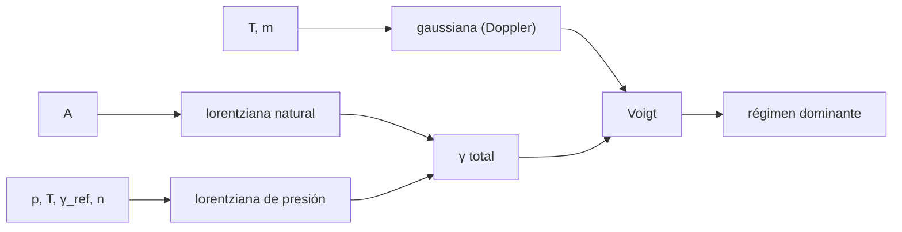

# B62-C06 — Ensanchamiento de líneas moleculares: natural, Doppler y por presión

<!-- nav:top -->
[🏠 Programa](../../../../README.md) · [📚 Bloque B62](../../../tronco-comun/B62-espectroscopia-molecular-para-astroquimica.md) · [← Anterior: B62-C05 — Constantes espectroscópicas y ajuste de espectros](../B62-C05-constantes-espectroscopicas-y-ajuste-de-espectros/CLASE.md) · [Siguiente: B62-C07 — Bancos de datos moleculares: CDMS, JPL, HITRAN y LAMDA →](../B62-C07-bancos-de-datos-moleculares-cdms-jpl-hitran-y-lamda/CLASE.md)
<!-- /nav -->

## 1. Ubicación, nivel y alcance

Clase 6 del bloque B62. Nivel N3. Ya sabes dónde cae una línea ([B62-C01](../B62-C01-espectros-rotacionales-de-moleculas-niveles-y-reglas-de-seleccion/CLASE.md)) y cuánta área tiene ([B62-C04](../B62-C04-momentos-dipolares-y-fuerza-de-linea/CLASE.md)); falta su **forma**. Comparas tres mecanismos de ensanchamiento (natural, Doppler térmico y por presión), construyes el perfil de Voigt que los combina y decides cuál domina en un entorno dado. Usas el efecto Doppler de B45-C12 y la termodinámica de [B05](../../../tronco-comun/B05-fisica-fundamental-para-el-espacio.md). La línea conductora es `J = 1→0` del ¹²C¹⁶O a 115,2712018 GHz. Los parámetros de presión son **ilustrativos**.

## 2. Por qué esta clase existe

El ancho de una línea es un termómetro, un velocímetro y un manómetro a la vez. Si no sabes qué mecanismo domina, lees mal la temperatura o la presión. La decisión central: **¿en qué régimen está la línea: Doppler, Lorentz o Voigt?**

## 3. Lo que podrás hacer al terminar

1. Calcular el ancho natural a partir del coeficiente de Einstein.
2. Calcular el ancho Doppler térmico (FWHM) en Hz y en km/s, y contrastarlo con la ecuación del catálogo JPL.
3. Calcular el ancho de presión con `γ(p, T) = γ_ref·(p/p_ref)·(T_ref/T)^n`.
4. Evaluar el perfil de Voigt y comprobar su normalización y sus límites.
5. Estimar la presión a la que los anchos de presión y Doppler se igualan.
6. Distinguir parámetros consultados de parámetros ilustrativos.

La evidencia es la **ficha del ancho de línea** del ejercicio 12.

## 4. Con qué llegas y cómo comprobarlo

1. ¿Qué es la FWHM?
2. ¿Qué es una distribución gaussiana?
3. ¿Qué dice el efecto Doppler no relativista?
4. ¿Qué es una convolución?
5. ¿Qué es la presión de un gas ideal `p = nkT`?

<details>
<summary>Ver respuestas</summary>

1. El ancho total a la mitad del máximo. 2. Una campana `exp(−x²/2σ²)`. 3. `Δν/ν = v/c`. 4. La mezcla de dos funciones: cada punto es una suma ponderada. 5. La presión es la densidad numérica por `kT`.
</details>

Con cuatro o cinco aciertos, sigue; si no, repasa los prerrequisitos.

## 5. Un caso de contexto y casos de referencia

La línea 1→0 del CO tiene `A = 7,203×10⁻⁸ s⁻¹` (LAMDA). ¿Qué ancho tendría en un núcleo frío de 20 K y en la atmósfera a 296 K y 1 atm? Es el **ejemplo conductor**.

## 6. Vocabulario

El **ensanchamiento natural** nace de la vida finita del nivel: perfil lorentziano de FWHM `A/(2π)`. El **ensanchamiento Doppler** viene de la agitación térmica: perfil gaussiano de FWHM `(ν/c)√(8kT ln2/m)`. El **ensanchamiento por presión** nace de las colisiones: perfil lorentziano de semiancho `γ`. El **perfil de Voigt** es la convolución de una gaussiana y una lorentziana. `γ_air` (HITRAN) es el semiancho (HWHM) en cm⁻¹/atm a 296 K y 1 atm, y `n_air` el exponente de `(T_ref/T)`.

## 7. Modelo mental: el borrón de una fotografía

Una línea ideal sería un trazo fino; el movimiento de las moléculas la emborrona con una forma de campana (Doppler), y las colisiones le dejan colas largas (Lorentz). Límite de la analogía: en un gas real las colisiones pueden además estrechar la línea y desplazarla; aquí se ignora.



*Descripción textual:* temperatura y masa dan la gaussiana; `A` y la presión dan lorentzianas que se suman; la convolución es el Voigt y su forma dice el régimen.

## 8. La explicación, paso a paso

### 8.1 Doppler frente a la ecuación del catálogo

El documento del catálogo JPL da el semiancho Doppler `1,17221×10⁻⁶·ν·√((T/300)(28/m))`. El laboratorio calcula `(ν/c)√(8kT ln2/m)` con CODATA 2022 y obtiene:

| `T` (K) | FWHM (kHz) | 2×(Ec. 7) (kHz) | dif. rel. | FWHM (km/s) |
|---|---|---|---|---|
| 10 | 49,3396 | 49,3396 | 7,1×10⁻⁷ | 0,1283 |
| 20 | 69,7768 | 69,7767 | 7,1×10⁻⁷ | 0,1815 |
| 100 | 156,0256 | 156,0255 | 7,1×10⁻⁷ | 0,4058 |
| 300 | 270,2443 | 270,2441 | 7,1×10⁻⁷ | 0,7028 |

La concordancia confirma la expresión (con `m = 28 u`, número de masa entero). El ancho crece como `√T`.

### 8.2 Ancho natural

`FWHM = A/(2π) = 1,146×10⁻⁸ Hz`: `1,6×10⁻¹³` del ancho Doppler a 20 K. Para líneas rotacionales del CO el ancho natural es irrelevante.

### 8.3 Presión

Con valores **ilustrativos** `γ_ref = 0,060 cm⁻¹/atm` y `n = 0,70` (no proceden de HITRAN ni de ninguna fuente consultada; solo la *definición* se consultó), a 296 K y 1 atm el FWHM de presión es `3597,5 MHz` frente a `0,2684 MHz` Doppler: domina Lorentz por un factor 13 000. En un núcleo molecular sintético (`n = 10⁴ cm⁻³`, 20 K) la presión es `2,73×10⁻¹⁷ atm` y el ancho de presión `6,5×10⁻⁷ Hz`, `9×10⁻¹²` del Doppler: dominan el movimiento térmico (y, en el medio real, la turbulencia, que aquí no se modela). Los anchos se igualan a 296 K con `p = 7,46×10⁻⁵ atm = 0,057 Torr`.

### 8.4 Voigt

El perfil de Voigt se evalúa con la función de Faddeeva. Con anchos iguales (gaussiana y lorentziana de 0,2684 MHz) el área vale `0,99992` (el pequeño déficit viene de truncar las colas lorentzianas) y la FWHM resultante es `0,4396 MHz`, menor que la suma `0,5369 MHz` y mayor que el mayor de los dos. Los límites funcionan: gaussiano con error `8×10⁻¹⁰` y lorentziano con `4×10⁻¹⁶`.

| `γ/σ` | FWHM_V / (FWHM_G + FWHM_L) | FWHM_V / máx |
|---|---|---|
| 0,01 | 0,9961 | 1,0045 |
| 0,10 | 0,9642 | 1,0460 |
| 1,00 | 0,8269 | 1,5293 |
| 10,00 | 0,9079 | 1,0147 |
| 100,00 | 0,9885 | 1,0001 |

## 9. Magnitudes, símbolos y unidades

| Símbolo | Qué es | Unidad | Valor / nota |
|---|---|---|---|
| `Δν_D` | FWHM Doppler | Hz, kHz | 69,78 kHz (20 K) |
| `Δν_N` | FWHM natural | Hz | 1,146×10⁻⁸ |
| `γ` | semiancho (HWHM) de presión | Hz o cm⁻¹ | 0,060 cm⁻¹/atm (ilustrativo) |
| `n` | exponente de temperatura | adimensional | 0,70 (ilustrativo) |
| `σ` | desviación gaussiana | Hz | `Δν_D/2,3548` |

## 10. Convenciones y referencias

Perfiles normalizados a área 1; `γ` es semiancho, `2γ` es FWHM; `T_ref = 296 K`, `p_ref = 1 atm` (convención HITRAN consultada); gas puro en reposo; masa por número de masa entero.

## 11. De dónde sale lo que afirmamos

| ID | Fuente | Localizador | Respalda | Consulta | Estado |
|---|---|---|---|---|---|
| S1 | NIST, CODATA 2022 | physics.nist.gov/cuu/Constants/Table/allascii.txt | `c`, `k`, `u` | 2026-11-09 | Consultada |
| S3 | Pickett et al., documento del catálogo JPL (ed. 2003) | spec.jpl.nasa.gov/ftp/pub/catalog/doc/catintro.pdf | Ec. (7) del ancho Doppler | 2026-11-09 | Consultada |
| S4 | Catálogo JPL, `c028001.cat` | spec.jpl.nasa.gov/ftp/pub/catalog/c028001.cat | frecuencia 1→0 | 2026-11-09 | Consultada |
| S5 | LAMDA, `co.dat` | home.strw.leidenuniv.nl/~moldata/datafiles/co.dat | `A` de 1→0 | 2026-11-09 | Consultada |
| S7 | HITRAN, definiciones y unidades | hitran.org/docs/definitions-and-units/ | definición de `γ_air` y `n_air` | 2026-11-09 | Consultada (solo definiciones) |

Límites: los valores numéricos de `γ_ref` y `n` son supuestos ilustrativos; no se consultó ningún valor medido de ensanchamiento del CO; no se consultó ningún texto sobre el perfil de Voigt (el laboratorio verifica sus límites y su área).

## 12. Cómo ver los anchos

| Magnitud | Valor |
|---|---|
| Doppler 20 K | 69,78 kHz |
| Natural | 1,146×10⁻⁸ Hz |
| Presión 1 atm, 296 K (ilustrativo) | 3597,5 MHz |
| Presión de igualdad | 0,057 Torr |

Descripción larga: en escala logarítmica los tres anchos están separados por muchos órdenes de magnitud; la presión de igualdad marca el paso del régimen Doppler al Lorentz.

## 13. Ejemplo trabajado: Doppler a 20 K

**Paso 1 · Datos.** `ν = 115,2712018 GHz`, `T = 20 K`, `m = 28 u = 4,6495×10⁻²⁶ kg`.

**Paso 2 · Velocidad.** `√(8kT ln2/m) = √(8·1,380649×10⁻²³·20·0,693147/4,6495×10⁻²⁶) = 181,5 m/s`.

**Paso 3 · Ancho.** `Δν = ν·181,5/c = 69,78 kHz`.

**Paso 4 · Lectura.** `0,1815 km/s`: es el ancho térmico, sin turbulencia.

## 14. Distintas formas de describir el ancho

**Por frecuencia:** Hz, kHz, MHz. **Por velocidad:** km/s (`c·Δν/ν`). **Por semiancho:** HWHM. **Por perfil:** gaussiano, lorentziano o Voigt.

## 15. Práctica guiada

**Ejercicio 1 · con los pasos indicados.** Pasa 69,78 kHz a km/s a 115,2712 GHz. *Pasos:* `c·Δν/ν`.

<details><summary>Solución comentada</summary>

`299792,458·69,78×10³/115,2712×10⁹ = 0,1815 km/s` (8.1).
</details>

**Ejercicio 2 · con una pista.** ¿Cuánto vale el Doppler a 80 K? *Pista:* escala con `√T`.

<details><summary>Solución comentada</summary>

`69,78·√(80/20) = 139,6 kHz`.
</details>

**Ejercicio 3 · casi autónomo.** ¿El semiancho es la mitad de la FWHM?

<details><summary>Solución comentada</summary>

Sí, en perfiles lorentzianos y gaussianos (sección 6).
</details>

## 16. Práctica autónoma, transferencia e integrador

**Ejercicio 4.** Ancho natural en Hz de una línea con `A = 10⁻⁵ s⁻¹`.

<details><summary>Solución comentada</summary>

`10⁻⁵/(2π) = 1,59×10⁻⁶ Hz` (8.2).
</details>

**Ejercicio 5.** ¿Cuánto vale la FWHM de presión a 0,01 atm y 296 K con los parámetros ilustrativos?

<details><summary>Solución comentada</summary>

Escala con `p`: `3597,5·0,01 = 35,975 MHz` (8.3).
</details>

**Ejercicio 6.** ¿Qué régimen domina a 0,01 atm?

<details><summary>Solución comentada</summary>

Lorentz: 36 MHz frente a 0,27 MHz de Doppler.
</details>

**Ejercicio 7.** Con `γ/σ = 1`, ¿qué fracción de la suma de anchos da el Voigt?

<details><summary>Solución comentada</summary>

`0,8269` (tabla 8.4).
</details>

**Ejercicio 8.** ¿Cuánto cambia el Doppler de 13C16O (masa 29) respecto del de 12C16O (28)?

<details><summary>Solución comentada</summary>

Escala con `1/√m`: `√(28/29) = 0,983` (a igual frecuencia).
</details>

**Ejercicio 9 · transferencia.** **Transferencia.** Una línea observada tiene 0,8 km/s de FWHM en un núcleo de 20 K. ¿Qué mecanismo extra hace falta?

<details><summary>Solución comentada</summary>

El térmico solo da 0,18 km/s; el exceso exige turbulencia o movimientos de gran escala (8.1; esa componente no se modela).
</details>

**Ejercicio 10 · transferencia.** **Transferencia.** ¿Por qué un espectrómetro de laboratorio a 1 atm no «ve» el ancho Doppler?

<details><summary>Solución comentada</summary>

La presión domina en 4 órdenes (8.3).
</details>

**Ejercicio 11 · transferencia.** **Transferencia.** ¿Por qué el área del Voigt sale 0,99992 y no 1?

<details><summary>Solución comentada</summary>

Se trunca la cola lorentziana en ±2000 anchos (8.4).
</details>

**Ejercicio 12 · integrador.** **Integrador.** Elabora tu *ficha del ancho de línea*: Doppler (con comprobación del catálogo), natural, presión (rotulando lo ilustrativo), presión de cruce y Voigt.

<details><summary>Solución modelo</summary>

Secciones 8.1–8.4 con los resultados de la sección 17.
</details>

## 17. Laboratorio: anchos y perfil de Voigt

El script [ensanchamiento.py](ensanchamiento.py) calcula los tres anchos, compara el Doppler con la Ec. (7) del catálogo, evalúa el Voigt con la función de Faddeeva y **comprueba** el Doppler (10⁻⁴), el área (10⁻³), los límites (10⁻⁶) y las cotas del FWHM.

**Datos:** frecuencia, `A` y Ec. (7) consultados; `γ_ref`, `n` y las densidades, **ilustrativos**. **Predice antes de ejecutar:** ¿qué ancho domina a 1 atm? (presión.) **Ejecución del 2026-11-09 (Python 3.12.9, numpy 2.4.4, scipy 1.17.1):**

```text
Python 3.12.9, numpy 2.4.4, scipy 1.17.1
Linea J=1-0 del 12C16O a 115.2712018 GHz; A = 7.203e-08 s^-1 (LAMDA); gamma_ref y n de presion son ILUSTRATIVOS (sinteticos)
T [K]   FWHM Doppler [kHz]   Ec.(7) 2*HWHM [kHz]   dif.rel.   FWHM [km/s]
  10.0         49.3396             49.3396    7.1e-07    0.1283
  20.0         69.7768             69.7767    7.1e-07    0.1815
 100.0        156.0256            156.0255    7.1e-07    0.4058
 300.0        270.2443            270.2441    7.1e-07    0.7028
Ancho natural FWHM = A/(2 pi) = 1.146e-08 Hz ; cociente con el Doppler a 20 K = 1.64e-13
Atmosfera 296 K, 1 atm: FWHM Doppler = 0.2684 MHz ; FWHM de presion (2 gamma) = 3597.5 MHz (ilustrativo)
Nucleo frio sintetico (n = 1e4 cm^-3, T = 20 K): p = 2.73e-17 atm ; FWHM de presion = 6.47e-07 Hz ; cociente con Doppler = 9.3e-12
Presion en que FWHM_L = FWHM_D a 296 K: 7.46e-05 atm = 0.057 Torr
Voigt con anchos iguales: area = 0.999920 ; FWHM_V = 0.4396 MHz ; FWHM_G = 0.2684 ; FWHM_L = 0.2684 ; suma = 0.5369
Limite gaussiano: error relativo maximo = 8.0e-10 ; limite lorentziano: 3.6e-16
  gamma/sigma =   0.01: FWHM_V / (FWHM_G + FWHM_L) = 0.9961 ; FWHM_V / max = 1.0045
  gamma/sigma =   0.10: FWHM_V / (FWHM_G + FWHM_L) = 0.9642 ; FWHM_V / max = 1.0460
  gamma/sigma =   1.00: FWHM_V / (FWHM_G + FWHM_L) = 0.8269 ; FWHM_V / max = 1.5293
  gamma/sigma =  10.00: FWHM_V / (FWHM_G + FWHM_L) = 0.9079 ; FWHM_V / max = 1.0147
  gamma/sigma = 100.00: FWHM_V / (FWHM_G + FWHM_L) = 0.9885 ; FWHM_V / max = 1.0001
Pruebas superadas.
```

```bash
python programa/clases/B62/B62-C06-ensanchamiento-de-lineas-moleculares-natural-doppler-y-por-presion/ensanchamiento.py
```

**Límites:** sin turbulencia, sin estrechamiento colisional, sin desplazamiento de línea y con parámetros de presión ilustrativos.

## 18. Errores frecuentes y cómo corregirlos

**Confundir semiancho con FWHM.** Se corrige con la sección 10.

**Sumar anchos de Voigt como si fueran lineales.** Se corrige con la tabla 8.4.

**Usar el ancho térmico para una nube real.** Se corrige con el ejercicio 9.

**Presentar `γ_ref` ilustrativo como dato.** Se corrige con 8.3.

## 19. Cómo sabrás que vas bien

Tras la sección 8: ¿qué régimen esperabas a 0,01 atm y cuál saliste? Si dudas, repasa el ejemplo 13. Tras el laboratorio: ¿qué comprueba? (ver la sección 17).

## 20. Qué entregas y cómo se evalúa

El producto es tu **ficha del ancho de línea** (ejercicio 12).

| Criterio | Inicial | En desarrollo | Logrado | Destacado |
|---|---|---|---|---|
| Conceptos | Los confunde | Parciales | tres mecanismos y Voigt | Explica la turbulencia como límite |
| Cálculo | Sin unidades | Con errores | Anchos en Hz y km/s | Calcula la presión de cruce |
| Numérico | Sin comprobar | Un caso | Contraste con la Ec. (7) | Interpreta los límites |
| Fuentes | Sin fuente | Sin fecha | Fuentes con fecha | Rotula lo ilustrativo |
| Límites | No los nombra | Uno | Tres | Discute qué falta del modelo |

**Condiciones críticas (no se compensan con promedio):** rotular `γ_ref` y `n` como ilustrativos; no presentar anchos simulados como medidos; citar solo lo consultado.

## 21. Ética, seguridad y límites

Clase educativa: no se modela ninguna observación ni ningún gas real. Accesibilidad: tablas equivalentes a las gráficas, fórmulas en texto, ejercicios sin conexión.

## 22. Para cerrar y seguir

El Doppler a 20 K es `69,78 kHz` (0,18 km/s), el natural es despreciable y la presión solo importa a partir de `0,057 Torr` en el aire (con parámetros ilustrativos). Queda una pregunta: ¿de dónde sacar los datos de cada línea?

**Glosario español–inglés.** ensanchamiento Doppler · *Doppler broadening*; ensanchamiento por presión · *pressure broadening*; ancho natural · *natural linewidth*; perfil de Voigt · *Voigt profile*; semiancho · *half width at half maximum*; función de Faddeeva · *Faddeeva function*.

**Continuidad.** [B62-C07](../B62-C07-bancos-de-datos-moleculares-cdms-jpl-hitran-y-lamda/CLASE.md) estudia los bancos de datos.

**Referencias:** ver sección 11.

<!-- nav:bottom -->
---

[← Anterior: B62-C05 — Constantes espectroscópicas y ajuste de espectros](../B62-C05-constantes-espectroscopicas-y-ajuste-de-espectros/CLASE.md) · [📚 Bloque B62](../../../tronco-comun/B62-espectroscopia-molecular-para-astroquimica.md) · [Siguiente: B62-C07 — Bancos de datos moleculares: CDMS, JPL, HITRAN y LAMDA →](../B62-C07-bancos-de-datos-moleculares-cdms-jpl-hitran-y-lamda/CLASE.md)
<!-- /nav -->
